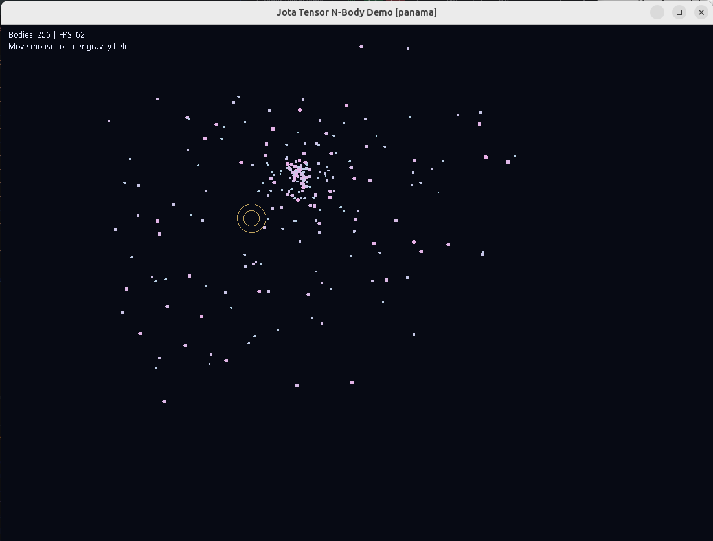
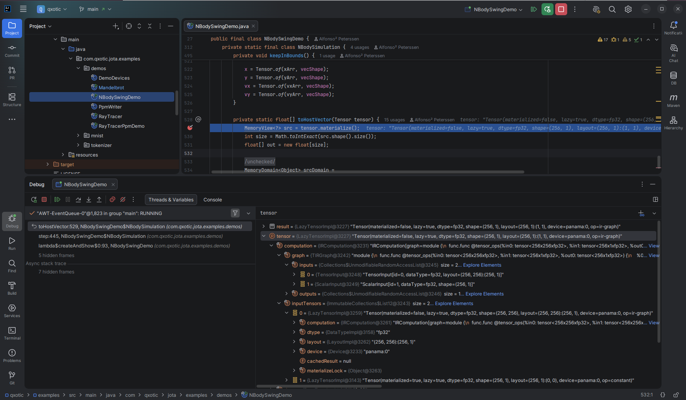
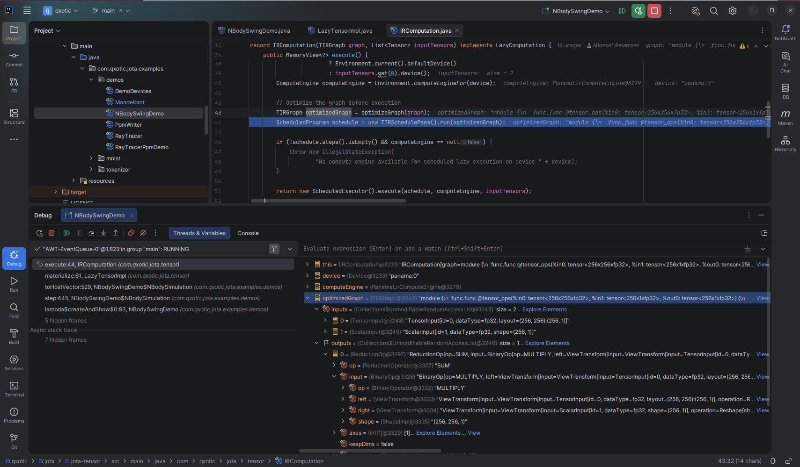
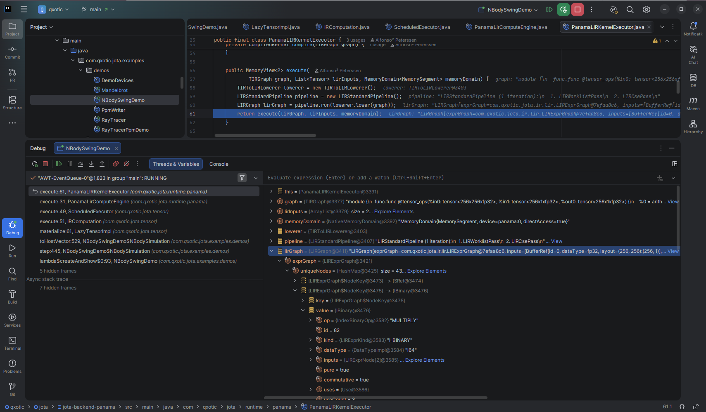
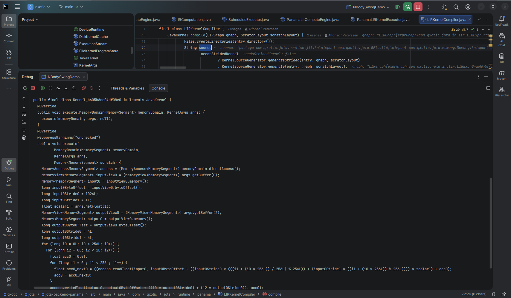

Running it..

com.qxotic.jota.examples.demos.NBodySwingDemo

using CPU only usi
ng 'panama', on Linux
```text
[jota-runtime] WARNING: backend 'mojo' on device mojo is unavailable: Mojo backend requires HIP runtime/toolchain availability | hint: Ensure libjota_hip and ROCm runtime libraries are installed and discoverable
[jota-runtime] WARNING: backend 'c' on device c is unavailable: C JNI runtime library is not available | hint: Ensure libjota_c is on java.library.path / LD_LIBRARY_PATH
[jota-runtime] WARNING: backend 'hip' on device hip is unavailable: HIP JNI runtime library is not available | hint: Ensure libjota_hip and ROCm runtime libraries are installed and discoverable
[jota-runtime] WARNING: backend 'metal' on device metal is unavailable: Metal runtime is only supported on macOS | hint: Run on macOS with an Apple Metal-capable GPU
[jota-runtime] WARNING: backend 'cuda' on device cuda is unavailable: CUDA JNI runtime library is not available: Native library not found in JAR: /META-INF/native/linux/x86_64/libjota_cuda.so. Platform: linux x86_64. Either the backend JAR doesn't include natives for this platform, or you need to provide the library via -Djava.library.path | hint: Ensure libjota_cuda and CUDA runtime libraries are installed and discoverable
[jota-runtime] WARNING: backend 'opencl' on device opencl is unavailable: OpenCL JNI runtime library is not available | hint: Library load error: Native library not found in JAR: /META-INF/native/linux/x86_64/libjota_opencl.so. Platform: linux x86_64. Either the backend JAR doesn't include natives for this platform, or you need to provide the library via -Djava.library.path. Ensure libjota_opencl is on java.library.path or the backend JAR includes natives for your platform (linux-x86_64). Supported platforms: Linux x86_64/aarch64, Windows x86_64, macOS aarch64. Also ensure OpenCL ICD/runtime libraries are installed.
WARNING: A terminally deprecated method in sun.misc.Unsafe has been called
WARNING: sun.misc.Unsafe::allocateMemory has been called by com.qxotic.jota.memory.internal.NativeUnsafeAllocator (file:/data/qxoticai/qxotic/jota/jota-memory/target/classes/)
WARNING: Please consider reporting this to the maintainers of class com.qxotic.jota.memory.internal.NativeUnsafeAllocator
WARNING: sun.misc.Unsafe::allocateMemory will be removed in a future release
```

Screenshot


Screen cast video
[Screencast_NBodySwingDemo.mp4](Screencast_NBodySwingDemo.mp4)


# Advanced Screenshot from Debugger

Debug step 1, in "Tensor.materialize()"


Debug step 2, showing TIR ("Tensor Intermediate Representation") Graph


Debug step 3, showing LIR ("Loop Intermediate Representation") Graph


Debug Step 4, show generated java source code, when using "panama" (fallback java backend, when no Cuda / OpenCL / .. is available)


