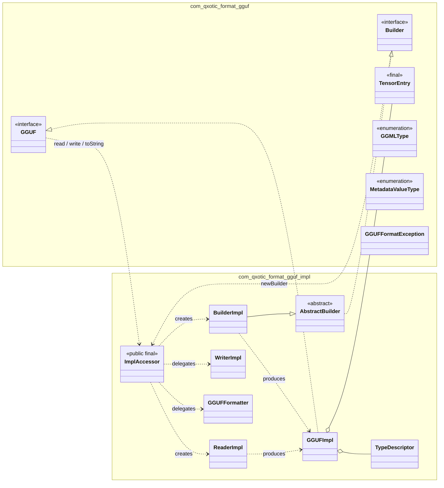
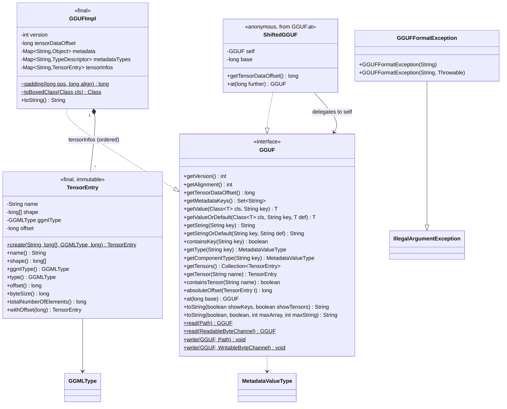
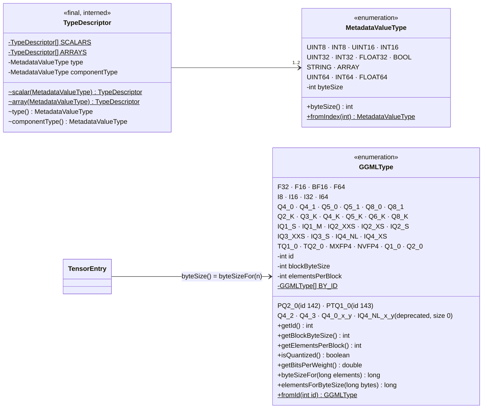
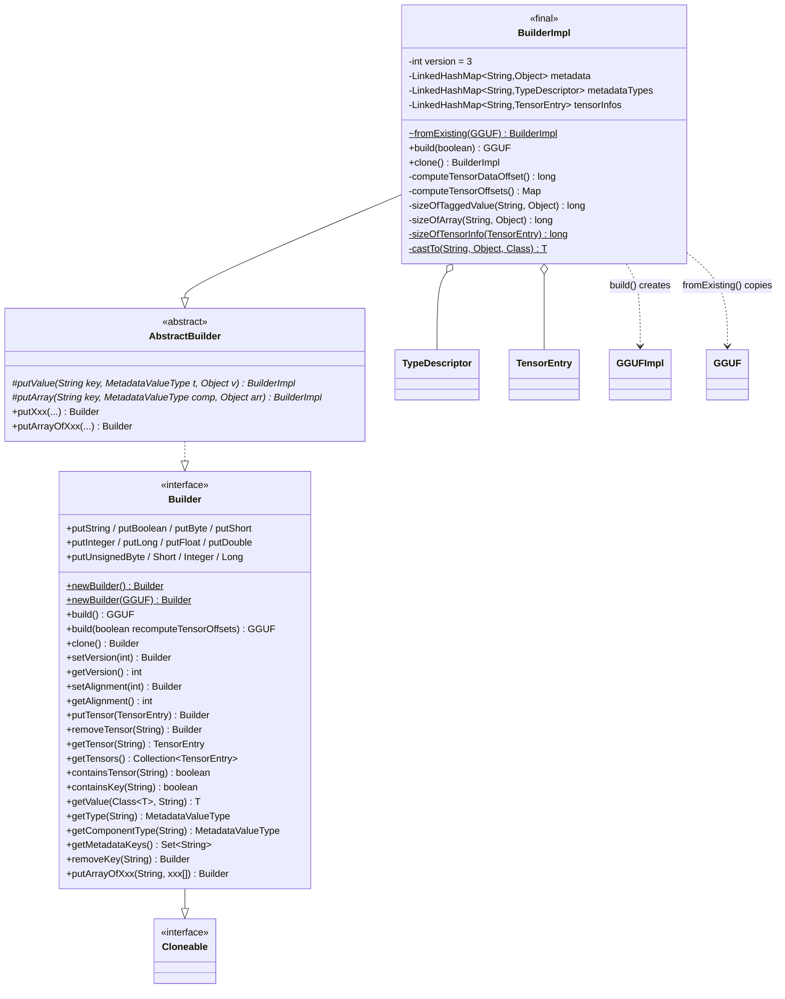
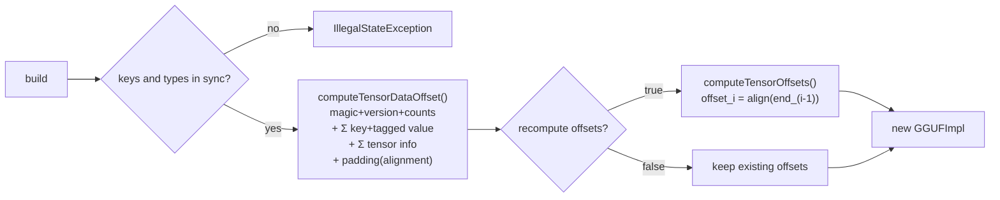
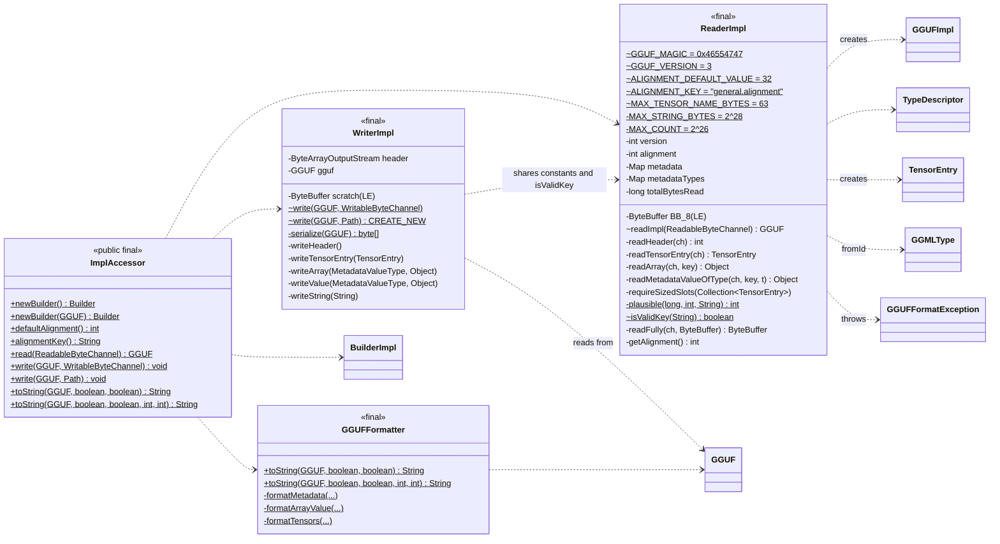
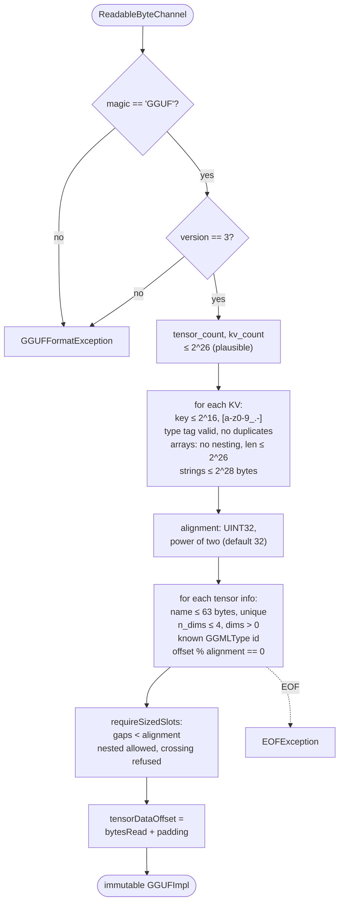
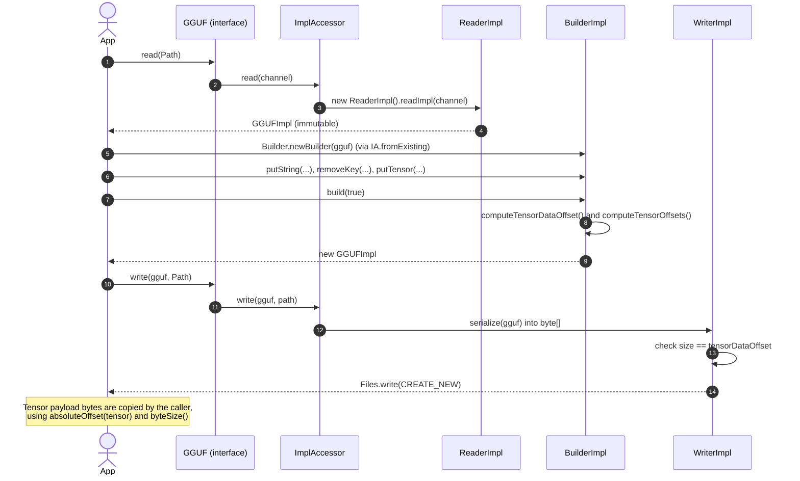
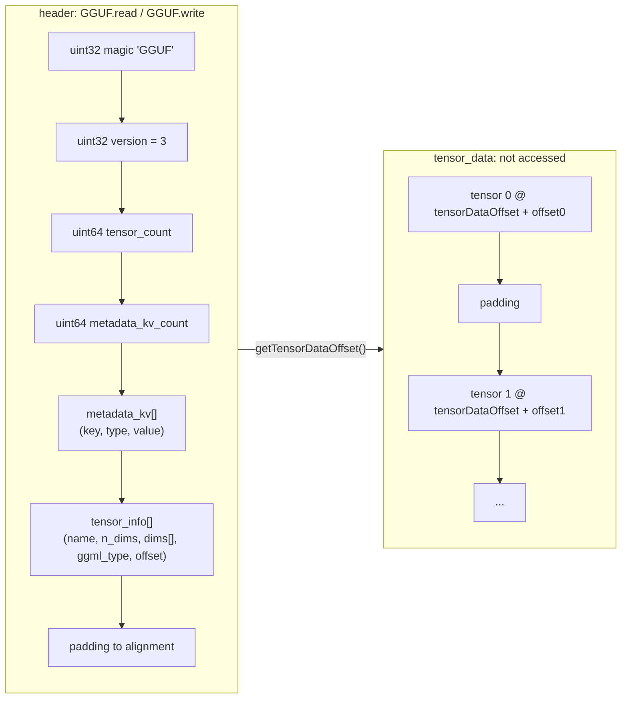

# GGUF module: architecture (class diagrams)

Companion to [ARCHITECTURE-summary.md](ARCHITECTURE-summary.md). The diagrams below cover
every class in `gguf/src/main/java`, one part of the library per diagram.

1. [Module and package overview](#1-module-and-package-overview)
2. [Public API: the `GGUF` model](#2-public-api-the-gguf-model)
3. [Type system: `GGMLType`, `MetadataValueType`, `TypeDescriptor`](#3-type-system)
4. [Builder hierarchy](#4-builder-hierarchy)
5. [Reading and writing (I/O)](#5-reading-and-writing-io)
6. [Sequence: read → edit → write](#6-sequence-read--edit--write)
7. [On-disk layout handled by the library](#7-on-disk-layout)

---

## 1. Module and package overview

The JPMS module exports only the API package. Public static factories on the interfaces
call `ImplAccessor`, the only `public` class in `impl`, which creates the package-private
implementations.

> `module com.qxotic.format.gguf { exports com.qxotic.format.gguf; }`, so the `impl`
> package cannot be reached from outside the module.

---

## 2. Public API: the `GGUF` model

`GGUF` is a read-only view of a header. `GGUFImpl` stores it in three ordered, unmodifiable
maps. `at(base)` returns an anonymous delegating `GGUF` whose offsets are shifted by `base`.

---

## 3. Type system

Two enums describe the two kinds of types in GGUF. `TypeDescriptor` (internal) pairs a
metadata type with its array component type, using one interned instance per
combination.

| Concept | On disk | In Java |
|---|---|---|
| `GGMLType` | `uint32 ggml_type` in each tensor info | `getId()` (ordinal, except PrismML ids) |
| `MetadataValueType` | `uint32` tag before each value | ordinal |
| scalar `UINTn`/`INTn` | n-bit little-endian | `byte`/`short`/`int`/`long` (signed) |
| `STRING` | `uint64 len` + UTF-8 bytes | `String` |
| `ARRAY` | `uint32 componentType` + `uint64 len` + elements | primitive array or `String[]` (no nesting) |

---

## 4. Builder hierarchy

`AbstractBuilder` maps the 24 typed setters to two abstract primitives. `BuilderImpl` owns
the mutable ordered maps and computes the header size and tensor offsets in `build`.

`build(recomputeTensorOffsets)`:

---

## 5. Reading and writing (I/O)

`ReaderImpl` is a stateful single-use parser. `WriterImpl` encodes into a
`ByteArrayOutputStream`, so a header that fails validation writes nothing.
`GGUFFormatter` is used only by `toString`.

### Reader validation pipeline

---

## 6. Sequence: read → edit → write

---

## 7. On-disk layout

The library reads and writes everything up to `tensorDataOffset`. The `tensor_data`
section is left to the caller.

