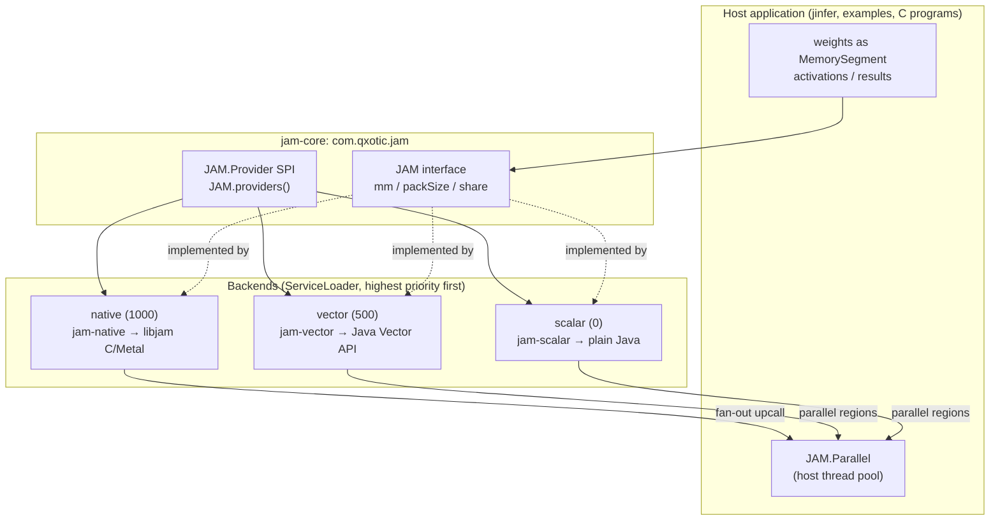
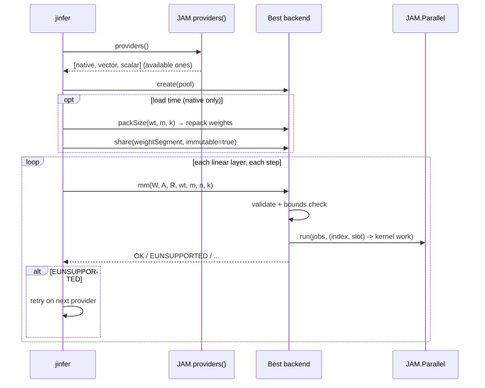

# jam — High-level overview

## What jam is

jam is a **single-operation library**: quantized matrix multiplication for LLM inference,

```
R = W @ Aᵀ        W: [m x k] weights, quantized (Q4_0, Q8_0, Q4_K, MXFP4, ...) or F16/BF16/F32
                  A: [n x k] F32 activations (n tokens)
                  R: [n x m] F32 result, token-major (llama.cpp mul_mat convention)
```

exposed to Java as the `JAM` interface (and to C as `jam_mm` in `jam.h`). `n == 1` is decode
(GEMV, memory-bound), `n > 1` is prefill (GEMM, compute-bound). Weights are never converted:
kernels read GGUF block layouts directly (or an optional packed layout, see below).

Its main consumer is **jinfer** (the LLM inference engine in this repository), which calls
`mm` for every linear layer.

## Big picture



## Key ideas

1. **One tiny contract, pluggable backends.** `jam-core` has only the `JAM` interface, the
   `Provider` SPI and the `Parallel` threading hook. `JAM.providers()` returns available backends
   sorted by priority; any one can be disabled with `-Djam.<id>.disabled=true`.

2. **Graceful fallback by status code.** A backend returns `EUNSUPPORTED` for a valid request it
   has no kernel for (e.g. `vector` for `n == 1`), and the caller tries the next provider.
   `scalar` supports everything and is always available.

3. **The host owns the threads.** Backends receive a `JAM.Parallel` at creation and run all
   parallel work on it, with a `slot` index for per-worker scratch. Even libjam, inside a JVM,
   creates no thread: it calls back into Java (`pfUpcall`). A C host without a pool gets libjam's
   own native pool.

4. **Off-heap, zero copy, checked once.** Operands are `MemorySegment`s with byte offsets and
   element strides. Each backend bounds-checks the exact byte span the kernel will touch
   (`GGMLType.spanBytes`) **before** running, then addresses memory by raw pointer and keeps the
   segments alive with `reachabilityFence`.

5. **Per-instance scratch, no static state.** All buffers belong to the `JAM` instance (no
   `ThreadLocal`, no static caches), so they are released with it; calls on one instance are
   serialized by a lock (native can surface `EBUSY` instead).

6. **Optional load-time optimizations (native).** `packSize` tells the caller whether to repack
   a weight once into a kernel-friendly layout (`wt | PACKED`), and `share` lets a GPU backend map
   long-lived buffers once instead of per call (Metal on Apple Silicon).

## The three backends at a glance

| | native (`jam-native`) | vector (`jam-vector`) | scalar (`jam-scalar`) |
|---|---|---|---|
| What runs | libjam: C kernels per ISA (SSE3 → AVX-512-VNNI, NEON → I8MM) + Metal | Java Vector API kernels, 128/256/512-bit | plain Java loops the JIT auto-vectorizes |
| When used | default whenever the bundled library loads | when `jdk.incubator.vector` is enabled and no native lib | always available; fallback and reference |
| Coverage | decode + prefill, all dtypes | prefill only (`n > 1`), contiguous weights | everything, heap segments too |
| Design | ISA dispatch once per context; band/row kernels | `BandGemm`: dequant rows to L2 panel, 3x3/4x4 FMA tiles | `Gemv` / `RowGemm` / `Gemm` on one `Tile` sweep |
| Platform tweaks | JNI or FFM binding, ISA cap | JIT-aware tile shape (C2 vs Graal), native-image `Feature` | GraalVM `@AlwaysInline` hints |

## Typical call flow



## Supported weight types

`F32`, `F16`, `BF16`, `Q4_0`, `Q5_0`, `Q8_0`, `Q4_K`, `Q5_K`, `Q6_K`, `MXFP4`, `NVFP4`, `Q1_0`,
`Q2_0`, and the PrismML-fork `PQ2_0`, `PTQ1_0`. The integer tags equal GGML's `ggml_type`
codes; jam keeps its own copy (`GGMLType`) and does not depend on the `gguf` module.

## Build and packaging notes

* Java 25+, FFM (`java.lang.foreign`); `jam-vector` needs `--add-modules jdk.incubator.vector`,
  and native backends need `--enable-native-access`.
* `jam-native` is a fat jar with one `libjam` per OS/arch, extracted to a per-user cache keyed by
  SHA-256 at first use.
* `graalvm-annotations` is a compile-only module so `@AlwaysInline` / `@NeverInline` take effect
  in GraalVM native images without a GraalVM dependency.
* Further reading: [ARCHITECTURE.md](ARCHITECTURE.md) (class diagrams), [design.md](design.md)
  (native kernels, packing, sharing, threading), [benchmarks.md](benchmarks.md),
  [../BUILDING.md](../BUILDING.md).
