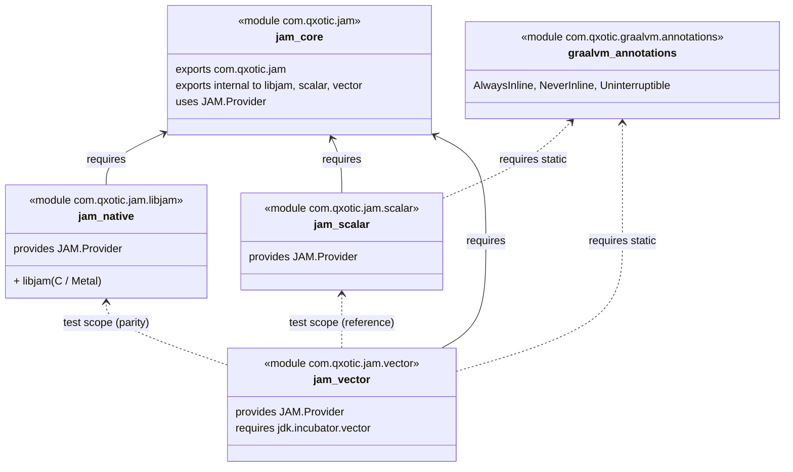
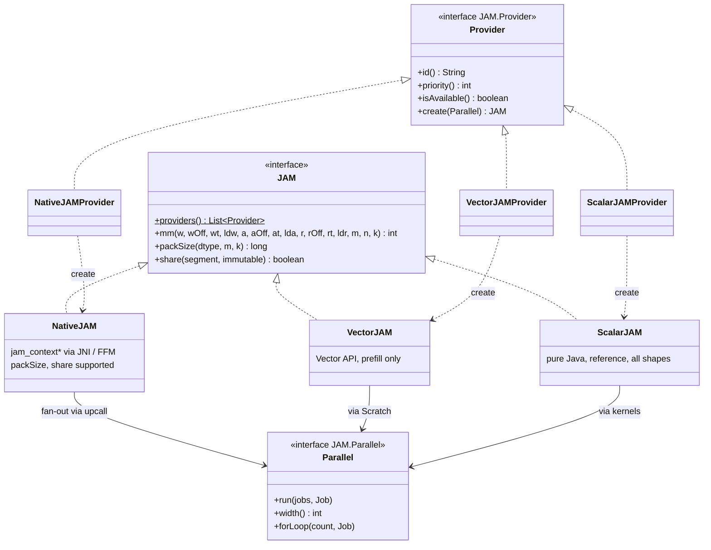
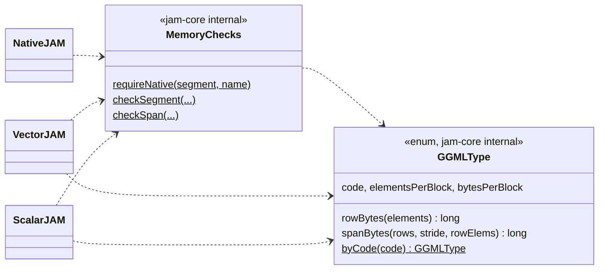
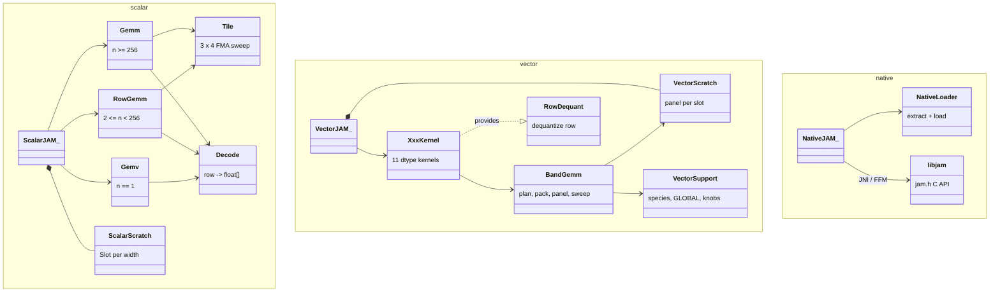
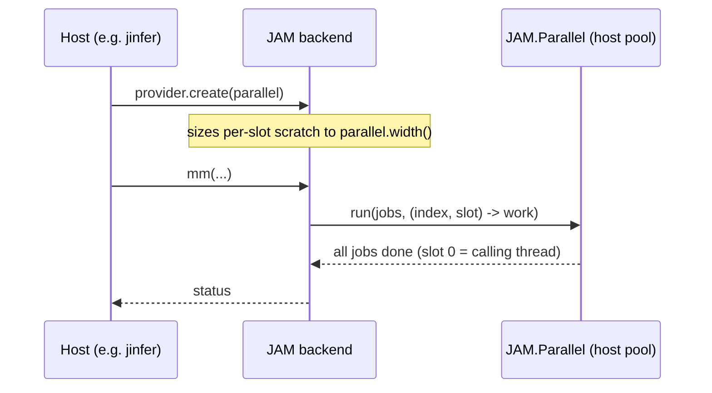

# jam — Architecture (summary)

jam ("JVM Accelerated Math", jokingly "Just A Matmul") computes `R = W @ Aᵀ` with quantized
weights on the CPU (and Apple GPU), behind **one interface**, `JAM`, and several interchangeable
backends discovered at run time. This page sums up the per-module documents:

| Module | JPMS module | Provider id / priority | Details |
|---|---|---|---|
| `jam-core` | `com.qxotic.jam` | — (API + SPI) | [jam-core/docs/ARCHITECTURE.md](../jam-core/docs/ARCHITECTURE.md) |
| `jam-native` | `com.qxotic.jam.libjam` | `native` / 1000 | [jam-native/docs/ARCHITECTURE.md](../jam-native/docs/ARCHITECTURE.md) |
| `jam-vector` | `com.qxotic.jam.vector` | `vector` / 500 | [jam-vector/docs/ARCHITECTURE.md](../jam-vector/docs/ARCHITECTURE.md) |
| `jam-scalar` | `com.qxotic.jam.scalar` | `scalar` / 0 | [jam-scalar/docs/ARCHITECTURE.md](../jam-scalar/docs/ARCHITECTURE.md) |
| `graalvm-annotations` | `com.qxotic.graalvm.annotations` | — (compile-only) | [graalvm-annotations/docs/ARCHITECTURE.md](../graalvm-annotations/docs/ARCHITECTURE.md) |

For the high-level picture see [ARCHITECTURE-overview.md](ARCHITECTURE-overview.md); for native
kernel internals see [design.md](design.md).

## 1. Module dependencies

## 2. The API and its three implementations

| | `native` | `vector` | `scalar` |
|---|---|---|---|
| Compute | libjam C kernels (SSE3 … AVX-512-VNNI, NEON/DotProd/I8MM) + Metal | Java Vector API, 128/256/512-bit | plain Java, JIT auto-vectorized |
| Shapes | all | `n > 1`, `ldw == k`, F32 A/R | all, F32 A/R |
| Operands | native segments only | native segments only | native or heap |
| Packed weights / `share` | yes | no (defaults) | no (defaults) |
| Concurrency | FIFO RW lock (or `EBUSY`) | fair lock | lock |
| Extras | ISA cap, JNI/FFM binding | native-image `Feature`, JIT-aware tiles | correctness reference |

## 3. Shared internal layer

Every backend follows the same `mm` preamble: reject dead / (for native & vector) heap segments,
validate the shape (`EINVAL`), refuse what it cannot run (`EUNSUPPORTED`), compute the exact byte
span of each operand with `GGMLType.spanBytes` and bounds-check it, then run the kernel and fence
the operands with `Reference.reachabilityFence`.

## 4. Backend internals side by side

* **scalar**: three kernels chosen by `n`, built on one row decoder and one register tile shape
  both JITs vectorize; all buffers per instance (`Scratch` + one `Slot` per parallel slot).
* **vector**: a strategy pattern, each dtype provides a `RowDequant` and the generic `BandGemm`
  does blocking (L2 panels, L1 k-blocks), packing, scheduling and 3x3/4x4 register sweeps.
* **native**: a thin JNI/FFM handle to a `jam_context`; parallel work comes back to the Java host
  pool through a `jam_parallel_fn` upcall.

## 5. Threading model (all backends)

No backend owns threads: the host's `JAM.Parallel` runs every task and `width()` is the thread
budget. Per-worker scratch is indexed by `slot`, never by `ThreadLocal`.
