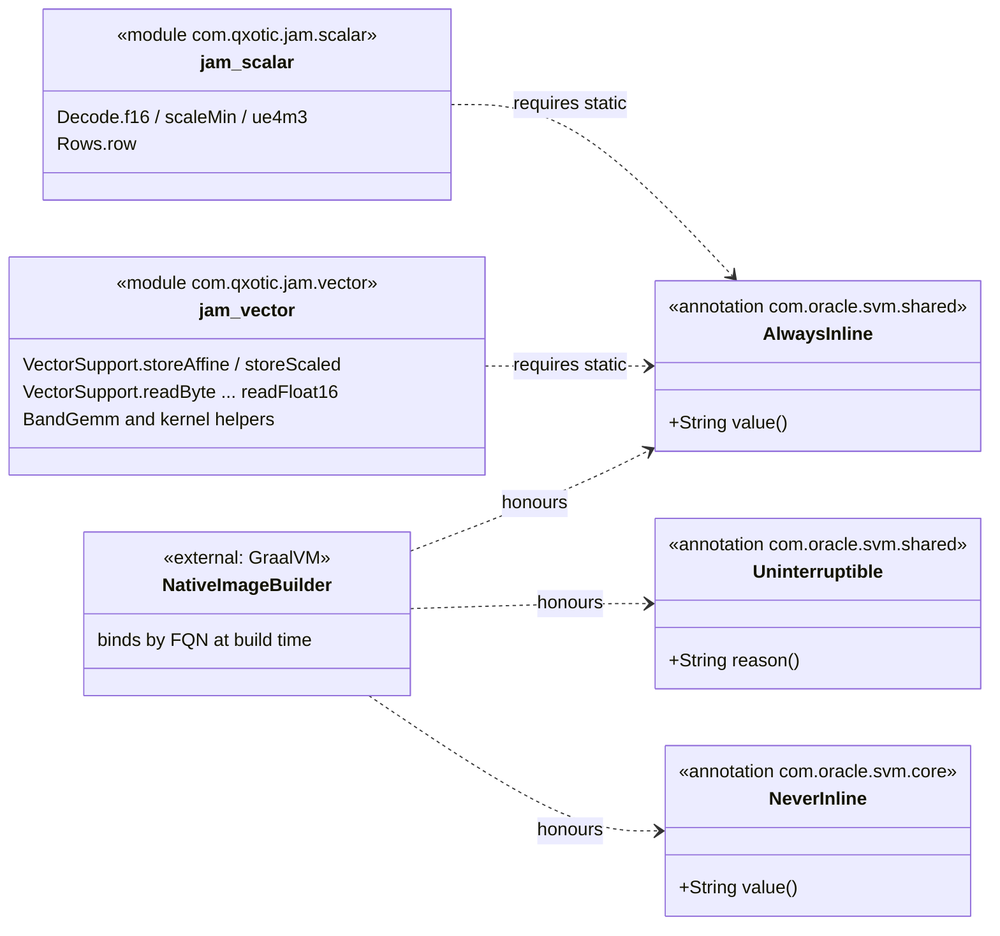

# graalvm-annotations — Architecture

`graalvm-annotations` (JPMS module `com.qxotic.graalvm.annotations`) is a tiny **compile-only**
module. It declares three annotations whose **fully qualified names** match GraalVM Native Image's
own (`com.oracle.svm.core.NeverInline`, `com.oracle.svm.shared.AlwaysInline`,
`com.oracle.svm.shared.Uninterruptible`). The image builder binds annotations by name, so code
annotated with these copies gets the real inlining behaviour in a native image, while HotSpot
ignores them. No GraalVM source is included, and the module is never published.

Consumers declare it `requires static` (optional at run time): `jam-scalar` and `jam-vector`.

| Annotation | Target | Retention | Meaning in a native image |
|---|---|---|---|
| `@AlwaysInline(String value)` | method, ctor | RUNTIME | Force inlining; `value` documents why (e.g. "a FloatVector must not cross a call in the image") |
| `@NeverInline(String value)` | method, ctor | RUNTIME | Forbid inlining, so a Vector API kernel keeps its own expansion budget |
| `@Uninterruptible(String reason)` | method, ctor | RUNTIME | No safepoint, no allocation; only calls uninterruptible code |

Why it matters for jam: in a native image a `FloatVector` that crosses a non-inlined call is boxed
and the hot loops collapse; `@AlwaysInline` on the small helpers (decode stores, scalar readers)
keeps the vectors in registers without relying on `-H:DirectedInline` (which is single-valued and
would clash with other jars' rules).
