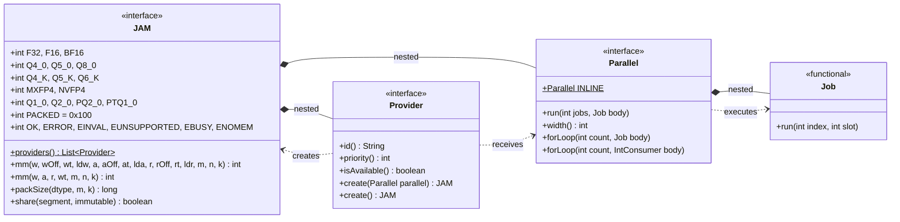
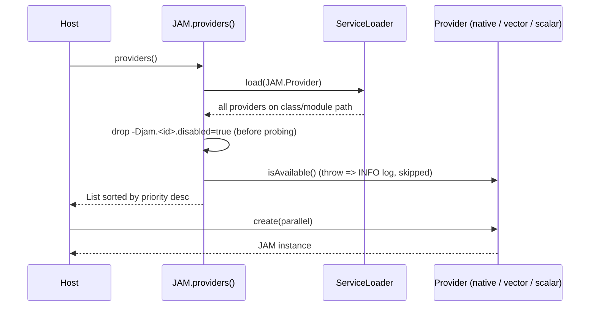
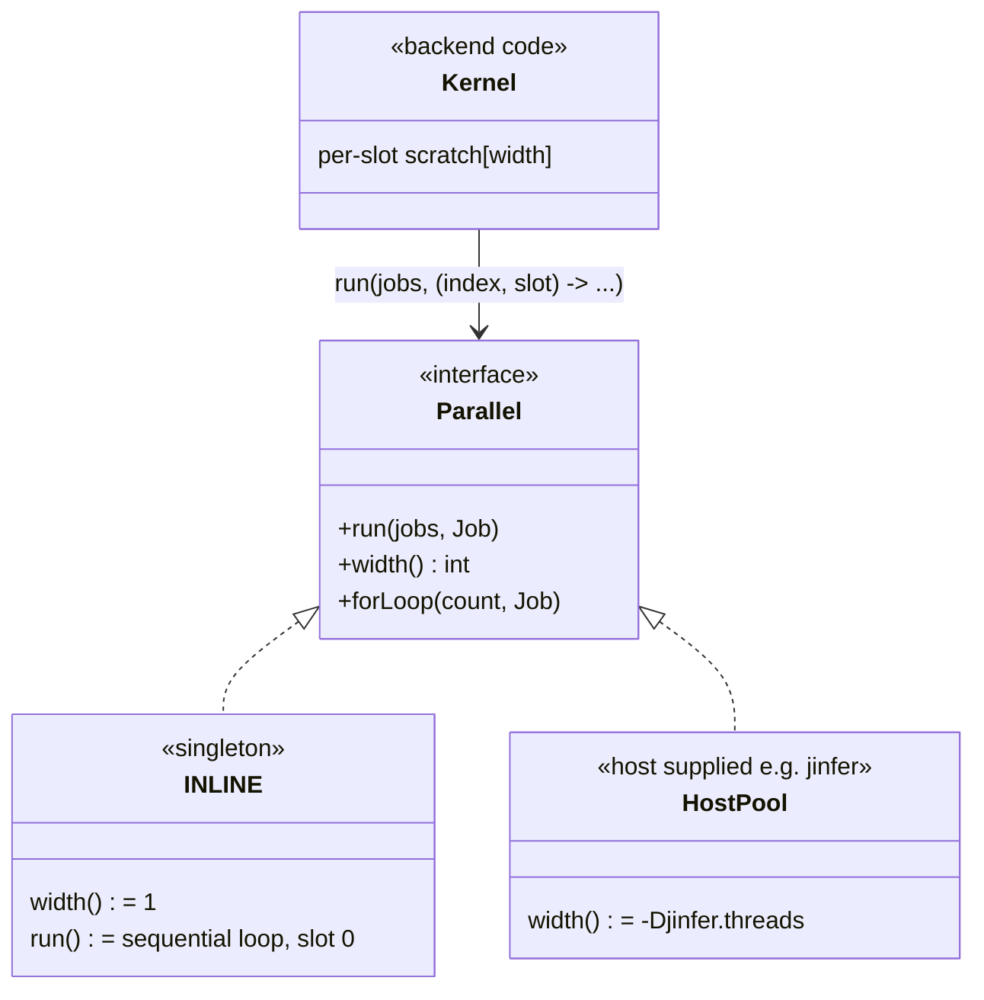
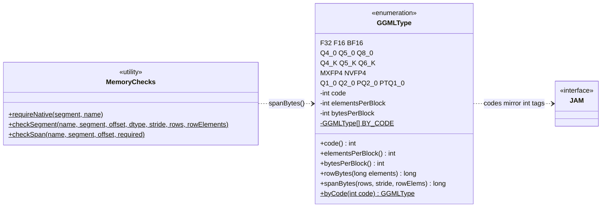

# jam-core — Architecture

`jam-core` (JPMS module `com.qxotic.jam`) is the **contract** of jam: one public interface, `JAM`,
plus a small `internal` package shared only with the built-in backends. It contains no kernel and
has no runtime dependency.

| Package | Class | Role |
|---|---|---|
| `com.qxotic.jam` | `JAM` | The matmul API: `mm`, `packSize`, `share`, dtype tags, status codes, `providers()` discovery |
| `com.qxotic.jam` | `JAM.Provider` | SPI discovered by `ServiceLoader`: `id`, `priority`, `isAvailable`, `create(Parallel)` |
| `com.qxotic.jam` | `JAM.Parallel` | The host's parallel loop handed to a backend (`run`, `width`, `forLoop`, `INLINE`) |
| `com.qxotic.jam` | `JAM.Parallel.Job` | Functional task `run(index, slot)` |
| `com.qxotic.jam.internal` | `GGMLType` | Block geometry per dtype (elements/bytes per block), code lookup, byte-span math |
| `com.qxotic.jam.internal` | `MemoryChecks` | Liveness / native / bounds checks shared by backends |

`com.qxotic.jam.internal` is exported **only** to `com.qxotic.jam.libjam`, `com.qxotic.jam.scalar`
and `com.qxotic.jam.vector`.

## 1. Public API: `JAM` and its nested types



### Semantics of `mm`

`R = W @ Aᵀ`, **token-major** (the ggml / llama.cpp `mul_mat` convention):

```
R[j*ldr + i] = dot(W[i, :], A[j, :])     W: [m x k] (any weight dtype)
                                           A: [n x k] F32 activations
                                           R: [n x m] F32 result
```

* operands are `MemorySegment` + **byte** offsets; `ldw/lda/ldr` are **element** row strides;
* `n == 1` is the GEMV / decode case, `n > 1` is prefill;
* `wt | PACKED` means W holds the backend's packed layout of size `packSize(wt, m, k)`;
* every implementation must keep the three segments reachable across the kernel
  (`Reference.reachabilityFence`), since kernels address memory by raw pointer.

### Status codes

| Code | Meaning | Caller reaction |
|---|---|---|
| `OK` (0) | done | — |
| `EINVAL` (-2) | impossible shape / stride | bug in caller |
| `EUNSUPPORTED` (-4) | valid request, no kernel here | fall back to next provider |
| `EBUSY` (-6) | another call running on this context | retry / fall back |
| `ENOMEM` (-7), `ERROR` (-1) | failure | report |

## 2. Provider discovery



Priorities of the built-in providers: `native` 1000, `vector` 500, `scalar` 0.

## 3. Threading contract: `JAM.Parallel`

Backends own **no threads**. The host gives a `Parallel` whose `width()` is the thread budget;
the kernel calls `run(jobs, body)` from the thread that called `mm`. The `slot` given to each job
is in `[0, width)`, unique among concurrently running jobs, and indexes per-participant scratch.



`forLoop(count, body)` is sugar: it cuts `[0, count)` into `2 x width()` contiguous bands so each
participant streams one long range.

## 4. Internal helpers



Block geometry (codes are GGML/GGUF codes; jam keeps its own copy and does not depend on `gguf`):

| dtype | code | elems/block | bytes/block |
|---|---|---|---|
| F32 / F16 / BF16 | 0 / 1 / 30 | 1 | 4 / 2 / 2 |
| Q4_0 / Q5_0 / Q8_0 | 2 / 6 / 8 | 32 | 18 / 22 / 34 |
| Q4_K / Q5_K / Q6_K | 12 / 13 / 14 | 256 | 144 / 176 / 210 |
| MXFP4 | 39 | 32 | 17 |
| NVFP4 | 40 | 64 | 36 |
| Q1_0 / Q2_0 | 41 / 42 | 128 / 64 | 18 / 18 |
| PQ2_0 / PTQ1_0 | 142 / 143 | 128 | 34 / 28 |

`spanBytes(rows, stride, rowElems) = (rows-1) * rowBytes(stride) + rowBytes(rowElems)` is the exact
number of bytes a kernel touches; `MemoryChecks.checkSegment` compares it against
`segment.byteSize()` before any kernel runs, so an undersized operand is refused whole with an
`IndexOutOfBoundsException` rather than read out of bounds.
