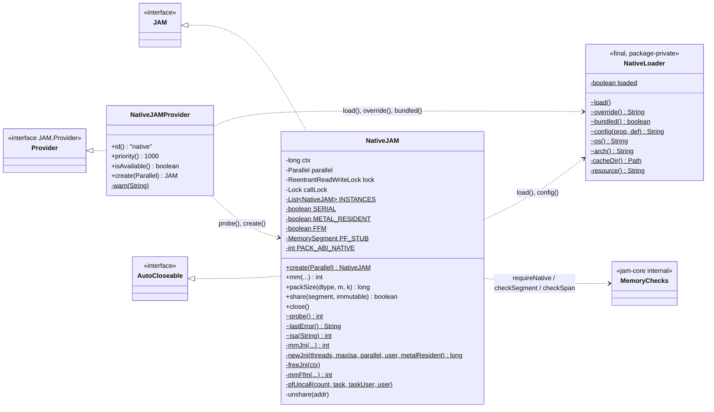
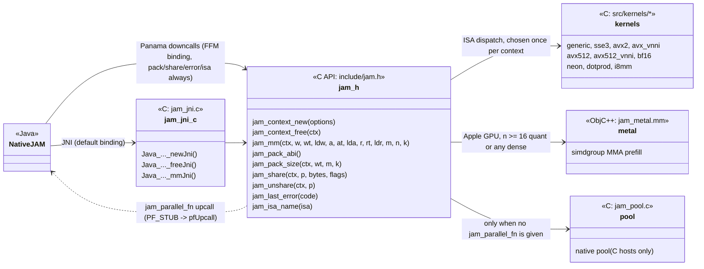
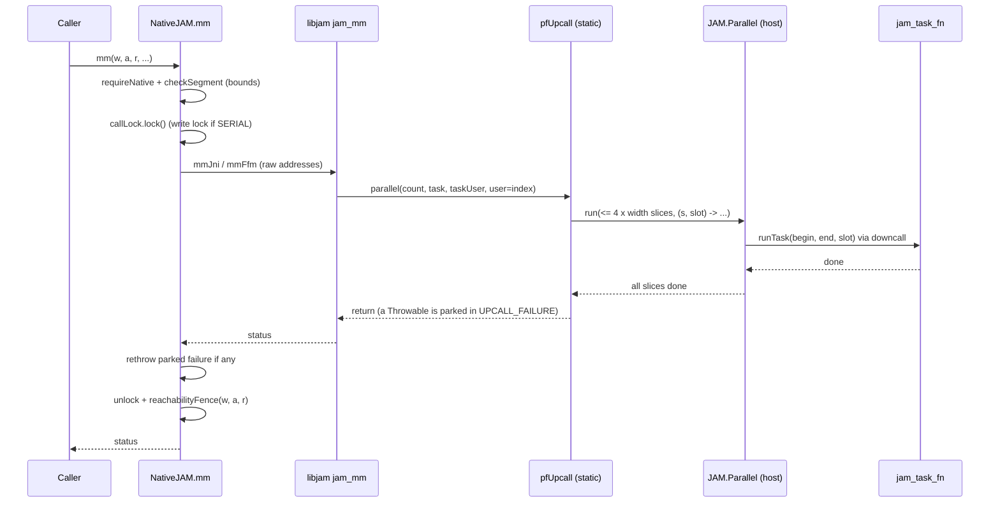
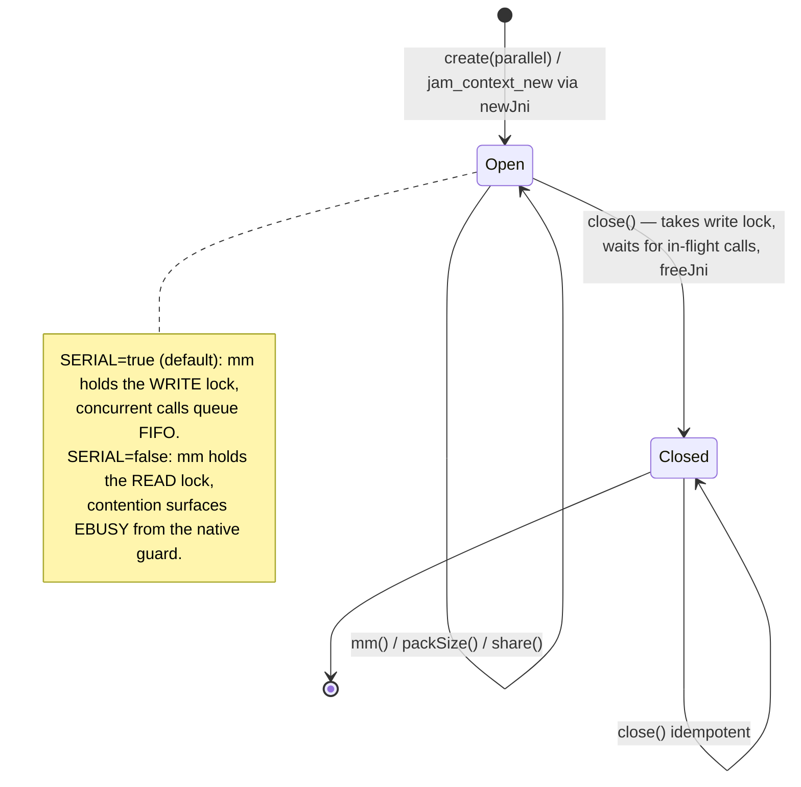
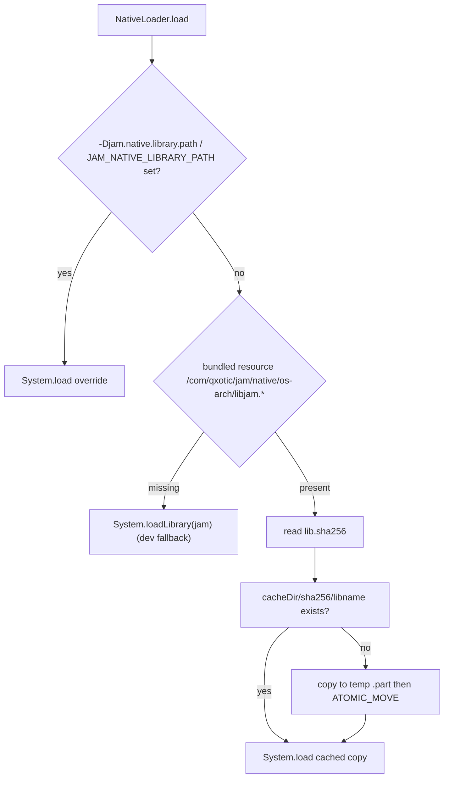

# jam-native — Architecture

`jam-native` (JPMS module `com.qxotic.jam.libjam`, provider id **`native`**, priority **1000**)
is the Java binding to **libjam**, the C/C++ (and Metal on Apple) matmul library built by CMake
from `src/`, `include/jam.h` and `src/kernels/`. The Java side is three classes; all the compute
is in native code.

| Class | Role |
|---|---|
| `NativeJAMProvider` | `JAM.Provider`: loads the library, probes symbols, creates `NativeJAM` |
| `NativeJAM` | `JAM` + `AutoCloseable`: owns one `jam_context*`, binds `jam_mm` (JNI or FFM), routes fan-outs to the host pool through an upcall |
| `NativeLoader` | Finds / extracts / `System.load`s the right `libjam` for the OS and arch; `config()` reads `-Djam.native.*` or `JAM_NATIVE_*` |

## 1. Class structure

## 2. The Java ↔ C boundary

* `jam_mm` is reached through the **JNI shim** (`-Djam.native.binding=jni`, default) or a
  **Panama downcall** (`ffm`). Every other symbol (`jam_pack_size`, `jam_share`, `jam_unshare`,
  `jam_last_error`, `jam_isa_name`, `jam_pack_abi`) is always a Panama downcall.
* All symbols are bound during `NativeJAM` class initialization, so a stale library that lacks
  a symbol fails in `NativeJAMProvider.isAvailable()` (warn + fallback), not at the first matmul.

## 3. Host-driven threading (no native thread inside the JVM)

`NativeJAM.create(parallel)` passes `parallel.width()` as the context's slot count and an upcall
stub (`PF_STUB`) as `jam_parallel_fn`. The `user` value is the instance's index in `INSTANCES`,
so the static upcall can find the right host pool.

## 4. Concurrency and lifecycle

`share(segment, immutable)` calls `jam_share` and registers `jam_unshare` as a cleanup on the
segment's own scope (through a view-only `Arena` returned by `shareScope`), so a share ends when the
segment's arena closes; after `close()` the context has already released it.

## 5. Library loading

Cache directory: `$XDG_CACHE_HOME` or `~/.cache` (Linux), `~/Library/Caches` (macOS),
`%LOCALAPPDATA%` (Windows), each `/jinfer/jam`; `java.io.tmpdir/jinfer/jam` as a last resort.

## 6. Configuration knobs

| Property / env | Default | Effect |
|---|---|---|
| `jam.native.library.path` / `JAM_NATIVE_LIBRARY_PATH` | — | load this file instead of the bundled one |
| `jam.native.isa` / `JAM_NATIVE_ISA` | auto | cap the ISA by its `jam_isa_name` (`avx2`, `i8mm`, …); an unknown name throws |
| `jam.native.binding` / `JAM_NATIVE_BINDING` | `jni` | `ffm` for Panama downcall to `jam_mm` |
| `jam.native.serial` / `JAM_NATIVE_SERIAL` | `true` | `false` = surface `EBUSY` on contention |
| `jam.native.metal.resident` | `true` | keep Metal shares wired (macOS 15+) |
| `jam.native.disabled` | `false` | drop the provider in `JAM.providers()` |
