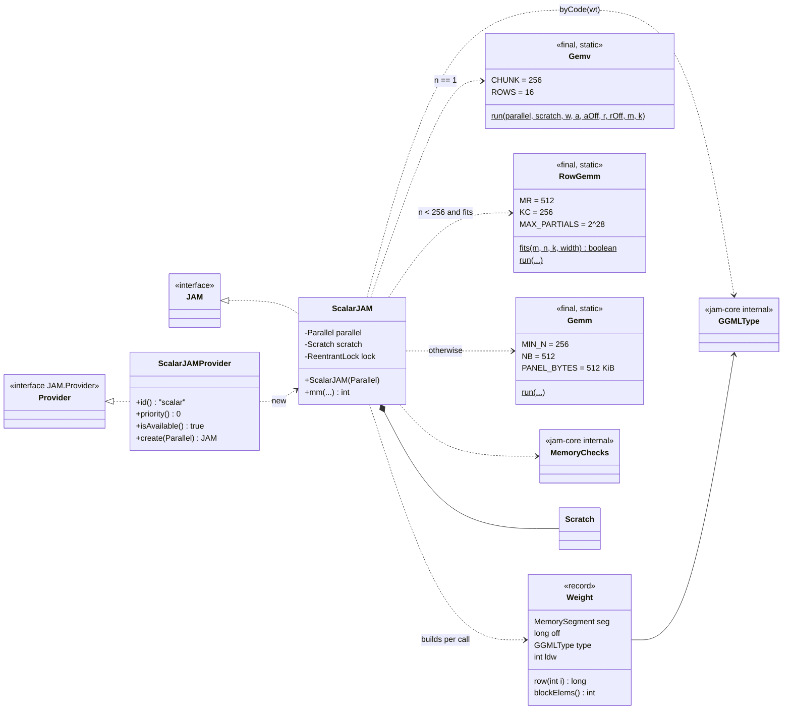
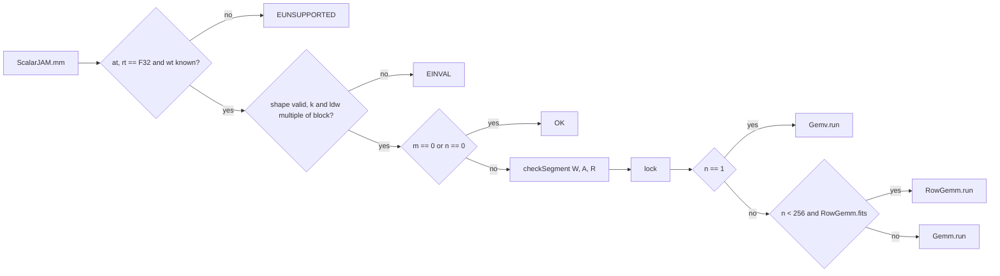
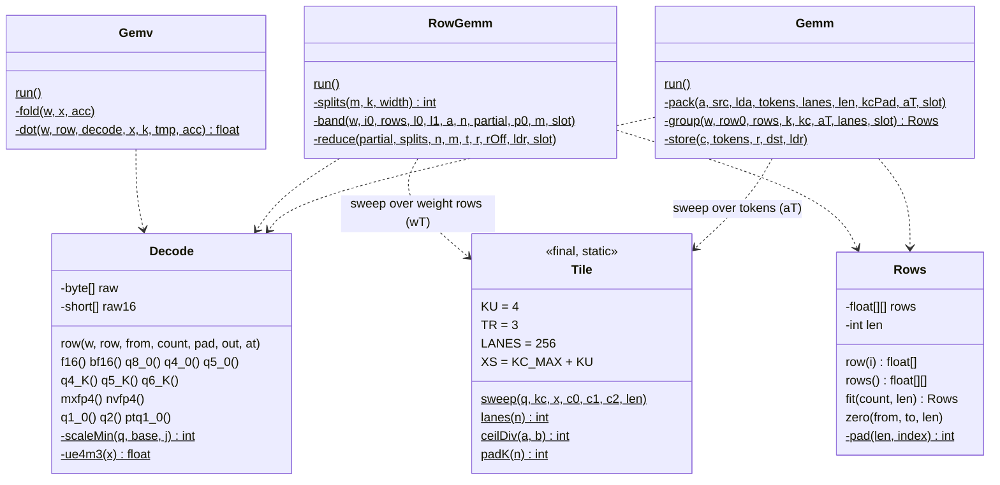
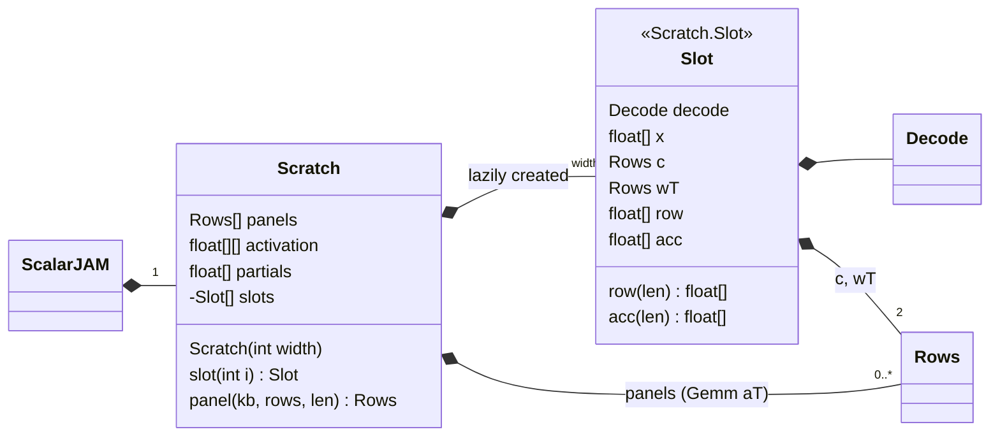

# jam-scalar — Architecture

`jam-scalar` (JPMS module `com.qxotic.jam.scalar`, provider id **`scalar`**, priority **0**) is
the **pure-Java** backend: no native code, no Vector API. It is always available, it is the
guaranteed fallback, and it is the **correctness reference** the other backends are tested against
(its dequantization mirrors libjam's `jam_ref.h` exactly). Speed comes from loop shapes that both
C2 and Graal auto-vectorize.

| Class | Role |
|---|---|
| `ScalarJAMProvider` | `JAM.Provider`, always available |
| `ScalarJAM` | `JAM`: validates, bounds-checks, picks one of three kernels, serializes calls |
| `Gemv` | `n == 1` (decode): per-row dot with chunked decode + FMA fold |
| `RowGemm` | `2 <= n < 256`: weight rows on the SIMD axis, k-split partials + reduce |
| `Gemm` | `n >= 256` (or when `RowGemm` partials would be too big): tokens on the SIMD axis |
| `Tile` | The 3-row x 4-k FMA register tile `sweep` both GEMM kernels run |
| `Decode` | Per-worker row decoder: one weight row span to `float[]`, every dtype |
| `Rows` | Growable panel of `float[]` rows padded to avoid 4 KiB aliasing |
| `Scratch` / `Scratch.Slot` | Per-instance buffers; one `Slot` per parallel slot |
| `Weight` | Record: weight segment + offset + `GGMLType` + `ldw` |

## 1. Entry point and dispatch





Unlike `native` and `vector`, the scalar backend also accepts **heap** segments (all accesses go
through checked `MemorySegment` accessors / bulk copies).

## 2. Kernels and their building blocks



| Kernel | Range | SIMD axis | Work item | Parallel regions |
|---|---|---|---|---|
| `Gemv` | `n == 1` | k (chunk of 256) | strip of 16 rows | `forLoop(ceil(m/16))` |
| `RowGemm` | `2..255` | weight rows (band of 512) | band x k-split | `run(bands*splits)` then `forLoop(n)` reduce |
| `Gemm` | `>= 256` | tokens (block of 512) | group of rows over all k | per token block: `run(kBlocks)` pack, `run(groups)` |

### The register tile

`Tile.sweep` is the one loop shape both JITs vectorize at full width:

```
c_j[i] = fma(q[l+3][i], x_j[l+3], fma(q[l+2][i], x_j[l+2], fma(q[l+1][i], x_j[l+1], fma(q[l][i], x_j[l], c_j[i]))))
```

three accumulator rows (`TR`) x four k-steps (`KU`) per pass; every array indexed by the bare lane
`i`. `Rows` keeps panel rows as separate `float[]` (a flat array with offsets stays scalar on C2)
padded by `16 + 16*(i & 3)` floats to avoid 4 KiB store/load aliasing.

## 3. Scratch ownership



* Buffers live in the `ScalarJAM` instance — never `static` nor `ThreadLocal` — so they are GC'd
  with the backend and grow on demand with no steady-state allocation.
* Call-wide buffers (`panels`, `activation`, `partials`) are shared by a whole `mm`; per-worker
  buffers sit in the `Slot` indexed by the `JAM.Parallel` slot, so no two threads touch one slot.
* Because buffers are shared, `ScalarJAM.mm` is serialized by a `ReentrantLock`.

## 4. Dtype decoding (`Decode`)

`Decode.row` stages the raw bytes of a row span into a Java `byte[]` / `short[]` with a single
bulk copy, then decodes with plain array code (per-element `MemorySegment` accessors lose inlining
inside large kernels, measured 8x slower).

| dtype | Decoder | Formula |
|---|---|---|
| F32 | bulk copy | — |
| F16 / BF16 | `f16`, `bf16` | `float16ToFloat`, `bits << 16` |
| Q8_0 | `q8_0` | `d * q` |
| Q4_0 / Q5_0 | `q4_0`, `q5_0` | `d * (q - 8)`, `d * (q - 16)` |
| Q4_K / Q5_K | `q4_K`, `q5_K` | `d*sc*q - dmin*mn` (6-bit `scaleMin`) |
| Q6_K | `q6_K` | `d*sc*(q - 32)` |
| MXFP4 / NVFP4 | `mxfp4`, `nvfp4` | `FP4[q] * scale` (e8m0 / ue4m3) |
| Q1_0 | `q1_0` | `bit ? d : -d` |
| Q2_0 / PQ2_0 | `q2(qk=64/128)` | `(code - 1) * d` |
| PTQ1_0 | `ptq1_0` + `trits` | `(trit - 1) * d`, base-3 packed |
