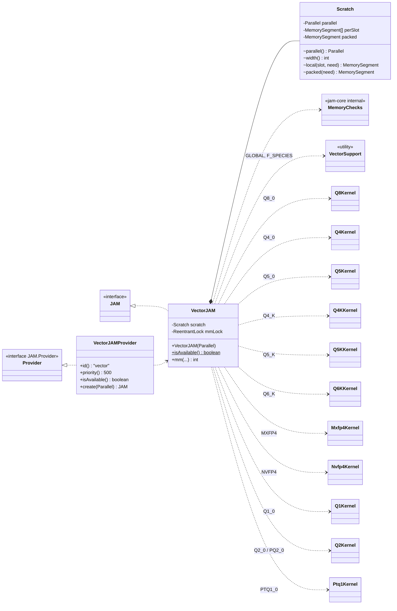
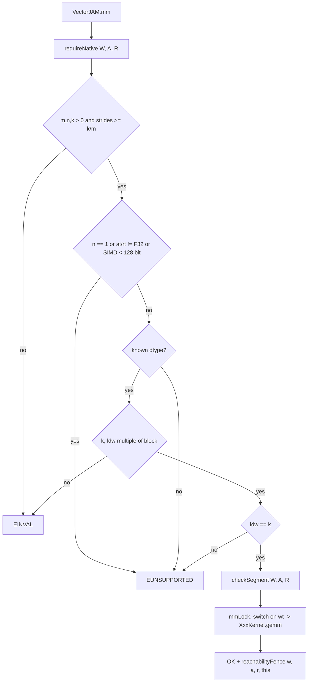
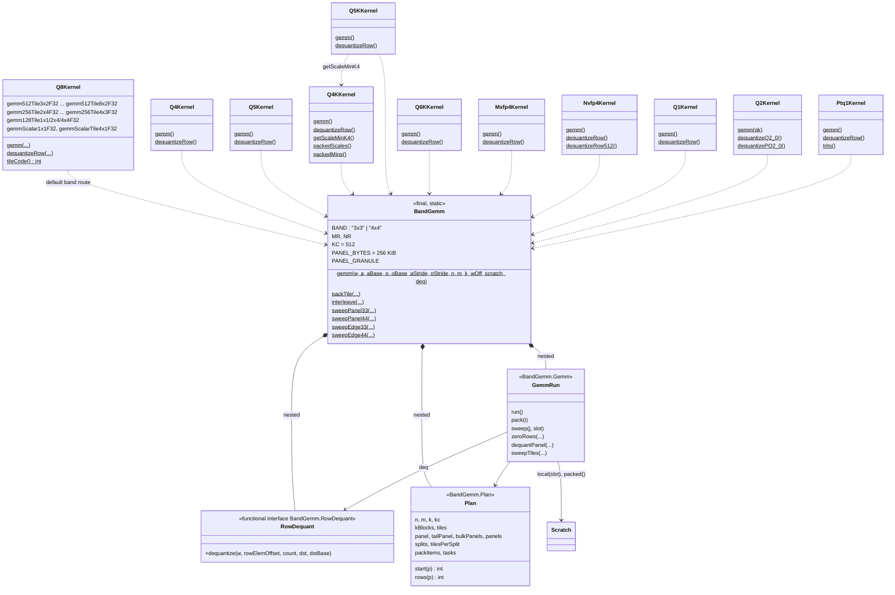
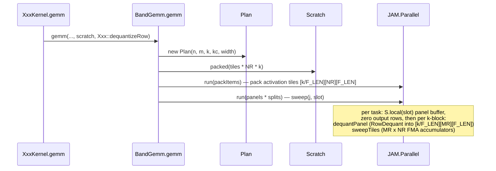
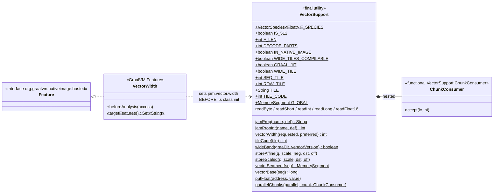

# jam-vector — Architecture

`jam-vector` (JPMS module `com.qxotic.jam.vector`, provider id **`vector`**, priority **500**) is
the **Java Vector API** backend (`jdk.incubator.vector`). It handles **prefill only** (`n > 1`)
with F32 activations/result and contiguous weights (`ldw == k`); anything else returns
`EUNSUPPORTED` so the caller falls back (typically to `scalar`). It also runs inside a GraalVM
native image.

| Class | Role |
|---|---|
| `VectorJAMProvider` | `JAM.Provider`; available when `jdk.incubator.vector` is in the boot layer and native access is allowed |
| `VectorJAM` | `JAM`: validation, bounds checks, per-dtype dispatch switch, `mmLock`, reachability fences |
| `VectorSupport` | Shared constants and helpers: `F_SPECIES`, `GLOBAL` absolute-address segment, fp16/byte readers, decode stores, tile/JIT selection, `jamProp` knobs, `parallelChunks` |
| `BandGemm` | Generic dequant-to-scratch F32 GEMM: blocking plan, activation packing, panel dequant, 3x3 / 4x4 register sweeps |
| `BandGemm.RowDequant` | Functional interface each dtype kernel provides: decode a run of one weight row to F32 |
| `Scratch` | Per-instance native buffers: one packed-activation buffer, one dequant panel per slot |
| `Q8Kernel` | Q8_0: band route by default; legacy register tiles (`-Djam.vector.q8=tile`) |
| `Q4Kernel`, `Q5Kernel` | Q4_0, Q5_0 dequant rows |
| `Q4KKernel`, `Q5KKernel`, `Q6KKernel` | K-quant dequant rows (6-bit scale/min unpack) |
| `Mxfp4Kernel`, `Nvfp4Kernel` | FP4 formats (e8m0 / ue4m3 scales, LUT decode) |
| `Q1Kernel`, `Q2Kernel`, `Ptq1Kernel` | Low-bit formats: Q1_0, Q2_0/PQ2_0, PTQ1_0 (ternary) |
| `VectorWidth` | GraalVM native-image `Feature`: pins `jam.vector.width` to the target ISA at build time |

## 1. Entry point and dispatch

Activations and results are addressed by **absolute address** through `VectorSupport.GLOBAL`
(`MemorySegment.NULL.reinterpret(Long.MAX_VALUE)`): one constant segment type, so bounds and
liveness checks fold, and Graal native-image vector loads compile to correct absolute addressing.
That is why the bounds are checked once up front and the operands are fenced after the call.

## 2. The band GEMM and the per-dtype kernels (strategy pattern)

Every dtype kernel is just a `RowDequant`: "decode `count` elements of a weight row into F32".
`BandGemm` owns the blocking, packing, threading and register sweeps.

(Each `XxxKernel::dequantizeRow` method reference is passed as the `RowDequant`.)

### How one `BandGemm.gemm` runs

Key blocking choices (see `BandGemm` Javadoc):

* **Panel**: up to `PANEL_BYTES` (256 KiB) of dequantized bands per task, kept in that core's L2;
  the slot's buffer is reused by the next task on the same slot.
* **k-blocks** of `KC` (512, multiple of 256) so an NR-column tile + a band stay in L1.
* **Scheduling**: pack items first, then full panels, then quarter-panel tail tasks; small `m`
  also splits the tokens. `PANEL_GRANULE` keeps panels on separate 64-byte output lines.
* **Tile**: 4x4 under C2 / GraalVM ≥ 25.4 JIT at 512 bit, otherwise 3x3 (Graal before 25.4
  only allocates zmm0-15); override `-Djam.vector.band=3x3|4x4`.

## 3. `VectorSupport`: species, addressing and tuning

* `F_SPECIES` is the float species, the JVM's preferred width or `jam.vector.width` (128/256/512).
  The decoders fan one 16-byte `ByteVector.SPECIES_128` chunk into `DECODE_PARTS` F32 stores, so
  every kernel runs at 128, 256 or 512 bit.
* `TILE_CODE` (used only by the legacy Q8_0 tile route) is picked from arch, width and JIT:
  NEON 4x4 on ARM, 4x4 on C2 at 512-bit, 3x2 on Graal / native image, AVX2 2x4 at 256-bit,
  scalar otherwise.
* In a native image the package is initialized at build time
  (`META-INF/native-image/.../native-image.properties`); `VectorWidth` sets `jam.vector.width`
  from the target CPU features (AVX512F → 512, AVX2 → 256, else 128) before the species freeze.

## 4. Configuration knobs (`-D` or `JAM_VECTOR_*` env)

| Property | Default | Effect |
|---|---|---|
| `jam.vector.width` | preferred | 128 / 256 / 512 |
| `jam.vector.band` | auto | `3x3` or `4x4` band sweep |
| `jam.vector.kc` | 512 | k-block length (rounded to 256) |
| `jam.vector.panelKb` | 256 | dequant panel size per task |
| `jam.vector.q8` | `band` | `tile` = legacy Q8_0 register tiles |
| `jam.vector.tile` | `auto` | legacy Q8 tile shape (3x2, 4x4, avx256-…, neon, scalar…) |
| `jam.vector.seqTile` / `rowTile` | 32 / 128 | legacy Q8 tile blocking |
| `jam.vector.wideTiles` | false | native-image build opt-in for 512-bit wide tiles |
| `jam.vector.disabled` | false | drop the provider |
