# jinfer-bailingmoe3 — class architecture

Package `com.qxotic.jinfer.models.bailingmoe3` (5 classes, ~1860 lines). It is the `jinfer-<model>` provider for GGUF
architecture `bailingmoe3` (Ling / Bailing V3): a **text-only** hybrid decoder whose layers are either **KDA**
(Kimi Delta Attention, a gated delta-rule recurrent mixer with causal depthwise convolutions) or **MLA** (compressed
latent attention with an F16 latent cache), followed by a dense SwiGLU FFN (leading layers) or a sigmoid-gated grouped
MoE with a shared expert. An optional embedded single **NextN / MTP** layer drives native speculative decoding.
There is no vision, audio or packed-sequence input.

Format: **Mermaid**. Legend: `..|>` implements; `--|>` extends; `-->` holds/uses; `..>` creates/depends;
classes marked `<<external>>` live outside this package.

1. [Position in the stack](#1-position-in-the-jinfer-stack)
2. [Class diagrams](#2-class-diagrams) — 2a contracts, 2b model internals, 2c weights, 2d speculative and chat subsystems
3. [Loading sequence](#3-loading-sequence)
4. [Forward pass](#4-forward-pass) — 4.0 global, 4a `ingest`, 4b `decoderBlock` (+ KDA, MLA, MoE, MTP detail)
5. [Heads and logits](#5-heads-and-logits)
6. [Speculative decoding flow](#6-speculative-decoding-flow)
7. [Chat template flow](#7-chat-template-flow)
8. [State and checkpoint layout](#8-state-and-checkpoint-layout)

| Class | Role |
|---|---|
| `BailingMoe3` | The model: `LanguageModel` + `SpeculativeDecoding` impl with nested records `Configuration`, `KdaWeights`, `MlaWeights`, `FfnWeights`, `MoeWeights`, `NextNWeights`, `Weights` and the class `State`; GGUF loading, whole forward pass, logits, NextN drafting |
| `BailingMoe3Provider` | `ModelProvider` SPI for architecture `bailingmoe3`; builds the `LoadedModel` (stops, seed, chat template) |
| `BailingMoe3ChatTemplate` | `ChatTemplate`: native encoder of the Bailing V3 role format (`&lt;role&gt;HUMAN&lt;/role&gt;` ... `&lt;|role_end|&gt;`), tools as XML, reply parser with think/tool-call spans |
| `BailingMoe3CheckpointCodec` | `CheckpointCodec<State>`: MLA latent rows (per position) plus fixed KDA recurrent/conv state and the MTP pending hidden |
| `BailingMoe3Speculative` | Package-private draft-and-verify loop using the embedded NextN layer; owns the `Scratch` buffers |

---

## 1. Position in the jinfer stack

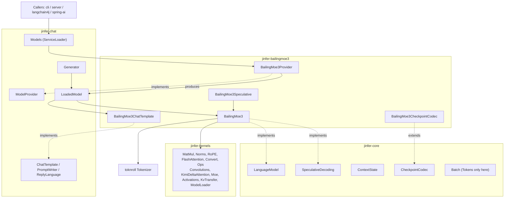

---

## 2. Class diagrams

### 2a. Contracts and relations

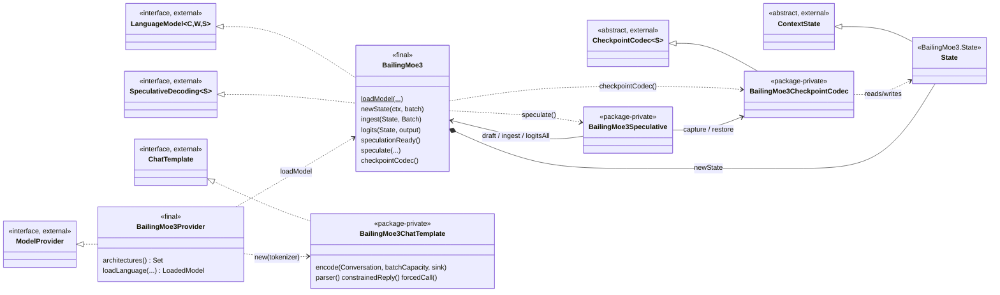

### 2b. Model internals

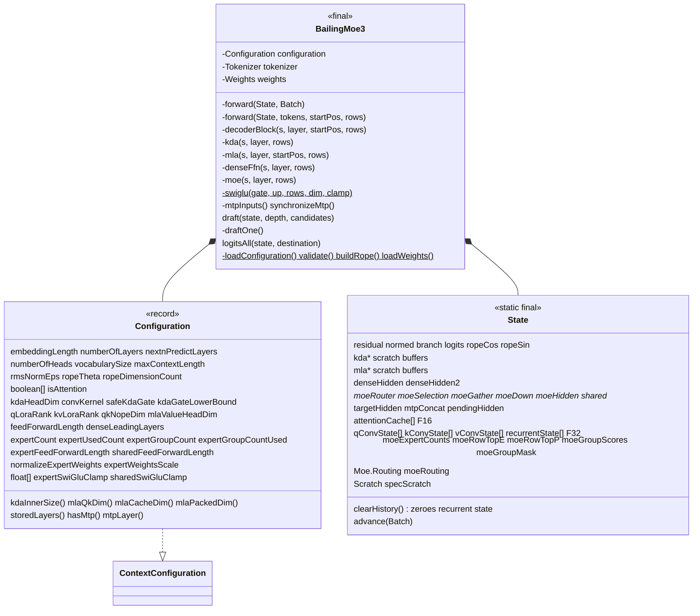

### 2c. Weights

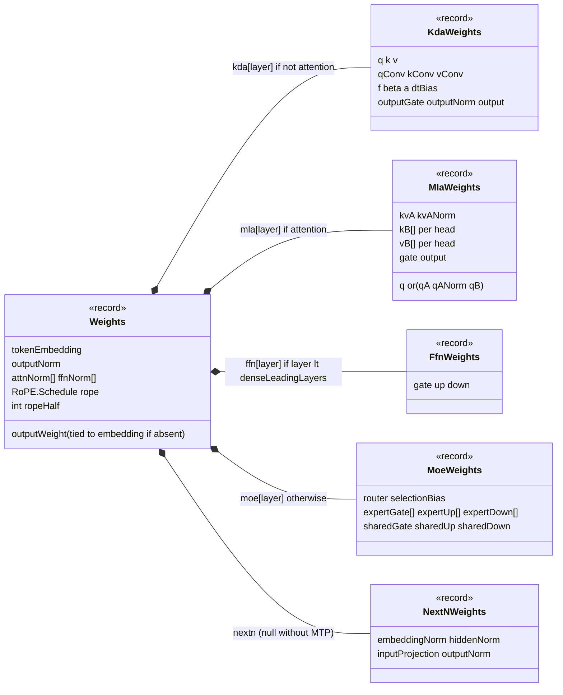

### 2d. Speculative and chat subsystems

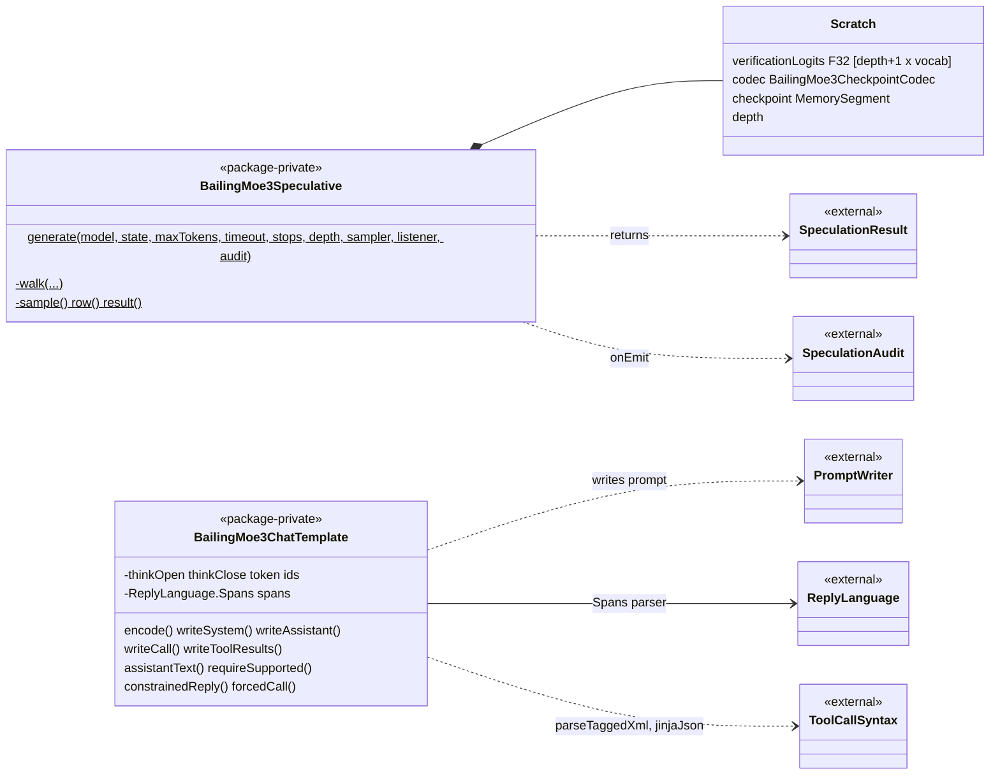

---

## 3. Loading sequence

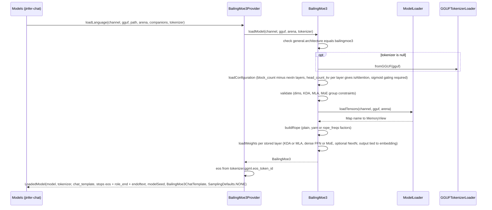

---

## 4. Forward pass

`ingest(state, batch)` runs `state.exclusively(forward)`. Only `Batch.Input.Tokens` is accepted. Per-layer carried state is the F16 MLA latent cache (attention layers) or the KDA recurrent matrix plus three conv tails (KDA layers).

### 4.0 Global architecture

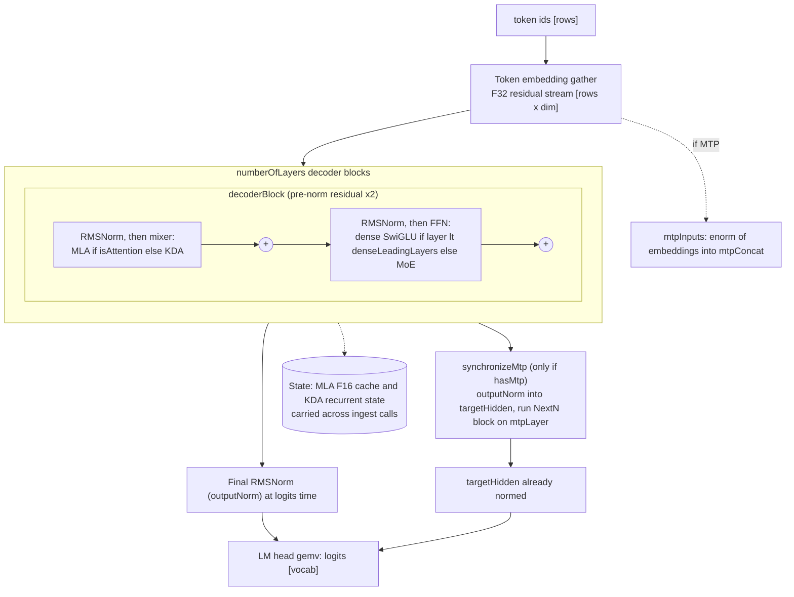

### 4a. `ingest` — validation, input kinds, rope/embedding, layer loop

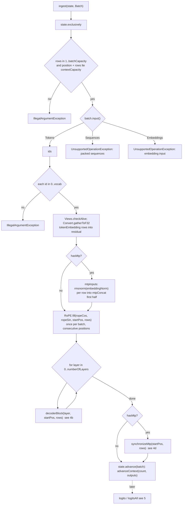

### 4b. `decoderBlock` — one layer

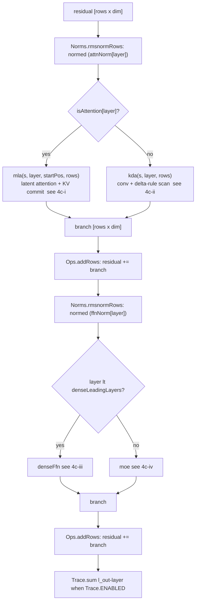

Layers differ in kind, so the mixer and FFN get their own sub-diagrams.

#### 4c-i. MLA mixer (attention layers) with KV commit

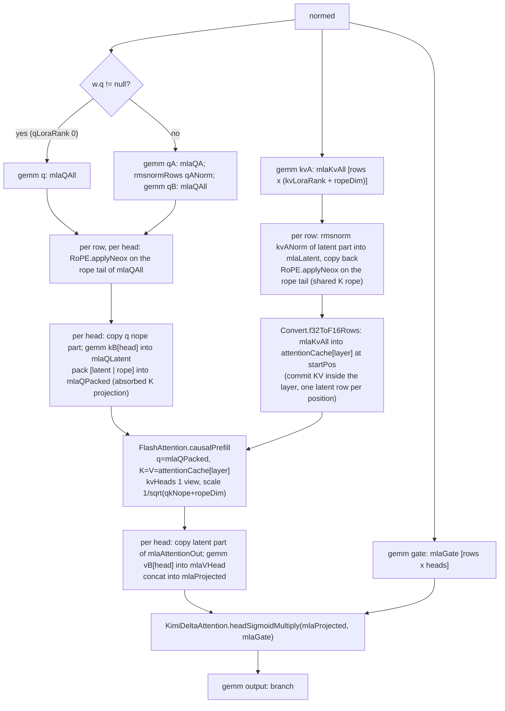

#### 4c-ii. KDA mixer (recurrent layers)

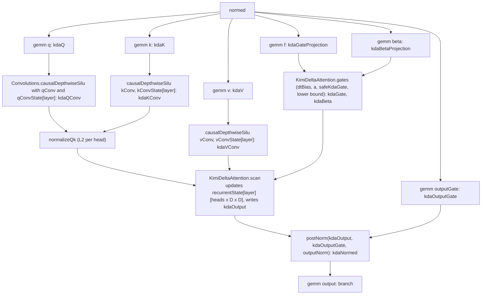

#### 4c-iii. Dense SwiGLU FFN and 4c-iv. MoE FFN

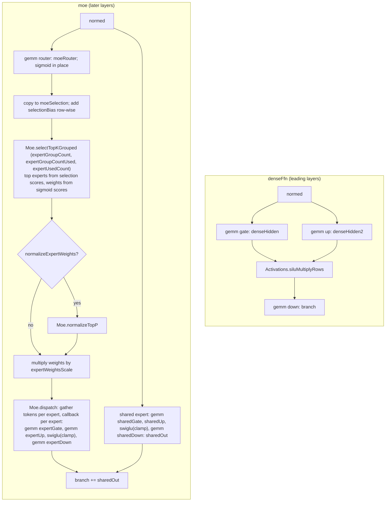

`swiglu` with `clamp` greater than 1e-6: SiLU on gate, gate clamped to at most `clamp`, up clamped to `[-clamp, clamp]`, then multiply; otherwise plain `siluMultiplyRows`. Clamps are per stored layer (`swiglu_clamp_exp`, `swiglu_clamp_shexp`).

#### 4d. MTP synchronisation

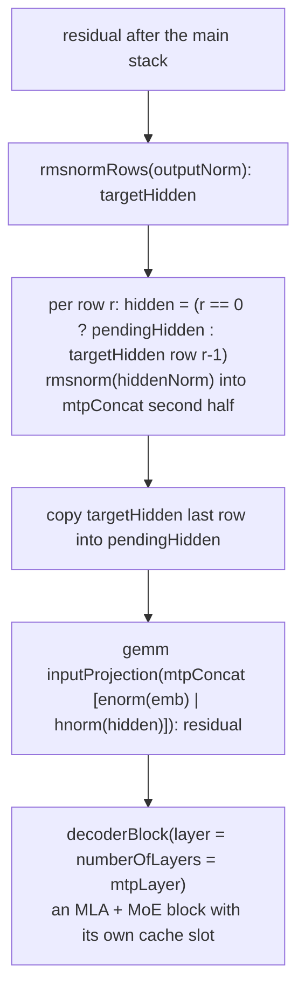

---

## 5. Heads and logits

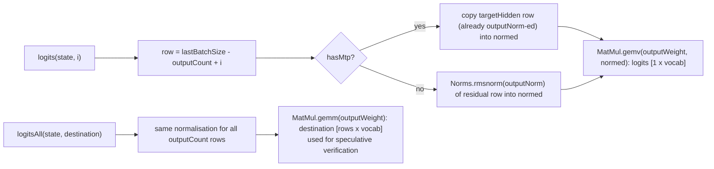

---

## 6. Speculative decoding flow

`speculationReady()` is true iff `weights.nextn != null`. `speculate` computes the token budget from the context room and `maxOutputTokens`, then calls `BailingMoe3Speculative.generate` (depth 1..8, capped at `batchCapacity - 1`). `draft` fills candidates greedily (argmax) by running the NextN block on one row at a time.

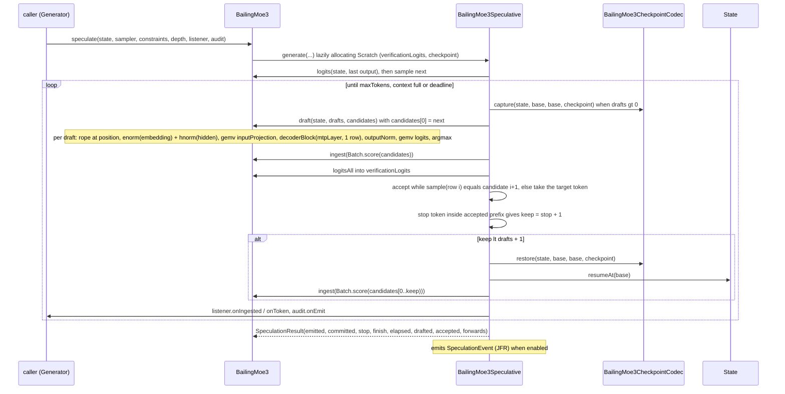

The checkpoint is needed because KDA state is not positional: rejecting drafts cannot simply rewind the cursor, so the recurrent state is restored and the accepted prefix is re-ingested.

---

## 7. Chat template flow

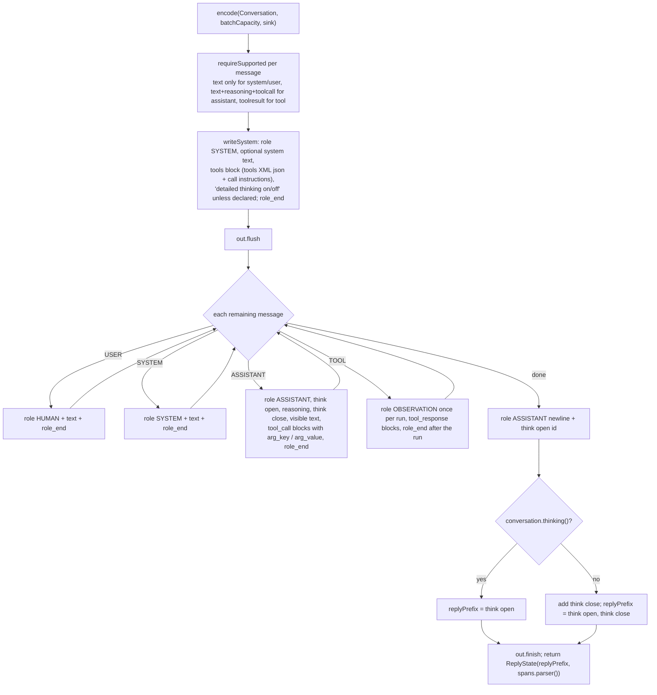

Reply parsing: `ReplyLanguage.Spans` over `&lt;think&gt;...&lt;/think&gt;`, `&lt;tool_call&gt;...&lt;/tool_call&gt;` with `ToolCallSyntax::parseTaggedXml`, turn end mark `&lt;|role_end|&gt;`. `constrainedReply` and `forcedCall` delegate to the same spans. Provider stop tokens: EOS id, `&lt;|role_end|&gt;`, `&lt;|endoftext|&gt;`.

---

## 8. State and checkpoint layout

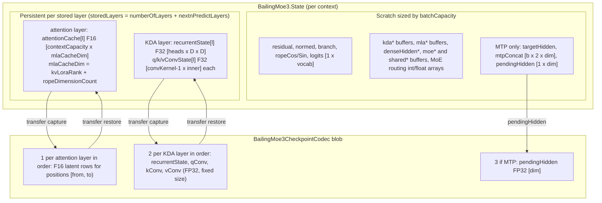

- `sizeOf(positions) = positions x attentionLayers x 2 bytes x mlaCacheDim + residueBytes`; `residueBytes = recurrentLayers x (heads x D x D + convFloats) x 4` (plus `embeddingLength x 4` with MTP), where `convFloats = 3 x (convKernel - 1) x kdaInnerSize` as computed in the codec.
- The KDA part is position-independent: capture/restore always moves the whole recurrent state, whatever `from`/`to` are.
- `clearHistory()` zeroes all recurrent and conv state and `pendingHidden`; the MLA cache needs no clearing (rows beyond the cursor are masked).
- `newState(ctx, batch)` owns a cross-thread arena (closed on constructor failure); `newState(ctx, batch, arena)` borrows the caller's arena. `State` rejects `contextCapacity` above `maxContextLength`.
