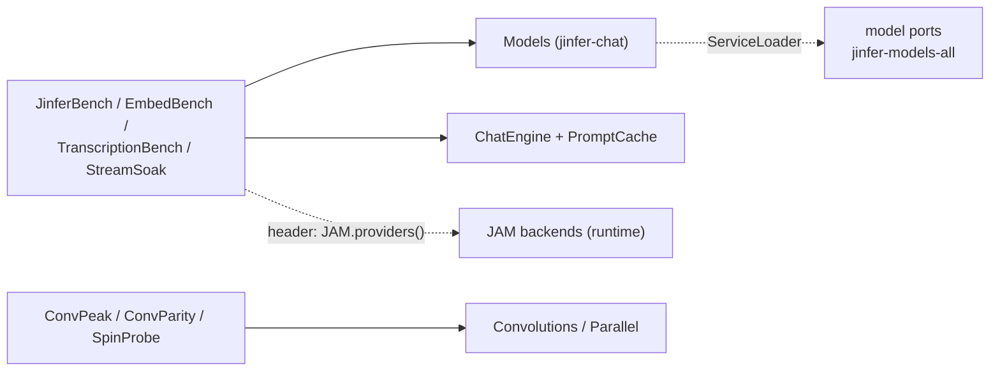

# jinfer-bench — architecture summary

`jinfer-bench` is the **benchmark harness** of the jinfer inference engine. It is a set of standalone
`main` programs in one package, `com.qxotic.jinfer.bench` (7 classes, ~1960 lines). It exposes no library API
and registers no ServiceLoader SPI. It is not published to Maven Central. Class-level detail and diagrams are
in [ARCHITECTURE.md](ARCHITECTURE.md).

## Where it sits

It is a leaf at the top of the stack. It calls the public loaders in `jinfer-chat` (`Models`, `ChatEngine`)
and the model contracts in `jinfer-core` (`LanguageModel`, `EmbeddingModel`, `TranscriptionModel`,
`ContextState`, `CheckpointCodec`, `Batch`). It also uses `jinfer-cache` (`PromptCache.Options`),
`jinfer-codecs` (`ImageCodec`, `AudioCodec`), `jinfer-kernels` (`Convolutions`), `jota-memory` and `toknroll-core`.
The model ports (`jinfer-models-all`) and the JAM backends (`jam-native`, `jam-vector`, `jam-scalar`) are
runtime-scope dependencies, discovered through ServiceLoader. As a result, any GGUF architecture on the
classpath can be benchmarked without code specific to it. `jinfer-lfm3` and `jinfer-qwen35` are compile-scope
dependencies for one reason only: decision checkpoints (see below).

## The programs

| Program | What it measures |
|---|---|
| `JinferBench` (the executable, `jinfer-bench`) | llama-bench-parity `pp<N>` / `tg<N>` tokens per second (mean ± stddev), optionally at a resident depth `@d<N>`. Then a capabilities pass: state allocation time, time to first token, prompt-cache hit vs full re-prefill, MTP draft acceptance and speedup, projected-media cold vs warm latency, and peak RSS |
| `EmbedBench` | Throughput of packed, ragged batched embedding (`embedAll`) in tokens/s and sequences/s |
| `TranscriptionBench` | ASR word error rate over a LibriSpeech-layout corpus, with an optional pass/fail `--gate` and a TSV `--dump`, or real-time factor on one audio file |
| `StreamSoak` | Hours-long streaming-transcription soak over a seeded synthetic program with injected silence, collapse clip, language switch, tone sweep and gain steps. It checks invariants, RSS slope and partial latency, after a phase-0 check that streamed output equals offline output |
| `ConvPeak` | `conv1dRows` throughput per register-tile shape, on a model's census of convolution shapes |
| `ConvParity` | Bit-exact SHA-256 digests of `conv1dRows` output, to compare across tile shapes |
| `SpinProbe` | Latency of one empty `Parallel.forLoop` region |

## Key concepts and flows

- **`JinferBench.BenchModel`** is the single model wrapper. It holds a `LoadedModel` from `Models.load`,
  one reusable `ContextState`, and an optional depth snapshot made with the model's `CheckpointCodec`.
  It drives the model at the raw boundary: `newState`, `reset`, `ingest(Batch)` and `logits`.
- **Decision checkpoints**: `Models.load` rejects some files with `IncompatibleModelException`. When such a
  GGUF is non-causal (`<arch>.attention.causal = false`) and its architecture is `lfm3` or `qwen35`/`qwen35moe`,
  the bench opens the network directly with `Lfm3.loadModel` / `Qwen35.loadModel` and runs only `pp` at depth 0.
- **Parity test loop**: one state per test, sized to the work. Every pass starts with `reset` (or a restore
  to depth) outside the timed region. Prefill runs in 512-token ubatches (`UBATCH`, pinned on purpose). Decode
  runs single-token steps fed with an LCG token. The logits are projected each step but never argmaxed.
- **Capabilities pass**: two `ChatEngine`s share one loaded model. One uses the default `PromptCache` and the
  other has caching disabled, as a control. The cache-hit test is a turn-2 prompt (prompt + reply + a small
  delta) because the cache serves strict extensions of a retained stream. The MTP test uses a real
  chat-templated prompt, because filler tokens cannot be predicted by a draft head.

## Notable design choices

- **Fidelity to llama-bench** is documented point by point in the `JinferBench` Javadoc. The only deviations
  are JVM-driven. Warmup is adaptive: it runs until 3 passes agree within 3%, with a maximum of 30.
- **Self-describing output**: the header line names the runtime (native image, GraalVM JIT or C2), the loaded
  JAM providers and where the thread count came from (`-t` sets `jinfer.threads` before `RuntimeFlags` loads).
- **Kernel tools run one tile shape per JVM** (`-Djinfer.convTile`), because that setting is a static final.
  `ConvPeak` requires at least 1.5 s of warmup, because a check for stable timings alone can pass while the
  code is still cold.
- **Allocation is never timed**, and `volatile` sinks stop the JIT from removing the measured work.
- Build: a shaded jar, plus a GraalVM native image via the `native` profile and the module `Makefile`.
