# jinfer-bench — class architecture

Package `com.qxotic.jinfer.bench` (7 top-level classes, ~1960 lines, plus 1 test class). It is the
**benchmark harness** of the jinfer stack: a set of independent `main` programs, none of which is a library API.
The headline program, `JinferBench`, is a llama-bench-parity harness (pp/tg throughput) that drives *any*
model on the classpath through the generic loader `Models.load`; the others benchmark embedding, speech
recognition (WER / RTF), unbounded streaming transcription, and two kernels (`conv1dRows`, `Parallel.forLoop`).
The module registers **no SPI** (`META-INF/services` is absent); it only *consumes* ServiceLoader-discovered
model ports (`jinfer-models-all`, runtime scope) and JAM backends (`jam-native`, `jam-vector`, `jam-scalar`, runtime scope).
The `JinferBench` main class is the executable (shaded jar / GraalVM native image `jinfer-bench`, via `jinfer.image.mainClass` in `pom.xml`).

Format: **Mermaid**. Legend: `..|>` implements; `--|>` extends; `-->` holds/uses; `..>` creates/depends;
`*--` composition (nested type / owned field); classes marked `<<external>>` live outside this module.

1. [Position in the stack](#1-position-in-the-jinfer-stack)
2. [Class diagrams](#2-class-diagrams) — 2a `JinferBench`, 2b `EmbedBench`, 2c speech benches, 2d kernel microbenches
3. [JinferBench: parity tests](#3-jinferbench-parity-tests) — 3a main loop, 3b loading, 3c `measure`/`runOnce`
4. [JinferBench: capabilities pass](#4-jinferbench-capabilities-pass)
5. [EmbedBench flow](#5-embedbench-flow)
6. [TranscriptionBench and StreamSoak flows](#6-transcriptionbench-and-streamsoak-flows)
7. [Kernel microbenches](#7-kernel-microbenches)
8. [Design notes](#8-design-notes)

| Class | Role |
|---|---|
| `JinferBench` | Main executable. llama-bench-parity `pp<N>` / `tg<N>` tests (optionally at depth `@d<N>`) per model, then a *capabilities* pass through `ChatEngine` (state alloc, TTFT, prompt-cache hit, MTP acceptance, media cold/warm, peak RSS). Nested: `BenchModel<S>`, records `Row`, `CapRow` |
| `JinferBench.BenchModel<S extends ContextState>` | The one model wrapper: holds a `LoadedModel<S>`, one reusable state, an optional depth snapshot (`CheckpointCodec` + `MemorySegment`); falls back to opening *decision checkpoints* (non-causal `lfm3` / `qwen35` / `qwen35moe`) directly via `Lfm3.loadModel` / `Qwen35.loadModel` |
| `EmbedBench` | Ragged/packed batched-embedding throughput through `EmbeddingModel.embedAll`, any embedder from `Models.loadEmbedder`. Nested: `EmbedModel<S>` |
| `TranscriptionBench` | ASR quality (WER over a LibriSpeech-layout corpus, optional `--gate` pass/fail and `--dump` TSV) and speed (RTF over one file) via `Models.loadTranscription`. Nested records `Utterance`, `Scored`; package-visible `normalize`, `editDistance` (unit-tested) |
| `StreamSoak` | Hours-long soak of one `TranscriptionStream` over a seeded synthetic program with injected pathologies; checks ordering/mute/recovery invariants, RSS slope, partial-latency percentiles. Nested: `Program`, record `Event` |
| `ConvPeak` | Microbench of `Convolutions.conv1dRows` per register-tile shape (`-Djinfer.convTile`), on a census parsed from a `-Djinfer.convProfile` dump or a fallback vocoder ladder; prints a FLOP-weighted predicted total |
| `ConvParity` | Parity check: SHA-256 digests of `conv1dRows` output for fixed shapes, to diff across tile shapes run in separate JVMs |
| `SpinProbe` | Microbench of the empty `Parallel.forLoop` region (dispatch + barrier latency) |
| `TranscriptionBenchTest` (test) | JUnit 5 tests of `TranscriptionBench.normalize` and `editDistance` |

---

## 1. Position in the jinfer stack

Dependencies are those declared in `jinfer-bench/pom.xml`. The bench sits at the very top: it depends on
the public loaders of `jinfer-chat` and the contracts of `jinfer-core`, and pulls every model port in at
runtime so that `Models.load` can resolve any GGUF architecture.

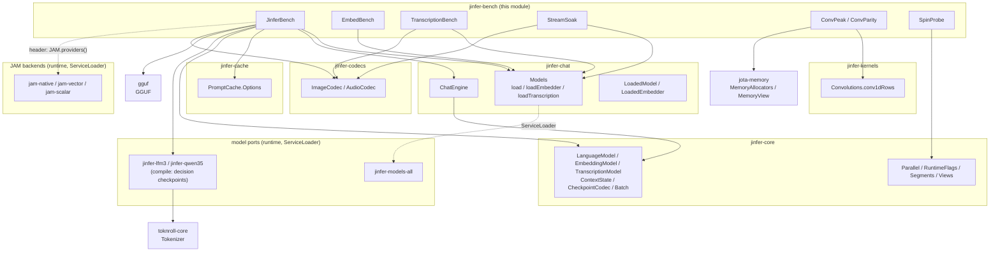

---

## 2. Class diagrams

### 2a. `JinferBench`

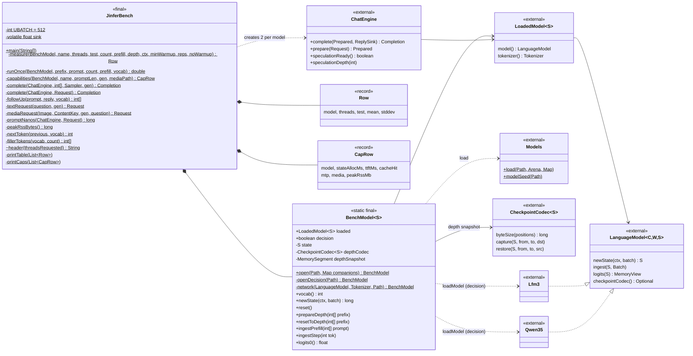

### 2b. `EmbedBench`

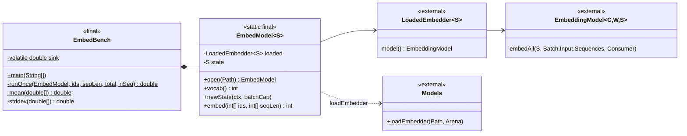

### 2c. Speech benches: `TranscriptionBench`, `StreamSoak`

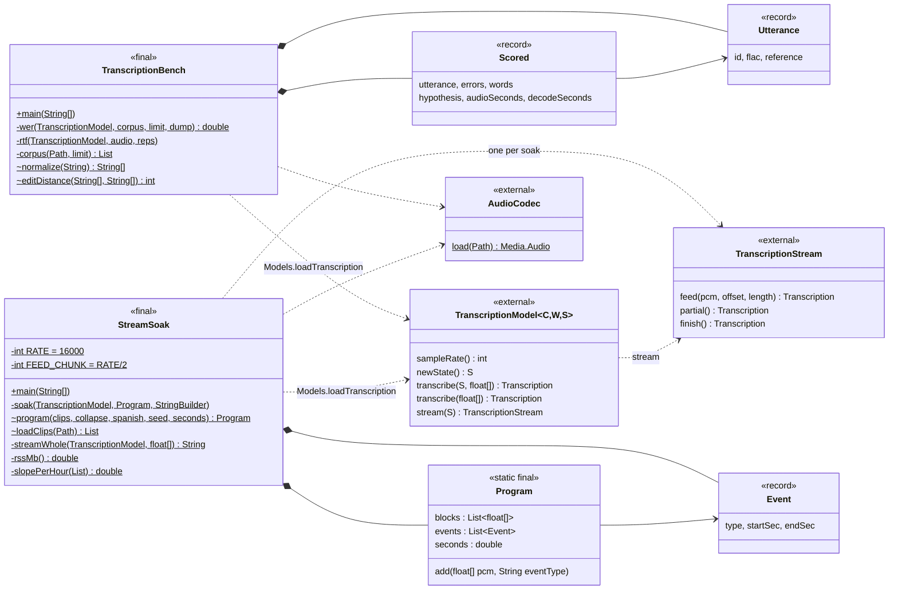

### 2d. Kernel microbenches: `ConvPeak`, `ConvParity`, `SpinProbe`

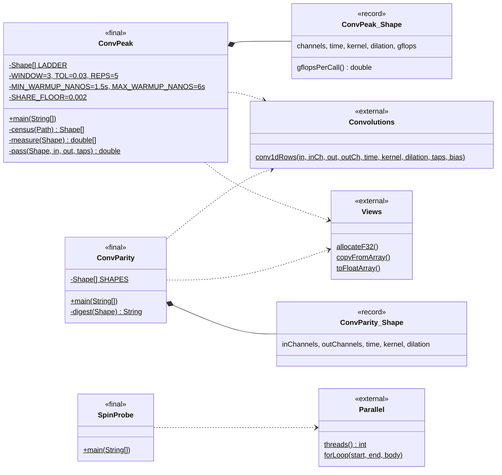

(`ConvPeak_Shape` / `ConvParity_Shape` stand for the private nested records both named `Shape`.)

---

## 3. JinferBench: parity tests

### 3a. Main loop

`main` parses llama-bench-style flags (`-m` repeatable, `-p`, `-n`, `-d`, `-r`, `-w`, `--no-warmup`,
`--no-capabilities`, `--ctx`, `-t`, `--media`, `--with cap=path`). `-t` is written to the system property
`jinfer.threads` **before** `RuntimeFlags` is first touched (by `header`). Per model: one `pp` row, one `tg`
row, one capabilities row; decision models get only `pp` at depth 0.

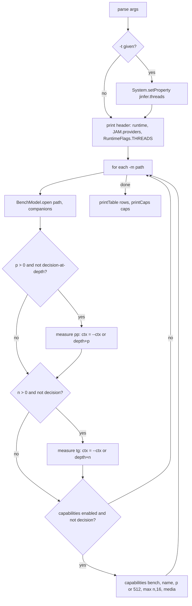

### 3b. Loading (`BenchModel.open`)

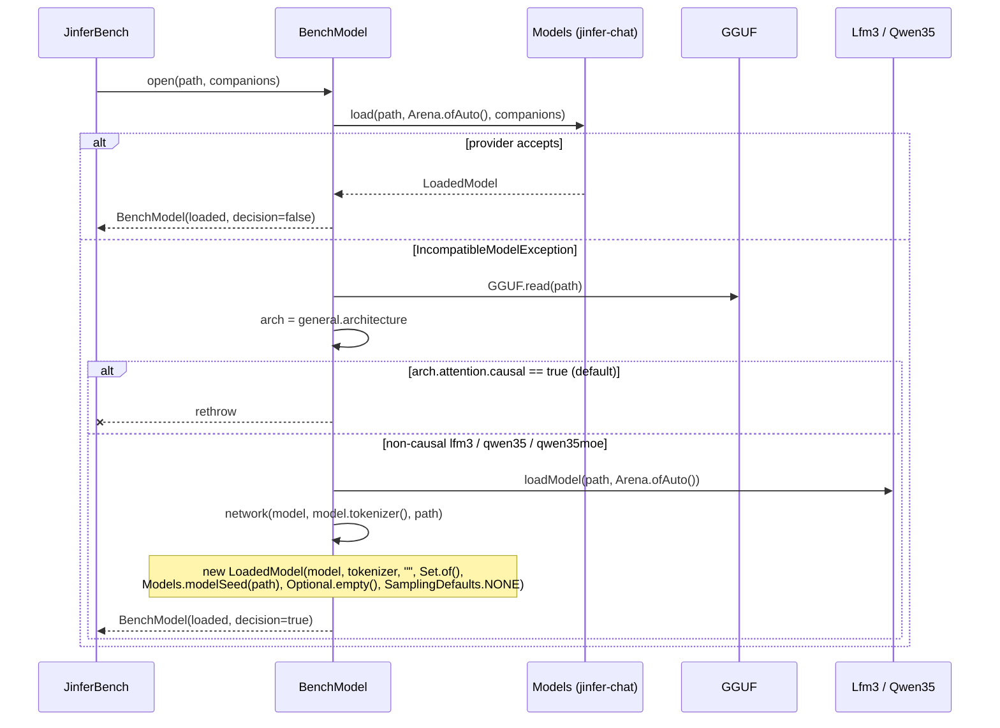

### 3c. `measure` / `runOnce`

One state per test, sized to the work (`newState(ctx, batch)` with `batch = UBATCH = 512`, or `count`
for a decision model which must read the prompt in one batch). The depth prefix is prepared once and
snapshotted through the model's `CheckpointCodec` if it has one; otherwise it is re-ingested before every
pass — always outside the timed region.

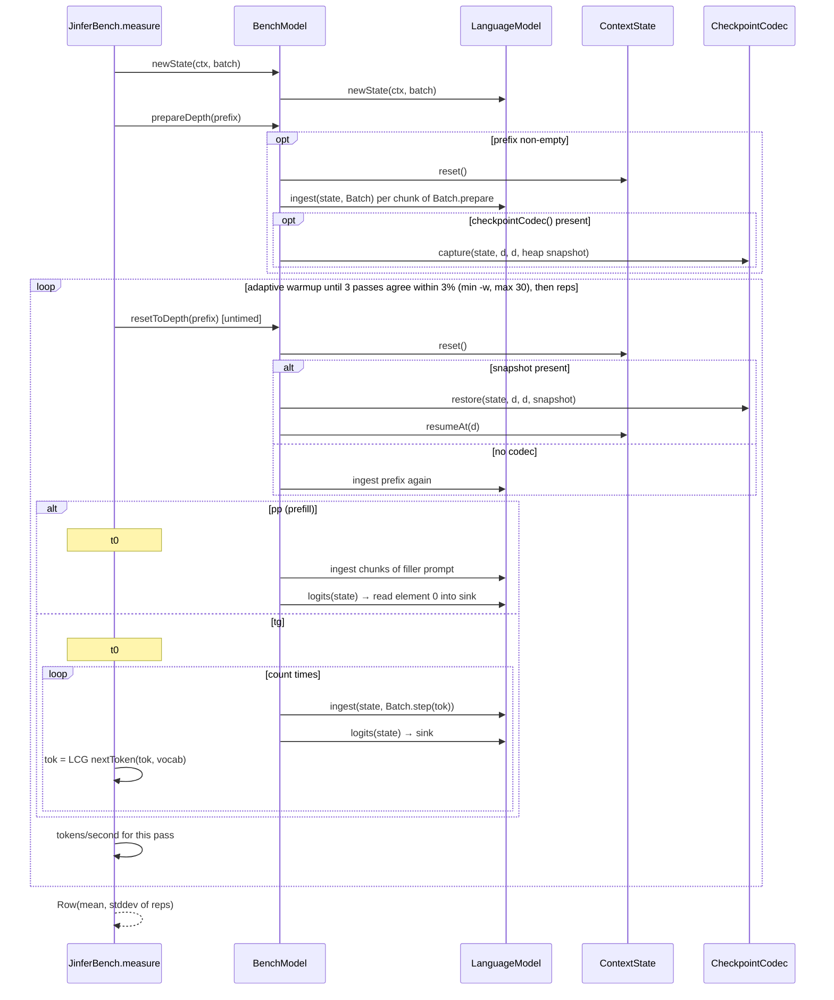

Synthetic tokens: `fillerTokens` gives `(i*17+1) % vocab`; `nextToken` is an LCG standing in for
llama-bench's `rand() % n_vocab`. The `volatile sink` keeps the logit projection from being eliminated.

---

## 4. JinferBench: capabilities pass

`capabilities` times a fresh state allocation, then builds **two** `ChatEngine`s over the same
`LoadedModel`: one with `PromptCache.Options.DEFAULTS` and a no-cache control
(`withRetainedSessions(0).withBlockBudget(0)`).

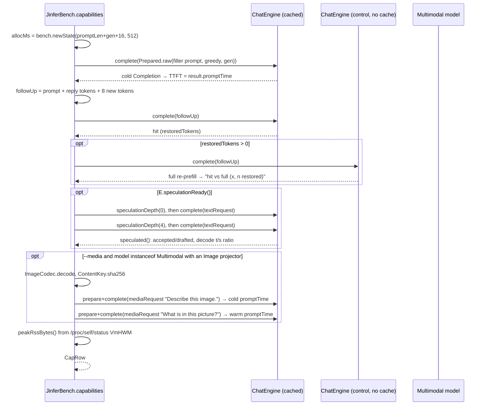

The MTP check uses a real chat-templated prompt (`textRequest`) rather than filler tokens, because a
draft head only accepts predictable text. The media warm pass asks a *different* question so only the
media cache, not the prompt cache, can serve it.

---

## 5. EmbedBench flow

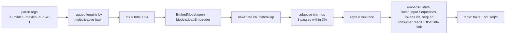

`runOnce` checks that exactly `nSeq` pooled vectors were streamed out, else throws.

---

## 6. TranscriptionBench and StreamSoak flows

### 6a. `TranscriptionBench`

Exactly one of `--librispeech` or `--audio` is required; `--gate` needs `--librispeech`. The model is loaded
into a shared `Arena` via `Models.loadTranscription`.

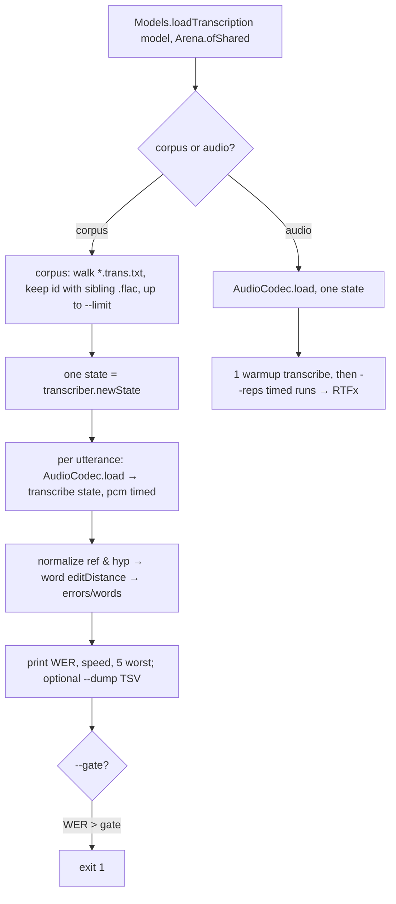

### 6b. `StreamSoak`

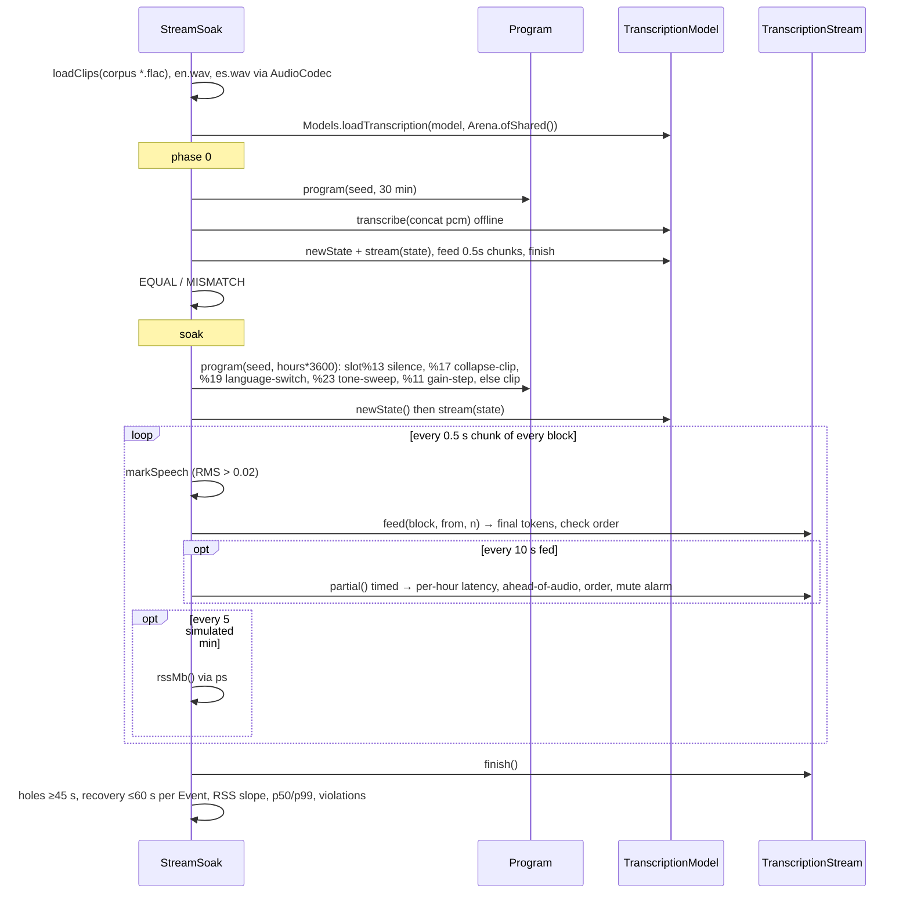

`newState` / `stream` are unchecked generic helpers that rebind the wildcard `TranscriptionModel<?, ?, ?>`
to a type variable `S extends RuntimeState`.

---

## 7. Kernel microbenches

All three run on `jinfer-core`/`jinfer-kernels` primitives with no model loaded.

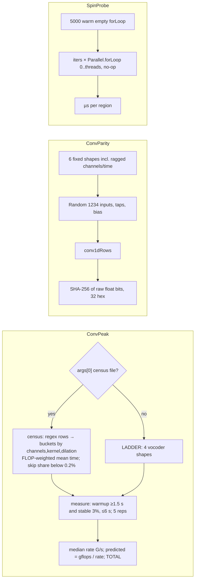

The conv tile shape is a static final read once per JVM (`-Djinfer.convTile=auto|4x2|4x4`), so both
conv tools are meant to be run once per tile value and their outputs compared.

---

## 8. Design notes

- **Generic, no per-model code** — `JinferBench`, `EmbedBench`, `TranscriptionBench` and `StreamSoak` all
  resolve models through `Models` (ServiceLoader over `jinfer-models-all`). The only architecture-specific
  code is the decision-checkpoint fallback naming `Lfm3` and `Qwen35`, which is why those two ports are
  compile-scope dependencies.
- **Allocation outside timing** — one state per test, `reset()` / `resetToDepth()` before every pass;
  `newState` returns its own elapsed time so it is reported separately (capabilities `state ms`).
- **Pinned compute width** — `UBATCH = 512` is a constant rather than `RuntimeFlags.BATCH_CAPACITY`, so
  `-Djinfer.batchCapacity` cannot change what is measured.
- **Adaptive warmup** — throughput must settle within 3% over a window of 3 (JIT needs more than
  llama-bench's single pass); `ConvPeak` additionally enforces a minimum warmup wall time.
- **Dead-code guards** — `volatile` `sink` fields in `JinferBench` and `EmbedBench`.
- **Self-describing output** — `header()` reports native image vs GraalVM JIT vs C2 (`Segments.FAST_VECTOR_JIT`),
  the loaded `JAM.providers()` ids, and the thread count source.
- **Memory measurement** — `JinferBench` reads Linux `VmHWM`; `StreamSoak` shells out to `ps -o rss=`.
