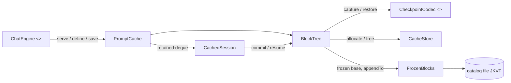

# jinfer-cache — architecture summary

`jinfer-cache` (package `com.qxotic.jinfer.cache`, 6 classes) is jinfer's **prompt / KV cache**: it lets a request
reuse model state already computed for an earlier prompt, in RAM and optionally across restarts through a catalog
file. It is model-agnostic. It depends on `jinfer-core` (`LanguageModel`, `ContextState`, `CheckpointCodec`,
`ContentKey`, `Batch`, `Arenas`), `jota-core`/`jota-memory` and `toknroll-core`, and declares no SPI services.
Detailed diagrams: [ARCHITECTURE.md](ARCHITECTURE.md).

## Where it sits

* **Above it**: `jinfer-chat`'s `ChatEngine` builds one `PromptCache` per loaded model and runs every generation
  through `PromptCache.serve`. `jinfer-native` (libjinfer) and `jinfer-cli` reuse `PromptCache.Options` (the shared
  context-capacity rule), and the CLI prints catalog files with `FrozenBlocks.describe`.
* **Below it**: each model family exposes an optional `CheckpointCodec` (`model.checkpointCodec()`) that copies a
  span of state to and from opaque memory. That interface is all the cache knows about a model. The model's identity
  comes in as a `ContentKey` seed (`Models.modelSeed` in jinfer-chat).

## Main concepts

| Concept | Class | In one line |
|---|---|---|
| Façade | `PromptCache` | The one production entry point: `of`, `serve`, `define`, `save`, `export`, `sample`, `close` |
| Retained sessions | `PromptCache` + `CachedSession` | The last N live states. A prompt that strictly extends one continues in place (`Tier.SESSION`) |
| Session / write handle | `CachedSession` | A state plus its exact fingerprint stream. Each ingested span commits as a block |
| Block layer | `BlockTree` | Prefix tree of self-contained KV blocks with chained SHA-256 keys, byte budget, LRU-leaf eviction |
| Persistent catalog | `FrozenBlocks` | The JKVF v4 file: lazy mmap, grafted under the tree as a never-evicted base, crash-safe append |
| Blob storage | `CacheStore` | One arena per blob, exact byte accounting, deterministic free |

## Key flows

1. **Construction**: `PromptCache.of(model, seed, options)` resolves the context capacity, then reads the codec. No
   codec means sessions-only (a configured catalog is then an error). Budget 0 with no catalog also means
   sessions-only. Otherwise a `BlockTree` is built over the mounted catalog. A fixed checkpoint overhead
   (`codec.byteSize(0)`) above `maxCheckpointOverhead` selects **define-only** blocks, where serving restores but
   does not write.
2. **Serve**: the prompt is fingerprinted and checked against the context capacity. The cache then tries a retained
   session the prompt strictly extends. In define-only mode it next tries a session's *tail snapshot* rewind. Failing
   both, it restores the longest block prefix into a recycled or fresh state (`Tier.BLOCKS`/`FRESH`). Only the
   missing part is ingested, one group per batch. Then the caller's `Pass` generates, wiring `Serving.tail` as its
   after-ingest hook. On success the session goes back to the pool. On an exception or an interrupted prefill it is
   discarded.
3. **Define / save / export**: `define` pins a prompt into the block layer and fails loudly if the budget refused it.
   `save` appends fresh blocks to the catalog. `export` freezes the whole tree into a new file, which also compacts
   it.

## Notable design choices

* **The law**: every resume stops one position short, so the last token is always re-ingested. The logits are
  therefore fresh, and cached output is identical to cold output.
* **Content addressing**: token ids are their own fingerprints. Media rows are fingerprinted by a SHA-256 of a
  content key or of the raw rows. Block keys chain a SHA-256 from a root derived from the model seed, so different
  models can never share blocks, and the cache treats a matching digest as proof of identity.
* **Every block is self-contained**: every block boundary is a resume point, and a miss or a corrupt block falls back
  to recomputation, never to a wrong answer. Frozen blobs are CRC32C-checked lazily on first use.
* **Tail granularity follows the codec**: residue-free codecs commit each decode token as its own block at no extra
  cost. Codecs that carry a residue commit one block per reply instead; the in-code comment cites 300x lower storage
  measured on LFM2.5.
* **The pool is the allocator**: when the pool is full, a miss recycles the least-recent state instead of
  allocating a new one.
* **Crash-safe, multi-writer catalog**: two checksummed commit slots, data forced to disk before publish, a JVM
  monitor plus a file lock, and merging against the disk's current view.
* **Single-threaded by contract** (the generation worker), with deterministic memory release. In a native image,
  frees fall back to GC because shared arenas are unavailable there.
