# jinfer-cache — class architecture

Package `com.qxotic.jinfer.cache` (6 classes + `package-info`, ~2840 lines). It is jinfer's **prompt (KV) cache**:
one production façade, `PromptCache`, over two layers — **retained sessions** (the last N live conversation states,
continued in place when a prompt strictly extends one) and an optional **block layer** (content-addressed,
budget-bounded KV checkpoints in RAM, optionally backed by an on-disk catalog file that survives restarts). The module
knows nothing about any particular model: a model contributes only a `CheckpointCodec`, storage is a `CacheStore`, and
identity is a `ContentKey` seed.

Dependencies (`pom.xml`): `jinfer-core`, `jota-core`, `jota-memory`, `toknroll-core`. No `META-INF/services` SPI —
the module is a plain library; its only resource is
`META-INF/native-image/com.qxotic/jinfer-cache/native-image.properties` (`--initialize-at-run-time=…CacheStore`,
because the store owns a `Cleaner` whose daemon thread cannot survive image build). JPMS automatic module name
`com.qxotic.jinfer.cache`.

Format: **Mermaid**. Legend: `..|>` implements; `--|>` extends; `-->` holds/uses; `..>` creates/depends;
`*--` owns (composition; label `nested` = nested type); classes marked `<<external>>` live outside this package.

1. [Position in the stack](#1-position-in-the-jinfer-stack)
2. [Class diagrams](#2-class-diagrams) — 2a overview, 2b `PromptCache` and its nested types, 2c block layer
3. [Construction: `PromptCache.of`](#3-construction-promptcacheof)
4. [Serving protocol: `serve`](#4-serving-protocol-serve)
5. [Block layer: resume and commit](#5-block-layer-resume-and-commit)
6. [Define / save / export and the catalog lifecycle](#6-define--save--export-and-the-catalog-lifecycle)
7. [Fingerprints and keys](#7-fingerprints-and-keys)
8. [JKVF file format (`FrozenBlocks`)](#8-jkvf-file-format-frozenblocks)
9. [Memory ownership](#9-memory-ownership)

| Class | Role |
|---|---|
| `PromptCache<S>` | Public façade, `AutoCloseable`. Nested `Options` (immutable config + the shared `contextCapacity` rule), `Tier` enum (`SESSION`/`BLOCKS`/`FRESH`), `Serving` interface (pass handle), `Pass<S,R>` functional interface, private `Live` (the `Serving` impl), `Sample` record. Owns the retained-session pool, the `BlockTree` and the `CacheStore` |
| `CachedSession<S>` | A live `ContextState` bound to its exact fingerprint stream; the block layer's *write handle* (commits each ingested span). Three modes: full, sessions-only (no tree), read-only (define-only serving). Also holds the optional *tail snapshot* used for coarse rewind |
| `BlockTree<S>` | The block layer's policy: prefix tree of variable-length KV blocks keyed by a chained SHA-256 (`BlockKey`), longest-prefix resume, commit with dedup, LRU-leaf eviction under a byte budget, frozen-base grafting, `freeze` / `appendTo`. Nested `BlockKey` record, inner `Block`, `Sample` record |
| `FrozenBlocks` | The on-disk artifact format **JKVF** v4: `createEmpty`, `open` (lazy mmap + validation), `describe`, `write`, crash-safe `append` (dual checksummed commit slots, file lock). Nested `Entry` and private `Commit` records |
| `CacheStore` | Blob allocator: one cross-thread arena per blob, deterministic `free`/`close`, exact `usedBytes()` for the budget, `Cleaner` backstop + `LeakWatch` |
| `Sha256` | Package-private helper: SHA-256 `MessageDigest` and digest → 4 little-endian longs |

---

## 1. Position in the jinfer stack

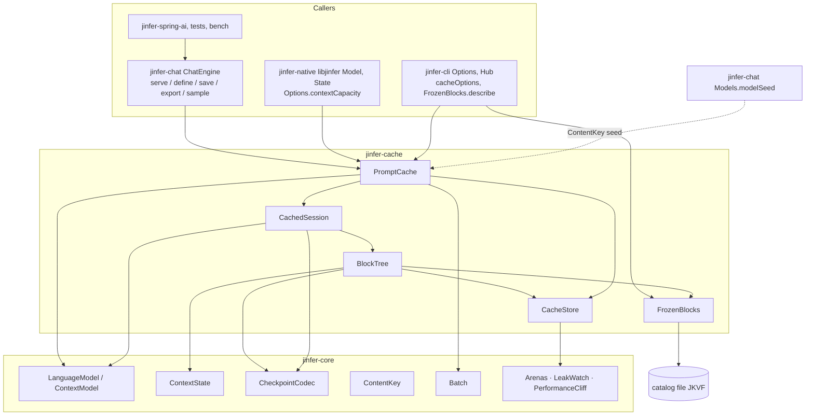

`ChatEngine` (jinfer-chat) is the production caller: it builds `PromptCache.of(loaded.model(), loaded.seed(), options)`,
runs every generation through `serve(prompt, pass, interrupt)` wiring `serving.tail(token)` /
`serving.tail(frame.row())` as the decoder's after-ingest hook, and exposes `define` / `export` / `save`. The CLI
reads catalog metadata with `FrozenBlocks.describe`; libjinfer and the CLI reuse
`PromptCache.Options.contextCapacity` as the one context-capacity rule.

---

## 2. Class diagrams

### 2a. Overview — relations between the package classes

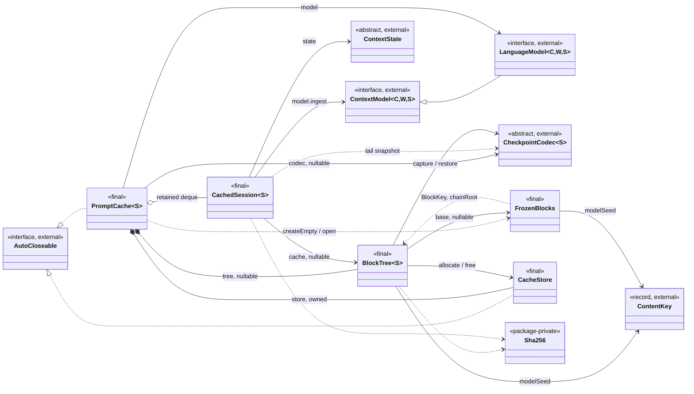

### 2b. `PromptCache` and its nested types

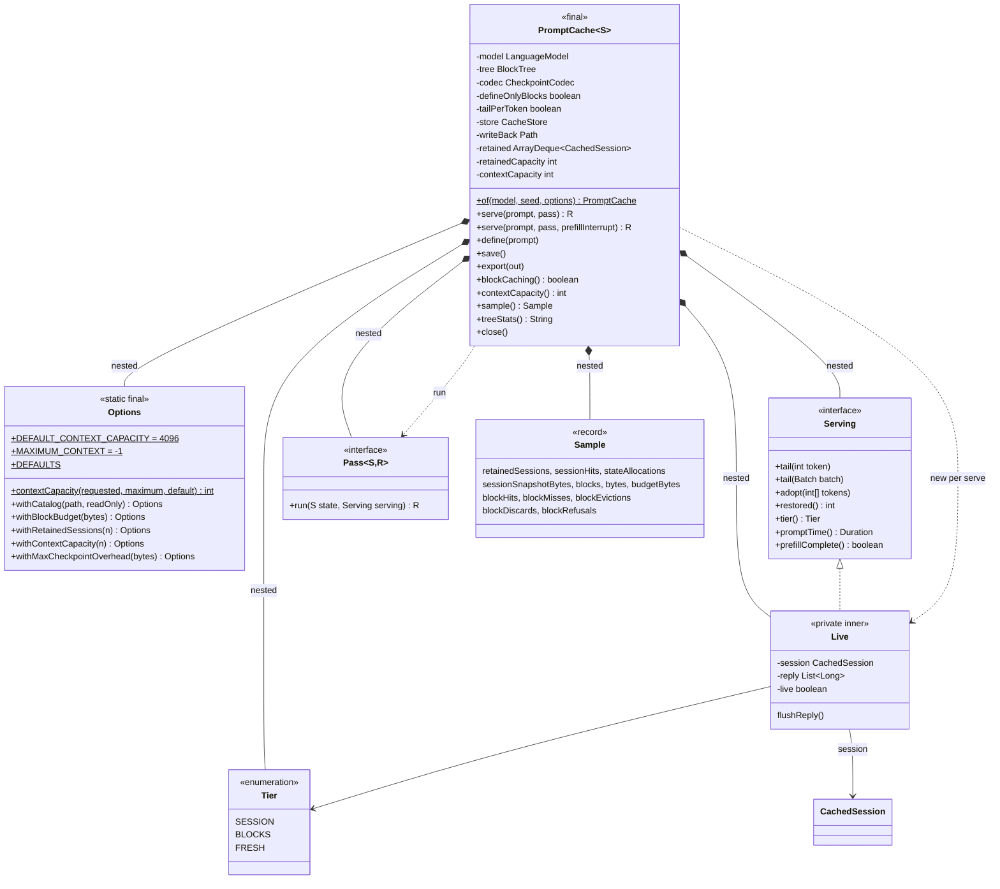

`Options.DEFAULTS` = 4 retained sessions, context capacity `0` (→ 4096 or the model's length if smaller), 2 GiB RAM
block budget, no catalog, 1 MiB max checkpoint overhead. `withBlockBudget(0)` disables the block layer.

### 2c. Block layer — `CachedSession`, `BlockTree`, `FrozenBlocks`, `CacheStore`

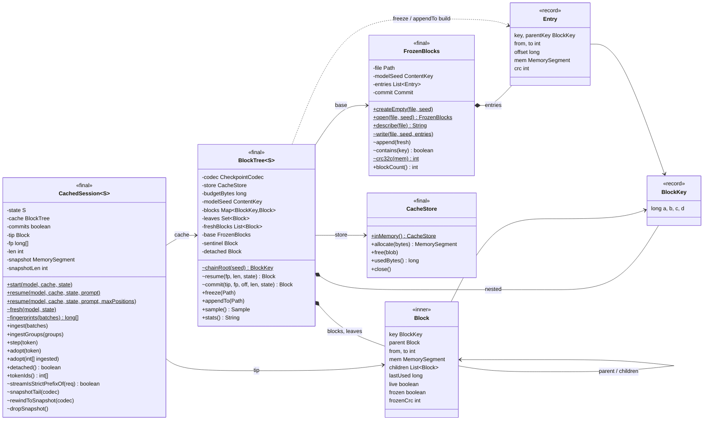

---

## 3. Construction: `PromptCache.of`

`of` is the only constructor. It resolves the context capacity, reads the model's capabilities and picks one of three
shapes.

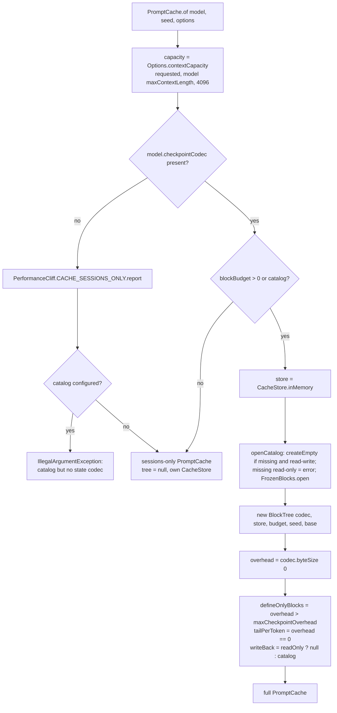

The three derived modes:

| Mode | Condition | Effect |
|---|---|---|
| sessions-only | no codec, or budget 0 and no catalog | `tree == null`; sessions still continue in place; `define`/`export` throw |
| define-only blocks | `codec.byteSize(0) > maxCheckpointOverheadBytes` | serving restores but never commits (`commits=false`); only `define` writes; enables the *tail snapshot* coarse rewind |
| full | otherwise | every ingested span commits; `tailPerToken` when the codec carries no fixed residue (`byteSize(0) == 0`), else the reply commits as one block |

---

## 4. Serving protocol: `serve`

Cheapest source first: retained session → block prefix → fresh prefill. The prompt is ingested **before** the pass
runs; the pass only generates.

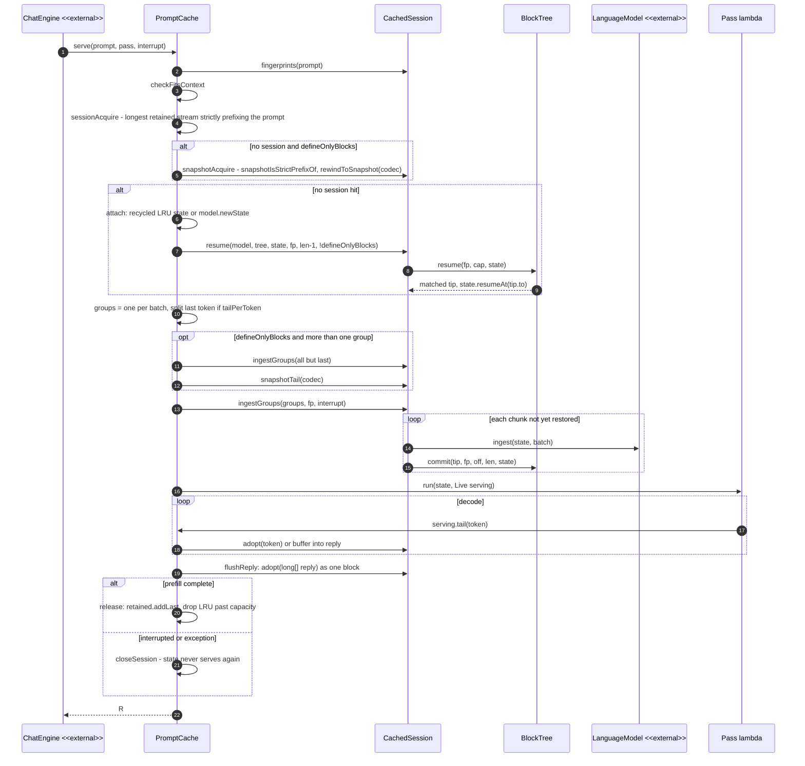

Key rules visible in the code:

* **The law** — every resume is capped at `fingerprints.length - 1` positions, so the last position is always
  re-ingested and logits are fresh; a cached answer equals a cold one.
* `Tier` is `SESSION` on a session/snapshot hit, `BLOCKS` when `restored > 0`, else `FRESH`.
* On a residue-free codec (`tailPerToken`), a final multi-token `LAST`-output prefill batch is split into
  `[ids..n-1] + [last]` so an identical future prompt can full-hit.
* `Live` expires when the pass returns: `tail`/`adopt` afterwards throw `IllegalStateException`.
* `release` discards a session whose stream length disagrees with `state.position()` (a caller that did not wire
  `tail`) and logs a warning — it must never poison future matches.
* With the pool full, a miss *recycles* the least-recent state (`dropSnapshot`, `reset`) instead of allocating:
  "the pool is the allocator".

---

## 5. Block layer: resume and commit

### 5a. `BlockTree.resume`

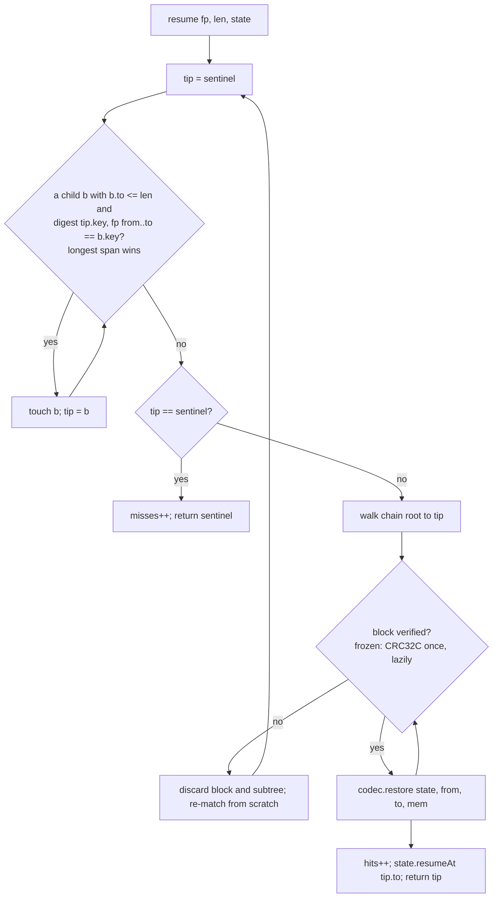

### 5b. `BlockTree.commit` (called by `CachedSession.commitSpan`)

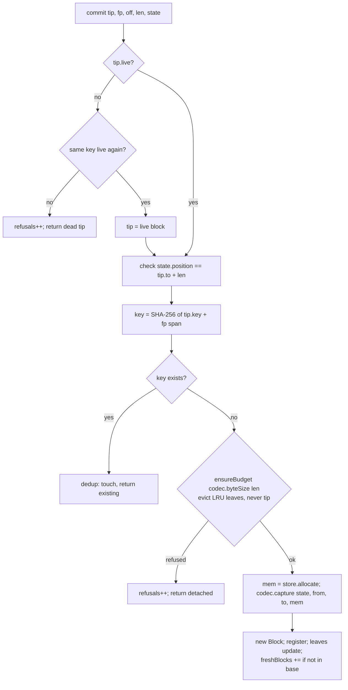

Eviction is **leaf-only LRU**, so every surviving chain stays contiguous; frozen (grafted) blocks are never leaves,
never evicted and never freed. A refused commit *detaches* the session (`CachedSession.detached()`); its state stays
valid for session reuse, it just stops reaching the shared tree. `define` turns a detach into an exception.

---

## 6. Define / save / export and the catalog lifecycle

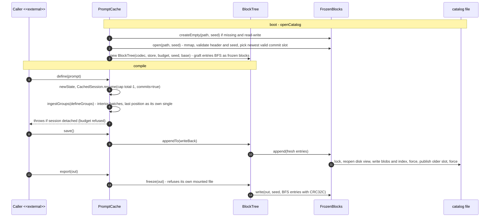

`appendTo` recreates the whole file via `freeze` when the catalog was deleted mid-run, then remounts it. `append`
serializes writers JVM-wide (`synchronized (FrozenBlocks.class)`) and cross-process (`FileChannel.lock`), merges
against what is *already on disk*, and refuses with an `IOException` when a fresh block's parent is on neither side
(catalog rebuilt since mount). Each append leaves the previous index as dead bytes; `export` to a fresh file is the
compaction.

---

## 7. Fingerprints and keys

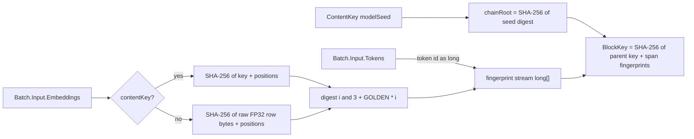

* `CachedSession.fingerprints(List<Batch>)` is the one fingerprint law, used both to match before ingest and to
  append during ingest. Media rows must be Panama-backed (`MemorySegment`) or fingerprinting throws.
* The chained `BlockKey` names the whole prefix; being cryptographic, matching trusts it as identity (no fingerprint
  storage, no collision handling).
* The model seed roots the chain, so two models (even sharing a tokenizer) can never match each other's blocks, and a
  catalog built under another seed fails `open` with an identity diff message.

---

## 8. JKVF file format (`FrozenBlocks`)

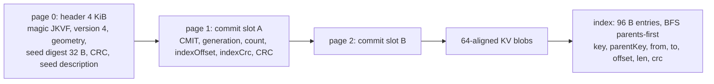

`open` maps only up to the chosen commit's `committedLength` (automatic arena — unmapped by GC), validates every index
entry (span, alignment, parent precedes child, continuity, no duplicate keys) and leaves blob CRCs lazy
(`BlockTree.verified`). A torn publication falls back to the other slot. `describe` reports everything the file says
about itself, verifying all checksums, without needing a model.

---

## 9. Memory ownership

| Memory | Owner | Freed by |
|---|---|---|
| RAM block blobs | `CacheStore` (one `Arenas.newCrossThread()` arena per blob) | `BlockTree.unlink` → `store.free`; `PromptCache.close` → `store.close` |
| Frozen block blobs | mmap slices of `FrozenBlocks` (`Arena.ofAuto()`) | GC once unreachable; never counted against the budget |
| Retained states | `PromptCache.retained` | `closeSession` → `ContextState.close` |
| Tail snapshot | `CachedSession` (own cross-thread arena) | `dropSnapshot` (every session end path calls it) |

`CacheStore` frees deterministically (shared arenas) on the JVM; in a native image `Arenas.newCrossThread()` yields
automatic arenas (shared-arena support conflicts with the Vector API), so frees become GC-eventual while the byte
accounting stays exact. A `Cleaner` backstop sweeps an abandoned store, and `LeakWatch.arm` reports one that was never
closed. Everything in the package is single-threaded by contract (the generation worker); only
`CacheStore.usedBytes()` is meant to be read from other threads.
