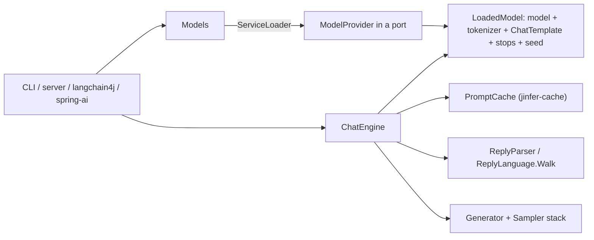

# jinfer-chat — architecture summary

`jinfer-chat` is jinfer's **framework-neutral chat runtime**: everything between "a GGUF file on disk" and "a
streamed, structured assistant reply", without any web or framework type. Two packages, ~42 top-level types,
~11 k lines: `com.qxotic.jinfer.chat` (conversation model, loading, templates, parsing, engine) and
`com.qxotic.jinfer.llm` (sampling, grammar, decode loop, model capability interfaces).
Details and all diagrams: [ARCHITECTURE.md](ARCHITECTURE.md).

## Where it sits

- **Below it**: `jinfer-core` (`LanguageModel`, `ContextState`, `Batch`, media types), `jinfer-cache`
  (`PromptCache`), `jinfer-jinja` (template renderer), `jinfer-kernels` (`Ops.argmax`, ...), `toknroll-core`
  (`Tokenizer`), `gguf`, `json`.
- **Beside it**: every `jinfer-<model>` port depends on it to implement `ModelProvider` (registered in
  `META-INF/services/com.qxotic.jinfer.chat.ModelProvider`) and usually a native `ChatTemplate`.
- **Above it**: `jinfer-cli`, `jinfer-server`, `jinfer-langchain4j`, `jinfer-spring-ai`, `jinfer-native`, ... map
  their own request types into `ChatEngine.Request` and drive `ChatEngine`.

## Main concepts

- **Conversation model** — `Message` (role + ordered `Content`: `Text`, `Reasoning`, `ToolCall`, `ToolResult`,
  `Media`), `Tool`, `Conversation` (validates that every tool result answers an open call), `Channel`, `Modality`.
  A generated reply carries a `Verbatim` record (exact token ids, speech frame codes, model seed) so later turns
  replay what the model actually wrote.
- **Loading** — `Models.load / loadEmbedder / loadReranker / loadDecisionModel / loadSpeech / loadTranscription`
  read the GGUF header, choose the provider for `general.architecture` (priority, then class name), validate
  companion files (e.g. `media` → mmproj) and tokenizer overrides, then compute the cache identity
  (`modelSeed`: sampled SHA-256, re-keyed with companions and media decoder/plan ids). Results are data records:
  `LoadedModel` (with layered `SamplingDefaults`), `LoadedEmbedder`, `LoadedReranker`, or a `DecisionModel`.
- **Templates** — `ChatTemplate` is a family's bidirectional codec: `encode` streams prompt `Batch`es (through
  `PromptWriter`) and returns a reply parser already seeded with the prompt-owned reply prefix; it also declares think
  markers, thinking policy, constrained-reply and forced-call languages. When a port has no codec, the conversation
  cannot be framed natively (`UnsupportedConversation`), or unknown template kwargs are given, `ChatEngine` falls back
  to `JinjaChatTemplate`, a scrubbed whole-render of the GGUF's Jinja template (ChatML if none).
- **Reply language** — `ReplyLanguage` describes a family's reply as one `Node` tree; a compiled `Selection` yields a
  `Walk` that is simultaneously the parser, the logit mask, and (via `forcedPrefix`) the forced-call seed. Byte-level
  payloads compile to `llm.Grammar` (GBNF → pushdown CFG with per-state mask cache). `SpansReplyParser` is the simpler
  marker-span fallback; `ToolCallSyntax` parses call payloads (JSON envelope, XML forms).
- **Sampling** — `Sampling` → `Samplers` (argmax / top-k / dense with top-p, min-p, temperature), wrapped by
  `Sampler.banning`, `Thinking.banMarkers` or `Thinking.capBudget` (reasoning budget with a forced paragraph break and
  close), and finally a `Walk.sampler` for grammars, forced calls or the structural guard.
- **Decode** — `Generator.generate` prefills (re-chunked to the state's batch capacity) and samples/ingests until
  stop token, budget, context wall, deadline or listener abort. Models may also implement `SpeculativeDecoding`
  (self-speculation) or `SpeechOutput` (spoken replies, decoded in `ChatEngine.speak`).

## Key flow: one chat request

1. `ChatEngine.prepare(Request)`: think-floor (`THINK_FLOOR` = 16) and thinking-policy checks, output modality check,
   `encode` (native first, Jinja fallback), sampler stack, grammar / guard / forced-call walk → `Prepared`.
2. `complete(Prepared, ReplySink)`: under the generation lock, `PromptCache.serve` restores from a retained
   `SESSION`, cached `BLOCKS`, or prefills `FRESH`; then plain `Generator`, speculation, or speech decoding.
3. Every token is fed to the `ReplyParser`; reasoning streams as `Delta(REASONING)`, content goes through the
   `TextStops.Holdback` stop-string filter as `Delta(CONTENT)`; generation also stops when the reply grammar ends.
4. `parser.finish()` builds the `Message`, a `Verbatim` record is attached, and a `Completion` (tokens, timings,
   cache tier, restored tokens, reasoning tokens, speculation stats) is returned and recorded as an `InferenceEvent`.

## Notable design choices

- **SPI dispatch, no hard-coded arch table** — ports are discovered by `ServiceLoader`; a reflective fallback list
  only rescues shaded jars that dropped `META-INF/services`.
- **Native codec first, prefix-stable prompts** — each `PromptWriter.flush()` is a turn boundary and a cache block, so
  growing conversations reuse cached KV; cached prompts (`definePrompt`) require the native codec.
- **Untrusted text never mints control tokens** — `PromptWriter.text` tokenizes plainly; the Jinja path scrubs
  special-token spellings with a zero-width space.
- **One definition, three faces** — the reply language parses, constrains and forces from the same tree.
- **Data, not behaviour** — `LoadedModel` is an immutable record; stop-token order is preserved because the first
  stop is emitted to end constrained replies.
- **Explicit concurrency** — one generation per engine (fair lock), prepares in parallel under a read lock, a single
  lazy streaming thread with a bounded queue, and a blocking `close()` that is the quiescence certificate.
