# jinfer-chat — class architecture

Packages `com.qxotic.jinfer.chat` (34 top-level types) and `com.qxotic.jinfer.llm` (8 top-level types), ~11 160
lines. It is the **framework-neutral chat runtime** of jinfer: the portable conversation model (`Message`,
`Content`, `Tool`, `Conversation`), the `ModelProvider` SPI and the `Models` loader that dispatches a GGUF to the
right `jinfer-<model>` port, the `ChatTemplate` codec contract that ports implement, reply parsing/constraining
(`ReplyParser`, `ReplyLanguage`, `Grammar`), sampling (`Sampling`, `Sampler`), the token decode loop (`Generator`),
and `ChatEngine`, which ties it all to `jinfer-cache`'s `PromptCache` and is what the CLI, server, langchain4j and
spring-ai adapters drive.

Format: **Mermaid**. Legend: `..|>` implements; `--|>` extends; `-->` holds/uses; `..>` creates/depends;
`*--` composition; classes marked `<<external>>` live outside this module.

1. [Position in the stack](#1-position-in-the-jinfer-stack)
2. [Class diagrams](#2-class-diagrams) — 2a loading/SPI, 2b conversation model, 2c engine, 2d reply side, 2e sampling & decode
3. [Model loading (`Models`)](#3-model-loading)
4. [Request lifecycle (`ChatEngine`)](#4-request-lifecycle) — 4a prepare, 4b encode, 4c complete/generate
5. [Reply parsing and constraining](#5-reply-parsing-and-constraining)
6. [Sampler stack](#6-sampler-stack)
7. [Prompt building and media caching](#7-prompt-building-and-media-caching)
8. [Retrieval and decision faces](#8-retrieval-and-decision-faces)
9. [Concurrency and lifecycle](#9-concurrency-and-lifecycle)

### `com.qxotic.jinfer.chat`

| Class | Role |
|---|---|
| `ModelProvider` | SPI interface (`ServiceLoader`, `META-INF/services/com.qxotic.jinfer.chat.ModelProvider`) a port implements: `architectures()`, `priority()`, `companionFiles()`, `retrieval(gguf)`, `loadLanguage/loadEmbedder/loadReranker/loadDecisionModel/loadSpeech/loadTranscription`. Nested `Retrieval` enum, `IncompatibleModelException` |
| `Models` | Static loader: discovers providers, opens the GGUF, selects provider by `general.architecture`, validates companions and tokenizer id-space, attaches sampling defaults and the cache seed (`modelSeed`, `companionSeeded`) |
| `LoadedModel<S>` | Record: `LanguageModel` + `Tokenizer` + Jinja source + ordered stop tokens + `ContentKey` seed + optional native `ChatTemplate` + nested `SamplingDefaults` |
| `LoadedEmbedder<S>` | Record around an `EmbeddingModel`: prefix/suffix tokens, dimension (Matryoshka min), query/document prefixes; `embedAll` packs texts greedily, `embed` for multimodal parts |
| `LoadedReranker<S>` | Record around a `ContextModel` + `Reranker`; `scoreAll` with telemetry |
| `DecisionModel` | Interface for probability-answering models; sealed `Question` = `Predicate` / `Choice` / `Rating`, `Option` |
| `ChatEngine` | The runtime: owns lock, `PromptCache`, `MediaEncodingCache`, `JinjaChatTemplate`, stream driver; nested `Request`(+`Builder`), `Prepared`, `Encoded`, `ForcedTool`, `Outcome`, `Delta`, `ReplySink`, `Completion`, `Spoken` |
| `ChatTemplate` | Interface: a family's bidirectional chat codec (`encode` → `ReplyState`, `parser`, `constrainedReply`, `forcedCall`, `thinkMarkers`, `thinkingPolicy`, `replyForbidden`, `mediaPositions`) |
| `JinjaChatTemplate` | Package-private whole-render fallback over `jinfer-jinja`; scrubs special-token spellings out of request strings, ChatML fallback when no template |
| `RenderMaps` | Package-private: `Conversation` → OpenAI-shaped maps for the Jinja render; `promptId` hashing |
| `PromptWriter` | Streaming prompt builder used by native templates: trusted ids, untrusted text, `trusted` spellings, `replay(Verbatim)`, `media`, `cachedMedia`, `flush` = cache-block boundary |
| `MediaEncodingCache` | Bounded LRU (`jinfer.mediaCacheMB`, default 192 MiB) of projected media batches keyed by `ContentKey` + batch capacity |
| `UnsupportedConversation` | Exception a native template throws to punt to the Jinja whole-render |
| `ReplyParser` | Interface: stateful single-use reply decoding (`seed`, `feed` → `Fragment`, `channel`, `finish`); factories `spans(...)`, `dropping(...)` |
| `SpansReplyParser` | Package-private marker-span parser (think span + optional call spans) |
| `SpanToolCallDetector` | Package-private: detects call spans delimited by special-token ids |
| `ReplyLanguage` | One reply grammar tree (`Node`: `Seq/Alt/Repeat/Bytes/Mark/Free/Gbnf/Region`) giving three faces: `Walk` (parse + mask), `Selection` (compiled, `forcedPrefix`), `Spans` preset |
| `JsonEnvelopeReplies` | Shared ChatML JSON-envelope forced-call language (SmolLM3, Granite, Mellum) |
| `ToolCallSyntax` | Parsers for call payloads: JSON envelope, XML function form, tagged XML; Jinja value helpers |
| `Thinking` | Package-private sampler wrappers: `banMarkers`, `capBudget` (reasoning budget with forced close) |
| `TextStops` | Stop-string truncation (`apply`) and streaming `Holdback` |
| `PendingUtf8`, `ContentBuilder`, `JsonValues` | Package-private helpers: incremental UTF-8, reply content runs, immutable JSON copies |
| `JsonCodec` | Bridge to the `com.qxotic:json` library (`Json.NULL` ↔ `null`) |
| `Message`, `Content`, `Role`, `Tool`, `Conversation`, `Channel`, `Modality`, `Verbatim` | Portable conversation value types (records / sealed interface / enum) |

### `com.qxotic.jinfer.llm`

| Class | Role |
|---|---|
| `Generator` | Static decode loop: prefill (re-chunked to state batch capacity), sample/ingest until stop, budget, context wall, deadline or abort; `Constraints`, `GenerationListener`, `GenerationResult`, `FinishReason` |
| `Sampler` | Functional interface `sampleToken(logits)`; `ARGMAX`, `banning(...)` |
| `Sampling` | Record (temperature, topP, topK, minP, seed); `sampler(vocab)` → `Samplers.create` |
| `Samplers` | Package-private implementations: argmax, compact top-k path, dense path |
| `Grammar` | GBNF → byte-level pushdown CFG; `Spec` (per-state mask cache), `Cursor`, `Term` builder, `json`, `fromSchema`, `choice` |
| `SpecialTokens` | Special-token lookup over toknroll's `Vocabulary`: `find`, `stops`, `bos/eos`, `isSpecial`, `spellings`, `encoder` |
| `SpeculativeDecoding<S>` | Capability interface a model implements for self-speculation (`speculate`, `SpeculationResult`) |
| `SpeechOutput<S>` | Capability interface a model implements to speak (`Speaker`, `Lane`, `Frame`) |

---

## 1. Position in the jinfer stack

From `pom.xml`: depends on `jota-core`, `jota-memory`, `jinfer-core`, `jinfer-codecs`, `jinfer-kernels`,
`jinfer-cache`, `toknroll-core`, `gguf`, `jinfer-jinja`, `json` (test: `jinfer-testkit`). Every `jinfer-<model>` port
and every front end depends on it.

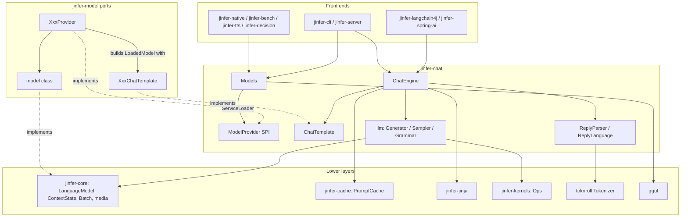

`ModelProvider` registrations found under `src/main/resources/META-INF/services/`: bailingmoe3, gemma4,
gemma-embedding2, gptoss, inflect2, kokoro, laguna, lfm2, lfm3, llama, maple, mellum, nemotronh, parakeet, qwen3,
qwen35. Native `ChatTemplate` implementations live in those ports (e.g. `Qwen35ChatTemplate`, `Gemma4ChatTemplate`,
`GptOssChatTemplate`, `Lfm2ChatTemplate`, `Llama32ChatTemplate`, `MistralChatTemplate`, `SmolLm3ChatTemplate`, ...).

---

## 2. Class diagrams

### 2a. Loading and the provider SPI

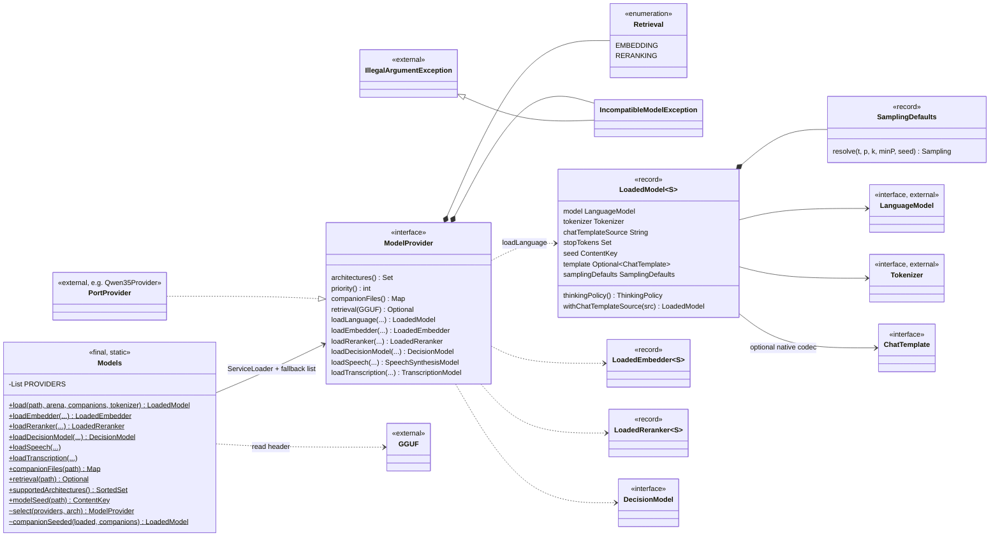

### 2b. Conversation value model

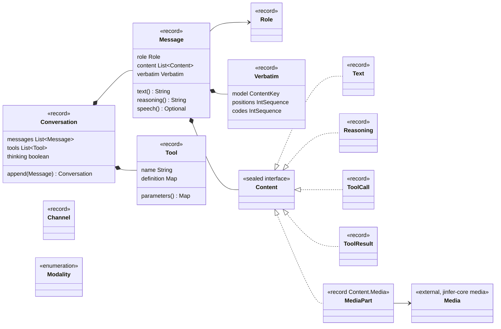

`Conversation` enforces at construction that every `ToolResult` answers an earlier open `ToolCall` (by id, else
oldest id-less call). `Tool` and `ToolCall` deep-freeze their JSON maps through `JsonValues`. `Channel`
(`CONTENT`, `REASONING`, `TOOL_CALL`, `COMMENTARY`) labels streamed deltas; `Modality` (`TEXT`, `AUDIO`, `IMAGE`,
`VIDEO`) is what a request allows as output.

### 2c. The engine

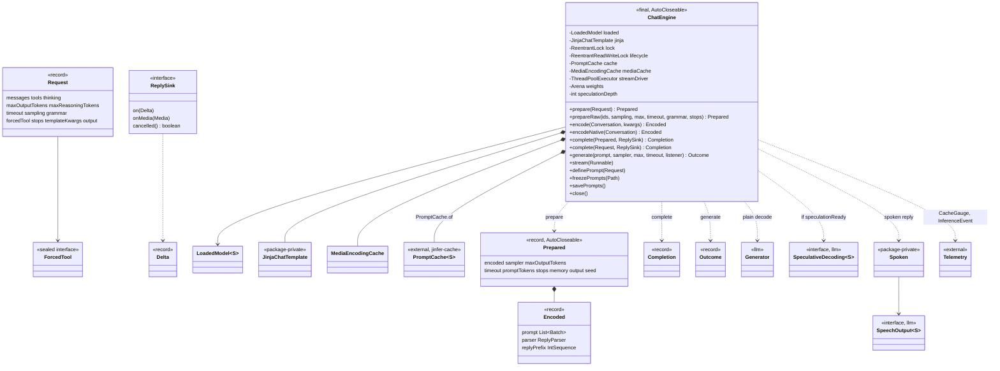

### 2d. Reply side: templates, parsers, reply language

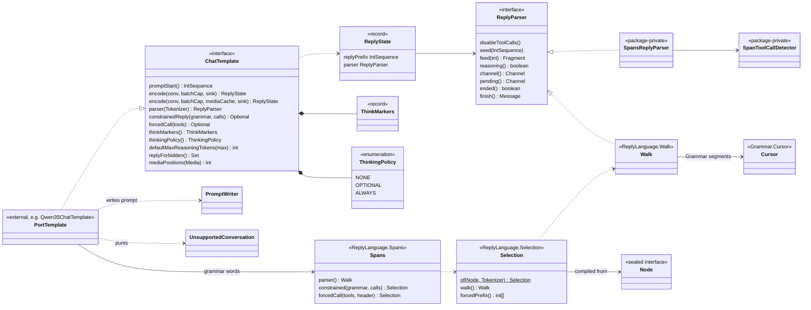

### 2e. Sampling and decode (`com.qxotic.jinfer.llm`)

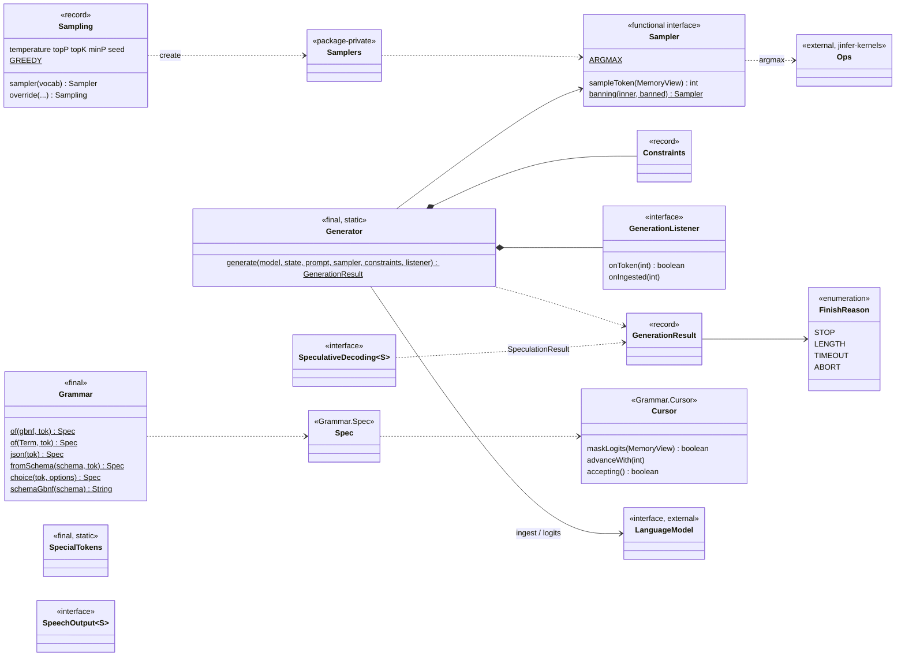

---

## 3. Model loading

`Models.PROVIDERS` is filled once by `ServiceLoader.load(ModelProvider.class)`; if that finds nothing (typically a
shaded jar without merged `META-INF/services`), it instantiates the hard-coded `KNOWN_PROVIDER_CLASSES` reflectively
and logs a warning. `select` picks the highest `priority()`, ties broken by class name with a warning.

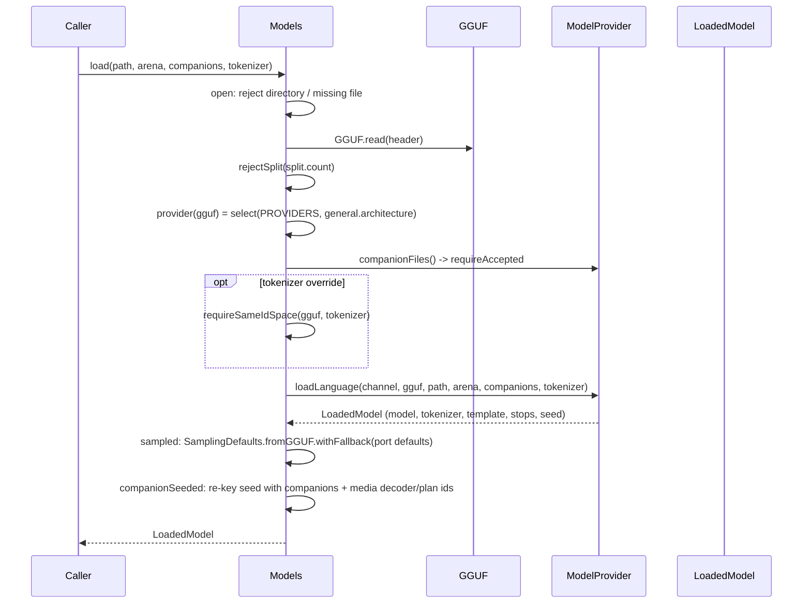

- An unknown architecture throws with the Maven artifact to add (`PORT_ARTIFACTS`, longest-prefix match —
  diagnostics only).
- `loadEmbedder` / `loadReranker` first call `requireRetrieval`, refusing a checkpoint whose header names the other
  retrieval face.
- `modelSeed` is SHA-256 over the file size plus five 1 MiB samples (domain `jinfer:model:sampled:v2`); it is the
  `PromptCache` identity, and `companionSeeded` composes it as `jinfer-cache/1 model=... companion:x=...`.
- Default `load*` methods on `ModelProvider` throw `IncompatibleModelException` (e.g. `'lfm2' is not a speech
  architecture`), which callers like the CLI server catch to try the next loader.

---

## 4. Request lifecycle

### 4a. `prepare(Request)` — lowering a request

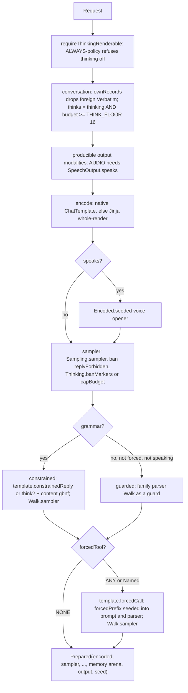

`prepareRaw` is the completion path for pre-tokenized prompts: it prepends `promptStart`, builds the `Sampling`
sampler, optionally wraps a `content(gbnf)` walk, and returns `Prepared.raw` with a null parser.

### 4b. `encode` — native first, Jinja fallback

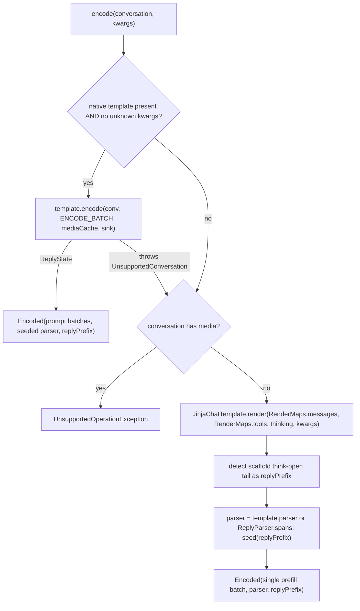

The sink wraps every batch with `own(batch, arena)`, copying borrowed embedding rows into the request's `Prepared`
arena. `encodeNative` (used by `definePrompt`) has no fallback: cached prompts require the native codec's
turn-stable batching.

### 4c. `complete` and `generate`

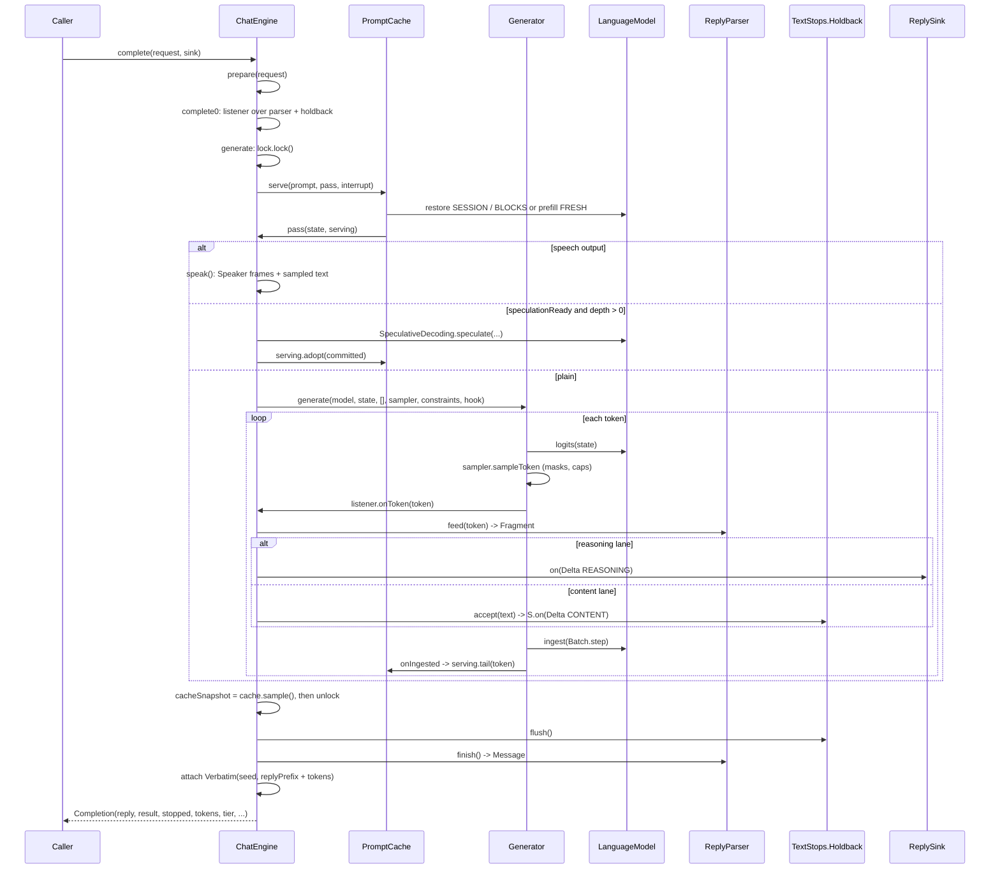

- The listener stops generation when the sink cancels, a stop string fires, or the parser `ended()` (control rule);
  an `ABORT` caused by an ended grammar is rewritten to `STOP`.
- A cancelled pass returns a `Completion` with a null `reply`; a prefill cut short by the deadline returns an empty
  `TIMEOUT` result.
- Every returned assistant `Message` carries a `Verbatim` record so a later turn can be replayed byte-exactly
  (`PromptWriter.replay`) and recognized by the prompt cache; `ownRecords` drops records from other model seeds.

---

## 5. Reply parsing and constraining

Two `ReplyParser` implementations exist in this module:

- `SpansReplyParser` (via `ReplyParser.spans(...)`): token-id driven think span (`<think>`/`</think>` or family
  markers) and, optionally, call spans through `SpanToolCallDetector` with a payload parser (e.g.
  `ToolCallSyntax::parseBlock`). Used as the generic fallback.
- `ReplyLanguage.Walk`: produced from a compiled `Selection` over a `Node` tree. The same object parses (`feed`),
  constrains (`maskLogits`, `sampler(base, endTurn)`), and the `Selection` derives the **forced prefix** (the leading
  run of marks with a single admissible path) used for forced tool calls.

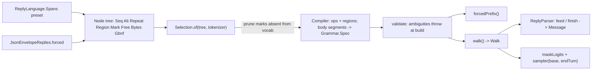

The **control rule** (from the class javadoc): `Free` admits plain tokens only; a control token either matches a
`Mark` the language expects at the current state, or ends the reply. `ChatEngine.guarded` uses a fresh walk of the
family parser as a sampler guard on otherwise free replies; `constrained` uses either the family's
`constrainedReply` or a generic `think? content(gbnf)` tree. Call payload text inside `CALL` regions is turned into
`Content.ToolCall`s by functions from `ToolCallSyntax` (JSON envelope, XML function form, tagged XML) or a port's own.

---

## 6. Sampler stack

Samplers are composed by wrapping (`Sampler` is a functional interface over a logits `MemoryView`):

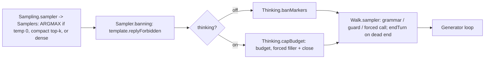

`Thinking.capBudget` counts tokens inside the think span and, when the budget is spent, forces `"\n\n"` (or the
request's `reasoningCutoffMessage` wrapped in breaks) followed by the close marker, then bans both markers.
`startInThink` is armed when the prompt's `replyPrefix` already contains the open marker. The reasoning budget
defaults to `ChatTemplate.defaultMaxReasoningTokens` (half the output budget). `Grammar.Cursor.maskLogits` masks to
tokens whose full byte string the pushdown CFG accepts; masks are cached per matcher state on the `Spec`.

---

## 7. Prompt building and media caching

Native templates in ports write prompts through `PromptWriter`:

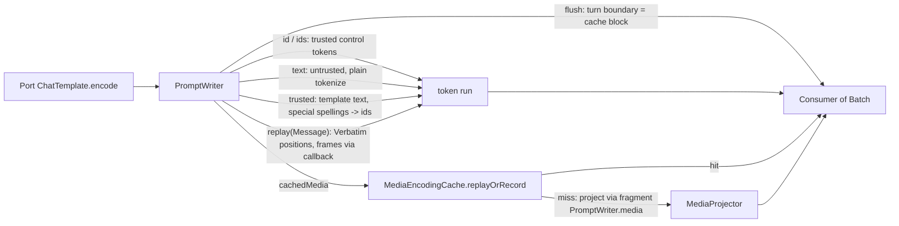

`flushTokens` splits runs into `Batch.prefill` chunks of `batchCapacity`; each flushed batch becomes one
`PromptCache` block, so a conversation growing by one turn reuses the earlier blocks. `MediaEncodingCache` keys on
`(ContentKey, batchCapacity)`, copies embedding rows to `float[]`, evicts LRU over its byte budget and refuses
(serves but does not retain) entries larger than the whole budget. The Jinja whole-render (`JinjaChatTemplate`)
produces a single batch, scrubs every special-token spelling except think markers out of request strings with a
zero-width space, opens/closes the think span on the render's tail when needed, and falls back to ChatML when the
GGUF has no template.

---

## 8. Retrieval and decision faces

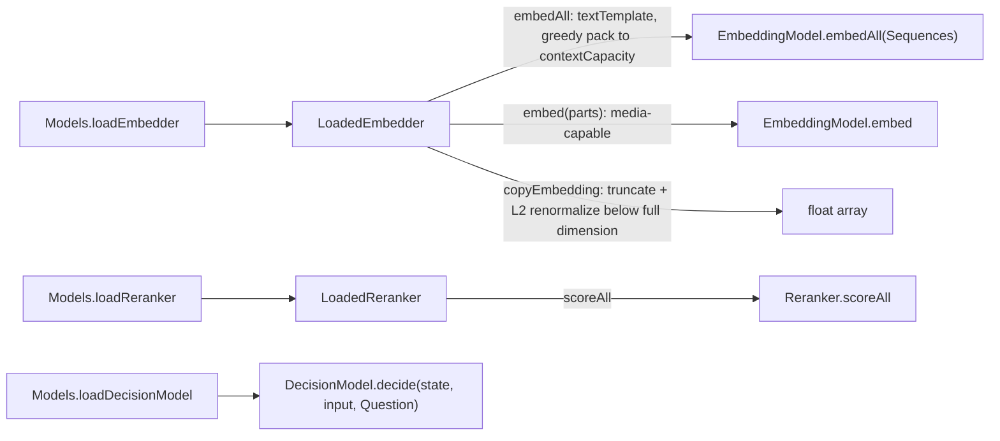

All three record an `InferenceEvent` (`EMBEDDINGS`, `RERANK`) for telemetry. `DecisionModel` answers
`Predicate`/`Choice`/`Rating` questions with one probability per option; `decide` over several questions defaults to
`decideIndependently`.

---

## 9. Concurrency and lifecycle

- **Generation lock**: a fair `ReentrantLock`; one generation at a time per engine, others queue. `PromptCache` is
  only touched under it; the JFR `CacheGauge` reads a volatile `cacheSnapshot` published after each pass.
- **Lifecycle lock**: `prepare`/`encode` take the read side so a request can be prepared while another generates;
  `close()` takes the write side before freeing caches and weights.
- **Stream driver**: a `ThreadPoolExecutor` with at most one lazy `jinfer-stream` thread (60 s idle) and a bounded
  queue (`-Djinfer.chat.streamQueueCapacity`, default 1024, -1 unbounded, 0 refused at class load).
- **Ownership**: `new ChatEngine(Path ...)` loads into `Arenas.newCrossThread()` and frees it at `close()`; the
  `ChatEngine(LoadedModel, ...)` constructor borrows the caller's arena. `Models` refuses confined arenas.
- **`close()`** refuses to run from the streaming thread or from inside a generation callback, waits for
  quiescence, closes the `PromptCache`, clears the media cache, unregisters telemetry, disarms `LeakWatch`.
- **Speculation**: `speculationDepth(0..8)`, default 0 (plain decoding).
