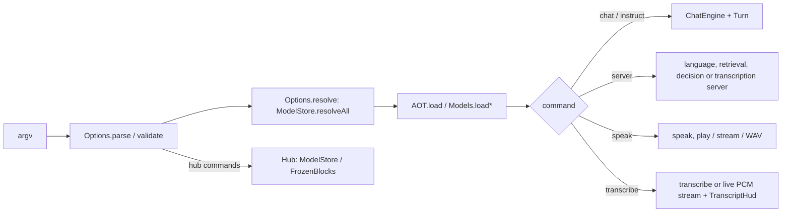

# jinfer-cli — architecture summary

`jinfer-cli` is the `jinfer` command-line application: the top of the jinfer stack, shipped as a shaded jar
(`jinfer.jar`) or a GraalVM native image (`jinfer`), main class `com.qxotic.jinfer.cli.Main`. One package,
`com.qxotic.jinfer.cli`, 14 classes (~3770 lines). It contains no inference code: it parses arguments, resolves model
files through `jinfer-hub`, loads models through `jinfer-chat`'s `Models` facade (whose `ModelProvider` ServiceLoader
finds the model families in the runtime dependency `jinfer-models-all`), and presents results on a terminal or over
HTTP via `jinfer-server`. Compute backends (`jam-native`, `jam-vector`, `jam-scalar`) are runtime-only dependencies.

For class diagrams and the detailed flows see [ARCHITECTURE.md](ARCHITECTURE.md).

## Commands

| Kind | Commands | Driven API |
|---|---|---|
| Text | `chat`, `instruct` (alias `prompt`) | `ChatEngine` (jinfer-chat) |
| HTTP | `server` (alias `serve`) | `Server`, `RetrievalServer`, `DecisionServer`, `TranscriptionServer` (jinfer-server) |
| Speech | `speak`, `transcribe` | `SpeechSynthesisModel`, `TranscriptionModel` (jinfer-core), `AudioCodec`/`AudioPlayer` |
| Hub | `pull`, `list`, `find`, `remove`, `prune` | `ModelStore` (jinfer-hub) |
| Cache | `cache-info` | `FrozenBlocks` (jinfer-cache) |

## Main concepts

- **`Main`** — sets UTF-8 streams, then `run(args, IO, ModelStore)` parses, dispatches and maps every outcome to an
  exit status (0, 1, 2 usage, 130 interrupted, 141 broken pipe). `Main.IO` bundles the borrowed streams so tests run
  the whole CLI in-process.
- **`Options`** — one mutable object for the whole command line. Each command class contributes its own
  `read(Options, Args)` and `validate(Options)`; every accepted flag records the commands it applies to, so a flag
  given to the wrong command is refused uniformly. `Options.resolve` turns model / `--with` references into a
  `Files(model, companions, tokenizer)` record.
- **`AOT`** — a transparent cache in front of `Models`. At native-image build time,
  `-Djinfer.preload=<model>...` bakes each model's parsed GGUF header and tokenizer into the image heap; at run time
  they are used only when file size and header SHA-256 match, otherwise a warning and a normal load.
- **Command classes** (`Chat`, `Instruct`, `Server`, `Speak`, `Transcribe`, `Hub`) — `final` classes of static
  methods, dispatched by `switch`; command-specific settings are nested `Settings` objects owned by `Options`.
- **Presentation** — `Turn` is the `ChatEngine.ReplySink` for one generation (streaming or buffered, reasoning routed
  to stderr or inline, `--echo`, stderr speed/cache summary); `LoadSpinner` shows load progress; `TranscriptHud`
  is a 30 fps live view of streaming transcription, styled by `Terminal` (color depth, Unicode) on top of
  `jinfer-hub`'s `TerminalSupport`.

## Key flows

- **chat / instruct**: `Main.runText` opens a `ChatEngine` over a cross-thread arena (with the prompt-cache options
  from `Options.cacheOptions`), derives `Sampling` from flags and model defaults, then `Chat` loops over stdin lines
  (trimming the oldest exchanges when the context is full) or `Instruct` runs once (templated or `--raw-prompt`,
  optionally pinning the prompt into a `--cache` file first).
- **server**: the model selects the API. Loading as a language model is tried first; on
  `IncompatibleModelException` the CLI checks retrieval (embedding / reranking), then a decision model, then
  transcription. The bind address is validated before any download.
- **transcribe --raw-pcm**: a reader thread drains stdin into a bounded queue so live capture never stalls while the
  model decodes; partials are requested every 0.5 s of new audio.

## Notable design choices

- Fail early and cheaply: bind config before model fetch, stdin text and audio decode before weight loading,
  `-Djinfer.*` validation surfaced as a usage error.
- Library refusals (`IllegalArgumentException`, `IllegalStateException`, `UnsupportedOperationException`) print as one
  line; anything else is reported as a bug with a stack trace. In `chat`, a refused turn is dropped and the session
  continues.
- Every terminal side effect (spinner line, hidden cursor, running server) installs and removes its own shutdown
  hook, so Ctrl-C leaves the terminal and sockets clean.
- No SPI is registered by this module (only a test `ModelProvider`, `CliModelProvider`, in test resources); the only
  native-image setting forces `Terminal` to run-time initialisation.
