# jinfer-cli — class architecture

Package `com.qxotic.jinfer.cli` (14 top-level classes, ~3770 lines). It is the `jinfer` command-line application:
one executable (shaded jar `jinfer.jar`, or a GraalVM native image named `jinfer`, main class
`com.qxotic.jinfer.cli.Main`) that parses arguments, resolves model files through the hub, loads a model through
`jinfer-chat`'s `Models` facade and runs one of eleven commands: `chat`, `instruct`, `server`, `speak`, `transcribe`
(model commands) and `pull`, `list`, `find`, `remove`, `prune`, `cache-info` (hub/cache commands). It owns no
inference code and registers no SPI: models arrive at run time through the `ModelProvider` ServiceLoader of
`jinfer-chat`, from the `jinfer-models-all` runtime dependency.

Format: **Mermaid**. Legend: `..|>` implements; `--|>` extends; `-->` holds/uses; `..>` creates/depends;
`*--` owns (nested type or owned settings object); classes marked `<<external>>` live outside this package.

1. [Position in the stack](#1-position-in-the-jinfer-stack)
2. [Class diagrams](#2-class-diagrams) — 2a commands and options, 2b terminal/presentation, 2c external contracts
3. [Process entry and dispatch](#3-process-entry-and-dispatch)
4. [Option parsing](#4-option-parsing)
5. [Model resolution and loading (AOT preload)](#5-model-resolution-and-loading)
6. [Text generation: chat and instruct](#6-text-generation-chat-and-instruct)
7. [Server: the model selects the API](#7-server-the-model-selects-the-api)
8. [Speech: speak and transcribe](#8-speech-speak-and-transcribe)
9. [Hub and cache commands](#9-hub-and-cache-commands)
10. [Exit status, errors and process lifetime](#10-exit-status-errors-and-process-lifetime)

| Class | Role |
|---|---|
| `Main` | Entry point: UTF-8 stdout/stderr, `run(args, IO, ModelStore)` dispatch, exit-status mapping; nested `IO` record (borrowed streams), `ClosedOutput` (broken pipe); `runText`, `openText`/`loadText` build a `ChatEngine` |
| `Options` | The parsed command line: all fields, `parse`, per-command validation via each command's `read`/`validate`, `resolve(ModelStore)` → nested `Files` record, `sampling`, `cacheOptions`, help layout; nested `Args` tokenizer and `UsageException` |
| `AOT` | Transparent cache in front of `Models`: GGUF headers + tokenizers baked into a native image via `-Djinfer.preload`, served only when size + header SHA-256 match; nested `PreloadedFile` record |
| `Chat` | `chat` command: REPL over stdin, history trimming to fit the context, `/help` `/context` `/quit` `/exit` |
| `Instruct` | `instruct` (alias `prompt`): one response, templated or `--raw-prompt`; `--cache` prompt pinning |
| `Requests` | Shared `ChatEngine.Request` construction and prompt-size check for chat and instruct |
| `Turn` | `ChatEngine.ReplySink` + `AutoCloseable`: renders one generation (streaming, think routing, `--echo`, stderr timing summary) |
| `Server` | `server` (alias `serve`): bind config, picks language / retrieval / decision / transcription server from the model; nested `Settings`, `Await` |
| `Speak` | `speak`: text-to-speech, playback, streaming or WAV output; nested `Settings`, `Playback` |
| `Transcribe` | `transcribe`: encoded audio or live `--raw-pcm` streaming with reader thread; nested `Settings` |
| `TranscriptHud` | Live terminal view of streaming transcription (own render thread, 30 fps); nested `Theme`, `ColorDepth`, `Glyphs` |
| `Terminal` | Record `(out, unicode, depth)`: palette selection and console queries, delegating to `jinfer-hub`'s `TerminalSupport` |
| `LoadSpinner` | "Loading model ..." dots on stderr, `AutoCloseable`, shutdown-hook safe |
| `Hub` | `pull`, `list`, `find`, `remove`, `prune` on `ModelStore`; `cache-info` on `FrozenBlocks` |

---

## 1. Position in the jinfer stack

Module dependencies from `pom.xml`: compile — `jinfer-core`, `jinfer-hub`, `jinfer-chat`, `jinfer-cache`,
`jinfer-server`, `gguf`, `toknroll-core`, `toknroll-gguf`; runtime — `jinfer-models-all` (every model provider),
`jam-native`, `jam-vector`, `jam-scalar` (compute backends); test — `jinfer-testkit`. `AudioCodec`/`AudioPlayer`
(`jinfer-codecs`) arrive transitively.

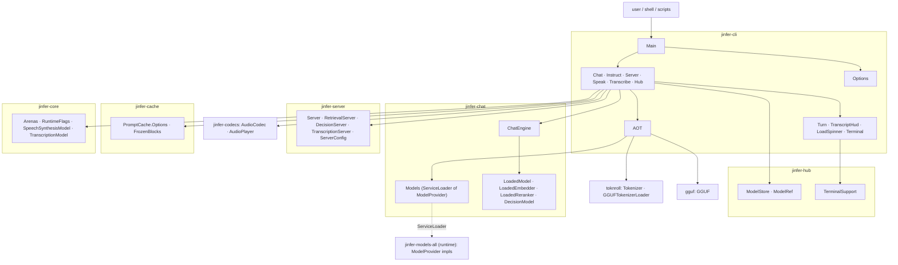

---

## 2. Class diagrams

### 2a. Commands, options and dispatch

Commands are not polymorphic: each is a `final` class with static `read(Options, Args)`, `validate(Options)`,
`printHelp(PrintStream)` and `run(...)` methods that `Options` and `Main` call through explicit `switch`/`||` chains.
Command-specific settings live as nested `Settings` objects owned by `Options`.

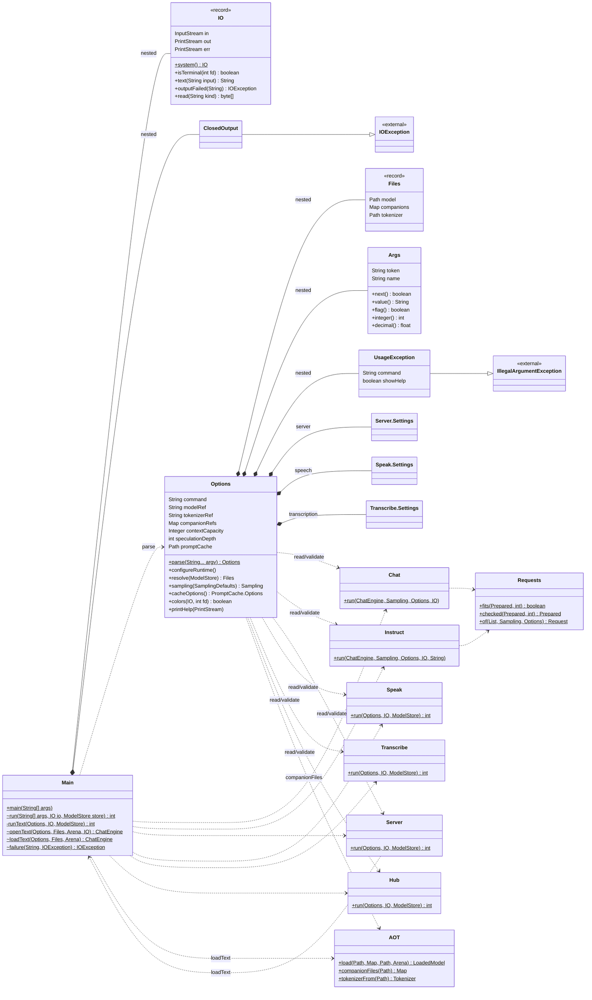

### 2b. Terminal and presentation

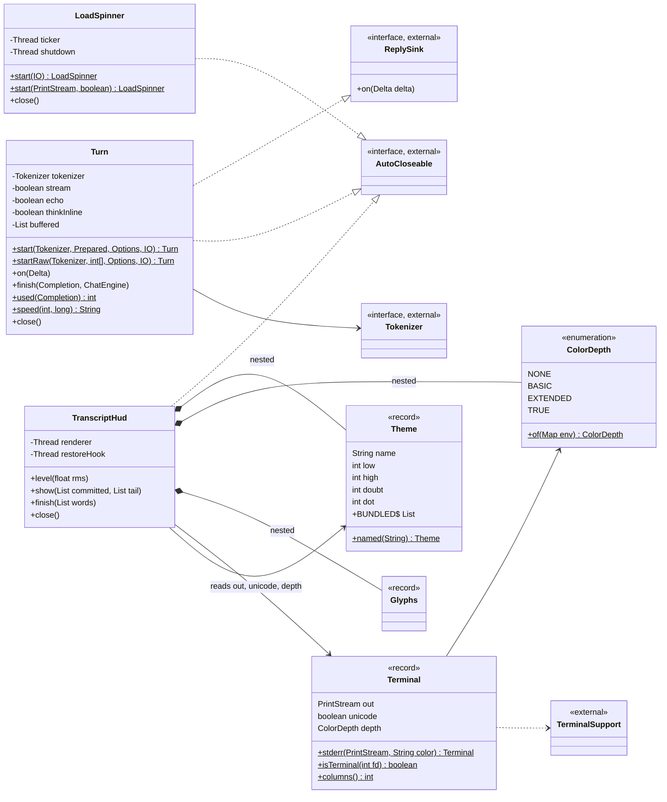

### 2c. External contracts the commands drive

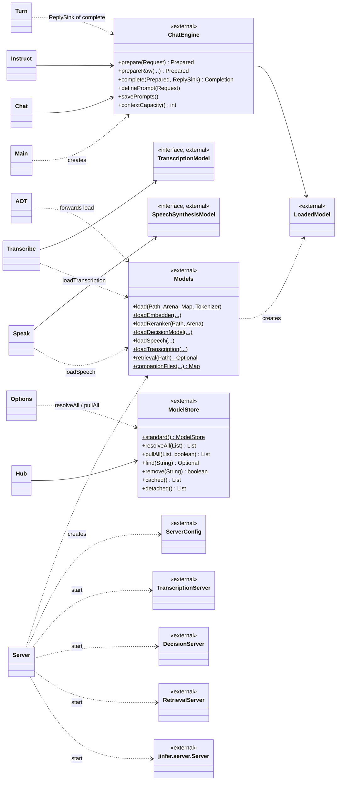

---

## 3. Process entry and dispatch

`Main.main` replaces `System.out`/`System.err` with buffered UTF-8 `PrintStream`s, sets a default
`java.util.logging` format, then calls `run(args, IO.system(), ModelStore.standard())` and passes its result to
`System.exit`. `run` is the testable boundary: tests pass their own `IO` and `ModelStore`. `IO.isTerminal(fd)` is
true only when the stream *is* the process's own stream and `Terminal.isTerminal(fd)` agrees, so borrowed streams
are always plain output.

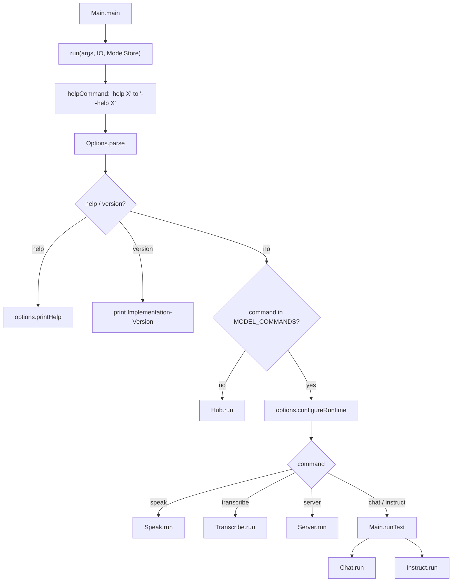

`configureRuntime` refuses a JVM without `jdk.incubator.vector` (unless running as a native image, detected via
`org.graalvm.nativeimage.imagecode`) and forwards `--threads` / `--batch-capacity` as the system properties
`jinfer.threads` / `jinfer.batchCapacity` before any model class initialises.

---

## 4. Option parsing

`Options.parse` walks an `Args` cursor (`--` ends options, `--name=value` inline values, `-` is an operand). The first
non-option token selects the command (aliases `serve`→`server`, `prompt`→`instruct`); later ones are operands. Each
option is offered in turn to `readShared` (model, generation, shared conversation flags), then to
`Instruct.read`, `Server.read`, `Speak.read`, `Transcribe.read`, `Hub.read`; whoever accepts it records, via
`Options.use(flag, commands)`, the set of commands it applies to. `validate()` then checks every used flag against
the chosen command, range-checks numeric values and delegates to the command's own `validate`.

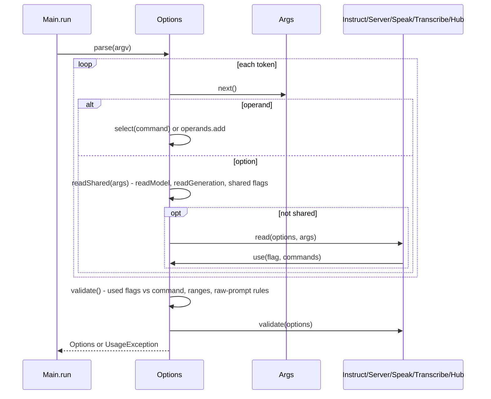

The first parse error is kept but parsing continues so that a later `--help` still wins. `--with role=value`
splits into `tokenizerRef` (role `tokenizer`) or `companionRefs` (any other role); roles are checked against the
architecture's offered companions only later, in `resolve`. Errors become `UsageException` (exit 2) carrying the
command for the "Run 'jinfer X --help'" hint.

---

## 5. Model resolution and loading

`Options.resolve(store)` sends the model, tokenizer and companion references through `ModelStore.resolveAll` in one
call (local files are checked first: existing file wins, a directory or missing path is refused). Companion roles are
validated against `AOT.companionFiles(model)`, which returns the architecture's offered roles. Text loading then goes
through `AOT.load`, the CLI's single path to `Models.load`.

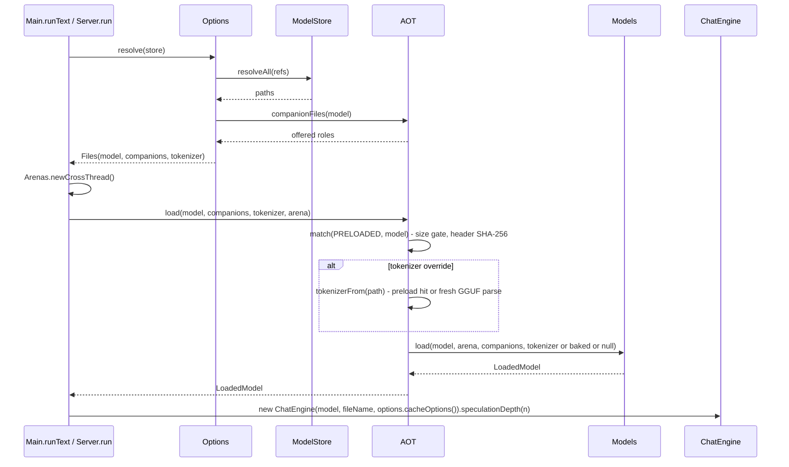

**AOT preload.** `AOT.PRELOADED` is computed in the static initialiser from `-Djinfer.preload=<model>[:<model>...]`.
Because `com.qxotic.*` initialises at native-image build time, the parsed `GGUF` header and the `Tokenizer` built by
`GGUFTokenizerLoader.createBuilderWithBuiltins()` are snapshot into the image heap. Each `PreloadedFile` keeps the
file name, size, header length (`gguf.getTensorDataOffset()`) and header SHA-256. At run time `match` uses a preload
only when the size matches and the SHA-256 of `[0, headerLength)` matches; otherwise it logs a warning (name match
with different size, or same size with different header) and returns `null`, so the result is a normal load.
Files without `tokenizer.ggml.tokens` (companions, vocabulary-less models) are refused at build time. Model objects
themselves are deliberately not preloaded (they wire into mmap'd segments). The tokenizer precedence is
`--with tokenizer=` file, then the baked tokenizer, then the GGUF's own.

`Terminal` is the one class forced to run-time initialisation (`native-image.properties`:
`--initialize-at-run-time=com.qxotic.jinfer.cli.Terminal`), since it reads `os.name` for its palette.

`Main.loadText` maps a context-capacity refusal from the cache to a flag error (`Options.asFlag`) and refuses an
explicit `--speculation-depth > 0` on a model whose engine reports `!speculationReady()`. `openText` wraps it in a
`LoadSpinner`.

---

## 6. Text generation: chat and instruct

`Main.runText` reads one-shot stdin for `instruct` *before* loading weights, resolves files, creates a cross-thread
`Arena`, opens the `ChatEngine` (try-with-resources), derives `Sampling` from `options.sampling(engine.loaded().samplingDefaults())`
(explicit flags, then the model's recommendations), and runs `Chat` or `Instruct`. The arena is closed by
`Arenas.close` after the engine. An `IncompatibleModelException` is rephrased via `Models.retrieval` into
"is an embedding/reranking model ... serve it with 'jinfer server'".

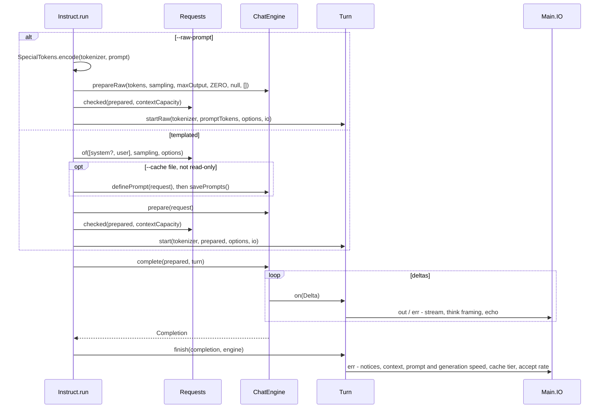

**Chat.** `Chat.run` keeps a `List<Message>` history (optional system message first) and reads lines from
`io.in()`. Prompt `> ` is shown only when stdin and stderr are terminals. Commands: `/help`, `/context`
(`used/contextCapacity` and `engine.sessionStats()`), `/quit`, `/exit`, EOF. Each user line is prepared by
`Chat.prepare`, which, while the prepared prompt does not fit, drops the oldest user turn and its assistant reply on
a copy (keeping the system prompt and the new message), committing the trimmed copy only on success. A library
refusal (`IllegalArgumentException` / `IllegalStateException` / `UnsupportedOperationException`) drops the turn and
keeps the session. After completion the reply (`completion.reply()`, carrying its verbatim record) is appended so
the engine's retained session reuses the KV prefix across turns.

**Turn.** One `Turn` per generation, the `ChatEngine.ReplySink`. Deltas arrive already UTF-8-safe and channel-tagged
(`Channel.REASONING` vs content). Reasoning goes to stderr (or stdout with `--think inline`) between
`[Start thinking]`/`[End thinking]`, grey when `Options.colors` allows. `--no-stream` buffers deltas and replays them
through the same `emit` in `finish`. `--echo` writes each token's escaped spelling to stderr and suppresses duplicate
rendering on the same screen. The raw lane (`startRaw`) drops deltas whose tokens are all special
(`SpecialTokens.isSpecial`). `finish` prints why generation stopped (reasoning cap, context full, `--max-output-tokens`)
and the summary line; rates are shown only from `MIN_RATE_TOKENS = 32`. `checkOutput` flushes and converts a stdout
error into `io.outputFailed`.

---

## 7. Server: the model selects the API

`Server.run` first builds `ServerConfig` (`config(options, null)`): resolves `--host` via DNS, keeps link-local scope,
and requires `--api-key` for non-loopback binds — all before fetching a model. Then it tries the model as a language
model and falls back by `IncompatibleModelException`:

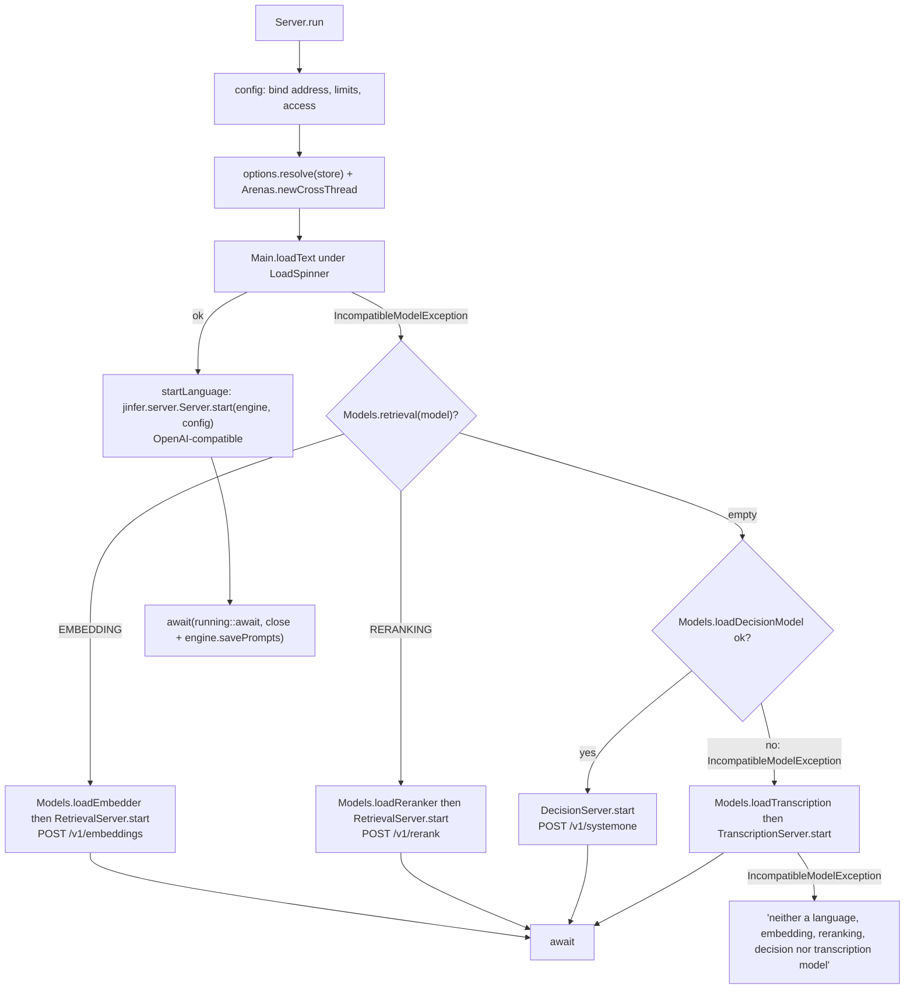

Before each task server, `validateTask` rejects language-only options (`Options.rejectLanguageOptions`, keeping only
`--context-capacity`/`-c` for retrieval and decision), `--raw-prompt`, `--no-grammar` and `--cache`.
`contextCapacity` resolves through `PromptCache.Options.contextCapacity(requested, maximum, DEFAULT_CONTEXT_CAPACITY)`.
`Server.Settings.limits()` builds `ServerConfig.Limits` (concurrency, body size, grammar flag, timeouts) and
`defaults(...)` builds `ServerConfig.Defaults` (sampling, max output, think, raw prompt, reasoning cap and cutoff).
A `BindException` becomes an "already in use; choose another with --port" `IOException`.

`Server.await(Await, Runnable)` blocks on the running server and installs a shutdown hook; a `synchronized`
local `Stop` makes close idempotent whether it runs from the hook (Ctrl-C) or the normal return, after which the hook
is removed. For language models, close also calls `engine.savePrompts()` to persist the prompt cache catalog.

---

## 8. Speech: speak and transcribe

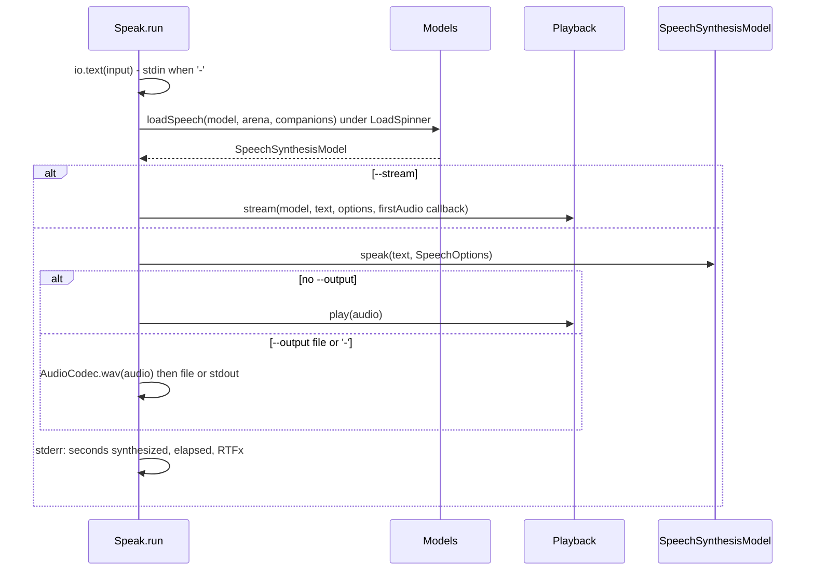

`Speak.Playback` is the seam for tests; the production `PLAYER` delegates to `AudioPlayer.play`/`stream`.
`--output` and `--stream` exclude each other; `--speed` maps to `SpeechOptions.speed`.

`Transcribe.run` decodes the audio *before* loading the model (`AudioCodec.decode` for stdin, `AudioCodec.load` for a
file), then `Models.loadTranscription`. Encoded audio goes to `model.transcribe(audio)`. With `--raw-pcm`, `pump`
streams 16 kHz mono s16le from stdin:

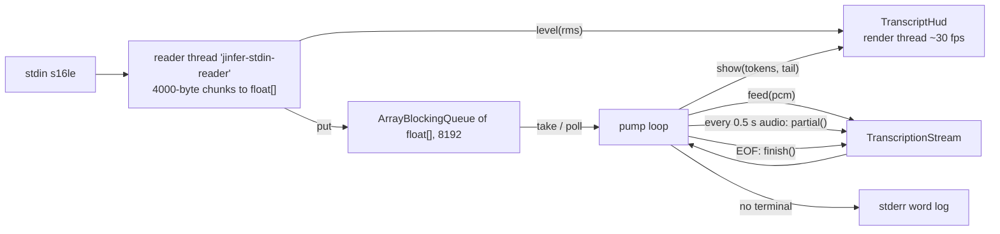

The reader thread keeps the pipe drained so the capture side never drops audio while the model decodes; the bounded
queue (about 17 minutes of chunks) backpressures otherwise. The model state is `model.newState()` and the stream
`model.stream(state)`, both in try-with-resources. `TranscriptHud` is created only when stderr is a terminal and
`Terminal.stderr(...)` succeeds (not `TERM=dumb`, ANSI enabled); it paints on its own daemon thread, uses synchronized
output escapes, hides the cursor and restores it from a shutdown hook. Its `Theme` is chosen by `--theme`
(`mint`, `nord`, `catppuccin`, `ember`, `frost`, `mono`), its `ColorDepth` by `--color` or the environment
(`NO_COLOR`, `COLORTERM`, `TERM`), forced to `TRUE` on Windows when colored. The final transcript is printed to
stdout unless the live view already showed it on the same terminal.

---

## 9. Hub and cache commands

Commands outside `MODEL_COMMANDS` never load a model and skip `configureRuntime`.

| Command | Implementation |
|---|---|
| `pull [--force] <ref>...` | `Options.pullFiles` → `ModelStore.pullAll(refs, force)`; prints local paths |
| `list` | `ModelStore.cached()` sorted by `Hub.name` (shortest ref that `find`s the same file, e.g. `owner/repo:Q8_0`), sizes and total; reports bytes held by `detached()` versions |
| `find <ref>...` | `ModelStore.find` only (no network); misses list what the repository has cached |
| `remove <ref>...` | `ModelStore.remove`; a bare `owner/repo` with several cached files is refused with the menu |
| `prune` | removes every `ModelStore.detached()` entry, reporting freed bytes |
| `cache-info <file.jkv>` | `FrozenBlocks.describe(file)` from `jinfer-cache` |

`ModelRef.parse` (jinfer-hub) is used to compare host/repo and build short names.

---

## 10. Exit status, errors and process lifetime

| Status | Cause |
|---|---|
| 0 | success |
| 1 | `IOException`, `UncheckedIOException`, `IllegalArgumentException`, `IllegalStateException`, `UnsupportedOperationException` (one-line message via `Options.rootMessage`); other `RuntimeException` (printed with stack trace as "unexpected failure"); `find`/`remove` misses |
| 2 | `Options.UsageException`; `ExceptionInInitializerError` (a `-Djinfer.*` value refused by `RuntimeFlags`) |
| 130 | thread interrupted (Ctrl-C during generation or server await) |
| 141 | `Main.ClosedOutput` in the cause chain: stdout reader went away (e.g. `\| head`), printed nowhere |

`IO.outputFailed` distinguishes a closed pipe (`ClosedOutput`) from a real write failure (stdout is a regular file
per `/dev/stdout`, or a borrowed stream). `Main.failure(summary, cause)` wraps I/O errors with the operation and a
remedy. Resources are released on every path: arenas via `Arenas.close` in `finally`, engines and prepared requests
in try-with-resources, and `LoadSpinner`, `TranscriptHud` and `Server.await` each register and remove their own
shutdown hook so that a signal still ends the line, restores the cursor or closes the server.
