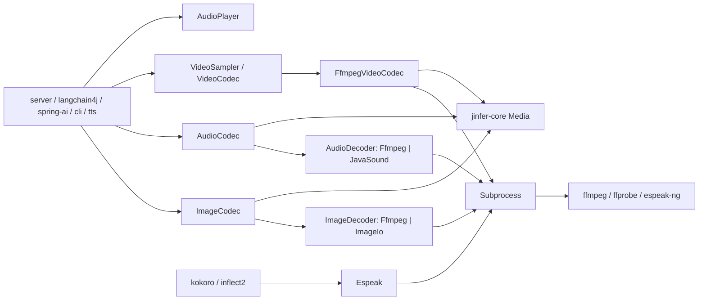

# jinfer-codecs — architecture summary

**What it is.** The media edge of jinfer: it turns local files and encoded bytes into the canonical model inputs
defined in `jinfer-core` (`Media.Image` RGB float [0,1] HWC, `Media.Audio` 16 kHz mono float PCM, `Media.Video`
truthfully timestamped frames). It also encodes synthesized speech back to WAV / raw PCM16, plays audio on the local
machine, and wraps espeak-ng as a grapheme-to-phoneme tool. One package, `com.qxotic.jinfer.codecs`, 15 types,
~1600 lines; its only Maven dependency is `jinfer-core`. The package is declared internal (no API promise).

**Where it sits.** Below the integration layers, beside the models:

- `jinfer-server`, `jinfer-langchain4j`, `jinfer-spring-ai`, `jinfer-cli`, `jinfer-tts` decode request media
  (`ImageCodec.decode`, `AudioCodec.decode`, `VideoSampler`) and encode speech (`AudioCodec.wav` / `pcm16`,
  `AudioPlayer`).
- `jinfer-chat` `Models` puts `ImageCodec.decoder().name()` / `AudioCodec.decoder().name()` into a model's identity,
  since two backends may decode the same bytes differently.
- Speech ports `jinfer-kokoro` (required) and `jinfer-inflect2` (optional lexicon fallback) build their
  `Phonemizer` over `Espeak`.
- Decoding stops at `Media`; a model's `MediaProjector` (jinfer-core) does the projection. No codec fetches remote
  content.

**Main concepts.**

- **Static facades with a cached backend** — `ImageCodec` and `AudioCodec` lazily pick an `ImageDecoder` /
  `AudioDecoder` once (double-checked `volatile`). `Codecs.choice` decides: the `-Djinfer.imageDecoder` /
  `-Djinfer.audioDecoder` override, else ffmpeg in a native image or when `ffmpeg -version` runs, else the JDK backend
  (`imageio` / `javasound`). The chosen backend is the only one asked; no silent fallback.
- **JDK decoders loaded reflectively** — `ImageIoDecoder` and `JavaSoundAudioDecoder` are instantiated through
  `Codecs.reflect` with a non-constant class name, so native-image does not pull in `java.desktop` /
  `javax.sound.sampled`. Native binaries therefore always use ffmpeg.
- **ffmpeg decoders** — images go through a forced demuxer chosen from magic bytes and come back as a P6 PPM parsed
  in Java; audio is decoded, resampled (swresample) and downmixed to f32le in one ffmpeg pass.
- **Video as a sampler, not a decoder** — `VideoCodec` has three primitives (`totalDuration`, `framePeriod`,
  `framesAt`) and default policies of pure timestamp arithmetic (`uniform` centered, `every` HF-style fps with
  `maxFrames`, `span` inclusive fencepost, `frameAt`). The one backend, `FfmpegVideoCodec`, caches one ffprobe per
  file (keyed by path, size, mtime) and extracts all frames in a single ffmpeg process via a concat filter graph.
  `VideoSampler` is the `Path → Media.Video` function callers pass around (`UNIFORM` = 32 frames).
- **Speech output** — `AudioCodec.wav` / `pcm16` are hand-written (no javax.sound, never touches the decoder
  backend). `AudioPlayer.stream` pipes raw PCM to aplay/ffplay on Linux, or plays one temp WAV per clip on
  macOS/Windows (afplay / PowerShell SoundPlayer / ffplay), signalling the first audible clip.
- **Espeak** — `find()` probes `espeak-ng` then `espeak`; `tiedIpa` sends text on stdin (with the required trailing
  newline), joins multi-letter phonemes with `TIE` (`^`), and strips language markers; `ipa` removes the ties.
- **Subprocess** — the single external-tool runner: daemon threads for stdin/stdout/stderr, timeout, output cap
  (typed `OutputLimitExceeded`), stderr in the error on non-zero exit, a "install it and put it on PATH" message when
  the tool is missing.

**Notable design choices.**

- Native-image awareness everywhere: run-time (not build-time) native detection, reflective JDK backends, a
  hand-written WAV encoder.
- Bounded resource use: 4096×4096 pixel limit, audio capped at `-Djinfer.codecs.maxAudioMinutes` (default 60),
  per-call timeouts and output caps.
- Fail loud rather than guess: forced demuxers, short video streams throw instead of mis-pairing frames and
  timestamps, unsupported formats name the ffmpeg switch.
- No `META-INF/services` SPI: selection is explicit via facades and system properties.

See [ARCHITECTURE.md](ARCHITECTURE.md) for class diagrams, selection and decode flows, video sampling, playback,
espeak and subprocess details.
