# jinfer-codecs — class architecture

Package `com.qxotic.jinfer.codecs` (15 top-level types + `package-info`, ~1600 lines). It turns local media files and
encoded bytes into jinfer's canonical model inputs (`Media.Image` RGB/[0,1]/HWC, `Media.Audio` 16 kHz mono float PCM,
`Media.Video` timestamped frames), encodes synthesized audio back to WAV/PCM16, plays audio locally, and wraps
espeak-ng as a grapheme-to-phoneme tool. Its only Maven dependency is `jinfer-core` (for `Media`, `SpeechSynthesisModel`,
`SpeechOptions`); external tools (ffmpeg, ffprobe, espeak-ng, audio players) are reached as subprocesses. There is **no
`META-INF/services` registration** and no resources: backends are selected by static facades with `-D` overrides and
reflective loading. `package-info` declares the package internal to jinfer (no API or compatibility promise).

Format: **Mermaid**. Legend: `..|>` implements; `--|>` extends; `-->` holds/uses; `..>` creates/depends;
classes marked `<<external>>` live outside this package.

1. [Position in the stack](#1-position-in-the-jinfer-stack)
2. [Class diagrams](#2-class-diagrams) — 2a image/audio decoding, 2b video, 2c speech side, 2d subprocess layer
3. [Backend selection](#3-backend-selection)
4. [Decode flows](#4-decode-flows) — 4a ffmpeg image, 4b ffmpeg audio, 4c javasound audio
5. [Video sampling](#5-video-sampling)
6. [Audio encoding and playback](#6-audio-encoding-and-playback)
7. [Espeak grapheme-to-phoneme](#7-espeak-grapheme-to-phoneme)
8. [Subprocess runner](#8-subprocess-runner)
9. [Limits and system properties](#9-limits-and-system-properties)

| Class | Role |
|---|---|
| `ImageCodec` | Static facade: lazily selects and caches an `ImageDecoder` (`ffmpeg` / `imageio`); `load`, `decode`, `decoder()`; holds `MAX_PIXELS` and `checkDimensions` |
| `ImageDecoder` | Interface: `load(Path)`, `decode(byte[])` → `Media.Image`; `name()` |
| `FfmpegImageDecoder` | ffmpeg-based image decoder; forces the demuxer from magic bytes; parses binary PPM (P6), also reused for video frames |
| `ImageIoDecoder` | `javax.imageio` decoder (PNG/JPEG/GIF/BMP/TIFF), JVM only, loaded reflectively |
| `AudioCodec` | Static facade: selects and caches an `AudioDecoder` (`ffmpeg` / `javasound`); also hand-written encoders `wav(Audio)` and `pcm16(Audio)` |
| `AudioDecoder` | Interface: `load(Path)`, `decode(byte[])` → 16 kHz mono `Media.Audio`; `name()` |
| `FfmpegAudioDecoder` | ffmpeg decode+resample+downmix to f32le in one pass; owns `SAMPLE_RATE` and the max-minutes limit helpers |
| `JavaSoundAudioDecoder` | `javax.sound.sampled` decoder (WAV/AIFF/AU) via the JDK format converter, JVM only, loaded reflectively |
| `VideoCodec` | Interface: primitives `totalDuration`, `framePeriod`, `framesAt` + default sampling policies `frameAt`, `uniform`, `every`, `span`; `ffmpeg()` factory |
| `FfmpegVideoCodec` | Singleton `VideoCodec`: one cached ffprobe run per file, all frames extracted in one ffmpeg process |
| `VideoSampler` | `@FunctionalInterface` `Path → Media.Video` policy; constant `UNIFORM` |
| `AudioPlayer` | `AutoCloseable` local playback via afplay / aplay / ffplay / PowerShell SoundPlayer; `play`, `stream`; nested `Failed` exception |
| `Espeak` | espeak-ng / espeak wrapper: `find()`, `ipa`, `tiedIpa`, `TIE` |
| `Codecs` | Package-private selection helpers: `nativeImage()`, `choice()`, `ffmpegOnPath()`, `reflect()` |
| `Subprocess` | Package-private external-tool runner with timeout, output caps, stderr capture; nested `OutputLimitExceeded` |

---

## 1. Position in the jinfer stack

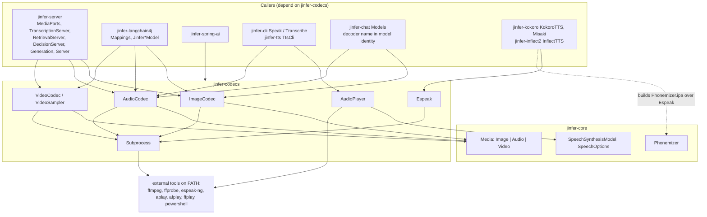

Decoding stops at `Media`: a model's `MediaProjector` (jinfer-core) turns decoded media into embedding rows; codecs never
see a model. No codec fetches remote content.

---

## 2. Class diagrams

### 2a. Image and audio decoding

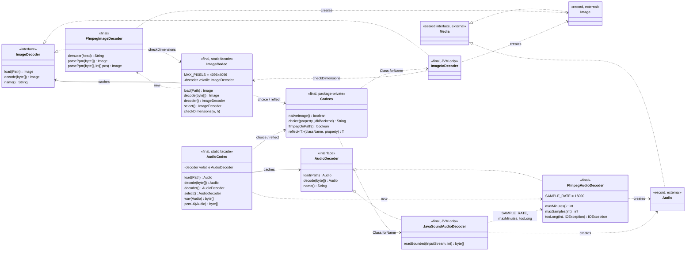

The two JDK-backed decoders are never referenced statically: `Codecs.reflect` receives their class name as a
non-constant argument, so native-image cannot fold the `Class.forName` and drag `java.desktop` /
`javax.sound.sampled` into the image.

### 2b. Video

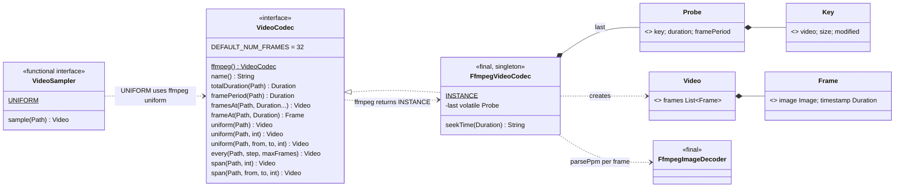

`VideoCodec` is a *sampler*, not a decoder: there is no `byte[]` overload and no whole-video decode. The policies
(`uniform`, `every`, `span`) are default methods of pure timestamp arithmetic over the three primitives.

### 2c. Speech side: encoding, playback, phonemization

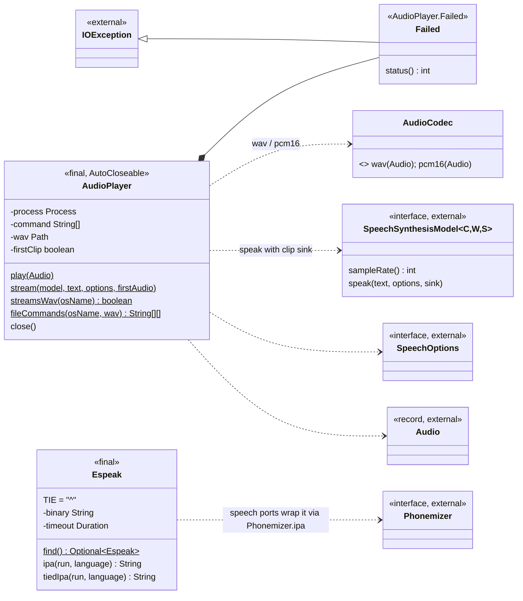

### 2d. Subprocess layer

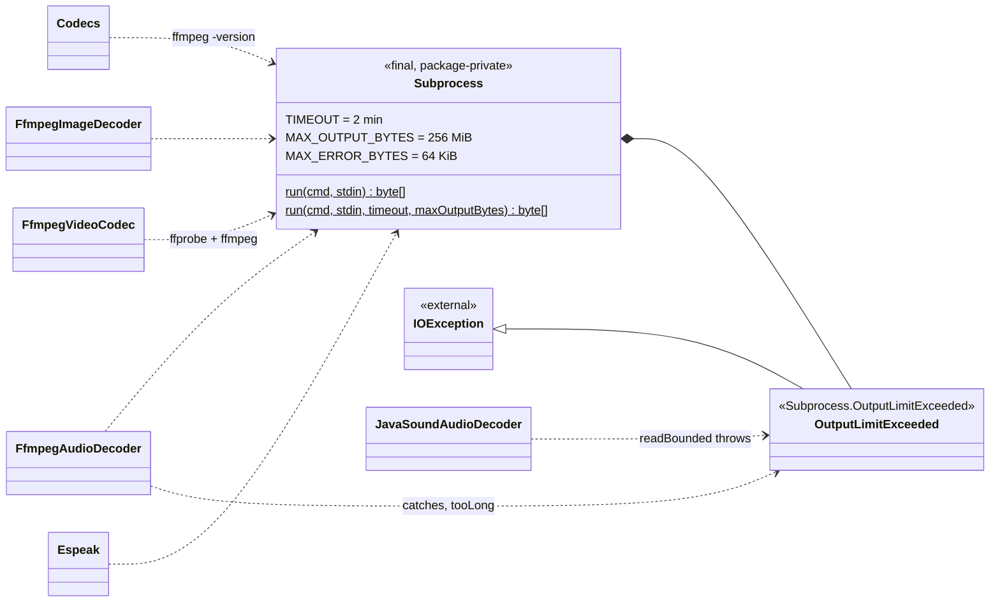

`AudioPlayer` does **not** use `Subprocess`: it starts its own long-lived `ProcessBuilder` processes (stdout discarded,
stderr inherited) because it streams to the player's stdin and waits on exit in `close()`.

---

## 3. Backend selection

`ImageCodec.decoder()` and `AudioCodec.decoder()` use double-checked locking on a `volatile` field; the first call runs
`select()`, which asks `Codecs.choice(property, jdkBackend)`.

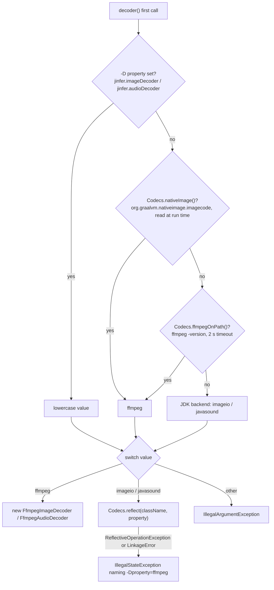

A selected backend is the only one asked: there is no runtime fallback from one decoder to the other, and `reflect`
refuses rather than silently swapping. `nativeImage()` is deliberately not a `static final` so it is not
constant-folded at image build time. `VideoCodec` has a single backend (`VideoCodec.ffmpeg()`), with no selection.

---

## 4. Decode flows

### 4a. ffmpeg image decode

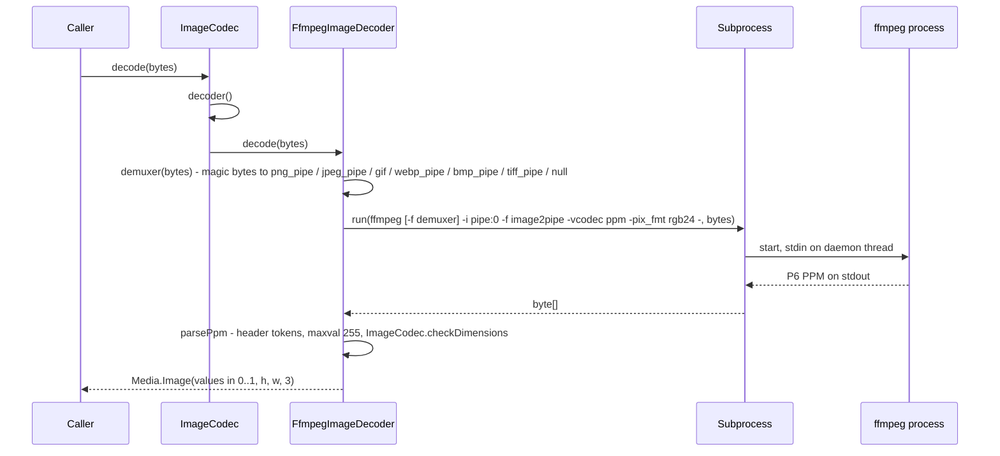

`load(Path)` reads the first 16 bytes of the file for the demuxer and passes the path as `-i`. The forced demuxer
prevents ffmpeg's probe from misidentifying a broken file (comment cites a corrupt PNG probed as CD+G graphics).
`ImageIoDecoder` instead picks the first `ImageIO` reader, checks dimensions from the reader before decoding, and
converts `BufferedImage.getRGB` to the same HWC float layout.

### 4b. ffmpeg audio decode

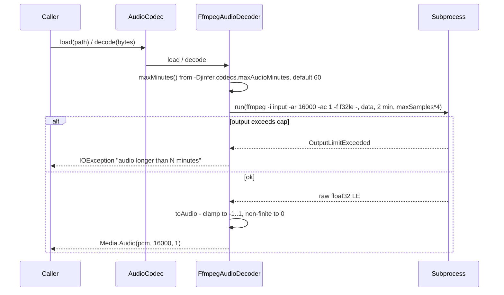

### 4c. javax.sound audio decode

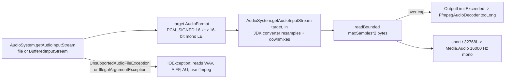

---

## 5. Video sampling

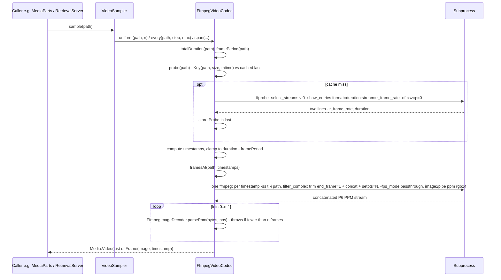

Policy formulas (from the default methods):

| Method | Timestamps |
|---|---|
| `uniform(v, from, to, n)` | centered: `from + k*(window/n) + window/(2n)`, `to` clamped to duration, each point clamped to the last frame |
| `uniform(v)` | `uniform(v, DEFAULT_NUM_FRAMES = 32)` over the whole source |
| `every(v, step, maxFrames)` | `duration/step` points (≥1), thinned like `numpy.linspace(0, count-1, kept).astype(int)`, last kept exact |
| `span(v, from, to, n)` | fencepost inclusive, `n ≥ 2`, `to` clamped to `duration - framePeriod` |
| `frameAt(v, t)` | `framesAt(v, t).frames().get(0)` |

Callers observed: `VideoSampler.UNIFORM` (OpenAI chat in jinfer-server, langchain4j default); `every(v, 1 s, 32)` for
embeddings (`RetrievalServer`, langchain4j `JinferEmbeddingModel`).

---

## 6. Audio encoding and playback

`AudioCodec.wav` writes a 44-byte RIFF/WAVE PCM header plus `pcm16` samples; `pcm16` rejects non-mono audio and clamps
`sample * Short.MAX_VALUE` to 16-bit LE. The encode side never touches the decoder backend (so a native binary does not
start shelling out to ffmpeg to encode).

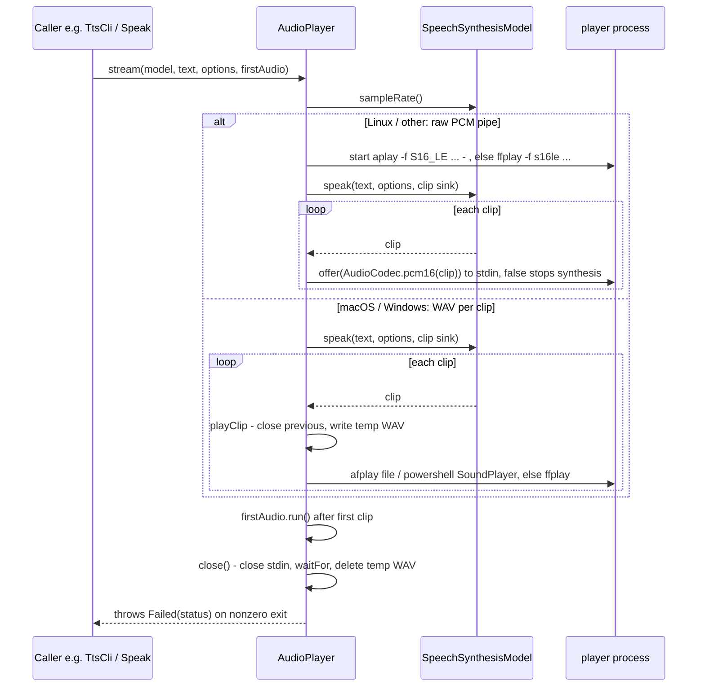

`start(candidates...)` tries each command in order; only a launch failure moves on to the next candidate. A clip whose
sample rate differs from `model.sampleRate()` raises `IllegalArgumentException`. `play(audio)` is the one-shot WAV path.

---

## 7. Espeak grapheme-to-phoneme

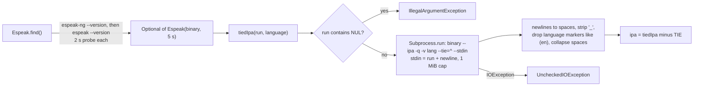

Consumers: `KokoroTTS` requires espeak (`tiedIpa` + `Misaki` dialect rewrite, which maps `Espeak.TIE`), and
`InflectTTS` uses it optionally as the lexicon fallback (`ipa(run, "en-us")`); both wrap it in `Phonemizer.ipa`
(jinfer-core). The text goes on stdin, never as an argument, and the trailing newline is required for espeak to
phonemize the last word completely.

---

## 8. Subprocess runner

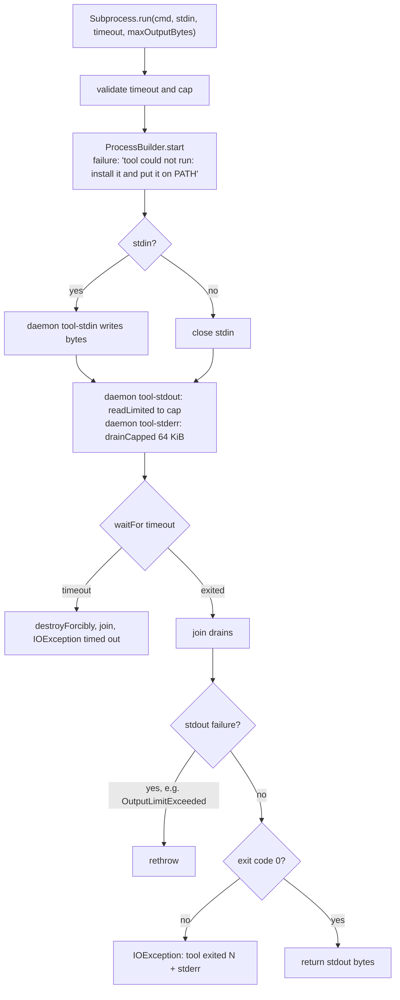

Defaults for the two-argument overload: 2 minutes, 256 MiB. Callers override: `ffmpeg -version` probe 2 s/64 KiB,
ffprobe 30 s/64 KiB, audio 2 min/`maxSamples*4`, espeak 5 s/1 MiB.

---

## 9. Limits and system properties

| Knob | Where | Effect |
|---|---|---|
| `-Djinfer.imageDecoder=ffmpeg\|imageio` | `ImageCodec.select` | force image backend |
| `-Djinfer.audioDecoder=ffmpeg\|javasound` | `AudioCodec.select` | force audio backend |
| `-Djinfer.codecs.maxAudioMinutes` | `FfmpegAudioDecoder.maxMinutes` | default 60; validated per decode in `[1, MAX_MINUTES_CEILING]`; shared by `JavaSoundAudioDecoder` |
| `ImageCodec.MAX_PIXELS` | `checkDimensions` | 4096 × 4096 pixels; enforced by both image decoders and per video frame |
| `org.graalvm.nativeimage.imagecode` | `Codecs.nativeImage` | read at run time; native images always use ffmpeg |
| `os.name` | `AudioPlayer` | Mac/Windows → WAV per clip; otherwise raw PCM pipe to aplay/ffplay |

`ImageCodec.decoder().name()` and `AudioCodec.decoder().name()` are part of a loaded model's identity string in
jinfer-chat `Models`, because two backends may decode the same bytes differently (media cache keys).
