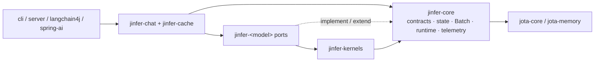

# jinfer-core — architecture summary

`jinfer-core` is the foundation every other jinfer module builds on. It holds **no model, no tokenizer and no
kernel math**. Instead it defines four things:

1. **Model contracts**: the interfaces each `jinfer-<model>` port implements.
2. **State and lifetime rules**: who owns memory, who may touch a state, and how a context is checkpointed.
3. **The runtime the kernels run on**: arenas, scratch memory, the Vector API set-up and the thread pool.
4. **Telemetry**: JFR events and once-per-run "performance cliff" warnings.

It has 3 packages (`com.qxotic.jinfer`, `.media`, `.telemetry`) and 44 types, about 4200 lines. Its only
dependencies are `jota-core` / `jota-memory` (`MemoryView`, `MemoryArena`, `MemoryAllocator`, `DataType`) and the
GraalVM `nativeimage` SDK. It registers nothing under `META-INF/services`. Model discovery through `ServiceLoader`
happens in `jinfer-chat`.

For class diagrams and call flows, see [ARCHITECTURE.md](ARCHITECTURE.md).

## Where it sits

## Main concepts

- **`Model<C,W,S>`** binds immutable configuration and weights to a mutable state type `S`.
  - **`ContextModel`** adds a bounded, positioned context: `newState(...)` and `ingest(state, Batch)`, plus an
    optional `CheckpointCodec`.
  - **`LanguageModel`** adds a logits head, and **`EmbeddingModel`** adds a pooled embedding head. `embedAll` is a
    default method that packs ragged sequences, and `embed` handles multimodal parts.
  - **`Reranker`** is a scoring recipe on top of a `ContextModel`.
  - **`SpeechSynthesisModel`** (with a `Phonemizer` and `SpeechOptions`) and **`TranscriptionModel`** (with
    `TranscriptionStream` and `Transcription`) cover text-to-speech and speech-to-text.
- **`RuntimeState` → `ContextState`**: a state is a *single serial pipeline*.
  - `exclusively(...)` takes a reentrant lock. A second thread fails fast with `ConcurrentModificationException`.
  - `close()` waits for any running operation, then releases resources exactly once.
  - `ContextState` tracks capacity, `position`, `outputCount` and `tokensRead`. Ports call `advanceContext` only
    after a forward pass succeeds. `resumeAt` and `reset` move the cursor.
- **`CheckpointCodec`** is a template method. Its public `capture`/`restore` check exclusive access, the span and the
  memory size, and the port supplies `sizeOf`/`transfer`. The prompt cache in `jinfer-cache` builds on it.
- **`Batch`** is one forward pass: an `Input` (`Tokens`, FP32 `Embeddings` rows, or packed `Sequences`) plus which
  rows to keep (`Outputs.LAST` or `ALL`).
  - Factories: `prefill`, `step`, `score`, `pack`, `embeddings`.
  - `prepare` merges or splits token batches to fit a batch capacity. Bidirectional media blocks stay whole.
- **Media**: `Media` is a sealed type (`Image`, `Audio`, `Video`) holding validated decoded data.
  - `MediaProjector` turns media into context rows in chunks.
  - `Multimodal` tells which modalities a model instance can take.
  - `ContentKey` and `FrameRef` give stable cache identities.

## Runtime

- **Memory**:
  - Weights and state must use **cross-thread arenas**. `Arenas` rejects confined ones with a zero-byte probe.
  - `newCrossThread()` returns `ofShared` on the JVM and `ofAuto` in a native image.
  - Whoever supplies an arena owns it. A state that owns its arena frees it through a `Cleaner`.
  - `LeakWatch` (opt-in) reports owners that were never closed.
  - `Workspace` is a scratch allocator that grows to the largest request and then reuses its buffers, so a warm
    state allocates nothing.
  - `Views` creates `MemoryView`s and runs the entry checks every kernel starts with.
- **Compute**:
  - `Segments` fixes the Vector API species, detects whether the JIT handles the Vector API well, and uses an
    absolute-address global segment that removes bounds checks.
  - `VectorWidth` is a GraalVM `Feature` that sets `jinfer.vector.width` to the native image's target ISA rather
    than the build machine's.
  - `Parallel.shared()` is the one process-wide pool. It is sized by `RuntimeFlags.THREADS` (physical or fast
    cores). The caller takes part as slot 0, and work is split into 2×width bands. Workers spin for about 1 ms
    before they park.
  - `RuntimeFlags` also holds `BATCH_CAPACITY` (512), `DECODE_BLOCK_SIZE` and the prompt-cache settings.
- **Telemetry**: JFR itself is the extension point, so there is no listener interface.
  - `Telemetry.install()` registers periodic events: `Runtime`, `PromptCache` and `MediaCache`. The cache events
    read weakly held `CacheGauge`s.
  - Other modules emit `InferenceEvent`, `DecodeEvent`, `SpeculationEvent` and `MediaProjectionEvent`.
  - `PerformanceCliff` logs each degraded path once per run (slow JIT, restricted native access, nested region,
    no jam backend, scalar scan, and so on).

## Key flows

- **Generation**: `newState` → `ingest(prefill)` → `logits` → sample → `ingest(step)` → …, with every call under
  `exclusively`.
- **Embedding**: `embedAll` resets the state, ingests chunks of `batchCapacity` with `Outputs.ALL`, and projects
  the last row of each sequence into the sink as a borrowed view.
- **Cache resume**: `checkpointCodec().capture(state, from, to, seg)` and later `restore(...)`, then
  `resumeAt(to)`.

## Notable design choices

- Returned views are **borrowed**. They stay valid only until the next operation on the state, or until the
  callback returns. Callers copy what they need to keep.
- Errors are raised early with the fix in the message, for example a missing `jdk.incubator.vector`, a confined
  arena, a closed borrowed arena, a bad flag value, or audio that is not mono at the expected rate (it is never
  resampled).
- Settings are tuned for native images. `native-image.properties` initialises `com.qxotic.` at build time but keeps
  flags, pools, cleaners and `ContextState` initialised at run time.
- Telemetry types such as `CacheSample` belong to telemetry, so the event stream never depends on cache modules.
