# jinfer-core — class architecture

Three packages, 44 top-level types (+ `package-info`), ~4200 lines: `com.qxotic.jinfer` (27 types),
`com.qxotic.jinfer.media` (4) and `com.qxotic.jinfer.telemetry` (13). It is the **foundation of the jinfer stack**:
the model contracts every `jinfer-<model>` port implements (`Model` → `ContextModel` → `LanguageModel` /
`EmbeddingModel`, plus `Reranker`, `SpeechSynthesisModel`, `TranscriptionModel`), the state/lifetime rules
(`RuntimeState`, `ContextState`, `CheckpointCodec`), the unit of work (`Batch`), the memory and threading runtime
(`Arenas`, `Workspace`, `Views`, `Segments`, `Parallel`, `RuntimeFlags`) and JFR telemetry. It has no model code, no
tokenizer and no `META-INF/services` SPI; its only compile dependencies are `jota-core`, `jota-memory` and the
GraalVM `nativeimage` SDK (for the `VectorWidth` build-time `Feature`).

Format: **Mermaid**. Legend: `..|>` implements; `--|>` extends; `-->` holds/uses; `..>` creates/depends;
`*--` owns (nested/composed); classes marked `<<external>>` live outside this module.

1. [Position in the stack](#1-position-in-the-jinfer-stack)
2. [Model contracts](#2-model-contracts) — 2a hierarchy, 2b speech & transcription
3. [State lifetime and exclusive access](#3-state-lifetime-and-exclusive-access) — 3a classes, 3b `exclusively`/`close`
4. [Batch — the unit of work](#4-batch--the-unit-of-work)
5. [Embedding and checkpoint flows](#5-embedding-and-checkpoint-flows)
6. [Media and multimodal input](#6-media-and-multimodal-input)
7. [Memory runtime: Arenas, Workspace, Views](#7-memory-runtime)
8. [Compute runtime: Segments, Parallel, RuntimeFlags, VectorWidth](#8-compute-runtime)
9. [Telemetry (JFR)](#9-telemetry-jfr)
10. [Native-image configuration](#10-native-image-configuration)

| Class | Role |
|---|---|
| `Model<C,W,S>` | Root contract: immutable `configuration()` + `weights()`, typed by its `RuntimeState` |
| `ContextModel<C,W,S>` | Bounded incremental context: `newState(...)` (owned or borrowed arena), `ingest(S, Batch)`, optional `checkpointCodec()` |
| `ContextConfiguration` | `vocabularySize()`, `maxContextLength()` |
| `LanguageModel<C,W,S>` | `ContextModel` + vocabulary-logits head `logits(S, output)` |
| `EmbeddingModel<C,W,S>` | `ContextModel` + pooled head `projectEmbedding`; defaults `embedAll` (packed sequences), `embed` (multimodal parts) |
| `Reranker<S>` | Task recipe over a `ContextModel`: `scoreAll(state, instruction, query, documents, sink)` |
| `SpeechSynthesisModel<C,W,S>` | Phonemes → `Media.Audio` (`synthesize`), text → clips (`speak`) |
| `TranscriptionModel<C,W,S>` | PCM → `Transcription`; optional `stream(S)` |
| `TranscriptionStream` | Live audio: `feed` / `partial` / `finish` |
| `Transcription` (+`Word`, `Token`) | Timed transcript record; `words()` groups tokens |
| `Phonemizer` / `RunPhonemizer` | Text → phoneme ids; `Phonemizer.ipa(symbols, g2p)` builds the package-private `RunPhonemizer` |
| `SpeechOptions` | Narrow per-utterance knobs (`speed()`), `NONE`, `speed(double)` |
| `AudioFormat` | Package-private `requireMono(audio, rate)` shared by transcription APIs |
| `RuntimeState` | `AutoCloseable` base: reentrant exclusive access, fail-fast concurrency, exactly-once `releaseResources` |
| `ContextState` | `RuntimeState` + capacity, position, outputCount, tokensRead; arena ownership via `Cleaner` |
| `CheckpointCodec<S>` | Template: validated `capture` / `restore` of `[from,to)` to opaque memory; ports supply `sizeOf` / `transfer` |
| `Batch` (+`Input`, `Outputs`, `Positions`) | One forward's input (`Tokens` / `Embeddings` / `Sequences`) and retained rows (`LAST`/`ALL`); `prepare` normalises lists |
| `ContentKey` | Printable content identity (`sha256:<hex>`), `digestBytes()` |
| `Arenas` | Cross-thread arena policy: `requireCrossThread`, `newCrossThread`, best-effort `close` |
| `LeakWatch` | Opt-in (`-Djinfer.leakDetection`) CloseGuard-style unclosed-resource reporter |
| `Workspace` | Grow-then-reuse scratch `MemoryAllocator` with stack `Scope`s; zero steady-state allocation |
| `Views` | `MemoryView` factories and kernel entry checks (dtype, contiguity, liveness), `sliceLeadingAxis` |
| `Segments` | Vector API species, `FAST_VECTOR_JIT`, absolute-address `GLOBAL_SEGMENT`, scalar read/write helpers |
| `Parallel` | Process-wide fork/join pool (`shared()`, `forLoop`, `run`) with spinning daemon workers |
| `RuntimeFlags` | `BATCH_CAPACITY`, `THREADS` (physical/fast cores), `DECODE_BLOCK_SIZE`, `cacheSessions()`, `cacheBudget()` |
| `VectorWidth` | Package-private GraalVM `Feature`: pins `jinfer.vector.width` to the image's target ISA |
| `media.Media` (+`Image`, `Audio`, `Video`) | Sealed decoded non-text input |
| `media.MediaProjector<R>` | Media → model context rows in chunks; optional `decoderPositions`, `planId` |
| `media.Multimodal` | Capability: `projector(Class)`, `supports(Class)` |
| `media.FrameRef` | Frame cache identity: video `ContentKey` + timestamp |
| `telemetry.Telemetry` (+`CacheGauge`) | Idempotent JFR periodic-event install; weakly-held cache gauges |
| `telemetry.PerformanceCliff` | Enum of once-per-run degraded-path warnings (log + `CliffEvent`) |
| `telemetry.*Event` | JFR events: `Inference`, `ModelLoad`, `Runtime`, `PromptCache`, `MediaCache`, `MediaProjection`, `Speculation`, `Decode`, `Cliff` |
| `telemetry.CacheSample` / `MediaCacheSample` | Telemetry-owned records the cache gauge reads |

---

## 1. Position in the jinfer stack

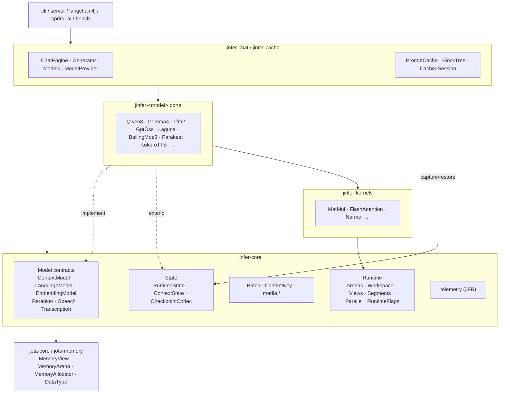

The upstream implementers above were confirmed by grep (e.g. `Qwen3`, `Gemma4CheckpointCodec`, `Lfm2`, `Parakeet`,
`KokoroTTS`; `ChatEngine` builds a `Telemetry.CacheGauge`; `Generator` emits `DecodeEvent`;
`BailingMoe3Speculative` emits `SpeculationEvent`).

---

## 2. Model contracts

### 2a. Hierarchy

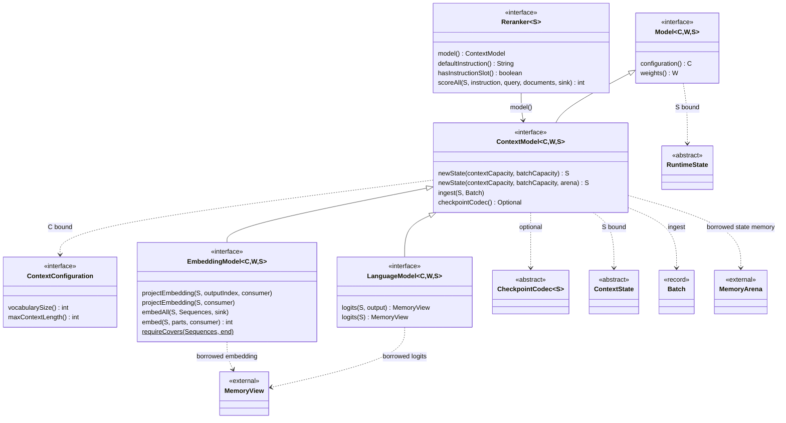

`ContextModel.newState(capacity)` defaults the batch capacity to `RuntimeFlags.BATCH_CAPACITY`. The interface
Javadoc pins the implementation contract: validate/compute/mutate under `RuntimeState.exclusively`, advance the
context only after a successful forward, and `Reference.reachabilityFence` the model. Returned views are
**borrowed** from the state.

### 2b. Speech synthesis and transcription

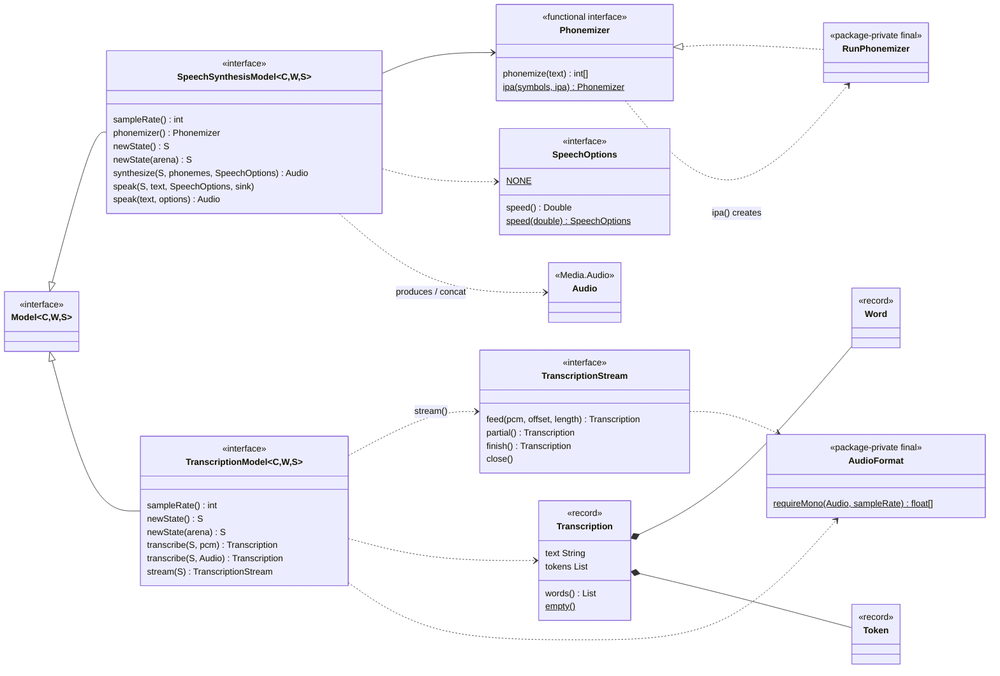

These two are bound to plain `RuntimeState` (no context/positions). `stream` throws
`UnsupportedOperationException` by default; the `Audio` overloads route through `AudioFormat.requireMono`, which
refuses (never resamples) non-mono or wrong-rate audio. `RunPhonemizer` splits text into punctuation-free runs, calls
the G2P function once per run, re-emits marks, and maps code points via a direct-indexed table (unknown IPA dropped).

---

## 3. State lifetime and exclusive access

### 3a. Classes

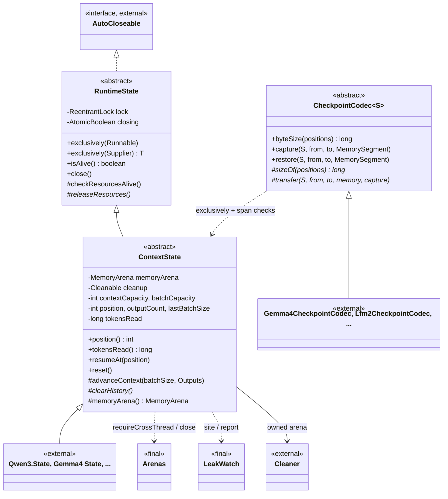

Ownership rule (from `package-info`): **whoever supplies an arena owns it**. A `ContextState` built with
`ownsArena=true` registers a `Cleaner` action that closes the arena (via `Arenas.close`) and, if `LeakWatch` is
armed and `close()` never ran, reports the creation site. A borrowed arena is only liveness-checked
(`checkResourcesAlive` throws `FREED_MESSAGE` when the caller closed it too early).

### 3b. `exclusively` and `close`

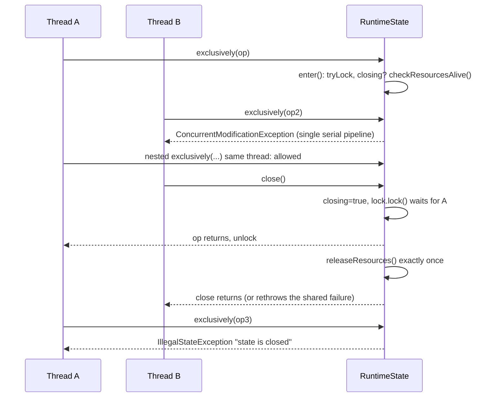

`close()` from within the state's own operation is refused. `ContextState.advanceContext` validates
`batchSize ≤ batchCapacity` and `position + batchSize ≤ contextCapacity`, then sets `outputCount` to the batch size
(`Outputs.ALL`) or 1 (`LAST`). `CheckpointCodec.capture/restore` take exclusive access, check the span against
`contextCapacity`, require `memory.byteSize() == byteSize(to-from)` and, for capture, `position == to`, then call
the port's `transfer`.

---

## 4. Batch — the unit of work

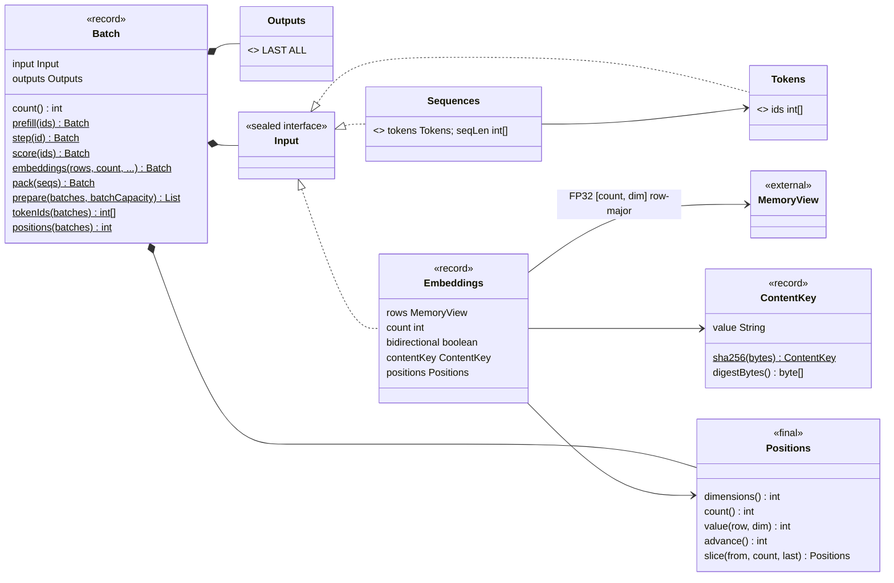

`Batch.prepare` normalises a list for a given batch capacity:

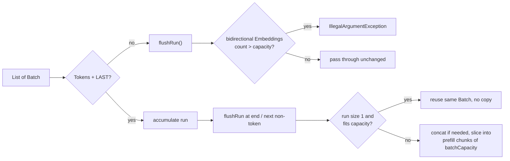

---

## 5. Embedding and checkpoint flows

`EmbeddingModel.embedAll` (default method) packs ragged sequences through the port's `ingest`:

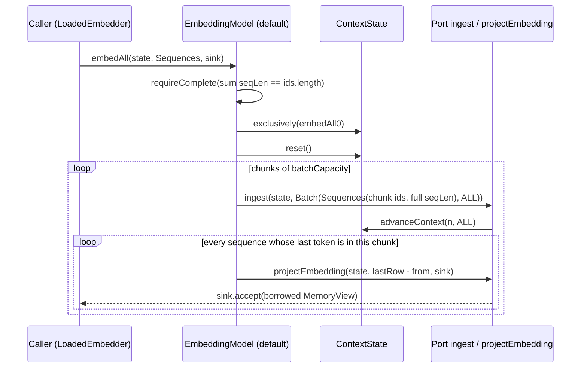

Each chunk carries the full `seqLen` layout, so ports validate with `EmbeddingModel.requireCovers` rather than
equality. Prompt caching (in `jinfer-cache`) uses `ContextModel.checkpointCodec()` →
`CheckpointCodec.byteSize/capture/restore` together with `ContextState.resumeAt(position)`; a port without a codec
triggers `PerformanceCliff.CACHE_SESSIONS_ONLY`.

---

## 6. Media and multimodal input

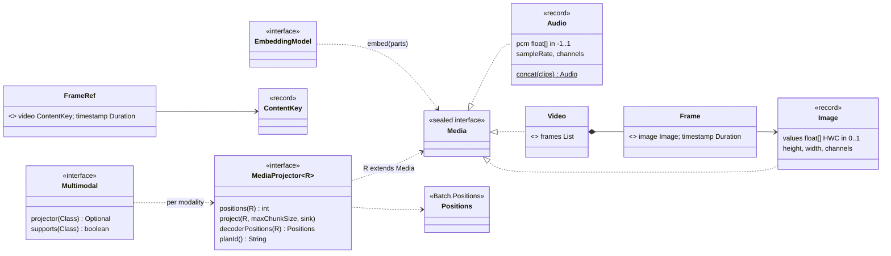

Records validate eagerly (dimensions, channel count 1/3/4, value ranges, ascending frame timestamps). A projector's
chunks are borrowed views, typically wrapped by callers as `Batch.embeddings(rows, count, bidirectional, contentKey,
positions)`; `Positions.slice` rebases coordinates per chunk.

---

## 7. Memory runtime

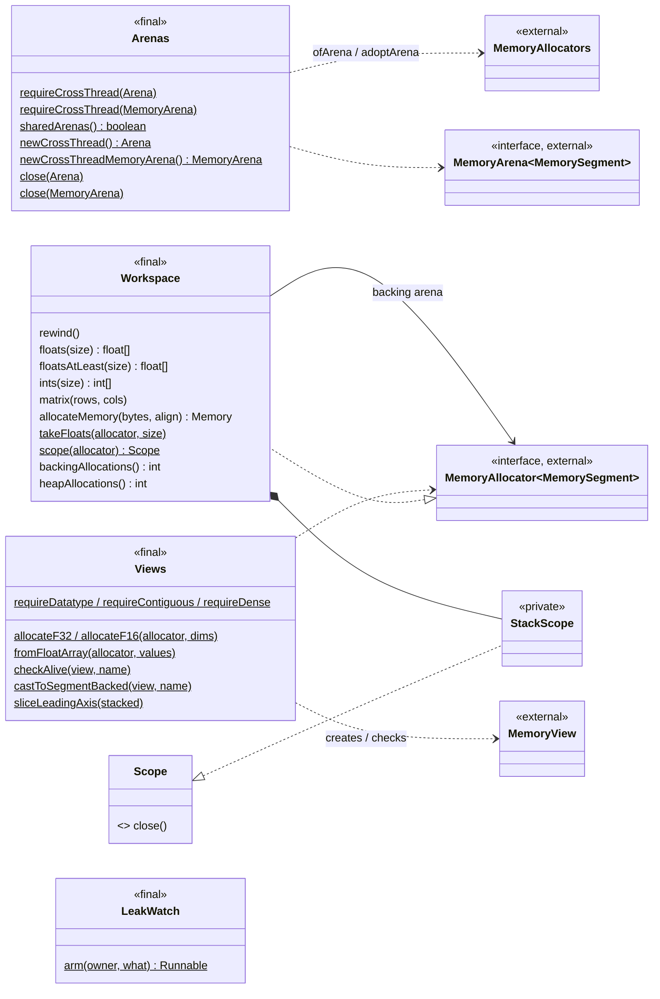

`Arenas` probes a zero-byte allocation against an unstarted local thread to refuse confined arenas (kernels may run
on pool or native threads and bypass JDK confinement). `newCrossThread()` is `Arena.ofShared()` on the JVM and
`Arena.ofAuto()` in a native image (unless `-Djinfer.sharedArenas`), decided at call time. `Workspace` hands buffers
out by allocation order and reuses them on `rewind()` (contents not zeroed); the static `take*`/`scope` helpers fall
back to fresh arrays when the allocator is not a `Workspace`.

---

## 8. Compute runtime

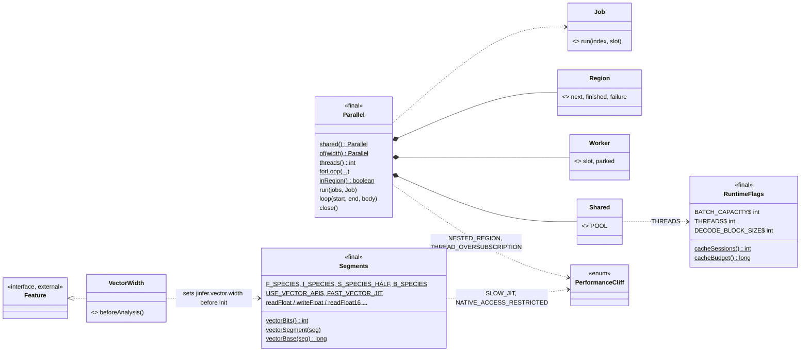

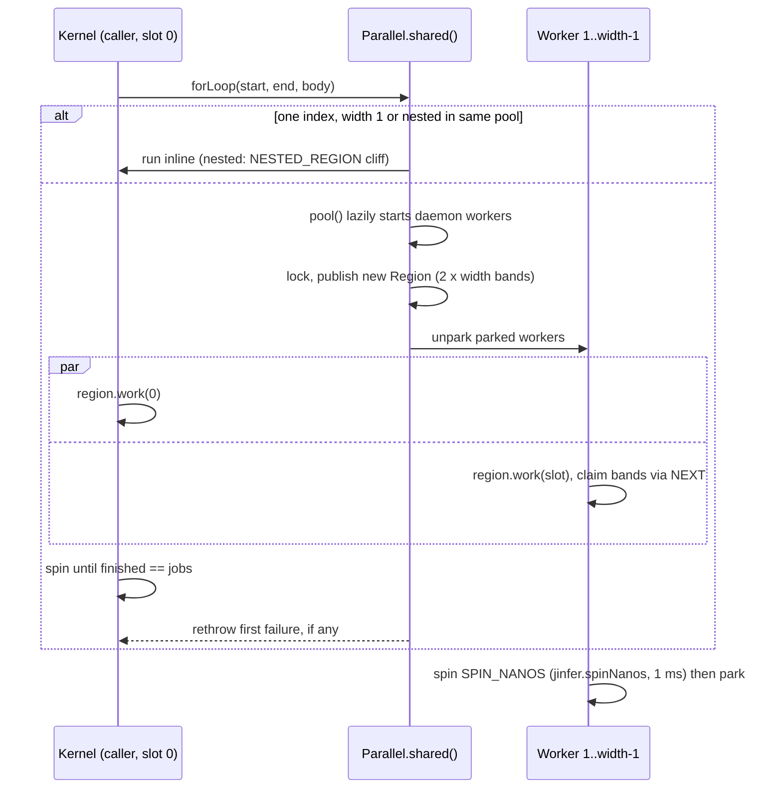

`RuntimeFlags.THREADS` defaults to the physical/fast-core count (Apple `sysctlbyname("hw.perflevel0.physicalcpu")`,
Linux sysfs topology incl. hybrid / big.LITTLE `cpu_capacity`, capped by `availableProcessors`). `Segments` fails
fast with a fix-it message when `jdk.incubator.vector` is missing; `-Djinfer.vector.width` accepts only
0/128/256/512 and `-Djinfer.vector.jit=auto|fast|slow` controls `FAST_VECTOR_JIT`. The absolute-address
`GLOBAL_SEGMENT` (`MemorySegment.NULL.reinterpret(Long.MAX_VALUE)`) needs native access.

---

## 9. Telemetry (JFR)

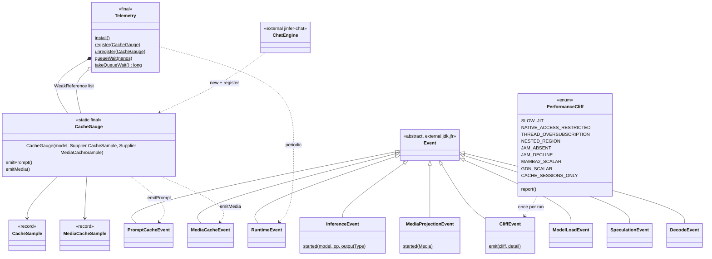

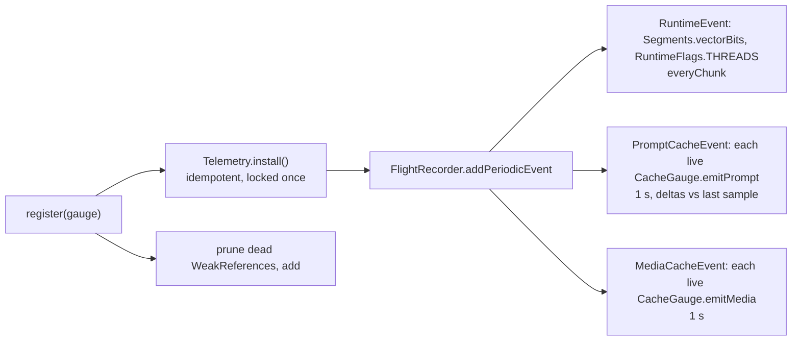

JFR is the seam: no listener interface. Gauges are held weakly so an unclosed engine stays collectable and
`LeakWatch` can still report it. `src/main/resources/jinfer.jfc` is a JFR settings profile enabling these events
(`jinfer.Decode` off by default). `PerformanceCliff.report()` is a plain-read once-filter; the first report is
`@NeverInline` and emits one `CliffEvent` plus one `jinfer.perf` log line. Within this repository no emitter of
`ModelLoadEvent` was found outside its schema test.

---

## 10. Native-image configuration

`META-INF/native-image/com.qxotic/jinfer-core/native-image.properties` enables `VectorAPISupport` and
`ForeignAPISupport`, registers `--features=com.qxotic.jinfer.VectorWidth`, adds `jdk.incubator.vector`, enables
native access, initialises `com.qxotic.` at build time and opts back to run time: `RuntimeFlags`, `Parallel`,
`Parallel$Shared`, `LeakWatch`, `LeakWatch$Holder`, `ContextState` (flags and threads read on the host, cleaners
and pools not baked into the heap). `reachability-metadata.json` sits alongside. There is no
`META-INF/services` registration in this module; model discovery (`ModelProvider` via `ServiceLoader`) lives in
`jinfer-chat`.
