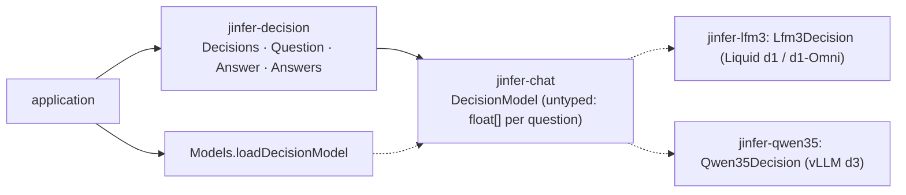

# jinfer-decision — architecture summary

**Typed decisions over a jinfer decision model**: ask predicate (yes/no), choice and rating questions about an input
(text and media parts) and get back the model's probabilities over the question's outcomes — nothing is generated.
One package, `com.qxotic.jinfer.decision`, four public types, ~440 lines. Details and all diagrams:
[ARCHITECTURE.md](ARCHITECTURE.md).

## Where it sits

- Compile dependencies: `jinfer-core` (`ContextState`) and `jinfer-chat` (`DecisionModel`, `Content`) only.
- No model code, no kernels, no SPI registration: the model comes from `Models.loadDecisionModel(path, arena)`, which
  dispatches to the family's `ModelProvider.loadDecisionModel`.
- `jinfer-lfm3` and `jinfer-qwen35` are **test-scope** only (integration tests `D1DecisionsIT`,
  `D1DecisionsRobustnessIT`, `D3DecisionsIT`). Server / LangChain4j / Spring AI integrations use `DecisionModel`
  directly, not this module.

## Main concepts

| Type | What it is |
|---|---|
| `Decisions` | `Decisions.of(model)`: immutable, thread-safe facade. `ask(state, input, question)` → typed answer; `ask(state, input, questions...)` and `askIndependently(...)` → `Answers` |
| `Question<A>` | Sealed: `Predicate`, `Choice<E>`, `Rating<E>` records built by static factories (`predicate`, `choice`, `rating`) from strings, enums, `SequencedMap` label→description, or any list plus a label function |
| `Answer` | Sealed: `Predicate` (`yes`, `no()`, `isYes()`), `Choice<E>` (`selectedOption()`), `Rating<E>` (`selectedLevel()`, `medianLevel()`, `mean()`); all share `probabilities()`, `selectedIndex()`, `confidence()` |
| `Answers` | The answers of a multi-question call, looked up by question: `answers.get(q)` returns `q`'s own answer type |

## How they fit together

1. The caller builds questions. A choice/rating keeps the caller's **values** (e.g. `Team` constants) next to the
   **labels** the model reads (`DecisionModel.Option`; enum `TECH_SUPPORT` reads as "tech support").
2. `Decisions` wraps the input string as `List.of(Content.Text)`, null-checks, and *lowers* each typed question to a
   `DecisionModel.Predicate / Choice / Rating` (labels only).
3. It calls `model.decide(...)` (one question, or several "the model's way") or `model.decideIndependently(...)`,
   in the caller's `ContextState`.
4. The returned `float[]` rows (option order, summing to 1) are turned back into typed answers by
   `Answers.answer(question, row)`: a predicate takes `row[1]` (options are no, yes), choice/rating zip the row with
   the caller's values.

## Key flows

- **One question**: `ask(state, input, q)` → `decide(state, input, lowered)` → `Answers.answer(q, p)` → `A`.
- **Several, shared reading**: `ask(state, input, q1, q2, …)` → `decide(state, input, list)`. For d1 (`Lfm3Decision`)
  up to 16 questions are packed after one copy of the input — fast, but answers may shift with what else is asked.
- **Several, isolated**: `askIndependently(...)` → `decideIndependently(...)`: row *i* is what `q_i` alone gets.
  For d3 (`Qwen35Decision`) both paths behave alike.

## Notable design choices

- **Type-safe answers via the question's type parameter**: `Question.Choice<E> implements Question<Answer.Choice<E>>`,
  so `ask` returns the right answer type with no caller cast; sealed interfaces + record patterns make lowering and
  answering exhaustive `switch`es.
- **Thin and stateless**: no caching or locking; one call at a time per `ContextState`, one state per thread over a
  shared model. `Decisions` only names caller nulls; every other refusal (too long, too many options, unsupported
  media) is the model's.
- **Immutability**: all records copy their lists (`List.copyOf`); `Answers` is keyed by record equality, so an equal
  question finds the answer and a duplicate question keeps the last answer.
- **Answers read the probabilities as-is**: `selectedIndex` is argmax (earlier wins ties, so `isYes()` needs
  `yes > 0.5`), `Rating.medianIndex` is the first level reaching cumulative 0.5; calibration belongs to the model.
- Reserved JPMS name `com.qxotic.jinfer.decision` (manifest `Automatic-Module-Name`, no `module-info.java`).
