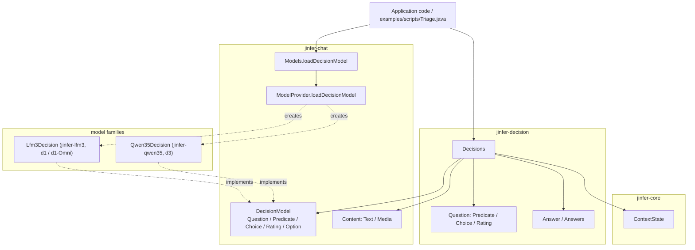
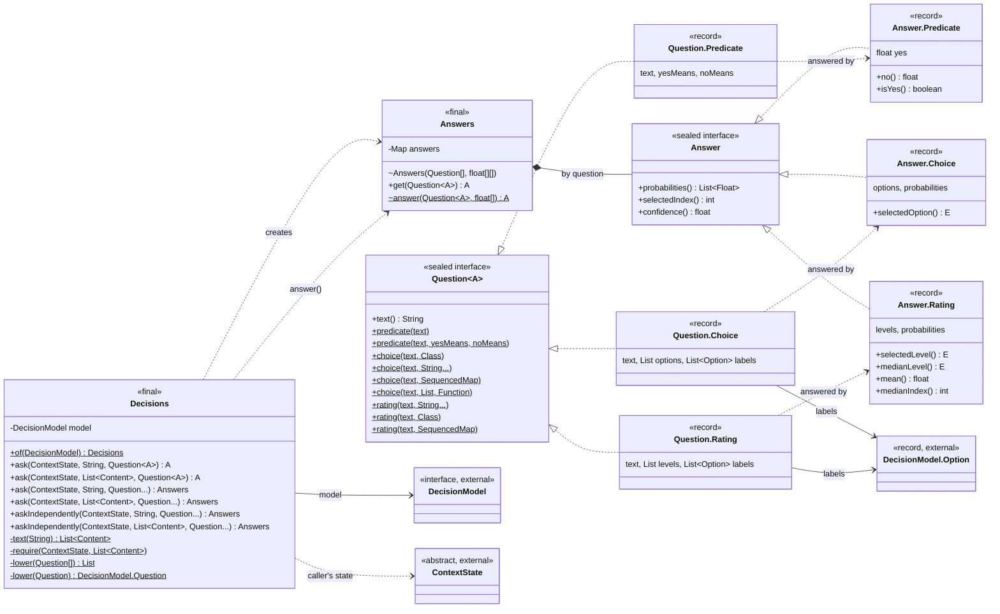
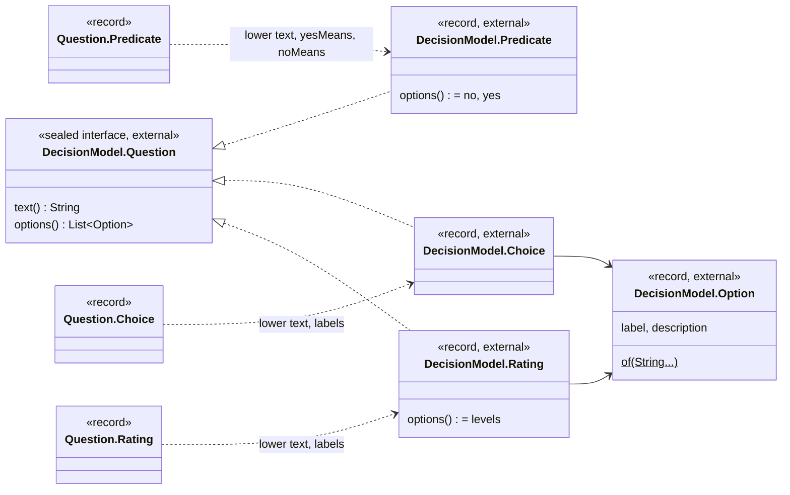
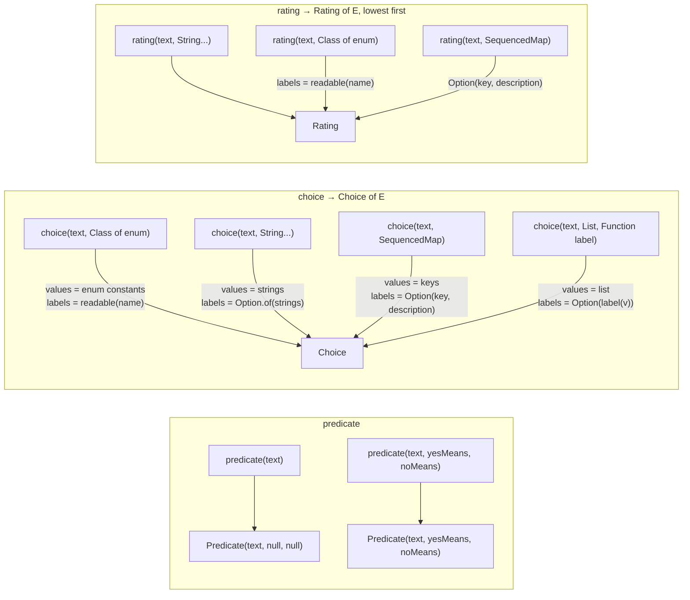
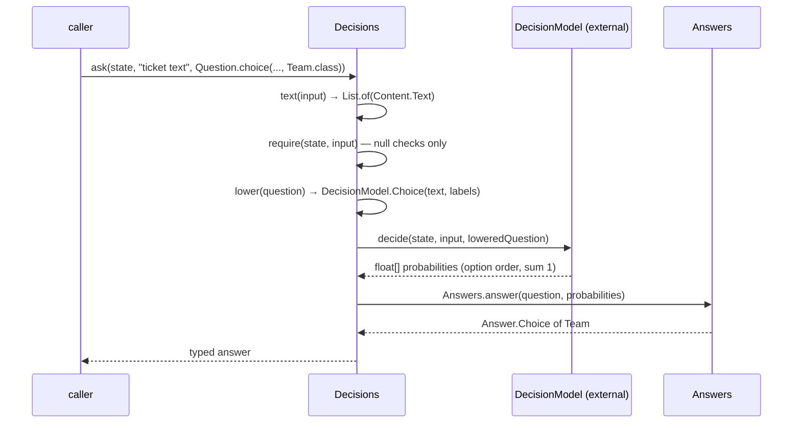
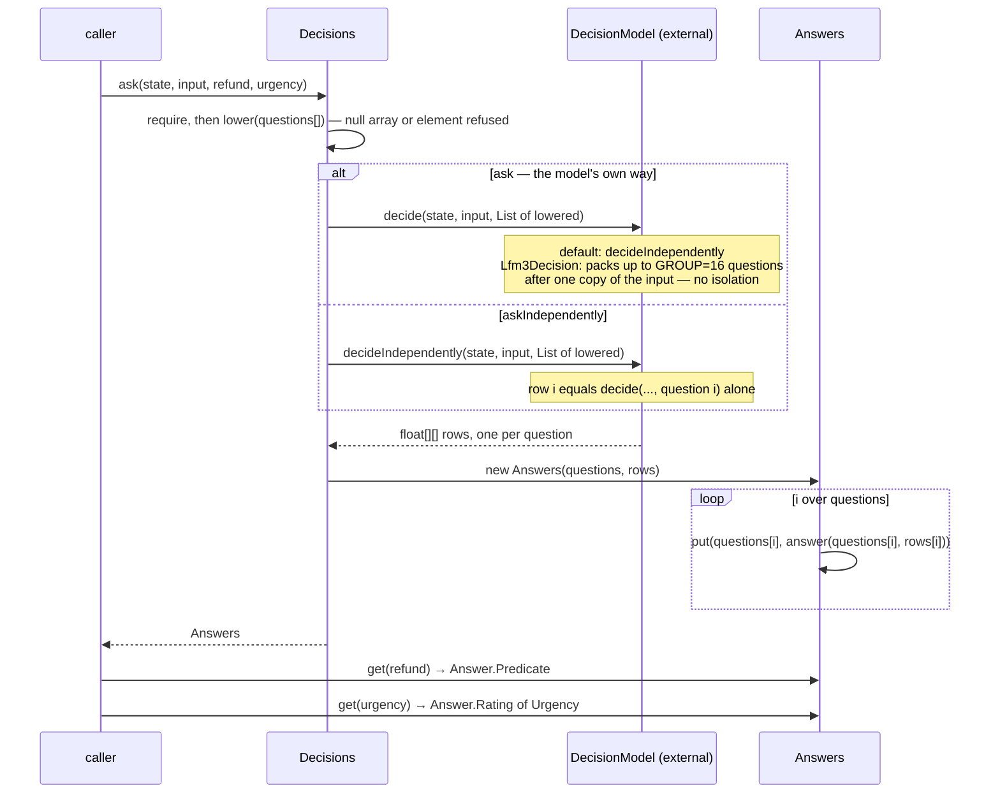
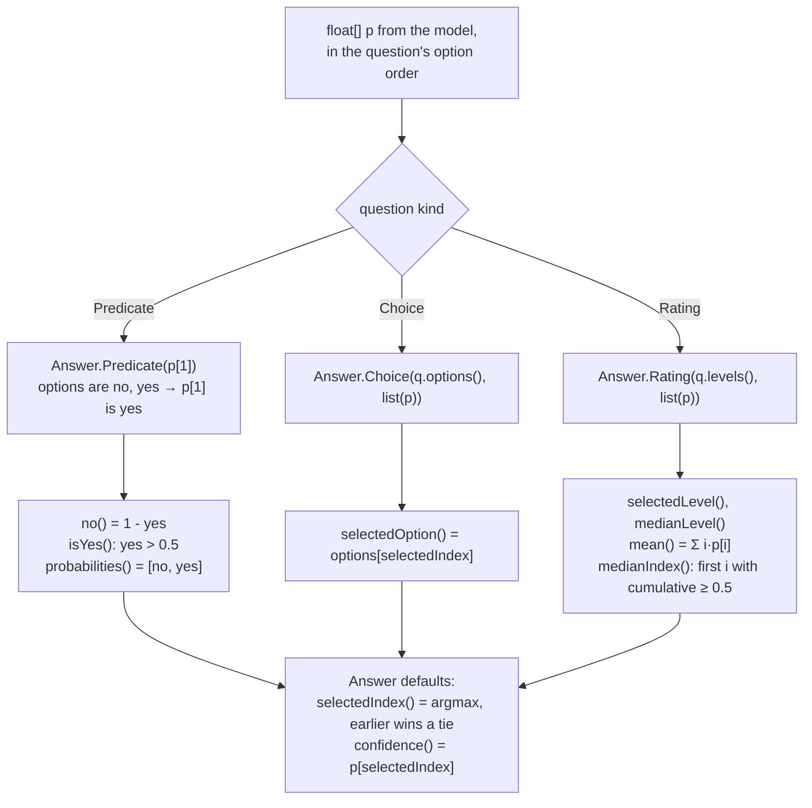

# jinfer-decision — class architecture

Package `com.qxotic.jinfer.decision` (4 top-level types, ~440 lines). It is a thin, **typed** layer over the
`DecisionModel` interface of `jinfer-chat`: predicate (yes/no), choice and rating questions about an input, each
answered with the model's probabilities over the question's outcomes — **no text is generated**. It owns no model,
no kernel and no state; every computation is delegated to a `DecisionModel` loaded by `Models.loadDecisionModel`
(implemented today by `Lfm3Decision` in `jinfer-lfm3`, Liquid d1 / d1-Omni, and `Qwen35Decision` in `jinfer-qwen35`,
vLLM's d3). Compile dependencies: `jinfer-core`, `jinfer-chat` only; no `META-INF/services` registration (the module
is not a `ModelProvider`). JPMS automatic module name: `com.qxotic.jinfer.decision`.

Format: **Mermaid**. Legend: `..|>` implements; `--|>` extends; `-->` holds/uses; `..>` creates/depends;
classes marked `<<external>>` live outside this package.

1. [Position in the stack](#1-position-in-the-jinfer-stack)
2. [Class diagrams](#2-class-diagrams) — 2a public API, 2b mapping to `DecisionModel`
3. [Question factories](#3-question-factories)
4. [Call flows](#4-call-flows) — 4a one question, 4b several questions
5. [Answer derivations](#5-answer-derivations)
6. [Invariants and validation](#6-invariants-and-validation)

| Class | Role |
|---|---|
| `Decisions` | Entry point (final, immutable, thread-safe): wraps a `DecisionModel`; `ask` (one or many questions) and `askIndependently`; lowers typed questions to `DecisionModel.Question` |
| `Question<A extends Answer>` | Sealed interface of typed questions with static factories `predicate` / `choice` / `rating`; nested records `Predicate`, `Choice<E>`, `Rating<E>` |
| `Answer` | Sealed interface: `probabilities()`, default `selectedIndex()` / `confidence()`; nested records `Predicate`, `Choice<E>`, `Rating<E>` |
| `Answers` | Final, immutable map from question to typed answer for multi-question calls; `get(Question<A>) : A`; package-private `answer(question, float[])` builds one typed answer |

---

## 1. Position in the jinfer stack

Other integrations (`jinfer-langchain4j`, `jinfer-spring-ai`, `jinfer-server`, `jinfer-cli`) talk to
`DecisionModel` directly; none of them depends on this module. It is listed in `jinfer-bom`.

---

## 2. Class diagrams

### 2a. Public API

The type parameter of `Question<A>` ties each question kind to its answer kind: `Question.Predicate implements
Question<Answer.Predicate>`, `Question.Choice<E> implements Question<Answer.Choice<E>>`, `Question.Rating<E>
implements Question<Answer.Rating<E>>`. So `decisions.ask(state, input, Question.choice("…", Team.class))` returns an
`Answer.Choice<Team>` and `selectedOption()` is a `Team`, with no cast at the call site.

### 2b. Mapping to `DecisionModel` (lowering)

`Decisions.lower` turns a typed question into the untyped one the model takes. The caller's values (enum constants,
strings, arbitrary objects) stay in the typed question; only their `Option` labels reach the model.

---

## 3. Question factories

All factories are static methods on `Question`. Choice and rating keep two parallel, equal-sized lists: the caller's
**values** (`options` / `levels`, type `E`) and the model's **labels** (`List<Option>`).

- `readable(Enum)`: `name().toLowerCase(Locale.ROOT).replace('_', ' ').strip()` — `TECH_SUPPORT` reads as
  "tech support"; the `strip()` keeps a leading/trailing underscore from becoming a stray space.
- Option order is part of the question: it is the order the model reads them in, and the order of the answer's
  probabilities. Enums use declaration order.

---

## 4. Call flows

### 4a. One question — `ask(state, input, question)`

### 4b. Several questions — `ask` vs `askIndependently`

`Qwen35Decision` (d3) answers `decide(list)` and `decideIndependently` alike (one prompt per question).
`Decisions` itself adds no state, locking or caching: one call at a time per `ContextState`, one state per thread
over a shared model.

---

## 5. Answer derivations

`Answers.answer(question, float[])` is a pattern-matching switch over the sealed `Question`:

- `isYes()` is strictly `yes > 0.5f`, so an even split is "no" — consistent with `selectedIndex()` choosing the
  earlier outcome (`no`) on a tie.
- `Rating.mean()` is a 0-based position on the scale; `medianIndex()` always names a level the model gave weight to,
  even when the mass is split between distant levels.
- The answer never re-normalises; calibration is the model's.

---

## 6. Invariants and validation

| Where | Check | Failure |
|---|---|---|
| `Decisions.of` | model non-null | `NullPointerException("model")` |
| `Decisions.require` | state, input non-null | `NullPointerException` |
| `Decisions.text` | input string non-null | `NullPointerException("input")` |
| `Decisions.lower(Question[])` | array and each element non-null | `NullPointerException` |
| `Question.*` compact ctors | text not null/blank | `IllegalArgumentException("blank text")` |
| `Question.Choice` / `Rating` | values and labels same size; ≥ 2 entries; lists copied (`List.copyOf`) | `IllegalArgumentException` |
| `DecisionModel.Option` (external) | label not blank | `IllegalArgumentException("blank label")` |
| `Answer.Choice` / `Rating` | outcomes and probabilities same size; lists copied | `IllegalArgumentException` |
| `Answers.get` | question was asked (by `equals`) | `IllegalArgumentException("this question was not asked")` |

- `Answers` is keyed by a `HashMap<Question<?>, Answer>`: since questions are records, an *equal* question finds the
  answer, and a question asked twice in one call holds the last of its answers.
- Everything else (input too long for the state, too many options, unsupported media part, empty input) is left to
  the model to refuse — "a caller's null is named here; anything else is the model's to refuse".
- All types are immutable and safe to share across threads.

Tests (`src/test`): `DecisionsTest`, `DecisionApiEdgeTest`, `DecisionsFailureTest` use a canned in-test
`DecisionModel`; `D1DecisionsIT` / `D1DecisionsRobustnessIT` run against LFM3 d1 and `D3DecisionsIT` against
Qwen3.5 d3 (test-scope dependencies `jinfer-lfm3`, `jinfer-qwen35`).
