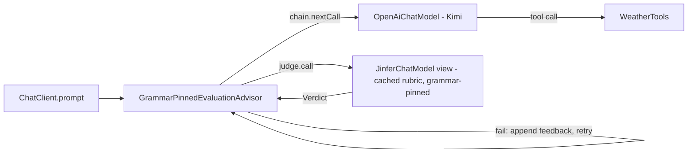

# jinfer-example-judge-advisor — architecture summary

A Spring Boot **demo** (not a library, not published to Maven Central) that pairs a **remote generator** with a
**local judge**: Kimi (an OpenAI-compatible endpoint, reached through Spring AI's `OpenAiChatModel`) answers the
question, and a GGUF model running inside the same JVM through jinfer's `JinferChatModel` grades each answer. A Spring
AI advisor re-runs generation with the judge's feedback until the verdict passes or the attempt limit is hit. It adapts
Spring AI's `evaluation-recursive-advisor-demo` and hardens it with jinfer-specific features.

For class diagrams, sequences and details see [ARCHITECTURE.md](ARCHITECTURE.md).

## Where it sits in the stack

It is a leaf consumer at the top of the stack:

- `jinfer-spring-ai-spring-boot-starter` — `JinferChatModel` / `JinferChatOptions` (`jinfer-spring-ai`) plus
  `JinferChatAutoConfiguration`, which builds the judge bean from `spring.ai.jinfer.chat.*`.
- `jinfer-lfm2` — an architecture port on the classpath (`Lfm2Provider`, registered via `ModelProvider` SPI) so the
  default LFM2.5 judge GGUF can load.
- `json` — `Json.parseMap` to read the verdict.
- `spring-ai-starter-model-openai` — the remote generator bean.

Underneath, `JinferChatModel` drives `jinfer-chat`'s `ChatEngine` and compiles JSON schemas to GBNF with `Grammar`.

## Main classes

| Class | Role |
|---|---|
| `JudgeAdvisorApplication` | Boot entry point; holds the judge `RUBRIC` and `JUDGE_OPTIONS`; `run(generator, judgeBase)` wires everything and asks "What is the weather in Paris?" |
| `GrammarPinnedEvaluationAdvisor` | `CallAdvisor` implementing the self-refine loop; nested `Verdict` record and `Builder` |
| `WeatherTools` | `@Tool weather(location)` that alternates `-255C` (impossible, must fail) and `15C` |

## Key flow

1. Boot creates the `OpenAiChatModel` (generator) and `JinferChatModel` (judge base) beans; the auto-configured
   `ChatClient` is disabled because two `ChatModel` beans exist.
2. `run` calls `judgeBase.withCachedPrompt([SystemMessage(RUBRIC)], [])`: the rubric is prefilled **once** into the
   engine's prompt cache; every evaluation then only ingests the question and answer.
3. A `ChatClient` is built over the generator with `WeatherTools` and the advisor
   (`maxRepeatAttempts(4)`, `successRating(3)`).
4. For each attempt the advisor calls the rest of the chain; tool-call turns are returned unjudged. The final text
   answer is sent to the judge as `Question: ... Answer: ...`.
5. The judge's JSON is parsed into a `Verdict`. If `rating >= successRating` the response is returned; otherwise the
   feedback is appended to the user message (`Prompt.augmentUserMessage`) and the chain re-runs, until attempts run out.

## Notable design choices

- **Grammar-pinned verdict.** `VERDICT_SCHEMA` is hand-written with `rating: enum [1,2,3,4]`, passed as
  `JinferChatOptions.outputSchema`; `JinferChatModel` compiles it to GBNF and masks logits during sampling. The verdict
  always parses and the rating is always in range — the two failure modes of the original demo. The rubric itself
  contains no format instructions.
- **Truncation is degraded, not fatal.** The grammar prevents invalid tokens but not running out of budget: a
  `length` finish reason becomes a failed `Verdict(1, ..., "Be more concise.")`.
- **Deterministic judge**: `temperature(0.0)`, `maxTokens(384)`.
- **Deterministic failure injection** via the cycling `WeatherTools` queue, so the retry path is always exercised.
- **Observability in the transcript**: each attempt prints rating, judge completion tokens, `cacheRead` tokens and the
  `eval-duration` metadata reported by `JinferChatModel`.
- **Testable seam**: `run(ChatModel, JinferChatModel)` is static and takes any generator; the offline integration
  test uses one LFM2.5 `JinferChatModel` as both generator and judge, and unit tests use stub `ChatModel` /
  `CallAdvisorChain` implementations.

## Configuration

`application.properties`: `JINFER_JUDGE_MODEL` (default `models/judge.gguf`), context capacity 8192, max tokens 512 for
the judge; `KIMI_BASE_URL`, `KIMI_API_KEY`, `KIMI_MODEL` for the generator. Run with
`KIMI_API_KEY=... mvn spring-boot:run`.
