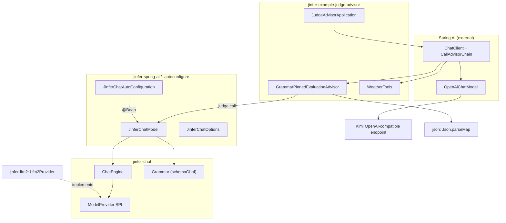
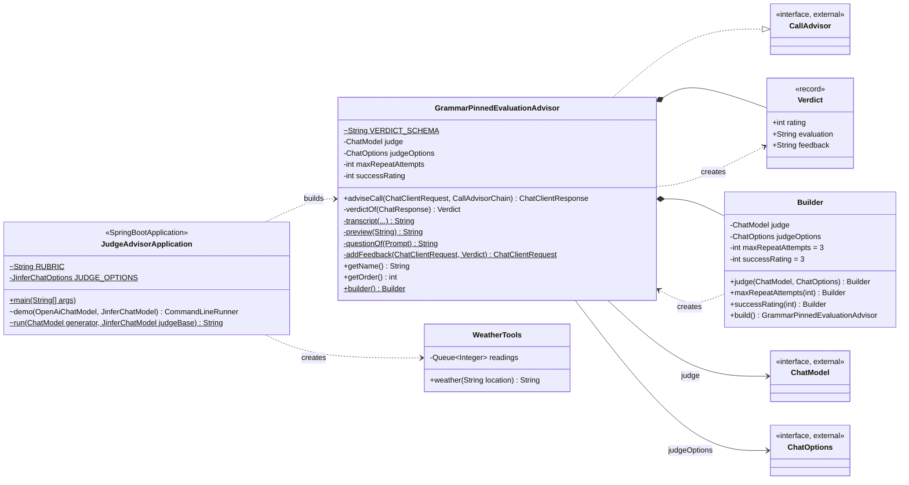
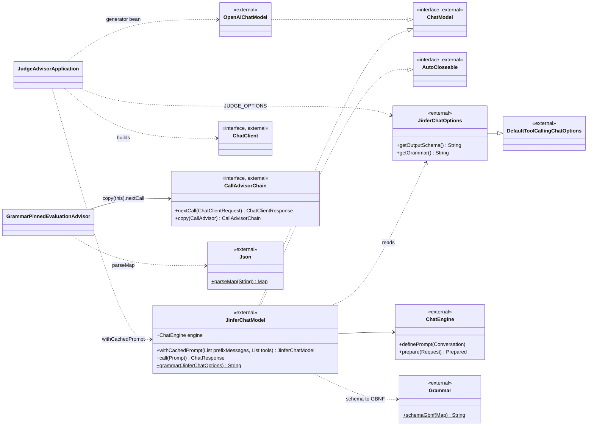
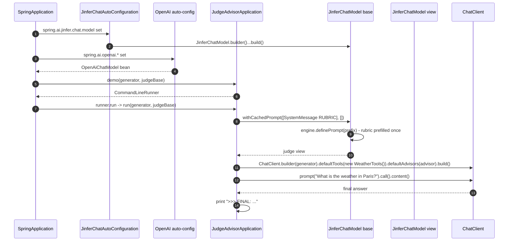
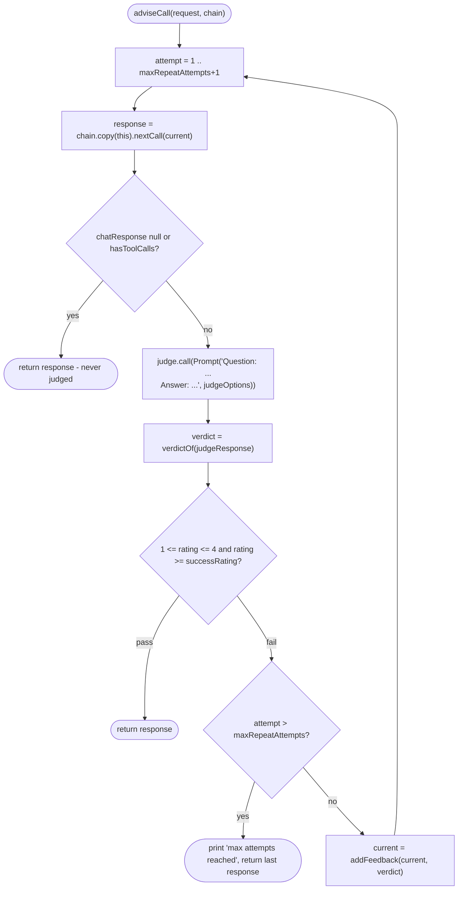
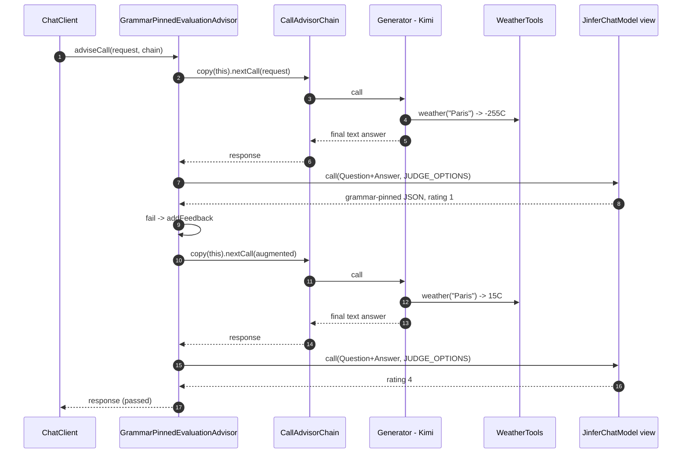
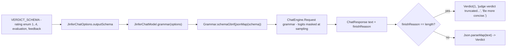

# jinfer-example-judge-advisor — class architecture

Package `com.qxotic.jinfer.example.judgeadvisor` (3 main classes + 1 nested record + 1 nested builder, ~325 lines;
3 test classes). A **Spring Boot demo**, not a library and not published to Maven Central: a remote OpenAI-compatible
generator (Kimi, via `spring-ai-starter-model-openai`) answers a question, and a **local in-JVM jinfer judge**
(`JinferChatModel` over a GGUF) grades each answer. A Spring AI `CallAdvisor` loops generation until the judge's
verdict passes. The verdict is *grammar-pinned*: its JSON schema is compiled to GBNF and enforced at sampling time,
so it always parses and its `rating` is always one of 1–4.

Format: **Mermaid**. Legend: `..|>` implements; `-->` holds/uses; `..>` creates/depends; `*--` nested/composed;
classes marked `<<external>>` live outside this module.

1. [Position in the stack](#1-position-in-the-jinfer-stack)
2. [Module dependencies](#2-module-dependencies)
3. [Class diagrams](#3-class-diagrams) — 3a module classes, 3b external collaborators
4. [Bean wiring and startup](#4-bean-wiring-and-startup)
5. [The self-refine loop](#5-the-self-refine-loop) — 5a flowchart, 5b sequence
6. [Verdict decoding and grammar pinning](#6-verdict-decoding-and-grammar-pinning)
7. [Tests](#7-tests)

| Class | Role |
|---|---|
| `JudgeAdvisorApplication` | `@SpringBootApplication`; holds the judge `RUBRIC` and `JUDGE_OPTIONS`; a `CommandLineRunner` bean calls `run(generator, judgeBase)`, which builds the cached-prompt judge and the `ChatClient` and asks one question |
| `GrammarPinnedEvaluationAdvisor` | Spring AI `CallAdvisor`: the self-refine loop — call the chain, judge the text answer, append feedback to the user message and retry up to `maxRepeatAttempts` |
| `GrammarPinnedEvaluationAdvisor.Verdict` | record `(rating, evaluation, feedback)` parsed from the judge's JSON |
| `GrammarPinnedEvaluationAdvisor.Builder` | fluent builder: `judge(ChatModel, ChatOptions)` (required), `maxRepeatAttempts` (default 3), `successRating` (default 3) |
| `WeatherTools` | `@Tool weather(location)`: a deterministic cycling queue of readings `-255`, `15` so the first answer is physically impossible and must fail |

Resources: `src/main/resources/application.properties` disables the auto-configured `ChatClient`
(`spring.ai.chat.client.enabled=false`, since two `ChatModel` beans exist) and configures both models
(`spring.ai.jinfer.chat.*` for the judge, `spring.ai.openai.*` for Kimi). The module declares no
`META-INF/services` entries of its own; it relies on the SPI and auto-configuration registrations of its dependencies
(see §2).

---

## 1. Position in the jinfer stack

The generator runs remotely; only the judge runs in-process. In the offline integration test, one `JinferChatModel`
plays both roles (§7).

---

## 2. Module dependencies

From `pom.xml` (versions managed by `jinfer-parent`; Jackson, Spring AI and Spring Boot BOMs imported):

| Dependency | Scope | Why |
|---|---|---|
| `jinfer-spring-ai-spring-boot-starter` | compile | brings `jinfer-spring-ai` (`JinferChatModel`, `JinferChatOptions`) and `jinfer-spring-ai-autoconfigure` (`JinferChatAutoConfiguration`, registered in `META-INF/spring/org.springframework.boot.autoconfigure.AutoConfiguration.imports`) plus Spring AI chat-client/tool auto-configuration |
| `jinfer-lfm2` | compile | one architecture port on the runtime classpath for the default judge (LFM2.5); registers `Lfm2Provider` under `META-INF/services/com.qxotic.jinfer.chat.ModelProvider` |
| `json` | compile | `com.qxotic.format.json.Json.parseMap` to read the verdict |
| `spring-ai-starter-model-openai` | compile | `OpenAiChatModel` bean for the remote generator |
| `spring-boot-starter-test` | test | JUnit 5, AssertJ, `ApplicationContextRunner` |
| `jinfer-testkit` | test | `TestModels.require(...)` model fixtures (gates model-backed tests) |

Build: `spring-boot-maven-plugin` (run with `KIMI_API_KEY=... mvn spring-boot:run`; jinfer JVM flags managed by the
parent).

---

## 3. Class diagrams

### 3a. Module classes

`getOrder()` returns `0`; `getName()` returns `"GrammarPinnedEvaluationAdvisor"`. `build()` throws
`IllegalArgumentException` when `judge` or `judgeOptions` is missing.

### 3b. External collaborators

---

## 4. Bean wiring and startup

- `JUDGE_OPTIONS`: `temperature(0.0)`, `maxTokens(384)`, `outputSchema(VERDICT_SCHEMA)`.
- The rubric carries no format instructions: structure is enforced by the grammar alone (the spring-ai adapter never
  restates the schema in the prompt).
- `run(...)` is static and takes a plain `ChatModel` generator, so tests can pass any model (including the same
  `JinferChatModel` as both roles).

---

## 5. The self-refine loop

### 5a. `adviseCall` control flow

- `questionOf(prompt)` joins the SYSTEM and USER messages of the current prompt as `TYPE: text` lines.
- `addFeedback` uses `Prompt.augmentUserMessage` to append "The previous answer failed evaluation with feedback: …
  Please answer again, addressing the feedback." and rebuilds the request with `request.mutate().prompt(...)`.
- Each attempt prints one transcript line: pass/fail, rating, judge completion tokens, `cacheRead` (from
  `Usage.getCacheReadInputTokens()`, when non-null), `decode` (metadata key `eval-duration`), feedback on failure, and an
  80-char preview of the answer.

### 5b. One run with the weather gimmick

`WeatherTools` keeps an `ArrayDeque` of `[-255, 15]`; each call polls the head and re-appends it, so readings
alternate forever.

---

## 6. Verdict decoding and grammar pinning

- `VERDICT_SCHEMA` is hand-written (not record-generated) so `rating` is pinned by `enum [1,2,3,4]`; all three fields are
  `required`.
- The grammar guarantees no invalid token, not completion within the budget: a `length` finish yields truncated JSON,
  which `verdictOf` degrades to a failed verdict instead of throwing.
- The range check in `adviseCall` (`1 <= rating <= 4`) is defensive; under the grammar an out-of-range rating cannot be
  produced.
- `JinferChatModel.grammar` refuses `outputSchema` and `grammar` set together.

---

## 7. Tests

| Test | Kind | What it covers |
|---|---|---|
| `GrammarPinnedEvaluationAdvisorTest` | unit (stubs `StubJudge implements ChatModel`, `StubChain implements CallAdvisorChain`) | pass on first good verdict; failed verdict retries with feedback in the user message; max attempts returns last response; tool-call responses skip evaluation; out-of-range rating never passes; truncated verdict degrades to a failed evaluation |
| `JudgeAdvisorOfflineIT` | `@Tag("integration")`, model-gated via `TestModels` | LFM2.5-8B-A1B Q8_0 plays both generator and judge: `JudgeAdvisorApplication.run(base, base)`; assumes the final answer contains `15` |
| `JudgeAdvisorKimiIT` | `@Tag("integration")`, gated on `KIMI_API_KEY` and model | `ApplicationContextRunner` with `JinferChatAutoConfiguration`, `ToolCallingAutoConfiguration`, `OpenAiChatAutoConfiguration`; runs the full hybrid loop |
