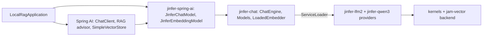

# jinfer-example-local-rag — architecture summary

Detailed class architecture and diagrams: [ARCHITECTURE.md](ARCHITECTURE.md).

## What it is

A **demo Spring Boot application** that runs retrieval-augmented generation (RAG) entirely inside one JVM. Two GGUF
models run in-process through jinfer: an embedding model (by default Qwen3-Embedding 0.6B) and a chat model (by
default LFM2.5 8B-A1B). There is no model server and no API key. Remote model refs download on first use and are
cached after that. The module is not published to Maven Central.

The corpus is four short "AcmeCloud" support documents. Their facts (refund as store credit, weekend orders ship
Monday, two-year warranty, support hours) appear only in the documents. A grounded answer therefore shows that
retrieval worked; it cannot come from what the model already knew.

## Where it sits in the stack

It is a leaf consumer at the top of the jinfer stack:

- `jinfer-spring-ai-spring-boot-starter` brings in the adapters (`jinfer-spring-ai`), their auto-configuration and
  Spring AI's chat-client support.
- `jinfer-lfm2` and `jinfer-qwen3` are the model ports for the default models. `Models` discovers them as
  `ModelProvider` services and picks one from the GGUF's `general.architecture`.
- `jam-vector` (runtime scope) supplies the Java Vector API compute backend.
- `spring-ai-vector-store` and `spring-ai-rag` supply `SimpleVectorStore`, `RetrievalAugmentationAdvisor` and
  `VectorStoreDocumentRetriever`.

## Main classes

| Class | Role |
|---|---|
| `LocalRagApplication` | The whole application: `CORPUS`, `QUESTIONS`, a `CommandLineRunner` bean and a static `run(chat, embeddings)` |
| `LocalRagIT` (test) | Builds both models without Spring and checks that the answers are grounded |
| `JinferChatModel` (external) | Spring AI `ChatModel` backed by a jinfer `ChatEngine` |
| `JinferEmbeddingModel` (external) | Spring AI `EmbeddingModel` backed by a jinfer `LoadedEmbedder` |
| `JinferChatAutoConfiguration` / `JinferEmbeddingAutoConfiguration` (external) | Build the two beans from `spring.ai.jinfer.*` properties |

## Key flows

1. **Boot.** `application.properties` sets `spring.ai.jinfer.chat.model`, which enables the chat auto-configuration
   through `JinferChatSelected`. It also sets `spring.ai.model.embedding=jinfer`, which embedding requires explicitly,
   and `spring.ai.jinfer.embedding.model`. Both model values come from `JINFER_CHAT_MODEL` and
   `JINFER_EMBEDDING_MODEL`, with local `models/*.gguf` fallbacks. The builders resolve refs through `ModelStore` and
   load weights through `Models.load` or `Models.loadEmbedder`.
2. **Ingest.** `run` builds a `SimpleVectorStore` over the embedding model, splits `CORPUS` with `TokenTextSplitter`
   and calls `store.add(...)`. The embedding model adds the embedder's `documentPrefix` to each document and embeds
   them in batches through `LoadedEmbedder.embedAll`.
3. **Answer.** A `ChatClient` is built over the chat model with a `RetrievalAugmentationAdvisor` as its default
   advisor. The advisor's retriever returns the top 2 documents. For each question, the advisor embeds the query
   with `queryPrefix` added, finds its nearest chunks and adds them to the prompt. `JinferChatModel.call` then runs
   `ChatEngine.complete`. Each answer is printed and returned.

## Design choices

- **One static `run` method.** Spring injects the models for the `CommandLineRunner` path. The integration test
  passes in models it built itself. Both paths run the same code, and the test needs no Spring context.
- **No wiring code.** The app relies only on the starter's auto-configuration and Spring AI's builders, so it shows
  that jinfer plugs into the standard Spring AI RAG APIs unchanged.
- **Separate query and document framing.** `JinferEmbeddingModel` adds the model card's query or document prefix
  depending on the call (`embed(String)` vs `getEmbeddingContent(Document)`). Retrieval quality depends on this
  asymmetry.
- **Small, fixed settings.** Chat context is 4096 tokens, replies are capped at 256 tokens and retrieval uses
  `topK(2)`. These keep the demo fast on a CPU-only JVM. The parent POM supplies the JVM flags (Vector API module,
  native access) to `spring-boot:run`.
