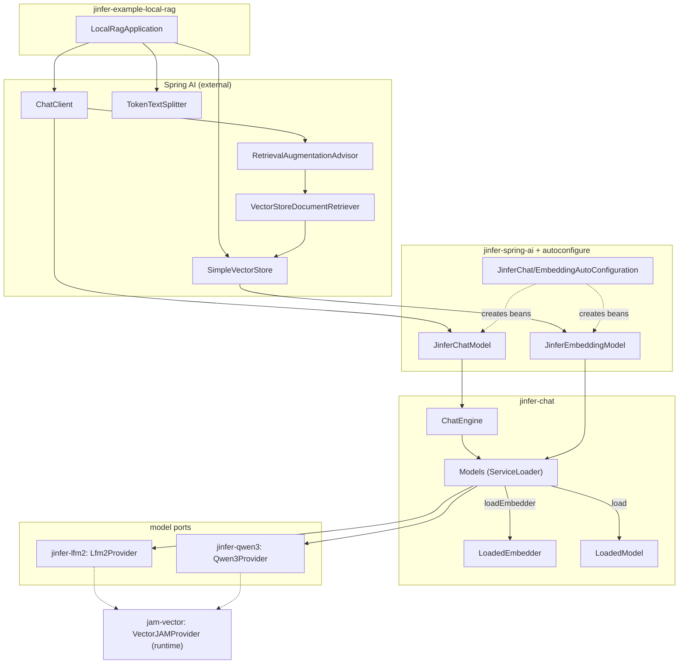
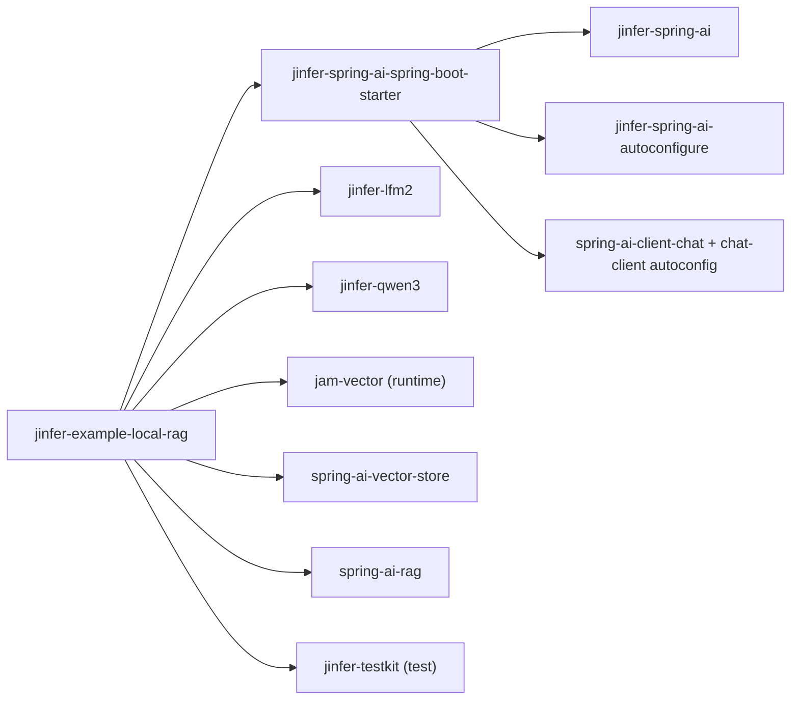
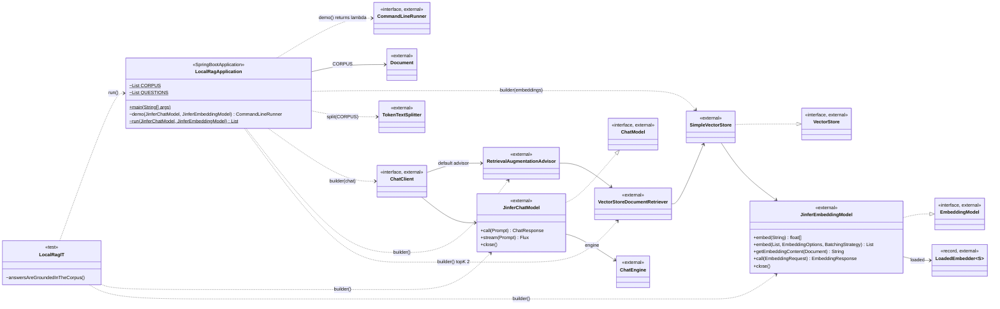
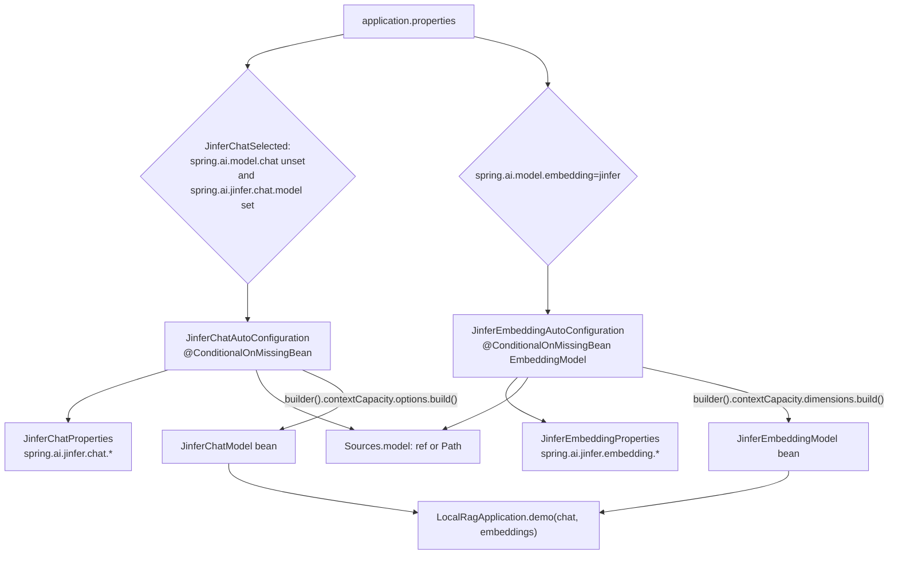
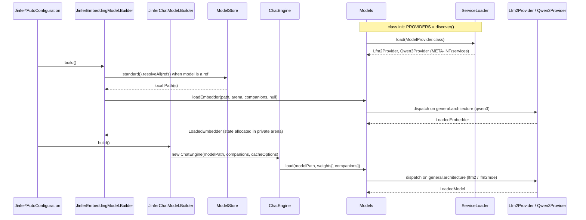
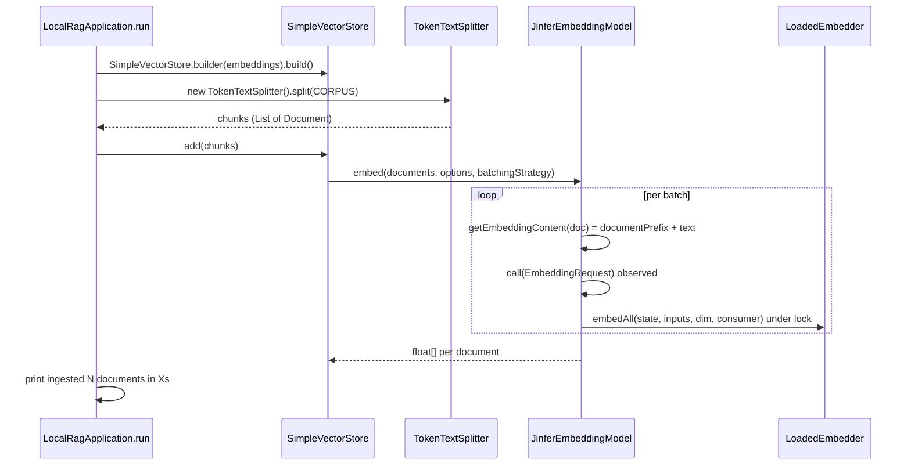
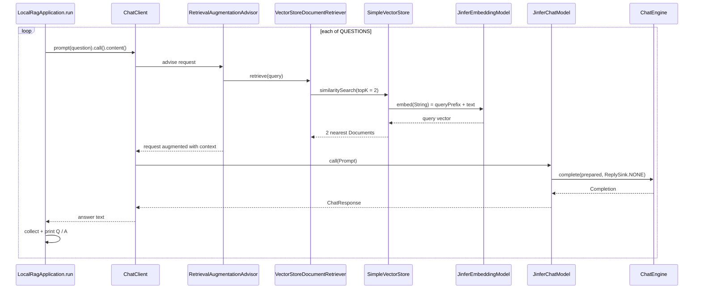
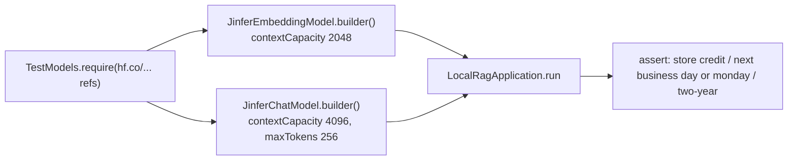

# jinfer-example-local-rag — class architecture

Package `com.qxotic.jinfer.example.localrag` (1 main class, ~90 lines; 1 integration test). It is a **demo Spring Boot
application**, not a library: fully-local retrieval-augmented generation in one JVM. A Jinfer embedding model fills a
Spring AI `SimpleVectorStore`, and a Jinfer chat model answers through `ChatClient` + `RetrievalAugmentationAdvisor`. No
model server, no API key. The module is not published to Maven Central (see `pom.xml` description).

Almost all behaviour lives in dependencies: Spring AI (vector store, RAG advisor, chat client), the jinfer Spring AI
adapters (`jinfer-spring-ai`, `jinfer-spring-ai-autoconfigure`) and, below them, `jinfer-chat` with the model ports
`jinfer-lfm2` and `jinfer-qwen3` discovered through `ServiceLoader`.

Format: **Mermaid**. Legend: `..|>` implements; `--|>` extends; `-->` holds/uses; `..>` creates/depends;
classes marked `<<external>>` live outside this module.

1. [Position in the stack](#1-position-in-the-jinfer-stack)
2. [Module dependencies](#2-module-dependencies)
3. [Class diagram](#3-class-diagram)
4. [Bean wiring (auto-configuration)](#4-bean-wiring-auto-configuration)
5. [Model loading and SPI discovery](#5-model-loading-and-spi-discovery)
6. [Run flow](#6-run-flow) — 6a ingestion, 6b question answering
7. [Configuration](#7-configuration)
8. [Integration test](#8-integration-test)

| Class | Role |
|---|---|
| `LocalRagApplication` | `@SpringBootApplication`; holds the 4-document `CORPUS` and 3 `QUESTIONS`; `demo(...)` `@Bean` returns a `CommandLineRunner`; static `run(chat, embeddings)` ingests and answers, returning the answers |
| `LocalRagIT` (test) | `@Tag("integration")`; builds both models directly with builders and `TestModels.require(...)`, calls `LocalRagApplication.run`, asserts corpus facts appear in the answers |
| `JinferChatModel` <<external>> | Spring AI `ChatModel` over a jinfer `ChatEngine` (`jinfer-spring-ai`) |
| `JinferEmbeddingModel` <<external>> | Spring AI `EmbeddingModel` over a jinfer `LoadedEmbedder` (`jinfer-spring-ai`) |
| `JinferChatAutoConfiguration` / `JinferEmbeddingAutoConfiguration` <<external>> | Create the two model beans from `spring.ai.jinfer.*` properties |

---

## 1. Position in the jinfer stack

The default chat model in the README is LFM2.5 (`LiquidAI/LFM2.5-8B-A1B-GGUF:Q8_0`, architecture `lfm2`/`lfm2moe`
served by `Lfm2Provider`) and the embedder is `Qwen/Qwen3-Embedding-0.6B-GGUF:Q8_0` (architecture `qwen3`, served by
`Qwen3Provider`). That is why exactly these two ports are on the classpath. Any GGUF whose architecture one of them
supports would work; others need their port added to `pom.xml`.

---

## 2. Module dependencies

- Spring AI and Spring Boot versions are imported as BOMs (`spring-ai-bom`, `spring-boot-dependencies`).
- `spring-boot-maven-plugin` gets its version and the jinfer JVM flags (`--add-modules jdk.incubator.vector,...
  --enable-native-access=ALL-UNNAMED`) from the parent `jinfer/pom.xml`, so `mvn spring-boot:run` starts with them.
- `jam-vector` is runtime-only: it registers `com.qxotic.jam.vector.VectorJAMProvider` as a `JAM$Provider` service,
  the Java Vector API backend for the kernels.

---

## 3. Class diagram

`run` is `static` and takes the two models as parameters, so the same code runs both as the Boot `CommandLineRunner`
(beans injected) and from `LocalRagIT` (models built by hand, no Spring context). The application never names
`ChatClient.Builder` as a bean; it calls `ChatClient.builder(chat)` directly.

---

## 4. Bean wiring (auto-configuration)

The starter's `jinfer-spring-ai-autoconfigure` lists its auto-configurations in
`META-INF/spring/org.springframework.boot.autoconfigure.AutoConfiguration.imports` (Chat, Embedding, Decision, Rerank,
Speech, Transcription, Session). Two of them produce the beans this app injects:

- Chat is enabled by `JinferChatSelected` (a `Condition`): if `spring.ai.model.chat` is set it must equal `jinfer`,
  otherwise `spring.ai.jinfer.chat.model` must have text. This app relies on the second branch.
- Embedding requires explicit selection, so the app sets `spring.ai.model.embedding=jinfer`.
- `Sources.model` rejects `://` URLs that are not valid refs, then sends a model ref (`ModelStore.isRef`) to
  `builder.model(String)` and anything else to `builder.modelPath(Path)`.
- `JinferChatProperties.toOptions()` maps the flat properties (here `max-tokens=256`) onto `JinferChatOptions`.

---

## 5. Model loading and SPI discovery

`jinfer-lfm2` registers `com.qxotic.jinfer.models.lfm2.Lfm2Provider` (architectures `lfm2`, `lfm2moe`) and
`jinfer-qwen3` registers `com.qxotic.jinfer.models.qwen3.Qwen3Provider` (architecture `qwen3`, retrieval family only)
in `META-INF/services/com.qxotic.jinfer.chat.ModelProvider`. This module registers no services of its own.

---

## 6. Run flow

### 6a. Ingestion

### 6b. Question answering

The query and document sides frame text differently: `JinferEmbeddingModel.embed(String)` prepends the embedder's
`queryPrefix`, while `getEmbeddingContent(Document)` prepends its `documentPrefix` (both fields of `LoadedEmbedder`,
supplied by the model port).

---

## 7. Configuration

`src/main/resources/application.properties`:

| Property | Value | Effect |
|---|---|---|
| `spring.ai.jinfer.chat.model` | `${JINFER_CHAT_MODEL:models/chat.gguf}` | Chat GGUF: a hub ref or local path; also enables chat via `JinferChatSelected` |
| `spring.ai.jinfer.chat.context-capacity` | `4096` | Context bound passed to `JinferChatModel.Builder.contextCapacity` |
| `spring.ai.jinfer.chat.max-tokens` | `256` | Default `JinferChatOptions.maxTokens` |
| `spring.ai.model.embedding` | `jinfer` | Activates `JinferEmbeddingAutoConfiguration` |
| `spring.ai.jinfer.embedding.model` | `${JINFER_EMBEDDING_MODEL:models/embeddings.gguf}` | Embedding GGUF: ref or path |

---

## 8. Integration test

`LocalRagIT` uses try-with-resources on both models (both are `AutoCloseable`), so weights and states are freed after
the test. It runs only in the `integration` group and only when `TestModels` finds the models.
