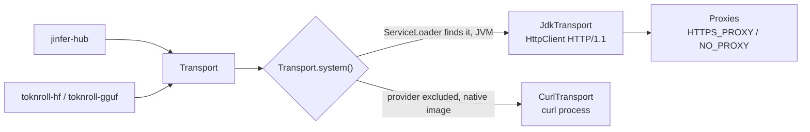

# jinfer-fetch — architecture summary

**One HTTP GET, two ways to make it.** `jinfer-fetch` (package `com.qxotic.jinfer.fetch`, 5 classes, ~620 lines)
is the small HTTP layer that every downloader in the stack goes through. It makes a GET either with the JDK's
`java.net.http.HttpClient` or by running `curl` as a process, behind one interface, `Transport`.

For class diagrams, sequences and details see [ARCHITECTURE.md](ARCHITECTURE.md).

## Where it sits

- **No project dependencies**: the module only `requires java.net.http`, and compiles at `--release 11`
  (below jinfer's Java 25) so the Java 11 tokenizer modules can use it.
- **Callers**:
  - `jinfer-hub` (`Fetch`, `RateLimit`): model downloads. It calls `Transport.system().get(...)` and handles
    redirects, ranged/parallel transfers and rate limits itself.
  - `toknroll-hf` (`RepositoryArtifactCache`, `HuggingFaceTokenizerLoader`) and `toknroll-gguf`
    (`GGUFMetadataCache`): they take a `Transport` (by default `system()`, or `offline()` for cache-only) and call
    `Transport.deadline(transport.follow(...), timeout)`.
- **jinfer-native**: the native image build excludes the `JdkTransport` service provider, so the image has
  **no TLS stack** and downloads through the system's curl.

## Main concepts

| Class | What it is |
|---|---|
| `Transport` | The interface. `get` = one GET, 3xx returned as-is. Default `follow` = up to 5 redirects, dropping `Authorization` when scheme/host/port changes. Static `deadline` = force-close a response after a timeout. Static `system()` / `offline()` |
| `Transport.Response` | `Closeable`: `status()`, `headers(name)` (case-insensitive), `header(name)`, `body()` as an `InputStream` |
| `JdkTransport` | Public SPI provider (`module-info` `provides` + `META-INF/services`). One static `HttpClient`: HTTP/1.1, no redirects, env proxies, 30 s connect timeout. Connect errors are rewritten to name the host |
| `CurlTransport` | Package-private. Runs `curl -q -sS -K - -D - --suppress-connect-headers -- URL`, parses status + headers from stdout, and the body checks curl's exit code at EOF |
| `Transports` | Process-wide choices made once at class load: `SYSTEM`, `OFFLINE`, the `DEADLINES` scheduler; the `requireHttp` / `requireClean` validators |
| `Proxies` | Reads `https_proxy`/`HTTPS_PROXY`, `http_proxy` (lowercase only), `no_proxy`/`NO_PROXY` the way curl does, falling back to `ProxySelector.getDefault()` |

## Key flows

1. **Selection**: `Transports.choose()` returns the first `ServiceLoader` provider (JdkTransport). If there is
   none, it uses curl when `curl --version` succeeds. Otherwise it returns a transport whose every call throws
   "no HTTP transport … install curl".
2. **GET**: both transports validate the URL (http/https with a host) and the headers (no CR/LF, no `:` in the
   name), then return a `Response`. The `timeout` bounds the wait for the headers. With curl, it becomes a
   `--speed-time` stall detector.
3. **Redirects**: `follow` resolves `Location` against the current URI and strips the bearer token when the
   origin changes, because signed CDN URLs reject or don't need it.
4. **Body deadline**: `deadline` schedules a forced `close()` on a daemon thread, so a stalled body fails its read
   instead of hanging. Closing the response earlier cancels the scheduled close.
5. **Offline**: `Transport.offline()` throws `NoSuchFileException` for every request, before it connects, so a
   cache miss reads as a missing file.

## Notable design choices

- **Same behaviour on JVM and native image**: proxy variables are read as curl reads them (`HTTP_PROXY`
  uppercase is ignored, the httpoxy defence), and neither transport follows redirects on its own.
- **HTTP/1.1 on purpose**: with HTTP/2, parallel ranged GETs would share one connection.
- **curl hardening**: no shell, and every argument is its own argv entry. `-q` ignores `.curlrc`. `--` comes
  before the URL. Headers, tokens included, go through a config block on stdin, never through argv. A
  truncated transfer surfaces as an `IOException` at end of stream.
- **Run-time initialisation**: `native-image.properties` sets `--initialize-at-run-time=com.qxotic.jinfer.fetch`,
  so the transport choice, the `HttpClient` and the deadline thread are never frozen into the image heap.
- **Tests** run both transports against a local `jdk.httpserver` server. This is why the POM adds
  `--add-modules jdk.httpserver` to the test compile and to surefire.
