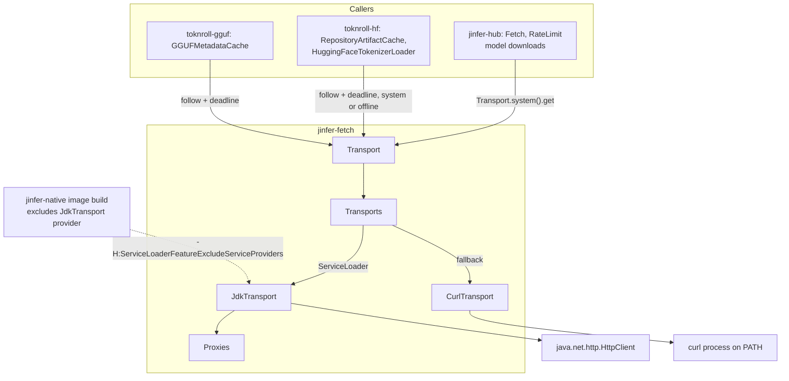
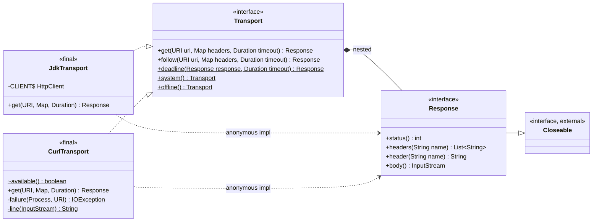
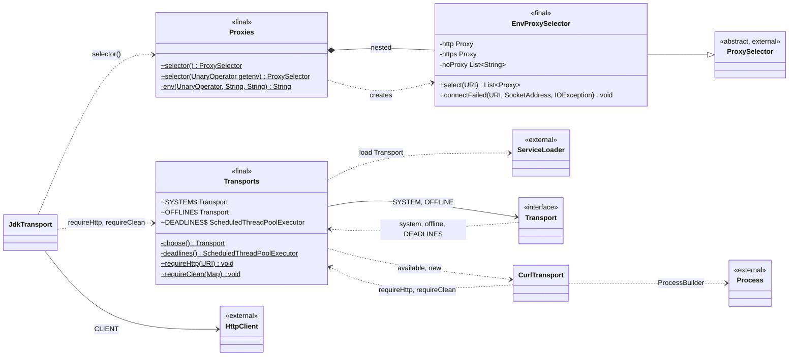
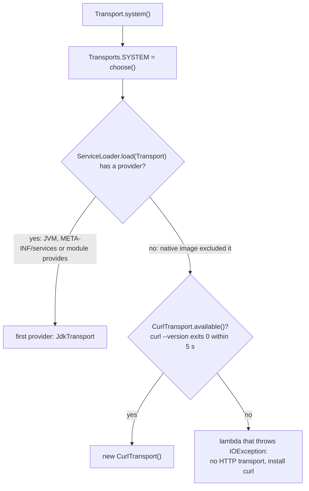
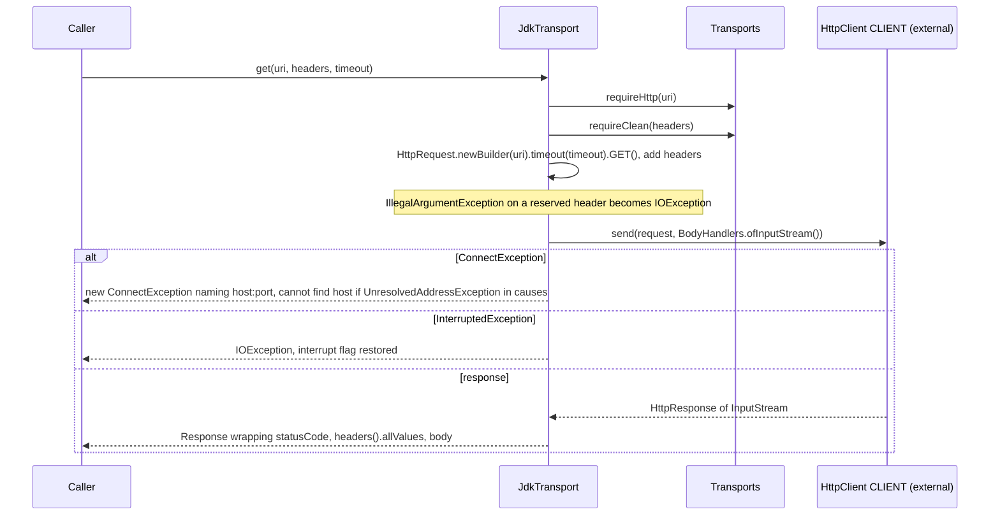
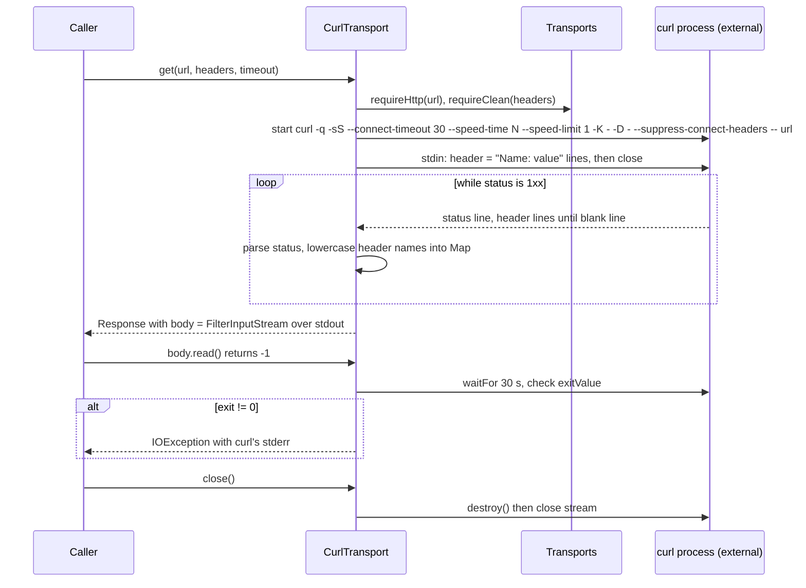
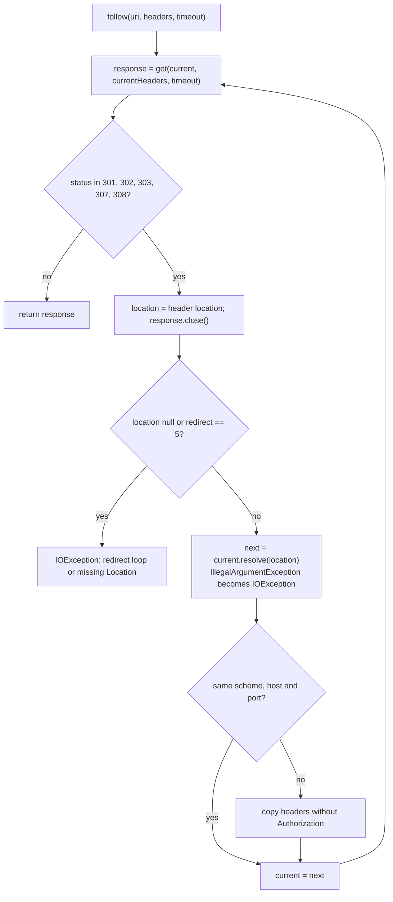
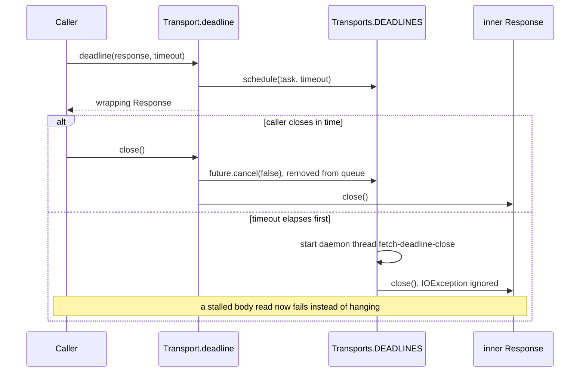
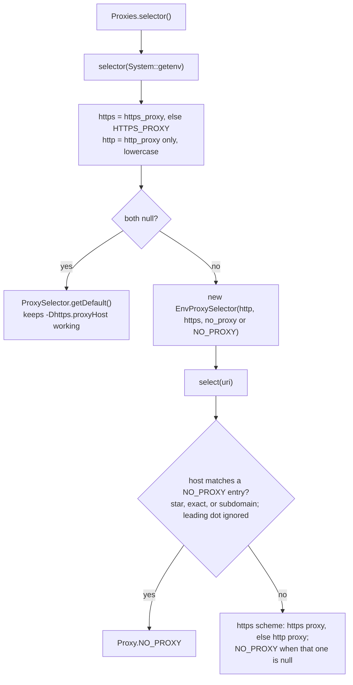

# jinfer-fetch — class architecture

Package `com.qxotic.jinfer.fetch` (5 classes, ~620 lines; JPMS module `com.qxotic.jinfer.fetch`). It is the
**HTTP GET layer** of the stack: "one HTTP GET, two ways to make it" — the JDK `HttpClient` (`JdkTransport`) or
`curl` run as a process (`CurlTransport`). The module has **no project dependencies** (only `java.net.http`) and
compiles with `--release 11`, below jinfer's Java 25, because `toknroll-hf` and `toknroll-gguf` download through
it as well as `jinfer-hub`. A native image excludes `JdkTransport` and so carries no TLS stack: curl and the
system's TLS do the work.

Format: **Mermaid**. Legend: `..|>` implements; `--|>` extends; `-->` holds/uses; `..>` creates/depends;
`*--` nested/composed; classes marked `<<external>>` live outside this package.

1. [Position in the stack](#1-position-in-the-stack)
2. [Class diagrams](#2-class-diagrams) — 2a contract, 2b internals
3. [Transport selection and SPI registration](#3-transport-selection-and-spi-registration)
4. [JdkTransport.get](#4-jdktransportget)
5. [CurlTransport.get](#5-curltransportget)
6. [follow: redirects and credential stripping](#6-follow-redirects-and-credential-stripping)
7. [deadline: bounding the body](#7-deadline-bounding-the-body)
8. [Proxies: environment proxy selection](#8-proxies-environment-proxy-selection)
9. [Hardening and native-image notes](#9-hardening-and-native-image-notes)

| Class | Visibility | Role |
|---|---|---|
| `Transport` | public interface | The contract: `get` (one GET, 3xx returned as-is), default `follow` (≤5 redirects, drops `Authorization` off-origin), static `deadline`, `system()`, `offline()`; nested `Response` |
| `Transport.Response` | public nested interface | `Closeable`: `status()`, `headers(name)` (case-insensitive, ordered), default `header(name)` (first value or null), `body()` |
| `JdkTransport` | public final | Service provider: one static `HttpClient` (HTTP/1.1, no redirects, `Proxies.selector()`, 30 s connect timeout); rewrites `ConnectException` to name the host |
| `CurlTransport` | package-private final | `curl -q -sS -K - -D - --suppress-connect-headers -- URL` as a process; parses status + headers off stdout, body checks curl's exit at EOF |
| `Transports` | package-private final | Process-wide singletons made at class load: `SYSTEM` (chosen transport), `OFFLINE`, `DEADLINES` executor; validators `requireHttp`, `requireClean` |
| `Proxies` | package-private final | `HTTP(S)_PROXY` / `NO_PROXY` read as curl reads them → a `ProxySelector`; nested `EnvProxySelector` |

Resources: `META-INF/services/com.qxotic.jinfer.fetch.Transport` → `JdkTransport` (also declared in `module-info`
with `provides … with JdkTransport` and `uses Transport`); `META-INF/native-image/com.qxotic/jinfer-fetch/native-image.properties`
→ `--initialize-at-run-time=com.qxotic.jinfer.fetch`.

---

## 1. Position in the stack

- `jinfer-hub`'s `Fetch` calls `Transport.system().get(...)` and follows redirects itself (`sendOnce`), adding
  rate-limit handling (`RateLimit.requested(Transport.Response, …)` reads `retry-after` / `ratelimit` headers).
- `toknroll-hf` and `toknroll-gguf` hold a `Transport` field (injected; `Transport.system()` by default,
  `Transport.offline()` when `HuggingFaceTokenizerLoader` is cache-only) and call
  `Transport.deadline(transport.follow(uri, headers, timeout), timeout)`.

---

## 2. Class diagrams

### 2a. Contract

`get` is the only abstract method, so `Transport` is usable as a lambda: `Transports.OFFLINE` and the
"no HTTP transport" fallback are lambdas. `follow` and `deadline` are written once, against `get` and `Response`,
and serve both transports.

### 2b. Internals

---

## 3. Transport selection and SPI registration

`Transports` is initialised once (first use of `Transport.system()`/`offline()`/`deadline()`); its static
fields fix the choice for the process.

- Registration is double: `module-info.java` (`provides com.qxotic.jinfer.fetch.Transport with JdkTransport`) for
  the module path, and `META-INF/services/com.qxotic.jinfer.fetch.Transport` for the class path. `JdkTransport` is
  therefore `public` with an implicit no-arg constructor; `CurlTransport` is not a provider and stays package-private.
- `jinfer-native/pom.xml` passes `-H:ServiceLoaderFeatureExcludeServiceProviders=com.qxotic.jinfer.fetch.JdkTransport`,
  so in the image the loader finds nothing and curl is chosen.
- `Transports.OFFLINE` throws `NoSuchFileException("offline: no request to " + uri)` before connecting, so a cache
  miss reads as a missing file.
- `Transports.DEADLINES`: a one-thread `ScheduledThreadPoolExecutor`, daemon thread `fetch-deadline`,
  `setRemoveOnCancelPolicy(true)`.

---

## 4. JdkTransport.get

`CLIENT` is built with `HttpClient.Version.HTTP_1_1` (HTTP/2 would multiplex parallel ranged GETs onto one
connection), `Redirect.NEVER`, `proxy(Proxies.selector())` and a 30 s connect timeout. The request `timeout`
bounds the wait for status and headers; the body is bounded by the caller (see §7).

---

## 5. CurlTransport.get

- Headers are delivered by `-K -` (a curl config block on stdin), quoted with `\` and `"` escaped, so tokens are
  never on the process list. `--` before the URL plus `requireHttp` means the URL can never be an option.
- `-q` ignores the user's `.curlrc`. `-L` is not given: redirects come back as 3xx, like the JDK transport.
- The timeout becomes `--speed-time ceil(timeout/1s)` with `--speed-limit 1`: a stall detector, the only curl
  timeout that also spans the headers.
- The body stream checks the exit code at EOF (`ended()`), so a transfer curl aborted is an `IOException`, not a
  silently truncated file. `close()` destroys the process first, because a reader blocked in the buffered stream
  holds its lock until curl's pipe reaches EOF.
- `failure(Process, URI)` returns curl's stderr text, or "curl exited with <code|no response>" when empty;
  `line(InputStream)` reads one ISO-8859-1 header line and strips CR.

---

## 6. follow: redirects and credential stripping

Default method on `Transport`, shared by both transports.

`jinfer-hub`'s `Fetch.sendOnce` implements the same loop itself (so it can wait on `RateLimit` per hop) rather than
calling `follow`.

---

## 7. deadline: bounding the body

The close runs on its own thread so that a close which waits for the transfer to unwind cannot delay other
deadlines on the single scheduler thread.

---

## 8. Proxies: environment proxy selection

- Blank values count as unset; values are stripped. `HTTP_PROXY` (uppercase) is ignored, as curl does (httpoxy,
  CVE-2016-5385), so the JVM and the curl-based native image route the same way.
- `parse` adds `http://` when no scheme is present, defaults the port to 8080, and returns `null` on a malformed
  value so a broken variable never blocks direct access. `connectFailed` does nothing.
- `selector(UnaryOperator getenv)` is the test seam (`ProxiesTest`).

---

## 9. Hardening and native-image notes

| Concern | Where | Mechanism |
|---|---|---|
| Non-http URL / option injection | `Transports.requireHttp`, `CurlTransport` | scheme must be http/https with a host; `--` before URL |
| Header smuggling | `Transports.requireClean` | null/blank name, `:` in name, CR/LF in name or value → `IOException` |
| Token on process list | `CurlTransport` | headers via `-K -` on stdin |
| Token leaked to CDN | `Transport.follow` | `Authorization` dropped on scheme/host/port change |
| Truncated download | `CurlTransport` body | exit code checked at EOF |
| Hung body | `Transport.deadline` | scheduled forced close |
| Build-time heap capture | `native-image.properties` | `--initialize-at-run-time=com.qxotic.jinfer.fetch` (transport choice, `HttpClient`, deadline thread are made at run time) |
| No TLS in native image | `jinfer-native/pom.xml` | `JdkTransport` provider excluded → curl |

Tests (`src/test`): `TransportTest` and `TransportQaTest` run both transports against a local `jdk.httpserver`
server (hence the `--add-modules jdk.httpserver --add-reads` in the compiler and surefire config); `ProxiesTest`
covers variable precedence and the leading-dot `NO_PROXY` spelling.
