# jinfer-gemma-embedding2 — class architecture

Package `com.qxotic.jinfer.models.gemmaembedding2` (4 classes, ~1240 lines). It is the `jinfer-<model>` provider for GGUF
architecture `gemma-embedding2` (Google EmbeddingGemma 2): a **bidirectional** Gemma 4 text encoder, mean-pooled into one
L2-normalised vector per input. It is **not a generative model** (no logits, no LM head, **no KV cache**, no checkpoint codec)
and it is **multimodal**: an optional Gemma 4 `mmproj` companion adds image, audio and video towers.

Format: **Mermaid**. Legend: `..|>` implements; `--|>` extends; `-->` holds/uses; `..>` creates/depends;
classes marked `<<external>>` live outside this package.

1. [Position in the stack](#1-position-in-the-jinfer-stack)
2. [Class diagrams](#2-class-diagrams) — 2a contracts, 2b model internals, 2c template and media
3. [Loading sequence](#3-loading-sequence)
4. [Forward pass](#4-forward-pass) — 4.0 global, 4a `ingest` / `embed`, 4b `decoderBlock`, 4c `GemmAttention`
5. [Pooling heads and `embedAll`](#5-pooling-and-embedall)
6. [State layout](#6-state-layout)

| Class | Role |
|---|---|
| `GemmaEmbedding2` | The model: `EmbeddingModel` + `Multimodal` impl with nested `Configuration`, `LayerWeights`, `Weights`, `State`; staging, the whole encoder forward, pooling, task-prompt helpers, GGUF loading |
| `GemmaEmbedding2Provider` | `ModelProvider` SPI: always `Retrieval.EMBEDDING`, declares the `media` companion (mmproj), builds `LoadedEmbedder` |
| `GemmaEmbedding2Template` | Input template: special-aware text encoding, BOS/EOS framing, interleaved text/image/audio/video placement into a `PromptWriter` |
| `GemmAttention` | Package-private kernel: unscaled non-causal attention over per-query key ranges `[first, end)`, direct dot products or batched GEMMs, with its `Scratch` record |

---

## 1. Position in the jinfer stack

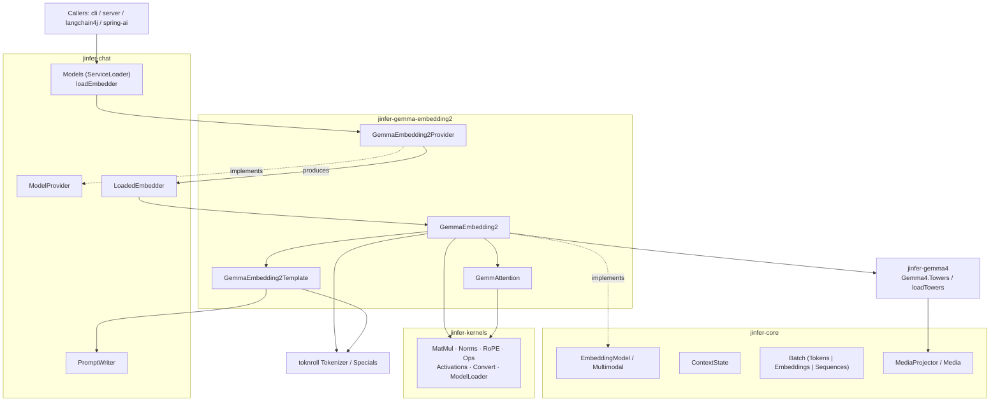

---

## 2. Class diagrams

### 2a. Contracts and relations

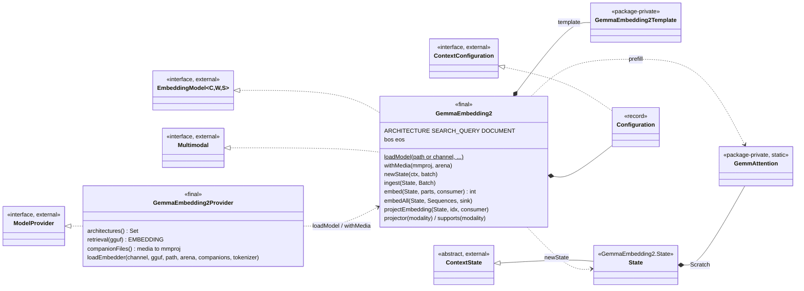

### 2b. Model internals — `GemmaEmbedding2` and its nested types

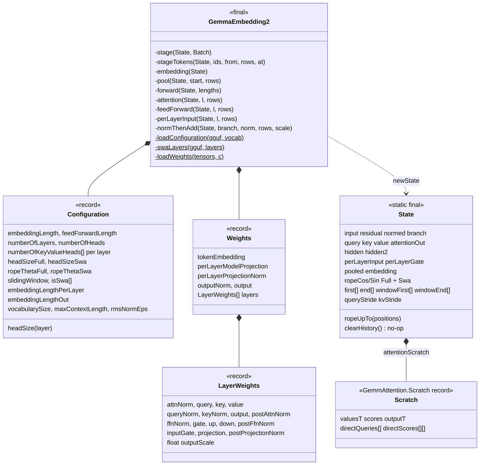

### 2c. Template and media subsystem

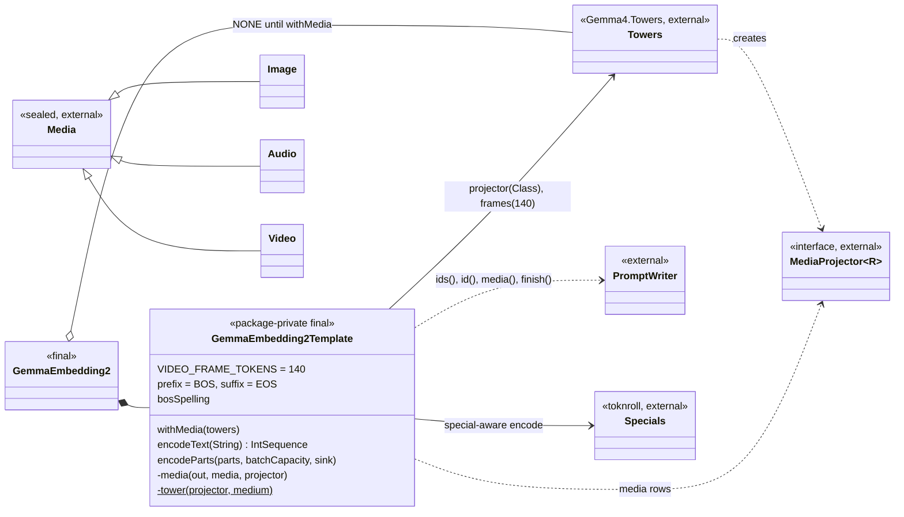

---

## 3. Loading sequence

`general.architecture` is checked twice: by `Models` (provider routing) and by `loadModel`. The provider answers `retrieval(gguf)` with `EMBEDDING` unconditionally, and advertises the `media` companion (an mmproj GGUF).

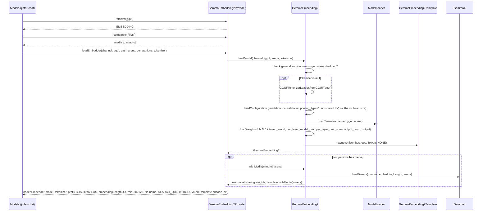

---

## 4. Forward pass

There is **no autoregressive decoding and no KV cache**. `ingest` only *stages* input rows into `State.input`; the encoder runs over the **whole staged input** at once when an embedding is requested (`embed`, `projectEmbedding`) or over packed sequences (`embedAll`). Every row may attend to rows after it (bidirectional).

### 4.0 Global architecture

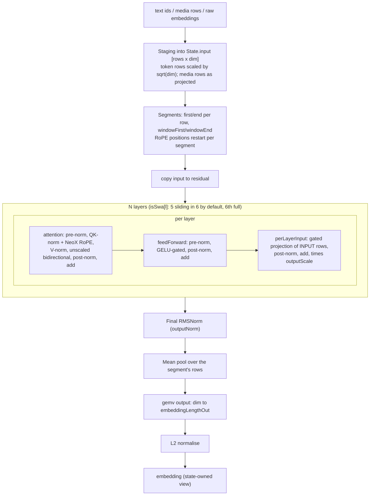

### 4a. `ingest` / `embed` — batch validation, input kinds, RoPE, layer loop

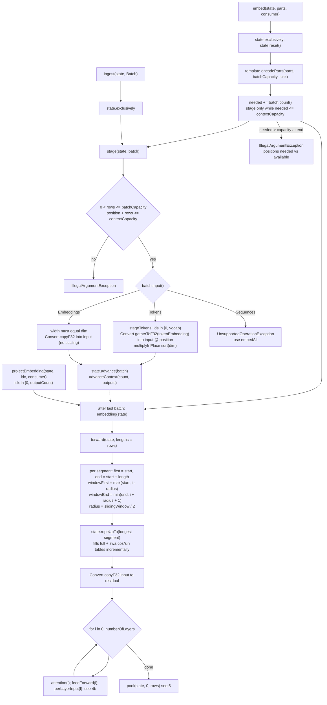

Position of a row inside its RoPE rotation is `r - first[r]`, so each packed segment restarts at 0.

### 4b. `decoderBlock` — one layer

There is no single `decoderBlock` method; a block is `attention(l)`, `feedForward(l)`, `perLayerInput(l)`. Each branch closes with `normThenAdd` (post-norm, add to residual, optionally scale). Full and sliding layers differ in head size, RoPE base and key range.

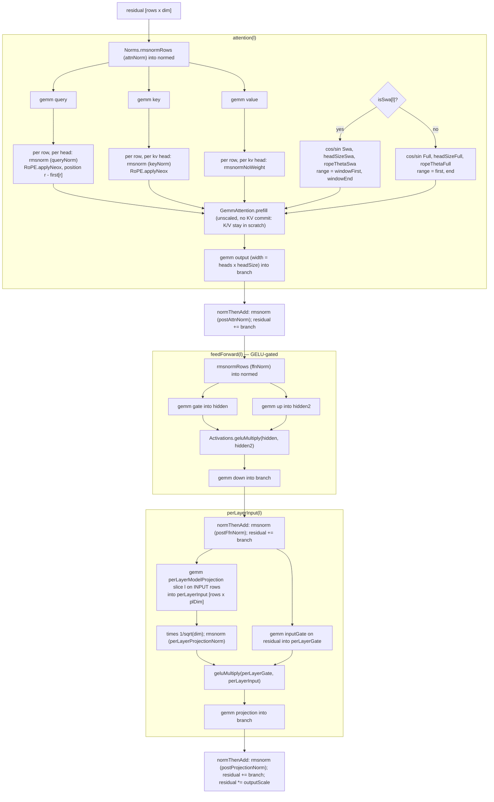

Details worth knowing:

- No KV cache: keys and values of the staged input live only in `State.key/value` and are recomputed by every `embed`.
- Attention is **unscaled** (no `1/sqrt(headSize)`); V is RMS-normed without weight; GQA via `h / (heads / kvHeads)`, with `numberOfKeyValueHeads` per layer.
- The per-layer input is projected from the **input rows** (`state.input`), not from the residual; there is no per-layer token table.
- `State` strides (`queryStride`, `kvStride`) are the widest layer's; `attentionOut` is re-viewed at each layer's width.

### 4c. `GemmAttention.prefill` — per-query key ranges

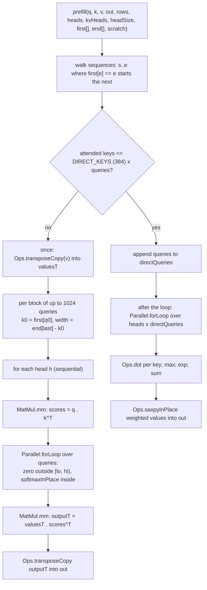

---

## 5. Pooling and `embedAll`

Every retained output of the staged input projects the **same** vector (`projectEmbedding` ignores which output index, only range-checks it). `embedAll` packs whole sequences, each attending only to itself.

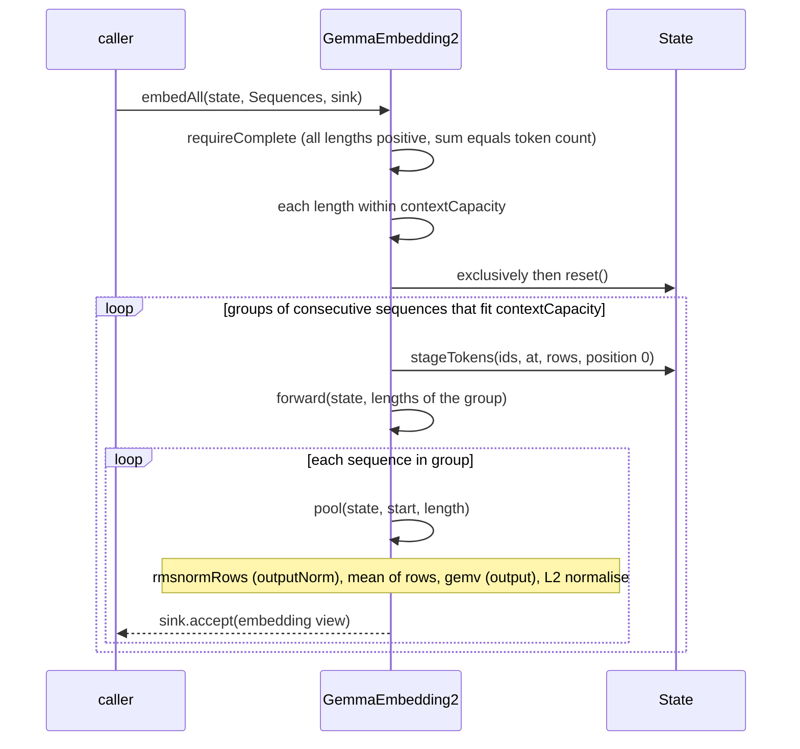

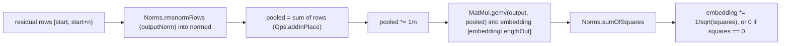

Template framing (`encodeText` / `encodeParts`): BOS + tokens + EOS, unless the text begins with the BOS spelling (reference processor behaviour). Media parts are wrapped in `<|image>`/`<image|>` or `<|audio>`/`<audio|>`; a video is its frames, each an image block (140-token budget). Without the matching tower, `UnsupportedOperationException` ("load the mmproj with withMedia"). Task prompts (`searchQuery`, `question`, `claim`, `codeQuery`, `document`, `classification`, `clustering`, `similarity`) are static string helpers applied to text only.

---

## 6. State layout

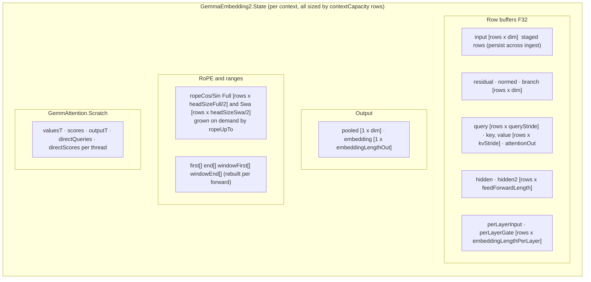

- There is **no checkpoint codec** and no persistent per-layer state: `clearHistory()` is a no-op (staged rows past the cursor are overwritten by the next ingest), and the provider does not override `checkpointCodec`.
- `newState(ctx, batch)` makes a cross-thread arena owned by the state (closed if construction fails); `newState(ctx, batch, arena)` borrows the caller's.
- `State` rejects `contextCapacity > maxContextLength`.
- `ingest` advances the cursor with `advanceContext(count, outputs)`; `embed` and `embedAll` call `reset()` first, so each call is independent.
