# jinfer-gemma4 — class architecture

Package `com.qxotic.jinfer.models.gemma4` (15 main classes, ~4,700 lines). It is the `jinfer-<model>` provider for GGUF
architecture `gemma4`: a generative decoder with **hybrid sliding-window / full attention**, **shared-KV tail layers**,
optional **per-layer input embeddings (PLE)**, an optional **MoE branch** next to the dense FFN, a **final logit
softcap**, optional **image / audio / video** input through an `mmproj` sidecar, and optional **MTP self-speculative
decoding** through a `gemma4-assistant` sidecar.

Format: **Mermaid**. Legend: `..|>` implements; `--|>` extends; `-->` holds/uses; `..>` creates/depends;
classes marked `<<external>>` live outside this package.

1. [Position in the stack](#1-position-in-the-jinfer-stack)
2. [Class diagrams](#2-class-diagrams) — 2a contracts, 2b model internals, 2c media towers, 2d speculative decoding, 2e chat template and tool syntax
3. [Loading sequences](#3-loading-sequences)
4. [Forward pass](#4-forward-pass) — 4.0 global, 4a `ingest`, 4b `decoderBlock`, 4c MoE branch, 4d per-layer inputs
5. [State and checkpoint layout](#5-state-and-checkpoint-layout)
6. [Media projection flows](#6-media-projection-flows)
7. [Speculative decoding loop](#7-speculative-decoding-loop)
8. [Chat template encode flow](#8-chat-template-encode-flow)

| Class | Role |
|---|---|
| `Gemma4` | The model: `LanguageModel` + `Multimodal` + `SpeculativeDecoding` impl with nested `Configuration`, `Weights`, `LayerWeights`, `MoeWeights`, `State`, `Towers`; the whole forward pass, loaders, sidecar attach/pairing checks |
| `Gemma4Provider` | `ModelProvider` SPI: arch `gemma4`, companion files `media` (mmproj) and `speculation` (mtp), stop-token set, chat template, sampling defaults |
| `Gemma4ChatTemplate` | `ChatTemplate`: `<\|turn>` framing, system/think block, tool declarations/calls/responses, thought channel, structural image/audio/video, reply parser |
| `Gemma4ToolSyntax` | Byte-exact port of the GGUF template's compact tool notation (`declaration`, `call`, `response`) plus the `parseBlock` call parser |
| `Gemma4CheckpointCodec` | `CheckpointCodec<State>`: serialises own-KV layers only, ring-aware for sliding-window layers |
| `Gemma4Mtp` | MTP sidecar reader (arch `gemma4-assistant`): `Configuration`, `Weights`, shape-verified `loadSidecar` |
| `Gemma4MtpDecoder` | One draft step of the 4-layer Q-only draft transformer attending the backbone's KV rings |
| `Gemma4Speculative` | Sample-and-accept speculative loop (`generate`/`walk`) with per-state `Scratch` |
| `VisionTower` | Interface for image projectors that size images to a token budget (`atBudget` for video frames) |
| `Gemma4Vision` | SigLIP-style tower (`gemma4v`): 2D RoPE bidirectional ViT, windowed mean pooling, projection |
| `Gemma4VisionUnified` | Unified projector (`gemma4uv`): patch embedding + norms + positions + projection, no transformer layers |
| `Gemma4Conformer` | Conformer audio tower (`gemma4a`): 2 conv subsampling stages, chunked-local attention blocks |
| `Gemma4Audio` | Raw-waveform audio projector (`gemma4ua`): framed PCM, RMS norm, one projection |
| `VisionPreprocess` | Aspect-preserving target size, Pillow-style bicubic resize to CHW, token budgets (system properties) |
| `AudioPreprocess` | Mono 16 kHz conversion, Butterworth resample, Hann/mel filterbank, 30 s log-mel chunks |
| `Clamped` | Projection weight with optional QAT input/output clamps (`gemm`) |

---

## 1. Position in the jinfer stack

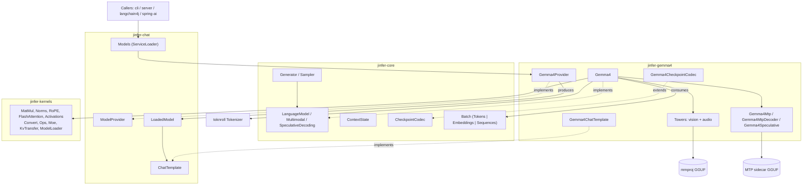

---

## 2. Class diagrams

### 2a. Contracts and relations

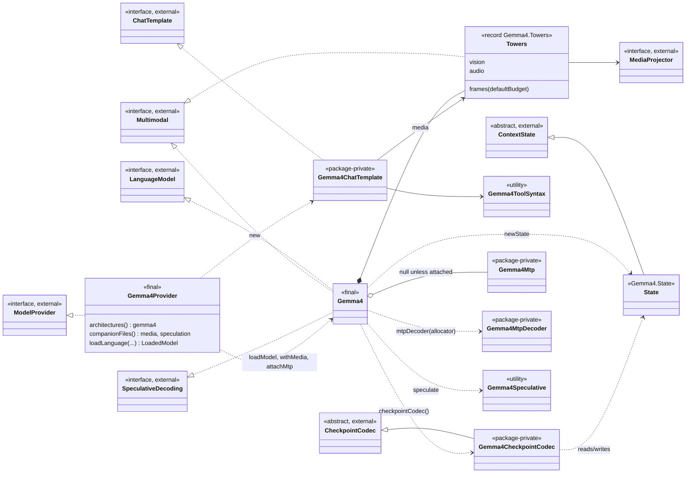

### 2b. Model internals — `Gemma4` and its nested types

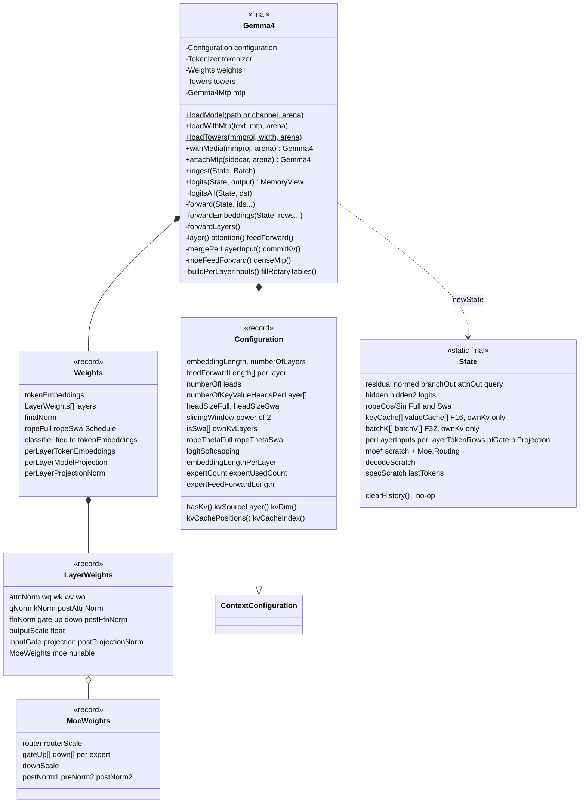

### 2c. Media towers

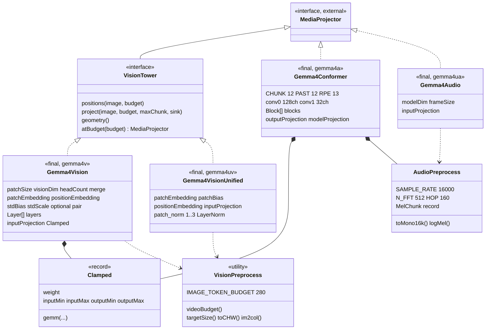

### 2d. Speculative decoding (MTP)

```mermaid
classDiagram
    direction LR
    class SpeculativeDecoding { <<interface, external>> }
    class Gemma4 {
        <<final>>
        speculationReady() mtp != null
        speculate(state, sampler, constraints, depth, listener, audit)
        mtpDecoder(allocator)
        logitsAll(state, dst)
    }
    class Gemma4Mtp {
        <<final>>
        loadSidecar(path, backboneVocab, arena)$
        configuration() weights()
    }
    class MtpConfiguration {
        <<record Gemma4Mtp.Configuration>>
        embeddingLength backboneDim
        numberOfLayers numberOfHeads
        headSizeFull headSizeSWA
        isSWA[] slidingWindow
    }
    class MtpWeights {
        <<Gemma4Mtp.Weights>>
        tokenEmbeddings tied
        preProjection postProjection
        outputNorm
        wq wo ffnGate ffnUp ffnDown per layer
        layerOutputScales ropeFreqFactors
    }
    class Gemma4MtpDecoder {
        <<final>>
        draft(state, hidden, off, token, position)
        chainedHidden()
    }
    class Gemma4Speculative {
        <<utility>>
        generate(model, state, budget, timeout, stops, depth, sampler, listener, audit)
        walk(...)
    }
    class Scratch {
        <<Gemma4Speculative.Scratch>>
        decoder vlogits row h depth
    }
    SpeculativeDecoding <|.. Gemma4
    Gemma4 o-- Gemma4Mtp
    Gemma4Mtp *-- MtpConfiguration
    Gemma4Mtp *-- MtpWeights
    Gemma4 ..> Gemma4MtpDecoder : mints per generation
    Gemma4MtpDecoder --> Gemma4Mtp : weights
    Gemma4MtpDecoder --> Gemma4 : backbone KV rings, token embeddings
    Gemma4 ..> Gemma4Speculative : speculate
    Gemma4Speculative *-- Scratch : stored in State.specScratch
    Scratch --> Gemma4MtpDecoder
```

### 2e. Chat template and tool syntax

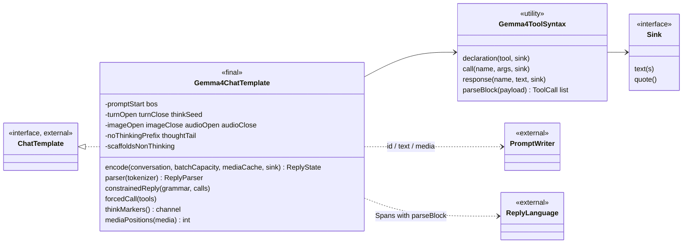

---

## 3. Loading sequences

The provider loads the backbone first, then attaches the optional sidecars by **copying** the model (`withMedia`, `attachMtp` commute, and a model never changes under a state minted from it). Both sidecars are pairing-checked from headers before any tensor is mapped (media) or by dimension checks (MTP).

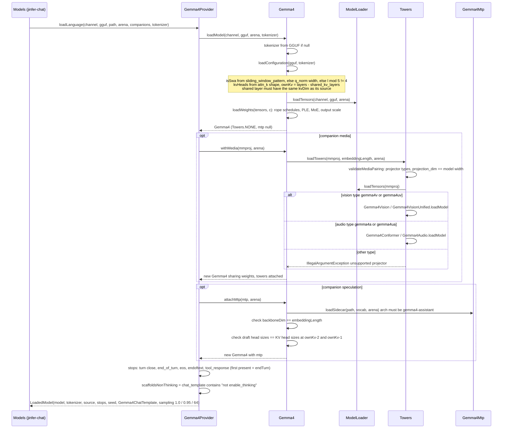

---

## 4. Forward pass

`ingest(state, batch)` runs `state.exclusively(forward)`. Unlike a plain dense decoder, a Gemma 4 layer stack has **three kinds of layers**: sliding-window own-KV, full-attention own-KV, and **KV-shared tail layers** (index `>= ownKvLayers`) that compute only Q and attend the K/V rings of the last own-KV layer of their kind (`ownKv-2` for SWA, `ownKv-1` for full). Every layer is attention, then FFN (dense, plus MoE when present), then the optional per-layer input merge, then a scalar output scale.

### 4.0 Global architecture

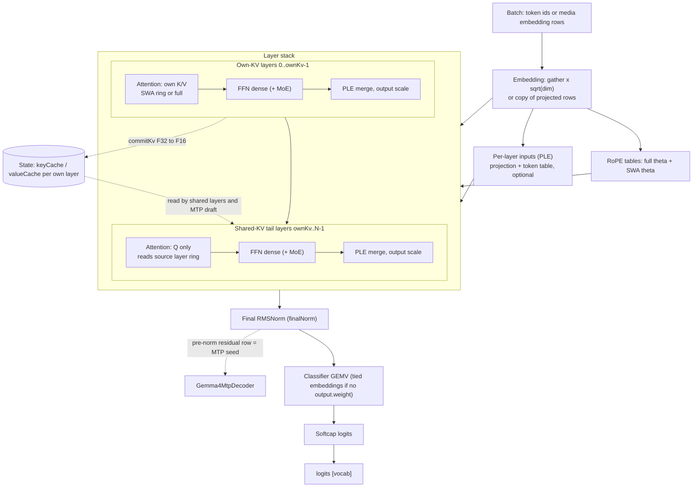

### 4a. `ingest` — batch validation, input kinds, rope/embedding, layer loop, advance

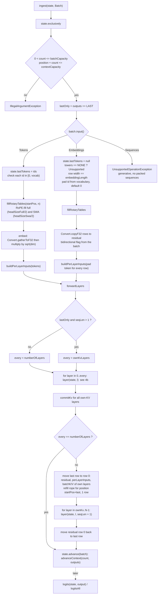

Pruned prefill: shared-KV layers write no cache, so when only the last row is read the earlier rows are dead after the own-KV layers; just that row continues through the tail as a decode step.

### 4b. `decoderBlock` — one layer

Gemma4 has no single `decoderBlock` method; a block is `layer(state, l, ...)` = `attention` + `feedForward` + `mergePerLayerInput` + output scale. Residual additions all use the "post-norm the branch, then add" idiom `normThenAddRows`.

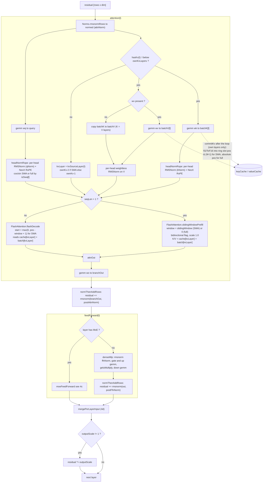

Details worth knowing:

- `commitKv` runs **after all processed layers**: each own layer has its own `batchK[l]/batchV[l]`, and the commit is one job per layer so a batch longer than the window writes ring slots in order.
- Rows of the shared scratch (`query`, `attnOut`, `hidden`) are addressed at the view's own stride, since SWA layers pack narrower rows than the max width.
- GQA via `kvMul = numberOfHeads / numberOfKeyValueHeadsPerLayer[l]`; head size and `kvDim` differ between SWA and full layers.
- Attention scale is 1.0 (QK-norm replaces `1/sqrt(d)`).

### 4c. MoE branch (`moeFeedForward`)

The dense MLP is **always** computed; on MoE layers its output is a *shared* branch and a routed expert branch is added to it.

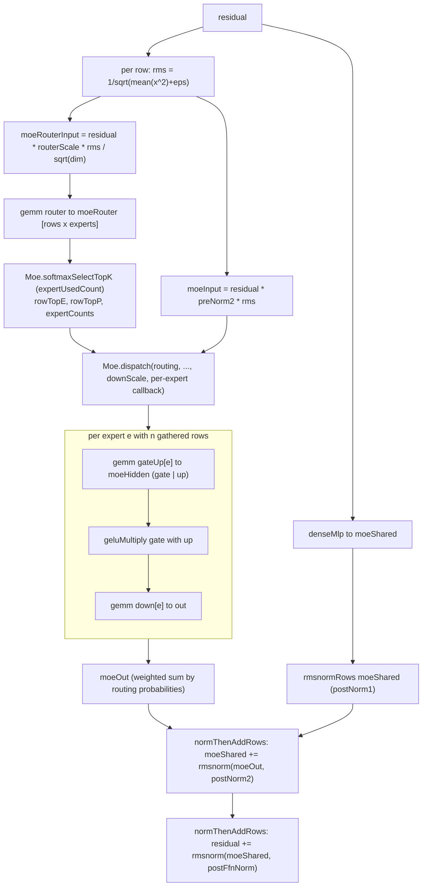

### 4d. Per-layer inputs (PLE)

Active only when `embeddingLengthPerLayer > 0` and `per_layer_token_embd.weight` exists; a layer merges its slice only if it has `inputGate`.

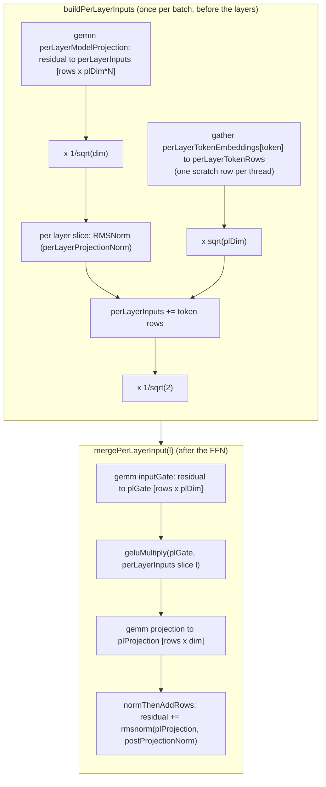

Media rows: PLE is built with the `<pad>` token id for every row, so media positions get the pad's per-layer embedding.

---

## 5. State and checkpoint layout

`State extends ContextState`; capacities come from `newState(contextCapacity, batchCapacity[, arena])` (a context above `maxContextLength` is refused). The cross-thread arena is owned only by the 2-argument form. There is **no recurrent state**: the only thing carried across calls is the KV rings of the own-KV layers.

```mermaid
flowchart LR
    subgraph Scratch["Per-batch scratch (batchCapacity rows, F32)"]
        direction TB
        S1["residual, normed, branchOut: dim"]
        S2["query, attnOut: maxQueryDim"]
        S3["hidden, hidden2: maxHiddenDim"]
        S4["ropeCos/Sin Full and Swa"]
        S5["perLayerInputs, plGate, plProjection, perLayerTokenRows (if PLE)"]
        S6["moeShared, moeInput, moeRouterInput, moeRouter, moeOut, moeGather,<br/>moeExpertOut, moeHidden (2*expertFf), Moe.Routing (if MoE)"]
        S7["logits [1 x vocab], decodeScratch"]
    end
    subgraph KVs["KV rings, own-KV layers only, F16"]
        direction TB
        K1["SWA layer: min(contextCapacity, slidingWindow) positions<br/>slot = position AND (window-1)"]
        K2["Full layer: contextCapacity positions<br/>slot = position"]
        K3["batchK[l], batchV[l]: batchCapacity x kvDim(l), F32 staging"]
    end
    subgraph Spec["Speculation seam"]
        direction TB
        P1["lastTokens: row to token map of the last token batch (null after media)"]
        P2["specScratch: Gemma4Speculative.Scratch, lazily built in the state arena"]
    end
    Scratch --- KVs --- Spec
```

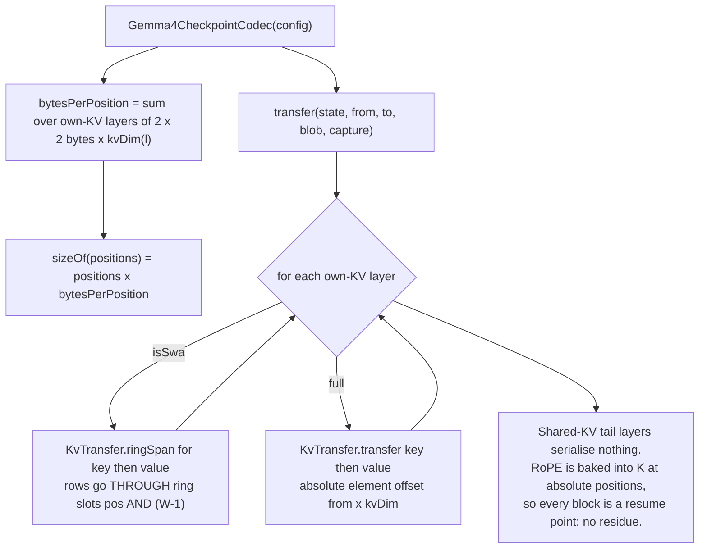

Blob layout: for each position range, layers appear in order `0..ownKv-1`, each as `[key span][value span]`, F16.

---

## 6. Media projection flows

`Gemma4.Towers` holds an optional image projector and an optional audio projector; video is read as frames through the vision tower at the video budget (`-Djinfer.gemma4.videoTokenBudget`, template default 70 tokens per frame; still images default 280, `-Djinfer.gemma4.imageTokenBudget`). Projected rows enter the model as `Batch.Input.Embeddings` (see 4a).

### 6a. Vision towers

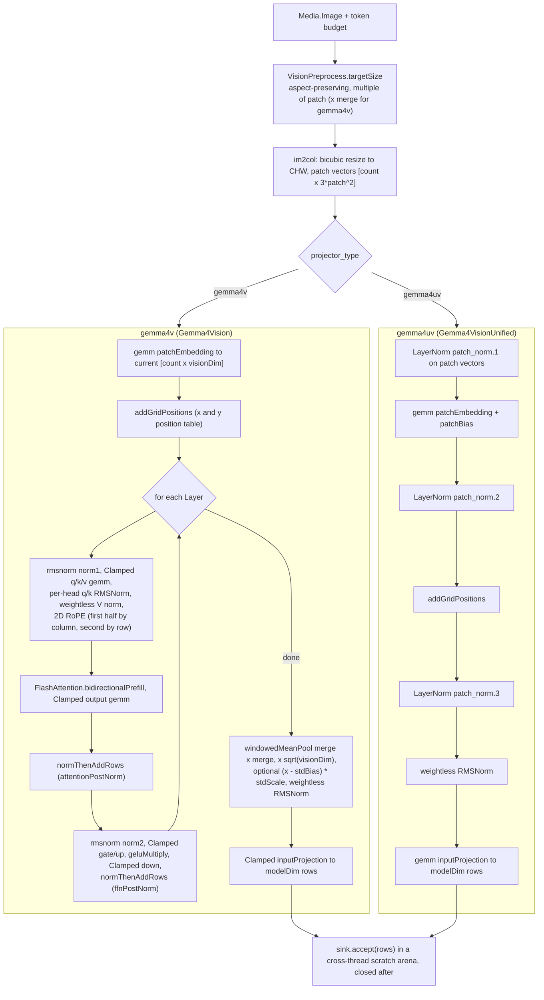

### 6b. Audio towers

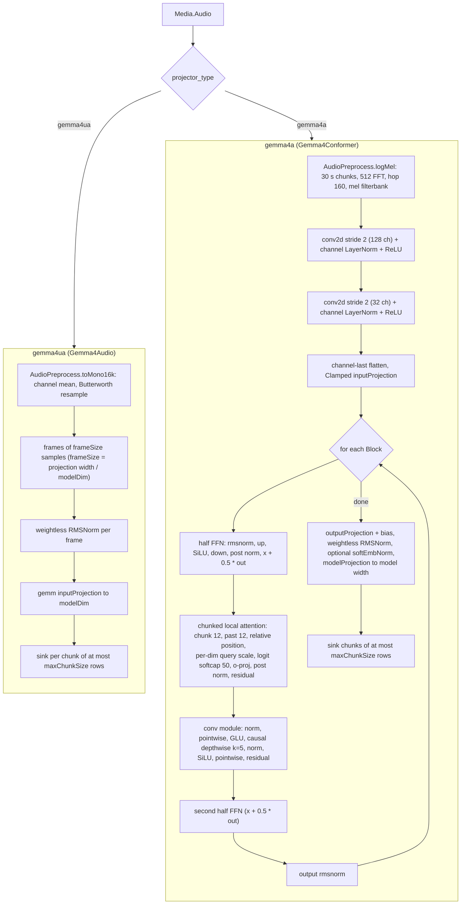

---

## 7. Speculative decoding loop

`speculate(...)` is a self-speculative loop over the MTP draft head (depth 1..8, clipped to `batchCapacity - 1`). The first draft step of each iteration is a *warm-up* over the last committed token and its hidden; the chain then drafts greedily. The verify pass is one `Batch.score` of `drafts+1` candidates, and logits come from a single `logitsAll` head GEMM. A draft survives only if it equals the **sampled** target token at its row.

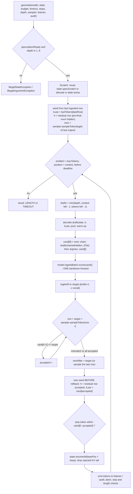

The MTP draft step (`Gemma4MtpDecoder.draft`):

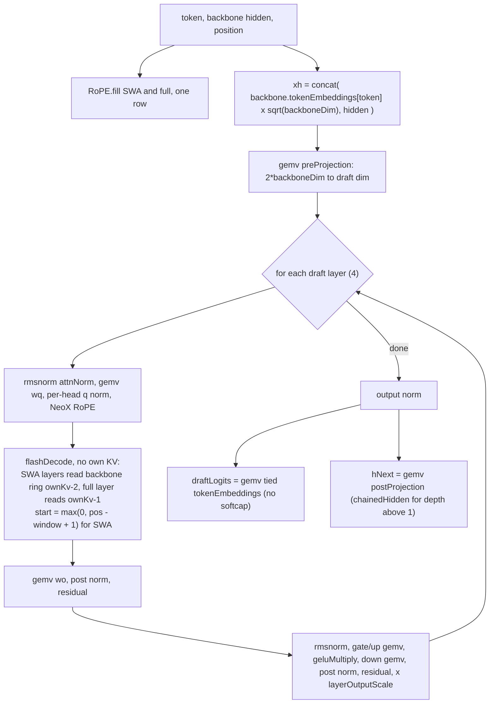

---

## 8. Chat template encode flow

`encode(conversation, batchCapacity, mediaCache, sink)` writes through a `PromptWriter`: text segments are plain-encoded, control tokens are trusted ids, media becomes `Embeddings` batches from the projector (cached per content key).

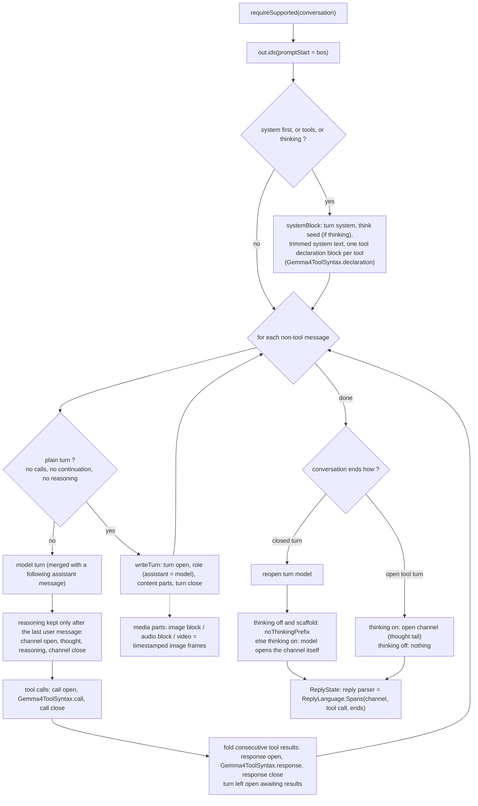

Reply parsing: `parser(tokenizer)` returns the `Spans` parser (reasoning in `<|channel>thought ... <channel|>`, calls in `<|tool_call> ... <tool_call|>` decoded by `Gemma4ToolSyntax.parseBlock`, ends at `<turn|>`, `<end_of_turn>`, `<|endoftext|>` or `<eos>`); `constrainedReply` and `forcedCall` build grammar-constrained and forced-call selections from the same spans.
