# jinfer-gptoss — class architecture

Package `com.qxotic.jinfer.models.gptoss` (4 classes, ~1050 lines). It is the `jinfer-<model>` provider for GGUF
architecture `gpt-oss` (OpenAI GPT-OSS): a **text-only, generative mixture-of-experts** model. Every layer is
attention (GQA, biases, per-head attention sinks, alternating sliding-window / full) followed by a top-k MoE FFN
(router, clamped SwiGLU experts with biases). There is no vision, audio or speculative subsystem in this module; the
Harmony reply grammar (analysis / commentary / final / call channels) lives in `GptOssChatTemplate`.

Format: **Mermaid**. Legend: `..|>` implements; `--|>` extends; `-->` holds/uses; `..>` creates/depends;
classes marked `<<external>>` live outside this package.

1. [Position in the stack](#1-position-in-the-jinfer-stack)
2. [Class diagrams](#2-class-diagrams) — 2a contracts, 2b model internals, 2c Harmony chat template
3. [Loading sequence](#3-loading-sequence)
4. [Forward pass](#4-forward-pass) — 4.0 global, 4a `ingest`, 4b `decoderBlock`, 4c output tail
5. [State and checkpoint layout](#5-state-and-checkpoint-layout)
6. [Harmony reply language](#6-harmony-reply-language)

| Class | Role |
|---|---|
| `GptOss` | The model: `LanguageModel` impl with nested records `Configuration`, `AttentionWeights`, `MoeFfnWeights`, `LayerWeights`, `Weights` and the class `State`; the whole forward pass, GGUF loading, expert top-k routing |
| `GptOssProvider` | `ModelProvider` SPI for arch `gpt-oss`: `loadLanguage` builds the `LoadedModel` (stop tokens, seed, chat template, sampling defaults) |
| `GptOssChatTemplate` | `ChatTemplate`: framing is delegated to the GGUF template (whole render); declares the Harmony reply language, parser, constrained reply and forced calls |
| `GptOssCheckpointCodec` | `CheckpointCodec<State>`: serialises F16 K/V rows of every layer, ring-aware for sliding-window layers |

---

## 1. Position in the jinfer stack

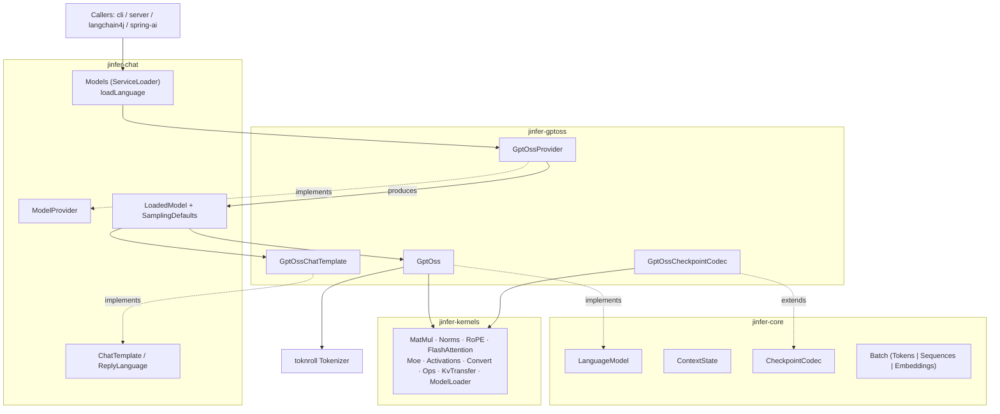

---

## 2. Class diagrams

### 2a. Contracts and relations

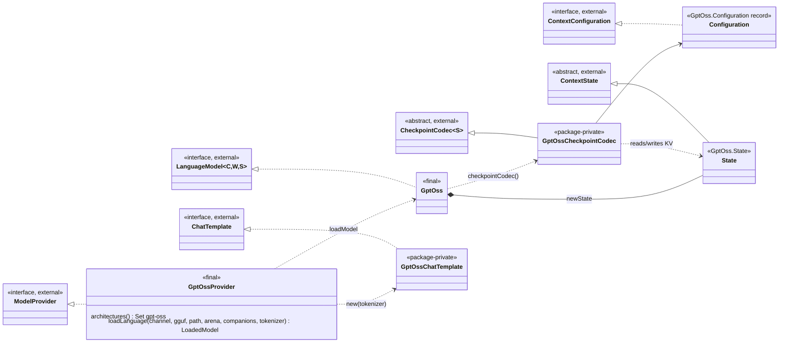

### 2b. Model internals — `GptOss` and its nested types

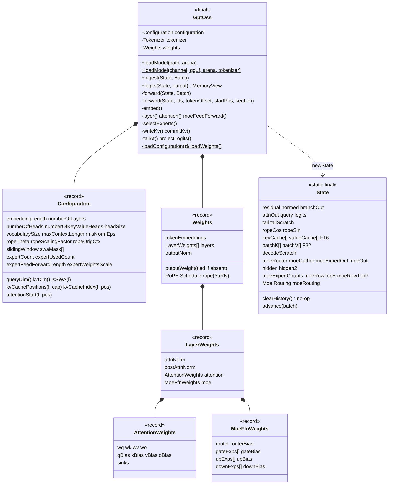

### 2c. Harmony chat template

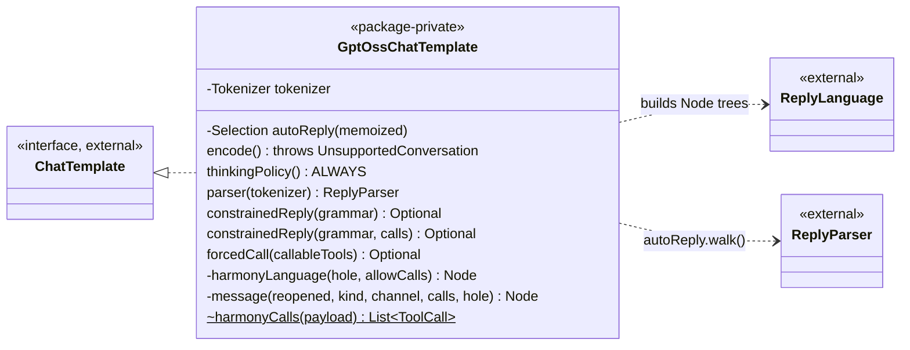

---

## 3. Loading sequence

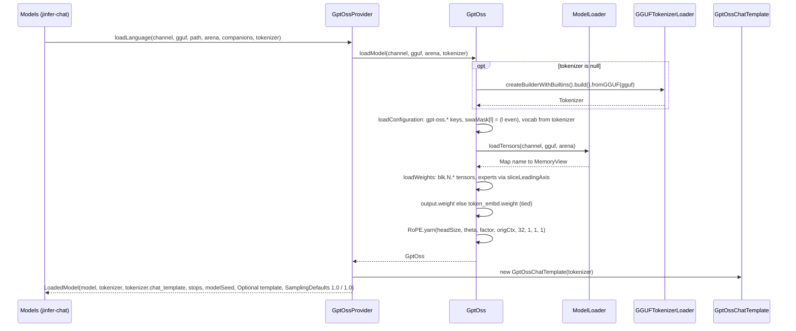

Stop tokens: `SpecialTokens.stops(tok, -1, "<|return|>", "<|call|>", "<|endoftext|>")`. Defaults for configuration keys:
`rms_epsilon` 1e-5, `rope.freq_base` 150000, `rope.scaling.factor` 1, `key_length` = dim / heads, `expert_*` 0.

---

## 4. Forward pass

`ingest(state, batch)` runs `state.exclusively(forward)`. Only `Batch.Input.Tokens` is accepted. All layers except the
last run the full block; the **last layer** only commits its K/V during `ingest`, and its attention + MoE are computed
lazily for a single row inside `logits(...)` (section 4c).

### 4.0 Global architecture

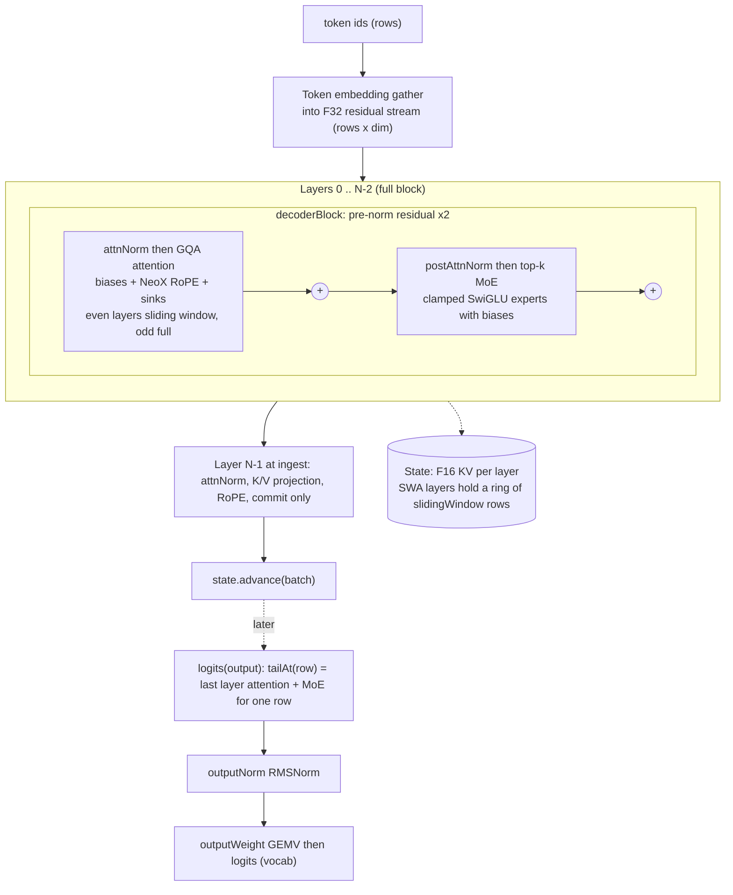

### 4a. `ingest` — validation, input kinds, rope/embedding, layer loop, advance

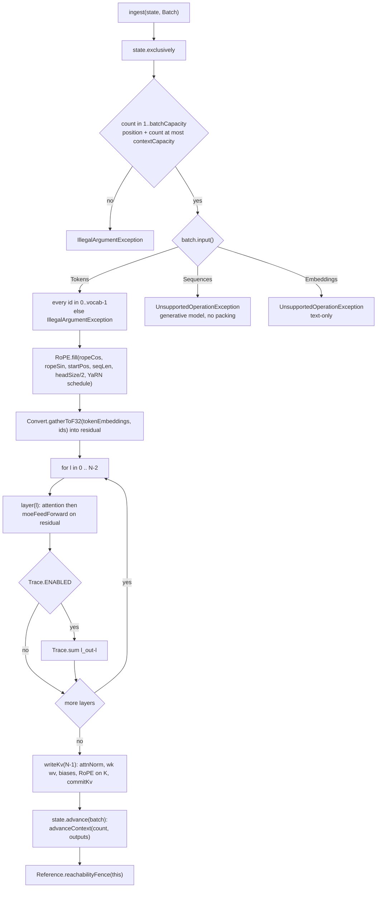

### 4b. `decoderBlock` — one layer (attention then MoE)

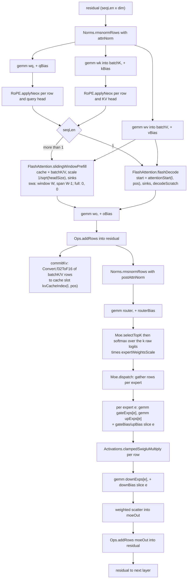

Layers differ only in the attention span: `swaMask[l] = (l % 2 == 0)`. Sliding layers keep a ring of
`min(contextCapacity, slidingWindow)` rows (`slidingWindow` must be a power of two, slot = `pos & (W-1)`), attend to
`[max(0, pos-W+1), pos]`; full layers keep `contextCapacity` rows at absolute positions. The MoE has no shared expert
and no dense layers.

### 4c. Output tail — `logits(state, output)`

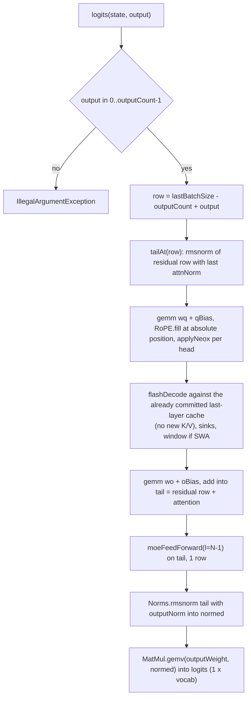

---

## 5. State and checkpoint layout

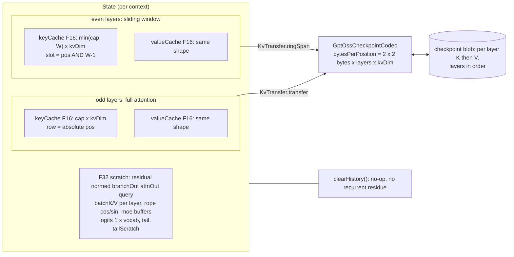

`transfer(state, from, to, blob, capture)` loops layers `0..N-1`; per layer it moves the K span then the V span.
`sizeOf(positions) = positions * 2 * sizeof(short) * numberOfLayers * kvDim` (uniform; SWA layers are accounted at the
same per-position size). Sliding-window rows are stored through their ring slots, so the live window rebuilds from
restored rows alone and every block is a resume point; spans longer than W alias ring slots (see `KvTransfer.ringSpan`).

---

## 6. Harmony reply language

`encode()` throws `UnsupportedConversation`: prompt framing is the GGUF template's whole render. The template only
declares the *reply* grammar; `thinkingPolicy()` is `ALWAYS`.

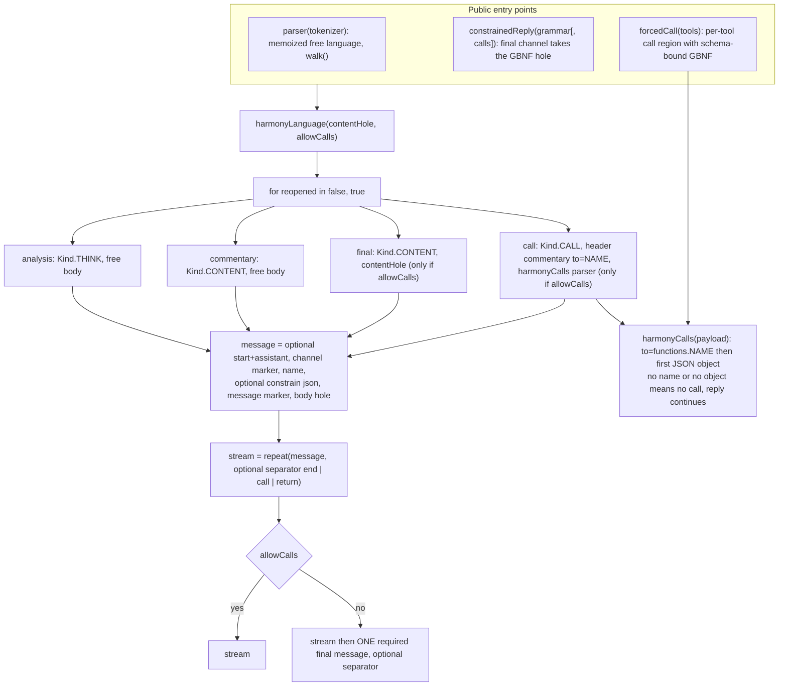
