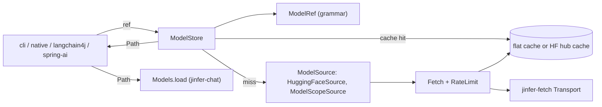

# jinfer-hub — architecture summary

**What it is.** `jinfer-hub` turns a *model reference* into a local GGUF file. A string such as
`unsloth/Qwen3.5-4B-GGUF:Q8_0` goes in, a `Path` comes out, and only what is missing is downloaded, from Hugging Face
(`hf.co`, the default host) or ModelScope (`modelscope.cn`). It is a downloader and a cache, nothing more: its only
dependencies are `json` (to parse the repository listing APIs) and `jinfer-fetch` (one HTTP GET: the JDK client on a JVM,
`curl` in a native image). The pom says why: it must not pull the inference engine onto a classpath that only wants files.

**Where it sits.** Callers resolve before they load: `jinfer-cli`, `jinfer-native` (libjinfer), `jinfer-langchain4j`,
`jinfer-spring-ai` and `jinfer-testkit` call `ModelStore.standard().resolve(...)` / `resolveAll(...)` and hand the
resulting path to `Models.load` (jinfer-chat). No library load touches the network by itself.

## Main concepts

| Concept | Classes | In one line |
|---|---|---|
| Reference grammar | `ModelRef`, `ModelRef.Host` | `[host/]owner/repo[@revision][/path][:quant]`; a closed host table; URLs refused, with the ref to use instead |
| The store | `ModelStore`, `ModelStore.Cached` | Ref in, path out; cache layout, quant selection, offline mode, source fallback, `cached`/`detached`/`remove` |
| Transport seam | `ModelSource`, `RepositorySource`, `HuggingFaceSource`, `ModelScopeSource`, `RemoteFile` | A source only answers "list this folder" and "fetch this file"; all policy lives in the store |
| HF interop | `Hub` | Reads (always) and, on the default root, writes the shared Hugging Face hub cache (`blobs/` + `snapshots/` + `refs/`), so llama.cpp and `hf download` share bytes with jinfer |
| Download engine | `Fetch`, `RateLimit` | Parallel 32 MB ranged GETs, resumable chunk map, sha256 verification, atomic rename, cross-process file locks, stall guard, polite 429 handling |
| Errors | `ModelNotFoundException` | An `IllegalArgumentException`: the ref names nothing reachable (no repo, gated, no such quant, offline miss) |
| Terminal | `Console` (SPI), `FfmConsole`, `TerminalSupport` | Terminal probes via the Foreign Function API for the progress board and the CLI |

## Key flows

1. **Resolve** (`ModelStore.resolve`): a non-ref is a local file (or `ModelNotFoundException`). A ref is parsed, then
   looked up in jinfer's own flat cache and then in the HF hub cache **before any network call**. On a miss, offline mode
   (`JINFER_OFFLINE` / `-Djinfer.offline`) refuses; otherwise the store takes a lock and tries each supporting source in
   order.
2. **Fetch pipeline** (per source): pin the branch to a commit (HF refs API), list the repository, pick exactly one GGUF
   (an explicit `/path`, else the `:quant`, else `Q4_K_M`, ignoring `mmproj*`/`mtp*` companions), refuse split GGUFs and
   safetensors-only repositories, check writability and free disk space, then download either into the hub cache
   (`Hub.fetchInto`) or into the flat layout `<root>/<host>/<owner>/<repo>[@rev]/<path>`.
3. **Download** (`Fetch.download`): lock, then parallel chunks for files of 64 MB or more (sequential otherwise), resume
   from `.part` + `.map` + `.etag`, verify sha256, `ATOMIC_MOVE` into place. Rate limits (`429`, `503` with a wait) put a
   per-host hold that all workers wait out within a budget.
4. **Pull / refresh** (`pullAll`): re-checks upstream; a changed file is staged as `.refresh.part` and swapped in only
   once verified, so a failed refresh keeps the old file.

## Notable design choices

- **The cache is the ref**: the flat layout mirrors the ref string one-to-one, so `ls` and `rm -rf` are valid management
  tools and `cached()` can render every file back as the ref that loads it.
- **Grammar and policy are separate**: `ModelRef` parses any repository path; only `ModelStore` knows jinfer loads GGUF.
  Whether a path is a file or a folder is decided by the listing, never by an extension.
- **No silent fallback**: a failing source is logged at WARNING before the next one is tried, and the last source's own
  answer is thrown.
- **A source never writes into the store** beyond the one path it is given, so a read-only store still serves every
  cache hit.
- **Safety in the details**: every ref field is validated as a single path component; credentials are dropped on
  cross-origin redirects and HTTPS never downgrades; lock files live in `java.io.tmpdir`, never next to models.
- **SPI for the console**: `module-info` `provides Console with FfmConsole`; a native image can supply its own through
  `TerminalSupport.use`, and with no provider everything degrades to plain output.

See [ARCHITECTURE.md](ARCHITECTURE.md) for class diagrams, sequence diagrams and the full list of configuration knobs.
