# jinfer-hub — class architecture

Package `com.qxotic.jinfer.hub` (JPMS module `com.qxotic.jinfer.hub`, 14 top-level types, ~4700 lines). It is jinfer's
**model downloader and cache**: a model reference such as `unsloth/Qwen3.5-4B-GGUF:Q8_0` goes in, a local GGUF path comes
out, and only missing files are downloaded, from Hugging Face or ModelScope. It has **no inference dependency**: the pom
depends only on `json` (`com.qxotic.format.json`) for the listing APIs and `jinfer-fetch` (`com.qxotic.jinfer.fetch`) for
the HTTP GET. The only exported API is `ModelStore`, `ModelRef`, `ModelSource` and its two public implementations,
`RemoteFile`, `ModelNotFoundException`, `Console`, `FfmConsole` and `TerminalSupport`. `RepositorySource`, `Hub`, `Fetch` and
`RateLimit` are package-private.

Format: **Mermaid**. Legend: `..|>` implements; `--|>` extends; `-->` holds/uses; `..>` creates/depends;
`*--` nested/owned; classes marked `<<external>>` live outside this module.

1. [Position in the stack](#1-position-in-the-jinfer-stack)
2. [Class diagrams](#2-class-diagrams): 2a public API and sources, 2b download machinery, 2c console SPI
3. [Model ref grammar](#3-model-ref-grammar)
4. [Resolution flow](#4-resolution-flow): 4a `resolve`, 4b `fetchPipeline`, 4c source fallback
5. [Cache layouts](#5-cache-layouts): flat store and the shared Hugging Face hub cache
6. [Download engine (`Fetch`)](#6-download-engine-fetch)
7. [Rate limits](#7-rate-limits)
8. [Console SPI and progress](#8-console-spi-and-progress)
9. [Configuration knobs](#9-configuration-knobs)

| Class | Role |
|---|---|
| `ModelStore` | Public façade. `standard()` / `of(root, sources...)`; `resolve`, `resolveAll`, `pullAll`, `select`, `find`, `cached`, `detached`, `remove`, `isRef`, `requireRef`. Owns cache layout, GGUF/quant selection, offline policy, source fallback. Nested `Policy` enum (`USE_CACHE`, `REFRESH`, `REDOWNLOAD`) and `Cached(ref, sizeBytes)` record |
| `ModelRef` | Record `(host, owner, repo, revision, path, quant)`: the pure grammar `[host/]owner/repo[@revision][/path][:quant]`, validation, URL refusal plus suggestion. Nested `Host` enum (`HF`, `MODELSCOPE`): the closed table of hosts |
| `ModelSource` | Transport seam interface: `supports(ref)`, `list(ref, dir)`, `fetch(ref, file, into)` |
| `RepositorySource` | Package-private `ModelSource` for one `ModelRef.Host`: listing (HF tree API / ModelScope files API), file URLs, credentials, `commitFor` (HF refs API) |
| `HuggingFaceSource` | Public final subclass for `Host.HF`; honors `HF_ENDPOINT` or an explicit `URI` |
| `ModelScopeSource` | Public final subclass for `Host.MODELSCOPE`; honors `MODELSCOPE_ENDPOINT` |
| `RemoteFile` | Record `(path, sizeBytes, sha256)` as a listing reports a file; `sha256` may be null |
| `ModelNotFoundException` | `IllegalArgumentException` carrying `source()`: the ref/path names nothing reachable |
| `Hub` | Package-private: reads and writes the shared Hugging Face hub cache (`models--owner--repo/blobs`, `snapshots/<commit>`, `refs/`) |
| `Fetch` | Package-private download engine: parallel ranged GETs, resume map, sha256 verify, atomic publish, file + in-JVM locks, redirects, stall guard, progress board. Nested `Board`, `Stall`, `Validator`, `Progress`, `HttpStatusException`, `InvalidTransfer`, `SingleStreamRequired`, `Sent`, `IOCall`, `StagedDownload` |
| `RateLimit` | Package-private: parses `Retry-After` / `RateLimit` / `RateLimit-Reset`, keeps a per-host hold every request waits out |
| `Console` | SPI interface (`uses` in module-info): `isTerminal`, `columns`, `enableAnsi`, `enableUtf8`, all defaulting to "no console" |
| `FfmConsole` | The registered `Console` provider: libc (`isatty`, `ioctl`) or kernel32 console APIs via the Foreign Function API |
| `TerminalSupport` | Static façade choosing a `Console` (given via `use`, else `ServiceLoader`, else none); used by `Fetch.Progress` and `jinfer-cli` |

---

## 1. Position in the jinfer stack

Nothing in the inference engine calls this module (stated in `ModelStore`'s javadoc): resolution happens in callers before
`Models.load`, so a library load given a path never touches the network.

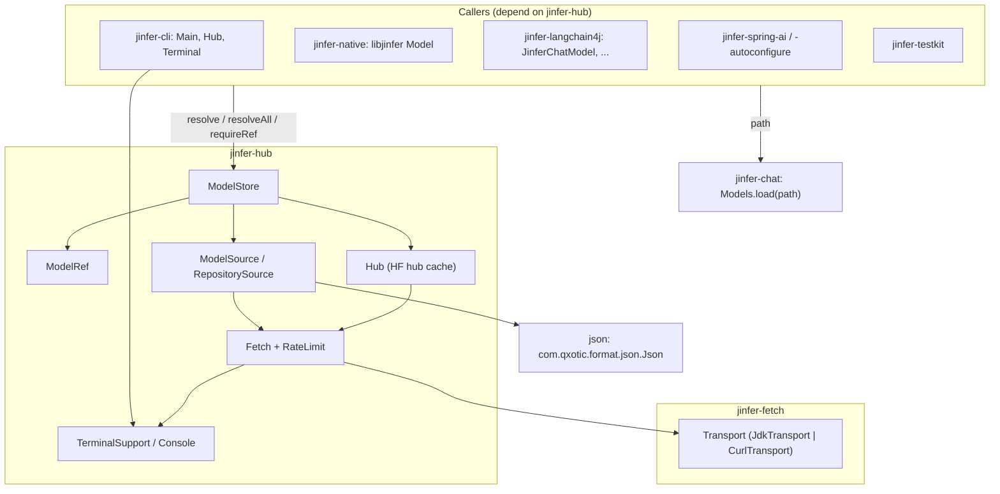

---

## 2. Class diagrams

### 2a. Public API, sources and errors

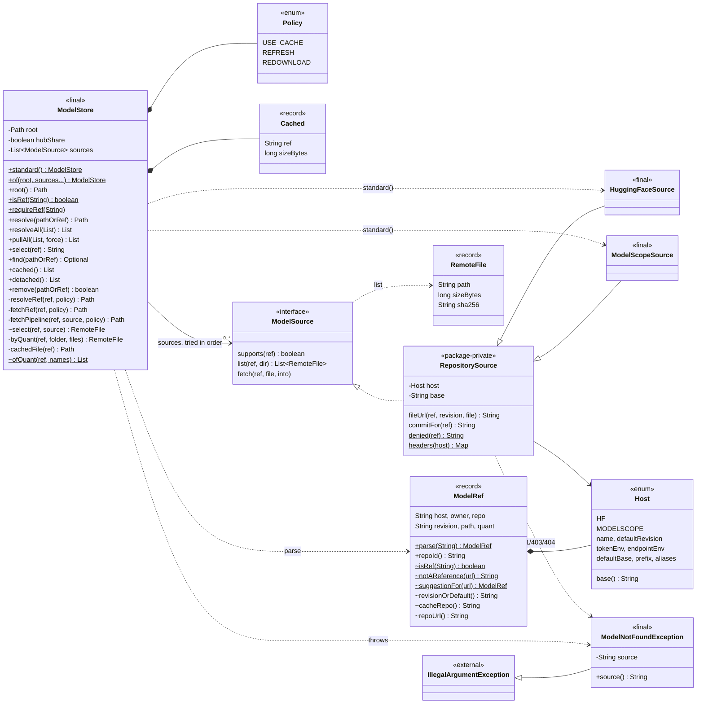

### 2b. Download machinery (package-private)

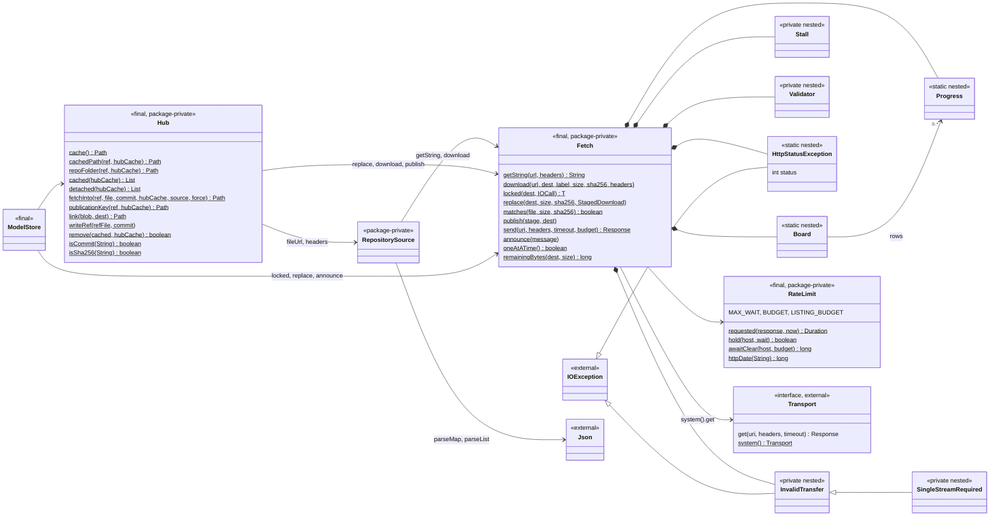

### 2c. Console SPI

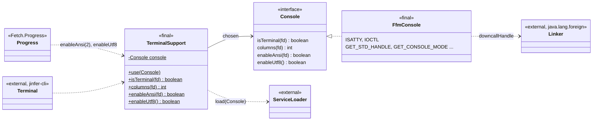

SPI registration: `module-info.java` declares `uses com.qxotic.jinfer.hub.Console` and
`provides com.qxotic.jinfer.hub.Console with com.qxotic.jinfer.hub.FfmConsole`; the class path equivalent is
`src/main/resources/META-INF/services/com.qxotic.jinfer.hub.Console` (one line: `FfmConsole`). `Console`'s javadoc says a
native image leaves that service out and gives its own provider through `TerminalSupport.use`.

---

## 3. Model ref grammar

`[host/]owner/repo[@revision][/path][:quant]`: `/path` says where, `:quant` says which, `@revision` says when.

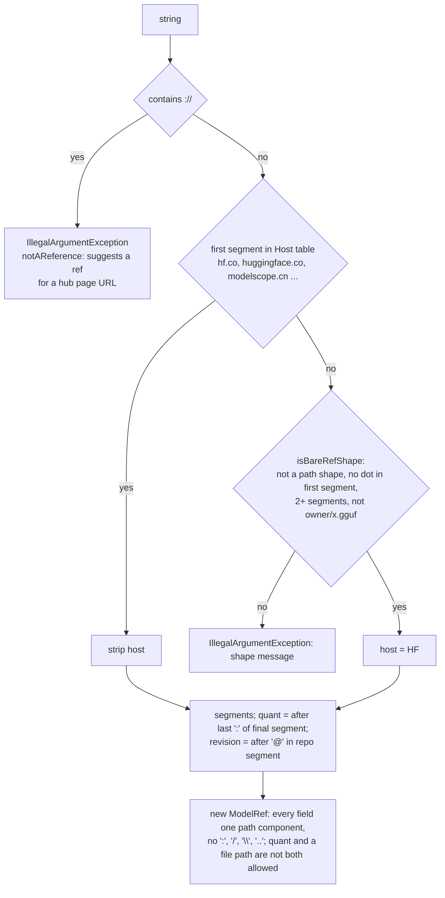

- `ModelRef.isRef(s)` = host-qualified, **or** bare ref shape and no existing local file of that name (a file wins).
- `Host` rows carry `defaultRevision` (`main` / `master`), `tokenEnv` (`HF_TOKEN` / `MODELSCOPE_API_TOKEN`),
  `endpointEnv` (`HF_ENDPOINT` / `MODELSCOPE_ENDPOINT`), `defaultBase` and URL `prefix` (`""` / `/models`).
- `suggestionFor(url)` maps hub page URLs (`tree`, `blob`, `resolve`, ModelScope `file/view`, `files`, `summary`) back
  to a ref, turning a root `<model>-<QUANT>.gguf` into `:QUANT` via `quantOf`.

---

## 4. Resolution flow

### 4a. `ModelStore.resolve(pathOrRef)`

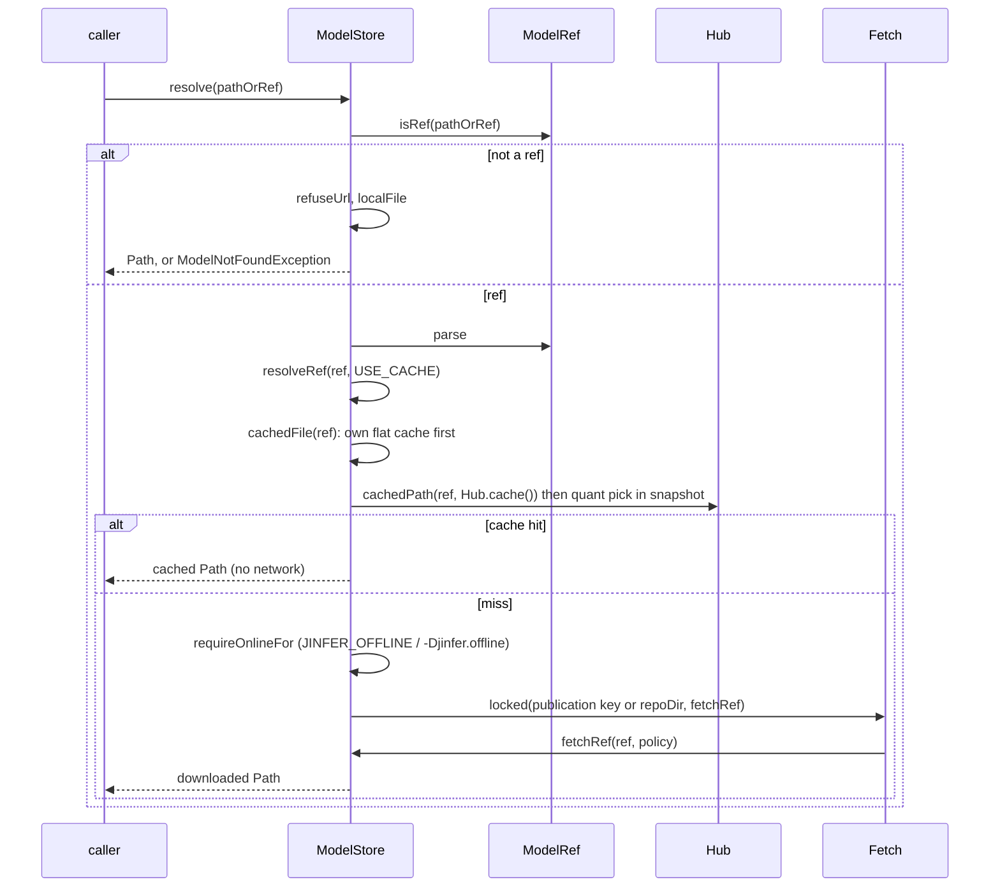

`resolveAll` runs each element through the same path, concurrently on a pool of at most 4 threads (sequentially when
there is one argument or `Fetch.oneAtATime()`); the first failure cancels the rest. `pullAll(refs, force)` uses
`Policy.REFRESH` / `REDOWNLOAD`, which skip the plain cache hit and re-check upstream. `select(ref)` returns the chosen
repository-relative file without downloading, remembering a quant's answer in `<repo>/quants/<quant>` for offline use.

### 4b. `fetchPipeline(ref, source, policy)` — one source

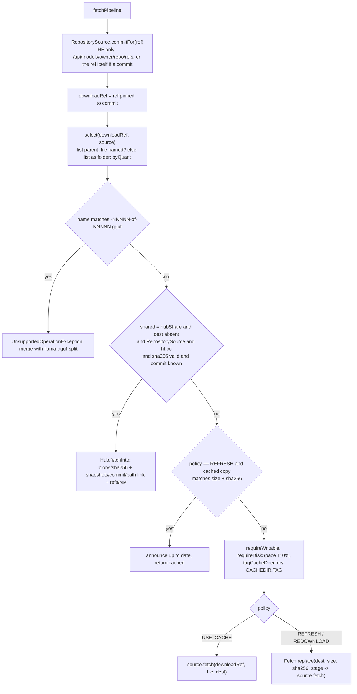

Selection rules (`byQuant` / `ofQuant`): only `.gguf` files that are not companions (`mmproj*`, `mtp*`) count as models;
one model and no quant means that file; otherwise the quant (explicit, else `DEFAULT_QUANT = "Q4_K_M"`, llama.cpp's
default) must match exactly one `-<QUANT>.gguf` / `.<QUANT>.gguf` file. None gives a `ModelNotFoundException` listing
`quants(...)`; several gives a copy-pasteable menu. A repository with only safetensors is refused before any download.

### 4c. Source fallback (`fetchRef`)

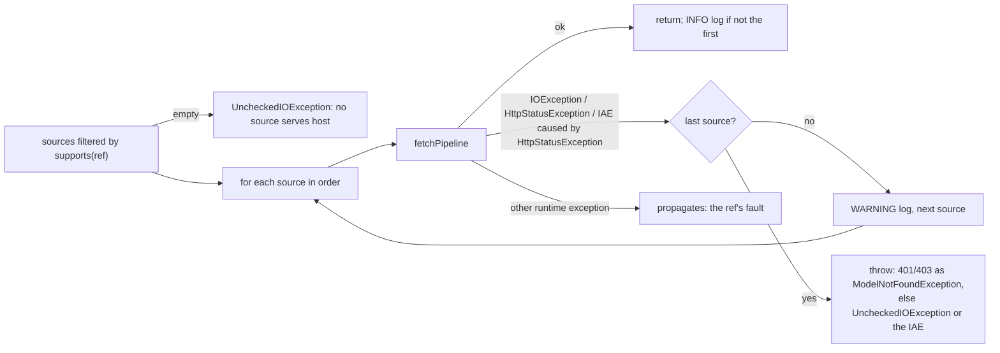

---

## 5. Cache layouts

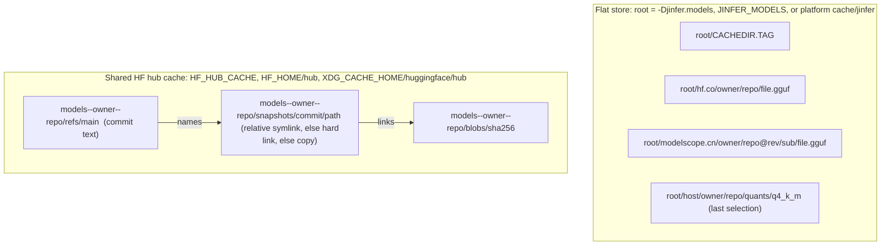

- `hubShare` is true only when `root` equals the platform default by value **and** the hub cache is writable; then
  `hf.co` downloads are written into the hub cache (visible to llama.cpp and `hf download`). An explicit root opts out.
  ModelScope always uses the flat layout. The hub cache is **always read** (`cachedFile`, `cached()`).
- Directory names are matched case-insensitively (`ModelStore.anyCase`), so differently cased ids share one folder.
- `cached()` merges own entries and `Hub.cached` (own first, one per ref); `detached()` lists GGUFs in snapshots no ref
  names, counting shared blobs once. `remove` deletes a flat file and prunes empty folders, or calls `Hub.remove`, which
  deletes the blob only when no other snapshot links it, then stale refs, then an emptied repository folder.

---

## 6. Download engine (`Fetch`)

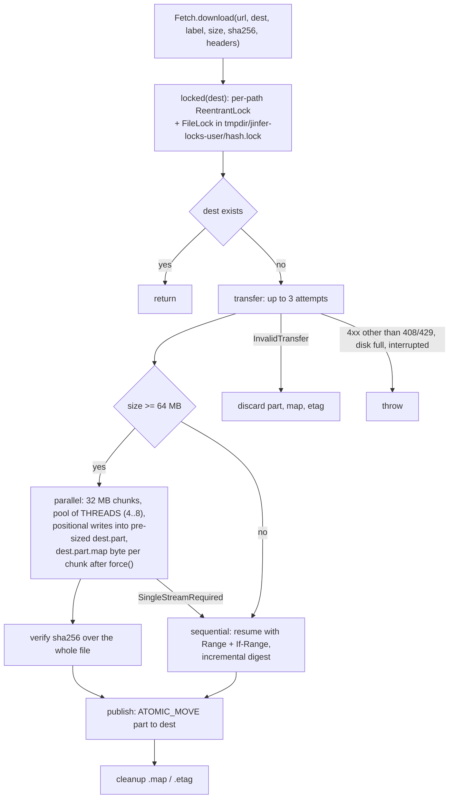

- **HTTP**: every request goes through `send` → `sendOnce` → `Transport.system().get(...)` (`jinfer-fetch`: JDK
  `HttpClient` on a JVM, `curl` in a native image). Redirects are followed by hand (max 5); `Authorization` is dropped
  when the origin changes, and HTTPS→HTTP downgrades are refused (`redirectTarget`).
- **Integrity**: `Validator` pins one strong ETag (stored in `.etag`) across workers and retries, else requires the
  sha256; `validateRange` checks `Content-Range`; `Accept-Encoding: identity` is forced.
- **Stall guard**: `Stall` registers each body stream with a daemon `jinfer-stall-guard` thread that closes a stream
  with no bytes for `jinfer.downloadStallSeconds` (default 60); the same value bounds the header wait.
- **Replace** (`Fetch.replace`): refresh downloads go to `dest.refresh.part`, are size- and sha256-checked, then
  atomically moved over the old entry, so a failed refresh keeps the published file.
- `getString` (listings) uses a 20 s header timeout, `RateLimit.LISTING_BUDGET` and a 64 MB body cap; a non-200 raises
  `HttpStatusException`, which `RepositorySource.get` turns into `ModelNotFoundException` (401/403/404) or a
  "limiting requests" `IOException` (ModelScope 403 with code `10013201001`).

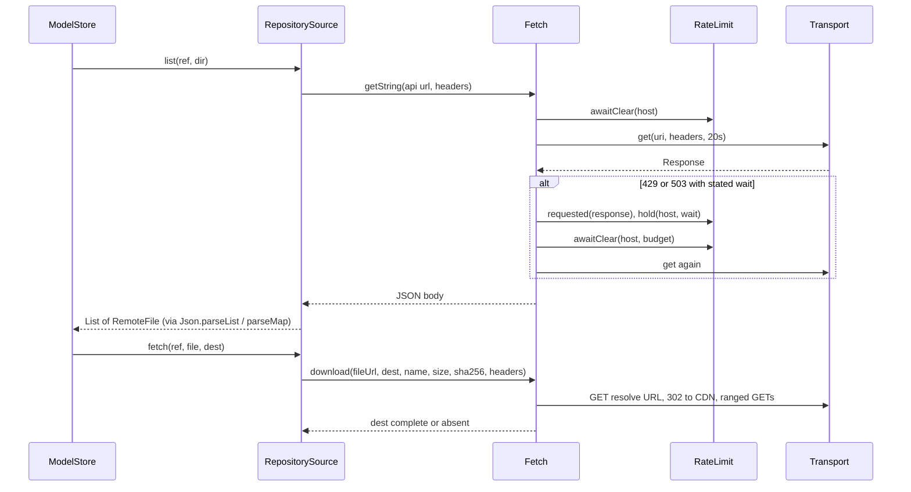

---

## 7. Rate limits

`RateLimit.requested` reads, in order, `Retry-After` (seconds or an RFC 1123 date parsed by hand in `httpDate`), the IETF
`RateLimit` structured field (`"policy";r=0;t=21`, only exhausted policies count) or its older `reset=` dictionary form,
then `RateLimit-Reset`. `Fetch.send` waits the asked time (or `5s << backoff`, capped at 60 s, when none is stated), capped
at `MAX_WAIT` (15 min) plus 250–1250 ms jitter, within a budget of `BUDGET` (30 min) for downloads or `LISTING_BUDGET`
(1 min) for listings. `hold(host, wait)` stores a process-wide per-host deadline in a `ConcurrentHashMap`, so every
chunk worker pauses together; only the caller that extended the hold logs and announces it.

---

## 8. Console SPI and progress

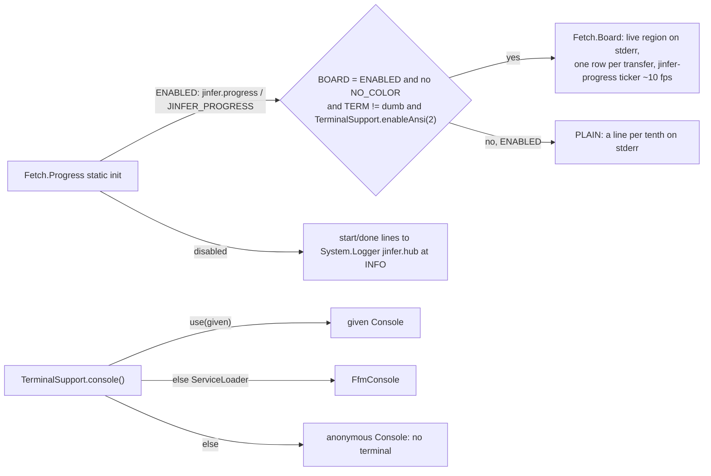

`FfmConsole` links symbols only when `FfmConsole.class.getModule().isNativeAccessEnabled()`; otherwise every probe
answers no. On POSIX it uses `isatty` and `ioctl(TIOCGWINSZ)` (`0x5413` Linux, `0x40087468` macOS); on Windows
`GetStdHandle`, `Get/SetConsoleMode` (virtual terminal processing), `GetConsoleScreenBufferInfo` (visible window width)
and `Get/SetConsoleOutputCP` (UTF-8, original restored by a `jinfer-console-restore` shutdown hook).
`TerminalSupport.columns` falls back to `$COLUMNS`, then 80. `native-image.properties` initializes `Fetch`,
`Fetch$Progress`, `FfmConsole` and `TerminalSupport` at run time and enables the Foreign API.

---

## 9. Configuration knobs

| Setting | Read by | Effect |
|---|---|---|
| `-Djinfer.models` > `JINFER_MODELS` > platform cache `/jinfer` | `ModelStore.ambientRoot` | Store root for `standard()` |
| `-Djinfer.offline` > `JINFER_OFFLINE` | `ModelStore.offlineSource` | Misses fail as `ModelNotFoundException`; pulls throw `IllegalStateException` |
| `-Djinfer.downloadThreads` > `JINFER_DOWNLOAD_THREADS` | `Fetch.threads` | Chunk workers (default clamp(cpus, 4, 8)); 1 also serializes `resolveAll` |
| `jinfer.downloadStallSeconds` | `Fetch.stallSeconds` | Stall guard and header timeout (default 60) |
| `-Djinfer.progress` > `JINFER_PROGRESS`, `NO_COLOR`, `TERM=dumb` | `Fetch.Progress` | Progress on/off and board vs plain lines |
| `JINFER_SKIP_DISK_CHECK=1` | `ModelStore.requireDiskSpace` | Skip the size + 10% free-space check |
| `HF_TOKEN`, `HF_TOKEN_PATH`, `HF_HOME/token`, `~/.cache/huggingface/token`; `MODELSCOPE_API_TOKEN` | `RepositorySource.headers` | `Authorization: Bearer` |
| `HF_ENDPOINT`, `MODELSCOPE_ENDPOINT` | `ModelRef.Host.base` | Mirror base URL |
| `HF_HUB_CACHE`, `HF_HOME`, `XDG_CACHE_HOME` | `Hub.cache` | Location of the shared hub cache |
