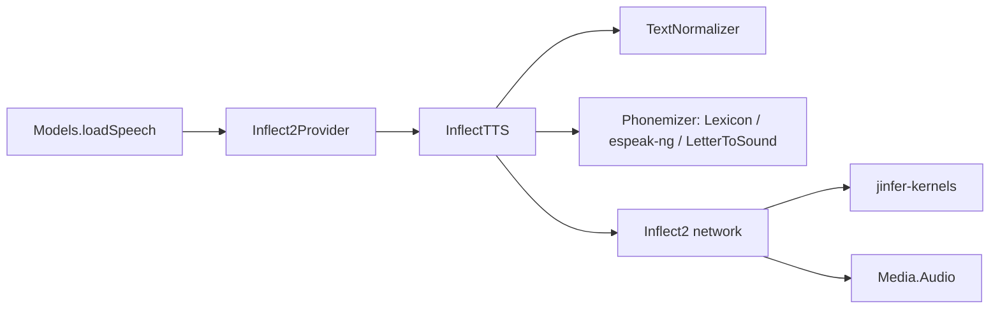

# jinfer-inflect2 — architecture summary

`jinfer-inflect2` runs **local text-to-speech** with the Inflect 2 models (VITS family; Nano 3.97M and Micro 9.36M
parameters, shipped as F16 / Q8_0 / Q4_0 GGUF, architecture `inflect-v2`). Text goes in, a mono `float[]` PCM
waveform (`Media.Audio`) comes out, in pure Java on the jinfer CPU kernels. Detailed class diagrams and flows:
[ARCHITECTURE.md](ARCHITECTURE.md).

## Where it sits

It is one of the `jinfer-<model>` ports. It plugs into `jinfer-chat` through the `ModelProvider` SPI
(`META-INF/services/com.qxotic.jinfer.chat.ModelProvider` → `Inflect2Provider`), so `Models.loadSpeech(path, arena)`
reaches it by GGUF architecture without callers naming the port. Consumers include the langchain4j and Spring AI
`JinferSpeechModel` adapters and the `examples/scripts` `Speak` / `Narrate` scripts. It is speech-only: the provider
overrides `loadSpeech` and nothing else.

Below it: `jinfer-core` (the `SpeechSynthesisModel`, `Phonemizer`, `SpeechOptions`, `RuntimeState` contracts),
`jinfer-kernels` (`MatMul`, `Convolutions`, `Norms`, `Activations`, `Ops`, `Convert`, `ModelLoader`), `jota-memory`
(`MemoryView` / `MemoryArena`), `gguf`, and `jinfer-codecs` (`Espeak`, an optional espeak-ng subprocess wrapper).

## Main classes

| Class | What it does |
|---|---|
| `Inflect2Provider` | SPI entry: architecture `inflect-v2`, companion role `lexicon`, delegates to `InflectTTS.load` |
| `InflectTTS` | The `SpeechSynthesisModel`: text policy (normalize, chunk, terminate, cut, pause, fade, clamp), phonemizer discovery, immutable tuning (`variation`, `seed`, `phonemizer`, `wordOverrides`) |
| `Inflect2` | The network and its GGUF loader: `SYMBOLS` (178-entry StyleTTS2 IPA table), `Configuration`, weight records, `State`, and `synthesize(state, tokens, lengthScale, variation, seed)` |
| `frontend.TextNormalizer` | English normalization: numbers, money, dates, times, versions, acronyms, abbreviations, pronunciation overrides |
| `frontend.Lexicon` | IVL2 binary word → IPA lexicon with suffix inflection; unknown runs go to espeak-ng, else to `LetterToSound` |
| `frontend.LetterToSound` | Rule-based guess for words nothing else covers, never silent |

## Key flows

1. **Load**: `Inflect2.load` reads tensors via `ModelLoader`, validates `inflect.v2.*` metadata in `readConfig`, and
   resolves every tensor once into typed records (`EncoderLayer`, `Durations`, `Coupling`, `Decoder`, `ResBlock`,
   `Conv`, `Norm`). Conv weights stay FP32 or Q8_0; everything else is dequantized to F32 once.
2. **Phonemizer ladder**: named lexicon (unreadable throws) → `lexicon.bin` beside the GGUF → classpath
   `/lexicon.bin` (for the native image) → espeak-ng alone (with a warning) → `IOException`. Every lexicon rung uses
   espeak-ng as its fallback when installed.
3. **Speak**: normalize → split into sentence chunks (≤ 279 chars, closed with `.` or `,`) → phonemize → cut by a
   phoneme ceiling (`4000 frames / 6 * speed`) → per piece: blank-intersperse, `Inflect2.synthesize`, 5 ms edge fade,
   clamp → a punctuation-dependent pause between clips → streamed to a `Predicate<Media.Audio>` sink (false stops).
4. **Synthesize**: embed + relative-position transformer encoder → per-token prior mean/log-scale and log-duration →
   seeded Gaussian prior expanded by duration → inverse coupling flow (WaveNet shifts) → HiFi-GAN decoder (transposed
   conv upsampling, averaged resblock banks, tanh).

## Notable design choices

- **Two layouts**: the encoder/flow are time-major and use im2col + `MatMul.gemm`; the decoder is channel-major
  and uses `Convolutions.conv1dRows` and a phase-split transposed conv parallelized per output channel, because
  time (up to ~110k samples) is the only axis worth vectorizing there.
- **Bounded cost**: `MAX_FRAMES = 4000` caps a chunk (~43 s); `speed` is refused outside [0.5, 2.0], `variation`
  outside [0, 1]. Over-long input is a loud `IllegalArgumentException`, not an allocation blow-up.
- **Allocation-free steady state**: `Inflect2.State` is a stack allocator with pooled scopes and buffers that grow to
  the largest request; only the returned `float[]` is allocated per pass.
- **Ownership**: "who provides the arena owns it" for both weights and state scratch; `newState()` owns a
  cross-thread arena, `newState(arena)` borrows. `RuntimeState.exclusively` (reentrant) guards each synthesis and is
  held across a whole utterance so `close()` cannot free scratch mid-speech. `LeakWatch` reports dropped states.
- **Determinism**: the prior noise is drawn channel-major from a `Random` reseeded per call, so same state, text,
  seed and variation produce the same waveform.
- **Honest fallbacks**: a named lexicon or companion never silently falls back; unknown words are pronounced by
  rules and logged once rather than dropped.
