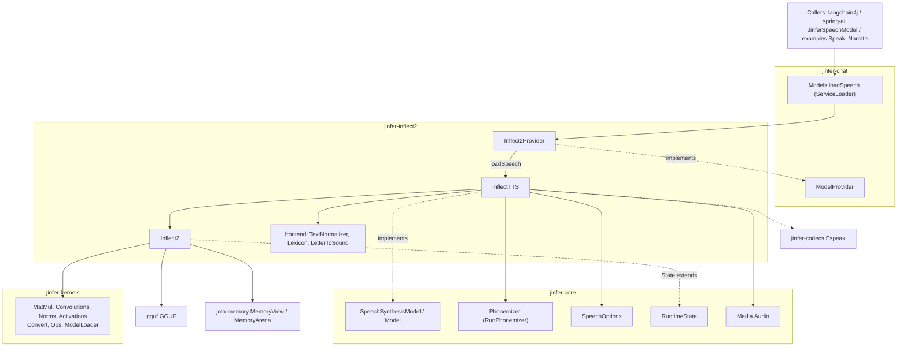
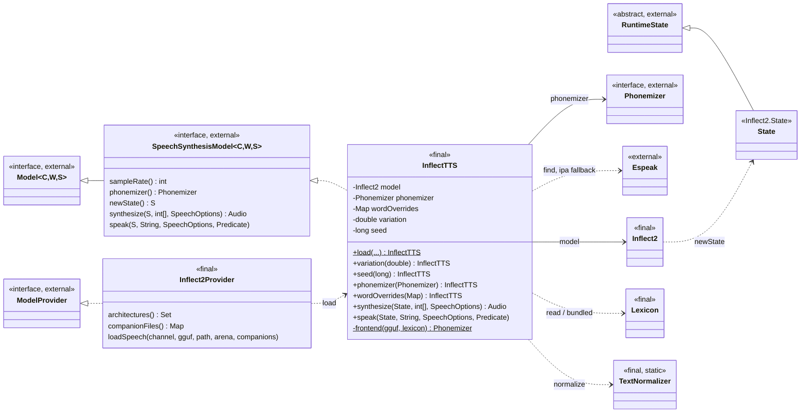
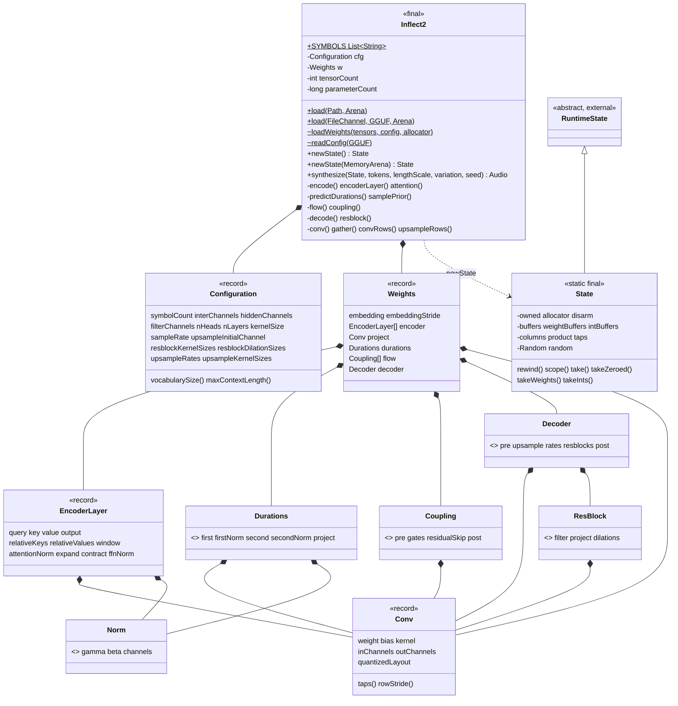
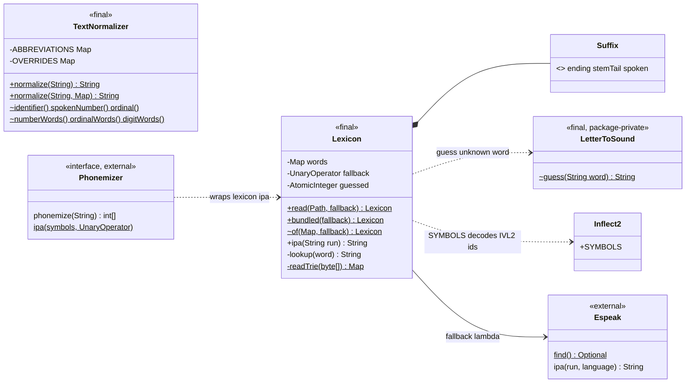
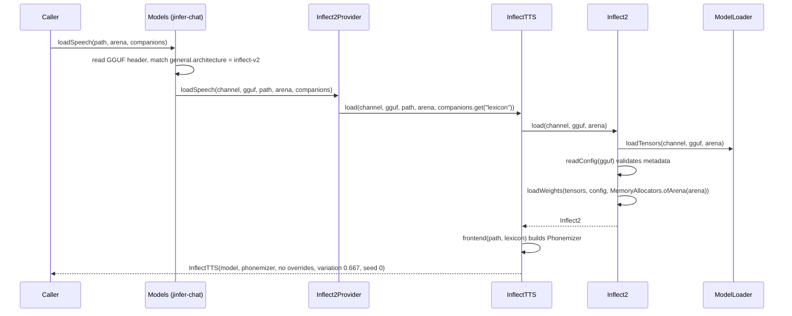
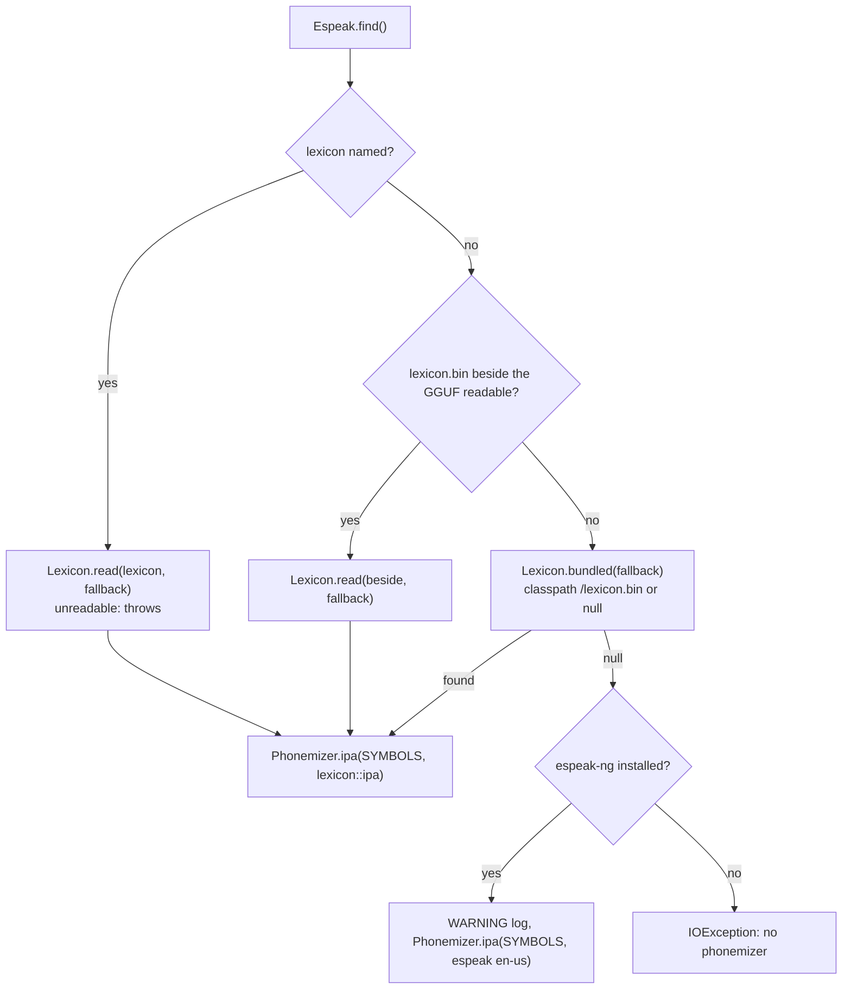
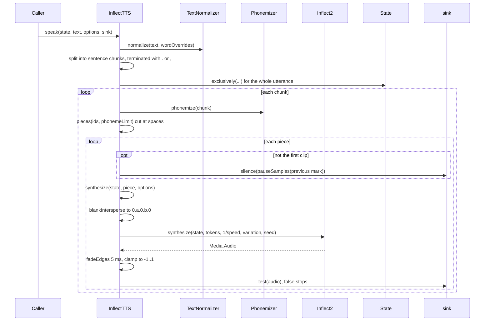
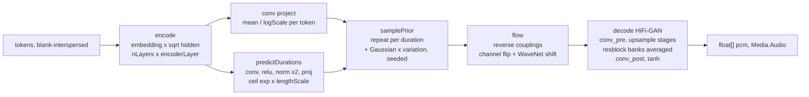
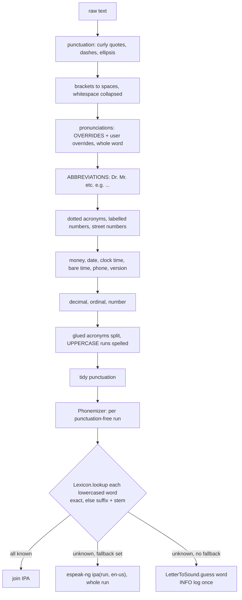
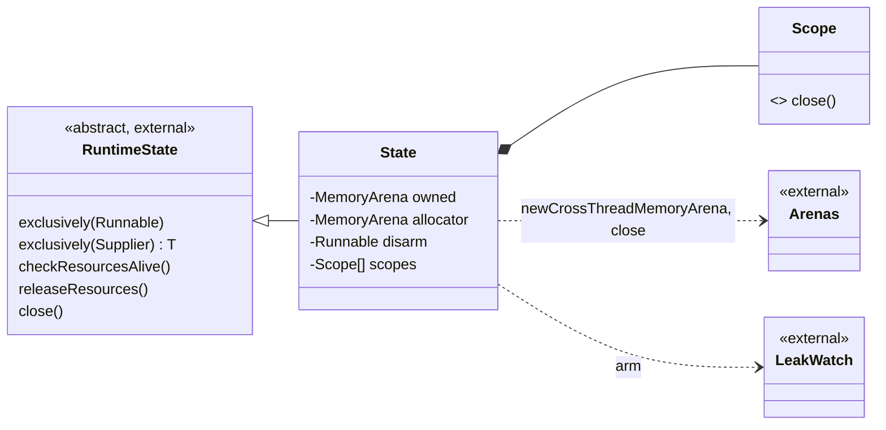

# jinfer-inflect2 — class architecture

Packages `com.qxotic.jinfer.models.inflect2` (3 classes) and `com.qxotic.jinfer.models.inflect2.frontend`
(3 classes), ~2800 lines in all. It is the `jinfer-<model>` provider for GGUF architecture `inflect-v2` — **not a
language model**: it is a local **text-to-speech** port of the Inflect 2 VITS-family models (Nano 3.97M, Micro 9.36M
parameters; F16 / Q8_0 / Q4_0 GGUF). It is a speech-only family: `Inflect2Provider` overrides only `loadSpeech`, every
other `ModelProvider` entry point keeps its default (which throws).

Format: **Mermaid**. Legend: `..|>` implements; `--|>` extends; `-->` holds/uses; `..>` creates/depends;
classes marked `<<external>>` live outside this module.

1. [Position in the stack](#1-position-in-the-jinfer-stack)
2. [Class diagrams](#2-class-diagrams) — 2a contracts, 2b model internals, 2c frontend
3. [Loading sequences](#3-loading-sequences) — 3a SPI dispatch, 3b the phonemizer ladder
4. [Speaking a text](#4-speaking-a-text) — `InflectTTS.speak`
5. [Synthesis pipeline](#5-synthesis-pipeline) — `Inflect2.synthesize`
6. [Text frontend](#6-text-frontend) — normalizer, lexicon, letter-to-sound
7. [State and memory](#7-state-and-memory)

| Class | Role |
|---|---|
| `Inflect2Provider` | `ModelProvider` SPI (`META-INF/services/com.qxotic.jinfer.chat.ModelProvider`): architecture `inflect-v2`, companion file role `lexicon`, `loadSpeech` → `InflectTTS.load` |
| `InflectTTS` | `SpeechSynthesisModel<Inflect2.Configuration, Inflect2.Weights, Inflect2.State>`: text policy (normalize, sentence chunking, terminating marks, phoneme-count cuts, pauses, edge fades, clamp), phonemizer discovery ladder, immutable tuning re-wraps (`variation`, `seed`, `phonemizer`, `wordOverrides`) |
| `Inflect2` | The network: `SYMBOLS` table, nested `Configuration`, weight records (`Conv`, `Norm`, `EncoderLayer`, `Durations`, `Coupling`, `ResBlock`, `Decoder`, `Weights`) and `State`; GGUF loading and the full forward pass (encoder → durations → prior → flow → HiFi-GAN decoder) |
| `frontend.TextNormalizer` | Static English normalizer: numbers, money, dates, times, phones, versions, ordinals, acronyms, abbreviations and pronunciation overrides rewritten as words |
| `frontend.Lexicon` | Grapheme-to-phoneme: IVL2 binary lexicon (word → IPA, delta-coded, symbol ids mapped through `Inflect2.SYMBOLS`) + suffix inflection; unknown run → espeak-ng fallback, else `LetterToSound` |
| `frontend.LetterToSound` | Package-private, rule-based English letter-to-sound guess with initial-stress mark; last rung of the pronunciation ladder |

---

## 1. Position in the jinfer stack

Module dependencies (`pom.xml`): `jota-core`, `jota-memory`, `jinfer-core`, `jinfer-kernels`, `jinfer-chat`
(ModelProvider SPI and speech loading contract), `jinfer-codecs` (espeak-ng wrapper), `gguf`, `toknroll-core`;
`jinfer-testkit` in test scope. No toknroll class is referenced from `src/main` (speech uses a phonemizer, not a
tokenizer). The jar's `Automatic-Module-Name` is `com.qxotic.jinfer.models.inflect2`.

---

## 2. Class diagrams

### 2a. Contracts and relations

### 2b. Model internals — `Inflect2` and its nested types

### 2c. Frontend

`InflectTTS` adapts `Lexicon.ipa` (or the bare espeak lambda) into a core `Phonemizer` via
`Phonemizer.ipa(Inflect2.SYMBOLS, ...)`, which builds a jinfer-core `RunPhonemizer`: it splits the text into
punctuation-free runs, asks the IPA function for each run, re-emits the marks as their own symbols, and maps each
IPA code point to its id in `SYMBOLS` (dropping code points the table lacks).

---

## 3. Loading sequences

### 3a. SPI dispatch

`readConfig` requires `general.architecture == "inflect-v2"`, reads the `inflect.v2.*` keys (`symbol_count`,
`inter_channels`, `hidden_channels`, `filter_channels`, `n_heads`, `n_layers`, `kernel_size`, `sample_rate`,
`upsample_initial_channel`, `resblock_kernel_sizes`, `resblock_dilation_sizes`, `upsample_rates`,
`upsample_kernel_sizes`), and refuses a symbol count other than `SYMBOLS.size()`, `add_blank = false`, an activation
other than `leaky_relu`, or an upsample layout whose `MAX_FRAMES` (4000) waveform would overflow an `int`.

`loadWeights` resolves tensor names (`enc_p.*`, `dp.*`, `flow.flows.{2i}.*`, `dec.*`) into the weight records once.
Kernel sizes absent from the metadata are constants (`POINTWISE=1`, `VOCODER_KERNEL=7`, `WAVENET_KERNEL=5`,
`DURATION_KERNEL=3`). Conv weights stay **FP32 or Q8_0** as stored; any other dtype, plus embeddings, relative
embeddings, norms and biases, is dequantized once to F32 (`Convert.copyToF32`). `Conv.quantizedLayout` remembers the
file's encoding for the transposed-conv tap ordering.

### 3b. The phonemizer ladder (`InflectTTS.frontend`)

Every lexicon rung layers espeak-ng underneath it as the `fallback` when installed. A named lexicon *replaces* the
ladder rather than joining it. The classpath rung exists for the native image (the lexicon is copied in at build
time, it is not a checked-in resource).

---

## 4. Speaking a text

Text policy details (all in `InflectTTS`):

- **Chunking**: normalized first, then split after `.!?;:`; a chunk longer than `CUT_LIMIT` (279 chars) is cut at
  the last `, ; :` past half the limit, else the last space, else hard.
- **Termination**: a chunk not ending in `.!?;:,` gets `.` (last chunk) or `,` (mid-sentence), because the model
  renders a chunk's final phoneme only when a mark closes it.
- **Phoneme ceiling**: `phonemeLimit = MAX_FRAMES / FRAMES_PER_PHONEME(6) * speed`; `pieces` cuts at the last
  space inside the limit, closing each non-final piece with a comma symbol.
- **Pauses** by final mark: `?` 0.28 s, `!` 0.24, `.` 0.22, `;` 0.16, `:` 0.13, `,` 0.09, else 0.08.
- **Speed** comes from `SpeechOptions.speed()`, default 1.0, refused outside [0.5, 2.0]; the model receives the
  length scale `1/speed`.
- The default `speak` overloads (no state, or returning one concatenated clip) come from `SpeechSynthesisModel`.

---

## 5. Synthesis pipeline

`Inflect2.synthesize` → `state.exclusively(synthesize0)` then `Reference.reachabilityFence(this)` (kernels read the
weights by raw address).

| Stage | Layout | Main kernels |
|---|---|---|
| `encode` / `encoderLayer` | time-major `x[token][channel]` | `Convert.copyF32`, `Ops.multiplyInPlace`; `attention` = per head/query `Ops.dot` + relative-key term within `window`, softmax on a heap row, `Ops.saxpyInPlace` (+ relative values); `addNorm` → `Norms.layerNormRows`; FFN conv + relu |
| `predictDurations` | time-major | `conv`, `Ops.clampInPlace` (relu), `Norms.layerNormRows`; throws when a token or the total exceeds `MAX_FRAMES` |
| `samplePrior` | channel-major draw, frame-major output | `java.util.Random` (`state.random.setSeed(seed)`), heap array then `Views.copyFromArray` |
| `flow` / `coupling` | time-major | `Ops.reverseChannelsInPlace`, `Activations.tanhSigmoidGate`, `Ops.addInPlace`, `Ops.saxpyInPlace(-1)` (shift subtracted from second half) |
| `decode` / `resblock` | channel-major `rows[channel][time]` | `Ops.transposeCopy`, `Ops.leakyReluInPlace` (0.1, final 0.01), `convRows` → `Convolutions.conv1dRows`, `upsampleRows` (phase-split transposed conv under `Parallel.forLoop`, `Ops.copyStrided`), `Ops.divideInPlace`, `Ops.tanhInPlace` |

Two convolution paths:

- `conv` (time-major, encoder/durations/flow): im2col via `gather` (skipped for a 1x1 conv with unpadded rows), then
  `MatMul.gemm` into `state.product`, copied out, `Ops.addRowBiasInPlace`.
- `convRows` / `upsampleRows` (channel-major, decoder): taps dequantized once per call (`dequantize`, or
  `dequantizeTransposed` which reorders a dense transposed layout), then vector FMA sweeps along time.

---

## 6. Text frontend

- `TextNormalizer` mirrors the reference `inflect_nano_v2_frontend.py` `normalize_text()`; narrow patterns run before
  general ones because each step consumes what it recognizes. Digit runs longer than 9 are spelled out.
- `Lexicon` reads the **IVL2** format: magic `IVL2`, version 1, entry count, entries offset; each entry is
  shared-prefix length, fresh bytes, symbol count, symbol ids (decoded through `Inflect2.SYMBOLS`). Malformed input
  becomes `IOException`. Suffixes tried: `ies`, `'s`, `s'`, `es`, `s`, `ied`, `ed`, `ing`.
- Only the lexicon key is lowercased; espeak sees the writer's casing.
- `LetterToSound` strips accents (NFD), applies consonant clusters, vowel digraphs, r-colored vowels, magic-e, final
  silent e, then inserts `ˈ` before the first syllable's onset.

---

## 7. State and memory

- **Weights** live in the caller's `java.lang.foreign.Arena` passed to `load` ("who provides it owns it"). A loaded
  `Inflect2` is immutable, so one instance serves concurrent syntheses, each with its own `State`.
- **`newState()`** owns a cross-thread `MemoryArena` (`Arenas.newCrossThreadMemoryArena`) freed on `close()`;
  **`newState(arena)`** borrows the caller's arena and never frees it.
- `State` is a stack allocator: `take` / `takeZeroed` (off-heap F32 views), `takeWeights` / `takeInts` (heap arrays),
  and dedicated growable `columns`, `product`, `taps` buffers. `rewind()` at the start of each pass; pooled `Scope`s
  hand back everything taken inside them. Buffers grow to the largest request, so a warmed-up state allocates
  nothing except the returned `float[] pcm`.
- `exclusively` is reentrant: `InflectTTS.speak` holds it across the whole utterance so a concurrent `close()` waits
  instead of freeing scratch between chunks.
- `LeakWatch.arm` reports a dropped, unclosed state (`-Djinfer.leakDetection`); there is no `Cleaner`, which keeps
  the state native-image heap friendly.
- `InflectTTS` tuning methods return a new wrapper over the same `Inflect2` — no reload, no arena.
