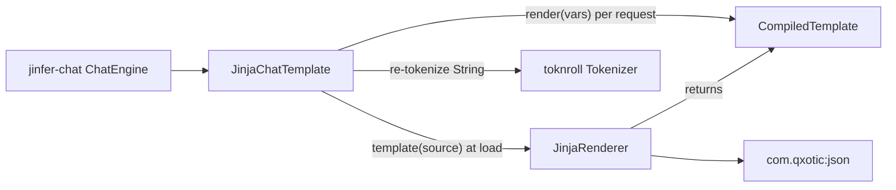

# jinfer-jinja — architecture summary

**What it is.** A small, self-contained Jinja engine for rendering LLM **chat templates** (the `chat_template` string
shipped in GGUF / HuggingFace tokenizer configs) in pure Java. Template source in, prompt `String` out. It is not a
general-purpose Jinja implementation: it covers what real chat templates use and throws on anything else.

**Size and shape.** One package, `com.qxotic.jinfer.jinja`, with two top-level types:

- `CompiledTemplate`: public functional interface, `String render(Map<String,Object> vars)`.
- `JinjaRenderer`: public final class (~2550 lines) with all internals as package-private nested types.

Its only dependency is `com.qxotic:json` (string escaping for the `tojson` filter). The `package-info` marks it as
internal to jinfer, with no API promise.

## Where it sits

`jinfer-chat`'s `JinjaChatTemplate` is the production consumer. It is the whole-render fallback used when a model
has no native turn-stable `ChatTemplate` codec, or when the request needs one that codec cannot handle (for
example `chat_template_kwargs`). It compiles the GGUF template once per model, renders `messages`, `tools`,
`add_generation_prompt`, `bos_token`, `eos_token`, `enable_thinking`, and so on, then re-tokenizes the result. Several
model modules (llama/Granite, lfm2, lfm3, qwen35, mellum, nemotronh, laguna) use `jinfer-jinja` in tests to check
their hand-written codecs against the reference template render.

## Main concepts

| Concept | Nested type(s) | Purpose |
|---|---|---|
| Values | `Val` sealed interface: `Int`, `Flt`, `Str`, `Bool`, `Arr`, `Obj`, `Func`, `None`, `Undef` | Python-like runtime values. `Val.of` converts Java `Map`/`List`/primitives |
| Tokens | `T` enum, `Tok` record | Flat token stream with whitespace-trim flags |
| Lexer | `Lexer` | Text vs tag modes, ``, comments, HF `trim_blocks` + `lstrip_blocks`, `-` trim markers |
| AST | `Node` sealed interface + 21 records | Statements (`IfNode`, `ForNode`, `SetNode`, `MacroNode`, `GenerationNode`, …) and expressions (`BinNode`, `FilterNode`, `CallNode`, `MemberNode`, `SliceNode`, …) |
| Parser | `Parser` | Recursive-descent / precedence-climbing parser in the style of llama.cpp |
| Execution | `Executor`, `Frame`, `LoopSignal` | Tree-walking interpreter with a root frame and a scope stack, plus `loop.*` and macros |
| Built-ins | static `applyFilter`, `applyTest`, `callFunction`, string/list/dict method dispatch, `JsonStyle` | The filters, tests and functions chat templates use |
| Output | `Rendered` record | Text plus `` character spans (`renderWithSpans`) |

## Key flows

1. **Compile:** `JinjaRenderer.template(source)` drops one trailing newline, runs `Lexer.tokenize()`, then
   `Parser.parseProgram()`, and returns the lambda `vars -> render(prog, vars)`. Syntax errors and unsupported
   constructs throw here, so in jinfer-chat a bad template makes the model load fail.
2. **Render:** each call wraps the vars into a fresh root `Frame` (`Val.of`) and runs a new `Executor` over the `Prog`.
   Statements append to a `StringBuilder` and expressions evaluate to `Val`. `asStr()` gives Python `str()`
   output (`True`, `None`, `{'k': 'v'}`, float `repr`).
3. **Spans:** `renderWithSpans` also returns the `(start, end)` offsets of `` bodies, which mark the
   assistant turns.

## Notable design choices

- **Fail loudly, render faithfully.** An unknown filter, filter kwarg, function, statement or call target throws
  `"[jinja] unsupported template feature: …"`. A silently mis-rendered prompt is treated as worse than an error.
  Undefined variables and attributes stay lenient (`Undef` is falsy and renders empty), as in Jinja.
- **Python and transformers parity.** Float formatting, container `repr`, `tojson` separators and `ensure_ascii`
  defaults, Python string methods (`strip`, `split`, `title`), negative indexing and slices, and loop filters applied
  before `loop.length` all follow what the models were trained against.
- **Jinja scoping.** `set` inside a `for` loop is loop-local. `namespace(...)` creates a typed `Obj` whose attributes
  can be mutated across scopes. Macros bind arguments by position, keyword or default.
- **Cheap control flow.** `break` and `continue` are preallocated stackless exceptions. The parser rejects them
  outside a loop.
- **Compile once, render many.** The parsed `Prog` is immutable and shared. Render state is created per call.
- **Narrow surface.** The lexer, parser, AST and executor are package-private. Callers only get render-only
  templates.

See [ARCHITECTURE.md](ARCHITECTURE.md) for class diagrams, the parser precedence chain, the compile and render
sequences, the full list of built-ins and the whitespace-control rules.
