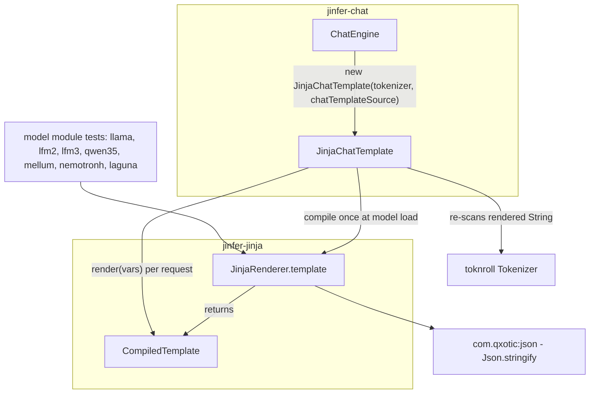
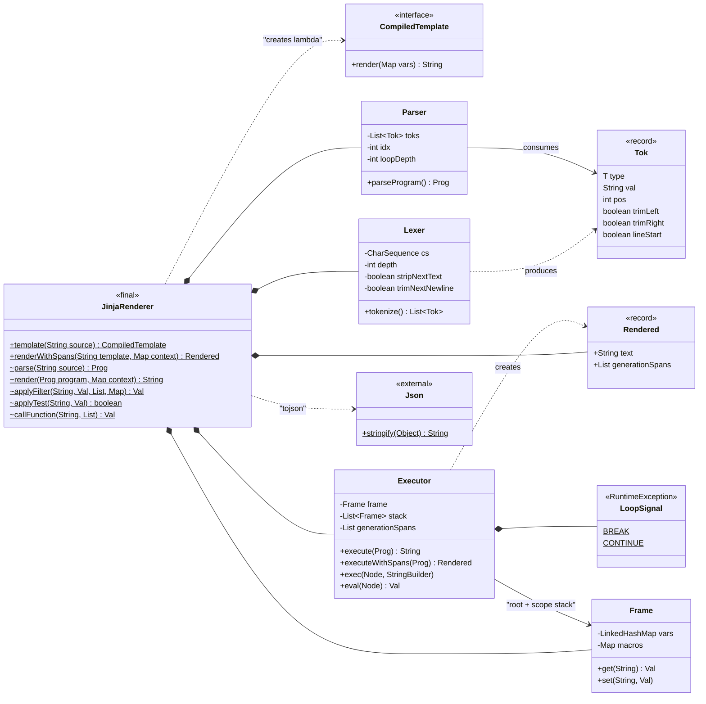
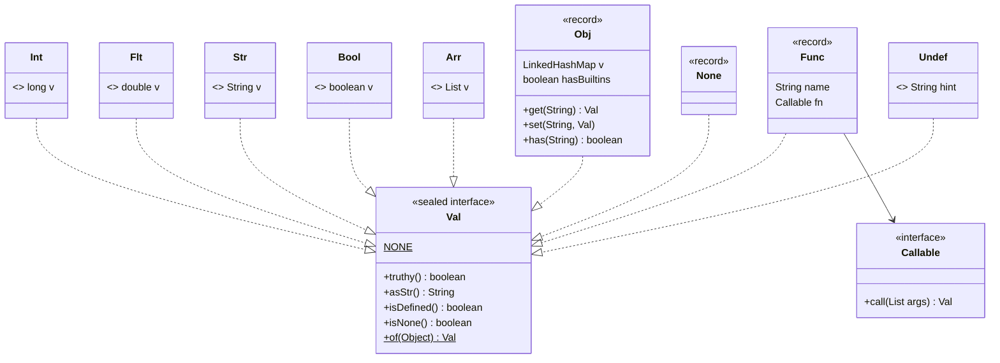
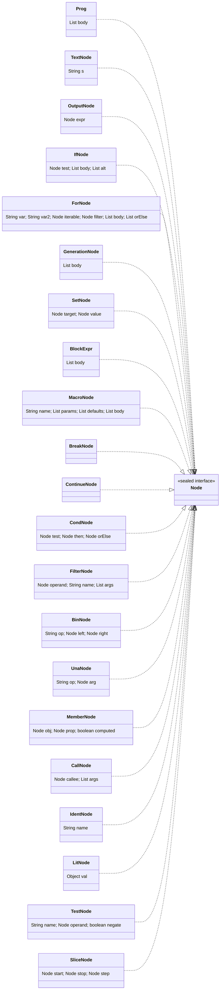
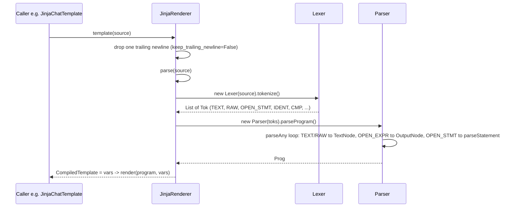
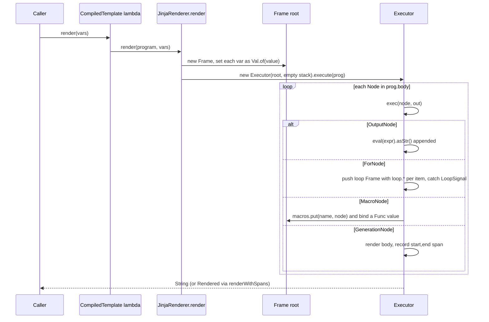
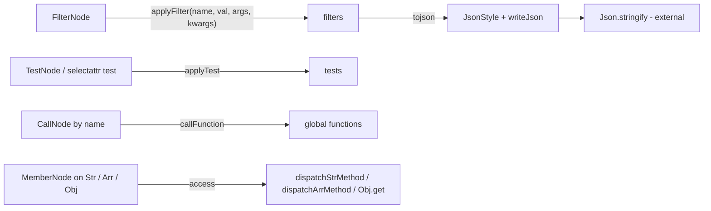

# jinfer-jinja — class architecture

Package `com.qxotic.jinfer.jinja` (2 top-level types + `package-info`, ~2570 lines). It is a **standalone, minimal Jinja
engine for LLM chat templates**: template source in, rendered `String` out. Almost everything lives in one file,
`JinjaRenderer` (~2550 lines), as package-private nested types: a value system (`Val`), a lexer, an AST (`Node`),
a recursive-descent parser and a tree-walking executor. The only public surface is `JinjaRenderer.template(String)`,
the `CompiledTemplate` functional interface, and `renderWithSpans` / `Rendered`. The single module dependency is
`com.qxotic:json` (used for `Json.stringify` in the `tojson` filter). The `package-info` states the module is internal
to jinfer with no API/compatibility promise; the jar reserves `Automatic-Module-Name: com.qxotic.jinfer.jinja`.

Format: **Mermaid**. Legend: `..|>` implements; `--|>` extends; `*--` nested/owns; `-->` holds/uses; `..>` creates/depends;
classes marked `<<external>>` live outside this module.

1. [Position in the stack](#1-position-in-the-jinfer-stack)
2. [Class diagrams](#2-class-diagrams) — 2a public surface, 2b value system, 2c AST
3. [Compile pipeline](#3-compile-pipeline) — lexer, parser
4. [Render pipeline](#4-render-pipeline) — executor, frames, scoping
5. [Built-ins: filters, tests, functions, methods](#5-built-ins)
6. [Whitespace control](#6-whitespace-control)
7. [Error policy and design notes](#7-error-policy-and-design-notes)

| Class (all nested in `JinjaRenderer` unless noted) | Role |
|---|---|
| `CompiledTemplate` (top-level, public) | `@FunctionalInterface`: `String render(Map<String,Object> vars)` — the render-only seam |
| `JinjaRenderer` (top-level, public final) | Static entry points `template`, `renderWithSpans`; package-private `parse`, `render`; all filters/tests/functions as static helpers |
| `JinjaRenderer.Rendered` (public record) | `(String text, List<int[]> generationSpans)` — output plus `` char spans |
| `Val` (sealed interface) | Runtime value: records `Int`, `Flt`, `Str`, `Bool`, `Arr`, `Obj`, `Func`, `None`, `Undef`; `Val.of(Object)` converts Java values |
| `Val.Func.Callable` | `@FunctionalInterface`: `Val call(List<Val> args)` |
| `JsonStyle` (record) | `json.dumps` knobs for `tojson`: indent, separators, `ensure_ascii`, `sort_keys` |
| `T` (enum), `Tok` (record) | Token types and tokens (with `trimLeft`/`trimRight`/`lineStart` flags) |
| `Lexer` (private final class) | Text/tag tokenizer; implements whitespace control, ``, comments |
| `Node` (sealed interface) + 21 records | AST: `Prog`, `TextNode`, `OutputNode`, `IfNode`, `CondNode`, `ForNode`, `GenerationNode`, `BreakNode`, `ContinueNode`, `SetNode`, `BlockExpr`, `MacroNode`, `FilterNode`, `BinNode`, `UnaNode`, `MemberNode`, `CallNode`, `IdentNode`, `LitNode`, `TestNode`, `SliceNode` |
| `Parser` (private final class) | Token-based recursive descent (llama.cpp style) producing `Prog` |
| `Frame` | Variable scope (`LinkedHashMap<String,Val>`) + macro table; resolves `loop`, `True`/`False`/`None` literals |
| `Executor` | Tree-walking interpreter over `Node`; records generation spans; nested `LoopSignal` |
| `Executor.LoopSignal` (private) | Stackless `RuntimeException` singletons `BREAK` / `CONTINUE` |

---

## 1. Position in the jinfer stack

`jinfer-chat` is the only production consumer: `ChatEngine` builds a `JinjaChatTemplate` from the GGUF
`chat_template` source; that class compiles it with `JinjaRenderer.template` (a parse failure fails the model load)
and later renders a vars map (`messages`, `tools`, `xml_tools`, `add_generation_prompt`, `bos_token`, `eos_token`,
`enable_thinking`, `preserve_thinking`, plus request kwargs) before re-tokenizing the string. It is the whole-render
fallback path when no native `ChatTemplate` codec fits. Several model modules depend on `jinfer-jinja` only for tests
(comparing their native codecs to the reference template render).

---

## 2. Class diagrams

### 2a. Public surface and internal components

### 2b. Value system

`Val.of` maps `null` → `None`, `Boolean` → `Bool`, `Integer`/`Long` → `Int`, other `Number` → `Flt`, `String` → `Str`,
`Map` → `Obj` (keys stringified, insertion order kept), `List`/`Iterable` → `Arr`, anything else → `Str(toString)`.
Rendering follows Python: `Bool` prints `True`/`False`, `None` prints `None`, `Undef` prints empty, `Arr`/`Obj` print
their Python `repr` form (`{'k': 'v'}`), floats use Python `repr(float)` formatting (`fmtDouble`). `Obj.get` exposes
dict builtins `items`, `keys`, `values`, `get` as `Func` values unless `hasBuiltins` is false (used for `loop` and
`namespace()` objects).

### 2c. AST

Statement nodes (`Prog` … `ContinueNode`) are executed by `Executor.exec`; expression nodes by `Executor.eval`.
Notable encodings: keyword arguments are `BinNode("kwarg", name, value)` inside call/filter arg lists; `not in` is
`BinNode("notin")`; unary minus is `BinNode("*", LitNode(-1L), x)`; list/dict literals are `LitNode` holding a
`List`/`Map` of element `Node`s; `…` is `SetNode(target, BlockExpr(body))`; slices are
`MemberNode(obj, SliceNode, computed=true)`.

---

## 3. Compile pipeline

**Lexer.** Two modes driven by `depth`: in text mode it accumulates `TEXT` until `{{`, `{%` or `{#`; inside a tag it
emits individual tokens (identifiers, string/int/float literals, punctuation, arithmetic operators and a single `CMP`
token for comparisons). `…` (regexes `RAW_BEGIN`/`RAW_END`) becomes one `RAW` token; comments are
skipped but still take part in whitespace control.

**Parser.** Precedence climbing, from loosest to tightest:

```mermaid
flowchart LR
    E["parseExpr"] --> TE["parseTernary: a if c else b"]
    TE --> OR["parseOr"] --> AND["parseAnd"] --> NOT["parseNot"] --> CMP["parseComp: CMP, in, not in, is"]
    CMP --> CC["parseConcat: ~"] --> ADD["parseAdd: + -"] --> MUL["parseMul: * / %"]
    MUL --> UN["parseUnary"] --> TX["parseTestExpr"] --> FI["parseFilter: pipe"]
    FI --> CA["parseCall: call, .attr, index, slice"] --> AT["parseAtom: literal, ident, list, dict, tuple, parens"]
```

Statements handled by `parseStatement`: `if/elif/else/endif`, `for … in … [if …] / else / endfor` (with two-variable
unpacking), `set` (assignment, including `ns.attr`, and block form `set … endset`), `macro/endmacro` with defaults,
`generation/endgeneration`, `break`/`continue` (rejected at parse time outside a loop via `loopDepth`), and bare
expression statements. A stray end keyword or an unknown bare statement (``, …) is a parse error.

---

## 4. Render pipeline

**Scoping.** `Executor` holds the root `Frame` (template globals + macro table) and a `stack` of child frames.
`scope()` returns the innermost frame, so `set` inside a loop is loop-local (Jinja semantics); `namespace()` objects
are the way to carry state out, since `SetNode` with a `MemberNode` target mutates the `Obj` in place. `lookup` walks the
stack innermost first; a name explicitly bound to `Undef` (an omitted macro parameter) still shadows outer names.
`Frame.get` resolves `loop` to the hidden `__loop__` object and the literals `True/true`, `False/false`,
`None/none/null`.

**For loops.** Iterates `Arr` items, `Obj` keys, `Str` code points; `None`/`Undef` iterate as empty. A loop filter
(`for x in xs if cond`) is applied before iteration, so `loop.length/last/previtem/nextitem` see only kept items.
`loop` exposes `index0`, `index`, `first`, `last`, `length`, `previtem`, `nextitem`.

**Macros.** `invokeMacro` binds each parameter from a positional arg, a keyword arg, its default expression, or
`Undef`, then runs the body in a fresh `Executor` sharing the root frame and returns the rendered body as a `Str`.
Calls by name go through `frame.macros` so kwargs and defaults work; the `Func` value bound in scope supports
positional use and `is defined`.

**Calls.** `CallNode` evaluation order: user macro by name → `namespace(...)` (typed kwargs object) → `Val.Func`
value (dict builtins, string/array methods) → global function by name (`callFunction`) → otherwise unsupported. For
non-macro callables, kwargs are appended as `"name=value"` strings.

**Generation spans.** `` renders its body transparently and appends `(start, end)` offsets into
`generationSpans`; only `renderWithSpans` returns them (the `CompiledTemplate` path discards them).

---

## 5. Built-ins

| Kind | Supported |
|---|---|
| Filters | `tojson` (kwargs `indent`, `separators`, `ensure_ascii`, `sort_keys`), `trim`, `string`, `length`, `count`, `default` (kwarg `boolean`), `join`, `split`, `upper`, `lower`, `capitalize`, `startswith`, `endswith`, `replace`, `list`, `first`, `last`, `selectattr`, `rejectattr`, `items`, `safe` (identity), `min`, `max` |
| Tests | `defined`, `undefined`, `none`, `string`, `mapping`, `sequence`, `number`, `boolean`, `callable`, `iterable`, `true`, `false`, `odd`, `even`, `integer`, `float`; plus `equalto/eq/==`, `ne/!=`, `in` inside `selectattr`/`rejectattr` |
| Functions | `strftime_now` (minimal strftime directives), `raise_exception` (throws `IllegalArgumentException("[jinja:raise] …")`), `range`, `namespace` |
| String methods | `strip`, `lstrip`, `rstrip`, `split` (Python semantics), `lower`, `upper`, `capitalize`, `startswith`, `endswith`, `replace`, `title` |
| List methods | `pop([index])` (mutating) |
| Dict methods | `items`, `keys`, `values`, `get` |
| Operators | `+ - * / %` (int/float tower via `arith`; `/` always float), `~` concat, comparisons (strings lexicographic, else numeric), `and`/`or` short-circuit returning operands, `in`/`not in`, `not`, indexing with negative indices, Python slices `[a:b:c]` |

`tojson` mirrors `transformers`' `json.dumps` call: compact separators `", "`/`": "`, `","` when indented,
`ensure_ascii` off by default, insertion order unless `sort_keys`.

---

## 6. Whitespace control

The lexer reproduces the HuggingFace `transformers` Jinja environment settings:

| Setting | Implementation |
|---|---|
| `trim_blocks` | After a bare block close `%}` / `#}`, `trimNextNewline` drops exactly one leading newline of the next `TEXT` |
| `lstrip_blocks` | `lstripLineToTag`: whitespace from a line start up to a bare `{%` / `{#` is removed (composes with `trim_blocks` through `Tok.lineStart`) |
| `` `-}}` `-#}` | `stripNextText`: strips all leading whitespace of the following `TEXT` |
| `keep_trailing_newline=False` | `template()` drops one trailing `\n` or `\r\n` of the source |
| `` | One `RAW` token, never stripped by a neighbouring tag |

Flags only apply to `TEXT` immediately after the tag that set them; an intervening tag cancels them.

---

## 7. Error policy and design notes

- **Fail loudly.** Unsupported filters, filter kwargs, functions, statements, iteration targets or calls of
  non-functions throw `RuntimeException("[jinja] unsupported template feature: …")` (`unsupported`). Parser errors are
  `RuntimeException("@pos: … near: '…'")`. The rationale stated in the code: a silently mis-rendered prompt is worse than
  an error; `JinjaChatTemplate` therefore fails the model load on a bad template.
- **Lenient undefined.** Unknown variables, attributes and out-of-range indices produce `Undef` (renders empty, falsy),
  so `x is defined` guards work as in Jinja.
- **Python fidelity.** `str()`/`repr()` of containers, float formatting, `True`/`False`/`None` spellings and
  `json.dumps` separators match what models were trained on.
- **Compile once, render many.** `template()` returns a lambda capturing the immutable `Prog`; each render creates a
  fresh root `Frame` and `Executor`, so a `CompiledTemplate` holds no mutable render state (values in the vars map are
  converted per render).
- **Control flow via singletons.** `break`/`continue` throw preallocated stackless `LoopSignal` instances.
- **Narrow public API.** AST, parser, lexer and executor are package-private; the module exposes rendering only.
