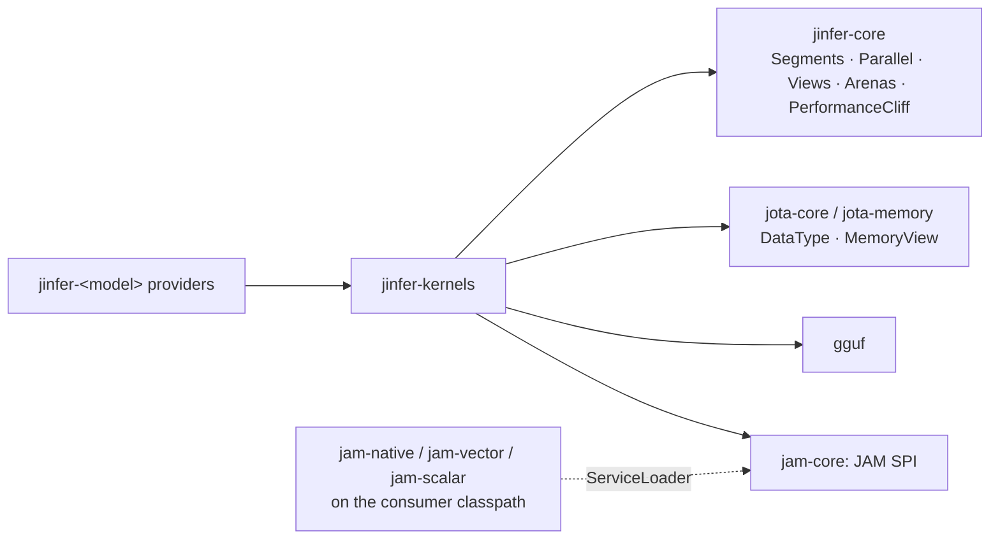

# jinfer-kernels — architecture summary

`jinfer-kernels` (package `com.qxotic.jinfer.kernels`, 25 types, ~10 800 lines) is the **shared compute layer of
jinfer**. Every model module (`jinfer-llama`, `jinfer-qwen3`, `jinfer-qwen35`, `jinfer-gemma4`, `jinfer-gptoss`,
`jinfer-lfm2/3`, `jinfer-nemotronh`, …) plus `jinfer-chat`, `jinfer-bench` and `jinfer-langchain4j` depend on it. It
does two jobs:

1. **Load GGUF weights** as zero-copy views: `ModelLoader` memory-maps the tensor data read-only and exposes each
   tensor as a jota `MemoryView<MemorySegment>` with the matching `DataType`.
2. **Compute over those views**: stateless, `static` kernels for everything a transformer, hybrid-recurrent, audio
   or vision model needs.

Its `package-info` marks it **internal**: published so the dependency graph resolves, with no API promise.

## Where it sits

## Main concepts

| Concept | Classes |
|---|---|
| Loading & dtype mapping | `ModelLoader`, `GGMLDataTypes` (GGMLType ↔ DataType), `Timer` |
| Weight repacking for native JAM | `JamPack` (load-time), `JamPacked` (a `DataType` impl that remembers the canonical view) |
| Matrix multiply | `MatMul` — `gemm`/`gemv` façades over `mm`, a router across three JAM rungs and a pure-Java floor |
| Raw access | `Raw` — checked `(segment, absolute base)` extraction; the only way kernels touch memory |
| Attention | `FlashAttention` — tiled causal / sliding-window / bidirectional prefill, partitioned `flashDecode` |
| Positional | `RoPE` — `Schedule` (plain, freq-factors, YaRN) + interleaved / NeoX rotation |
| Elementwise & norms | `Ops`, `Activations`, `Norms`, `FastMath` (polynomial exp / sigmoid / tanh) |
| Conversions | `Convert` — f16/bf16/f32, Q8_0 / MXFP4 / legacy dequant, row gather (reads `JamPacked.canonical()`) |
| Mixture of experts | `Moe` — top-k routing into `Routing`, CSR `dispatch` calling a model-supplied `ExpertKernel` |
| Recurrent layers | `GatedDeltaNet` (+`VectorGatedDeltaNet`), `Mamba2` (+`VectorMamba2`), `KimiDeltaAttention` |
| Convolutions | `Convolutions` — depthwise causal 1-D, register-tiled `conv1dRows`, short-conv scans, 2-D stride-2 |
| Media front ends | `LogMel` (audio spectrogram, `Spec`), `Resample` (Pillow bicubic for vision) |
| State checkpoints | `KvTransfer` — bounded copies between state views and a cache blob |
| Debugging | `Trace` (`-Djinfer.trace`) |

## Key flows

- **Load:** `readGguf` → `loadTensors(channel, gguf, arena)`: refuse confined arenas, check truncation, mmap once,
  build one `MemoryView` per tensor (GGUF dims reversed to row-major), then `JamPack.apply` (when native JAM asks
  for a packed layout, Q4_0/MXFP4/Q4_K/Q5_K/Q6_K weights are rewritten into a private mmap slab) and
  `MatMul.shareWeight` (GPU share hint).
- **Matmul:** `mm` sends packed weights to native JAM only (a reject is an error). Prefill (`n > 1`) tries
  native → vector → scalar JAM, then the Java floor; decode (`n == 1`) stays on the Java floor unless a
  per-dtype native-decode policy applies (AArch64, a narrow thread pool, slow-JIT k-quants, no Vector API).
  JAM backends are found via `JAM.providers()` (ServiceLoader) when `MatMul` initializes. With none present the
  result is bit-identical to the floor.
- **Recurrences:** each public `scan` picks the Vector API implementation when it is enabled, the JIT is fast and the
  geometry fits; otherwise it uses the scalar oracle and reports a `PerformanceCliff` when only the geometry
  blocked the vector path.

## Notable design choices

- **Static, allocation-free kernels over views.** Operands are validated once at entry (`Raw.f32` / `Raw.of`), then
  inner loops use raw addresses (`Segments.readFloat`, Vector API `fromMemorySegment`).
- **Selection is fixed per JVM.** Tile sizes, vector width, JIT speed and JAM rungs are static constants, so the
  surefire config runs the numerical tests once per selection (conv tiles, vector widths 128/256, scalar, JIT
  fast/slow, scalar recurrences, JAM parity).
- **Native-image aware.** `MatMul`, `FlashAttention` and `JamPack` initialize at run time (host facts, not build
  facts). Hot callees carry `@AlwaysInline` and big tiles `@NeverInline` so GraalVM keeps vectors intrinsified.
- **Per-slot scratch.** Parallel kernels index scratch by pool slot (`Parallel.threads()`), not thread-locals.
  Per-sequence decode partials live in the state's allocator (`FlashAttention.DecodeScratch`).
- **No SPI of its own.** The module registers no `META-INF/services` file; it consumes `com.qxotic.jam.JAM$Provider`.

See [ARCHITECTURE.md](ARCHITECTURE.md) for class diagrams, sequence diagrams and the switch table.
