# jinfer-kernels — class architecture

Package `com.qxotic.jinfer.kernels` (one package, 25 top-level types + `package-info`, ~10 800 lines). It is the
**compute layer** shared by every `jinfer-<model>` provider: static, dtype-checked kernels over
`MemoryView<MemorySegment>` (matmul dispatch, norms, RoPE, flash attention, MoE routing, recurrent scans,
convolutions, conversions) plus the GGUF tensor loader that produces those views. The `package-info` states it is
*internal to jinfer*: published so the dependency graph resolves, with no API or compatibility promise.

Maven dependencies (`pom.xml`): `jota-core`, `jota-memory`, `jinfer-core`, `gguf`, `jam-core` (API + ServiceLoader
discovery only — `jam-native` / `jam-vector` / `jam-scalar` come from the *consumer's* classpath; `jam-scalar` and
`jam-vector` are test-scoped here). `graalvm-annotations` is `provided` (build-time `@AlwaysInline` / `@NeverInline`
stubs). JPMS automatic name `com.qxotic.jinfer.kernels`.

Format: **Mermaid**. Legend: `..|>` implements; `--|>` extends; `-->` holds/uses; `..>` creates/depends;
classes marked `<<external>>` live outside this package.

1. [Position in the stack](#1-position-in-the-jinfer-stack)
2. [Class diagrams](#2-class-diagrams) — 2a loading & dtypes, 2b matmul & JAM, 2c kernel families, 2d shared infrastructure
3. [Loading sequence](#3-loading-sequence-modelloaderloadtensors)
4. [Matmul dispatch](#4-matmul-dispatch-matmulmm)
5. [Attention](#5-attention-flashattention)
6. [Recurrent scans: vector vs scalar selection](#6-recurrent-scans)
7. [MoE dispatch](#7-moe-dispatch)
8. [Run-time selection switches, SPI and native-image config](#8-run-time-selection-switches-spi-and-native-image)

| Class | Role |
|---|---|
| `ModelLoader` | GGUF entry: `readGguf`, `loadTensors` (mmap read-only → one jota `Memory`, one `MemoryView` per tensor, then `JamPack.apply` + `MatMul.shareWeight`), `requireComplete`, `requireVectorApi`, lookup helpers (`require`, `requireF32`, `find`, `findF32`, `findFirst`, `ropeFreqFactors`) |
| `GGMLDataTypes` | package-private `GGMLType` ↔ jota `DataType` table (19 pairs), geometry-checked at class init |
| `JamPack` | package-private load-time repacker: Q4_0/MXFP4/Q4_K/Q5_K/Q6_K weights → jam's packed layout in one page-aligned private mmap slab; `PackPolicy` seam |
| `JamPacked` | package-private `DataType` impl: a packed weight (one block = one row), keeps the `canonical()` view it replaced |
| `MatMul` | `c = w · aᵀ` (ggml convention): `gemm`/`gemv` façades, `mm` router over JAM rungs (native → vector → scalar) and the Java floor `mmFloor`; all per-dtype dot kernels; nested `JamMm` |
| `Raw` | record `(vseg, vbase)`: checked extraction of a raw segment + absolute base from a view (kernel-only access) |
| `FlashAttention` | causal / sliding-window / bidirectional prefill, `flashDecode` (partitioned) and `rollingDecode`; nested `Src`, `Buffers`, public `DecodeScratch` |
| `Norms` | RMSNorm (plain, ggml-ordering, rows, no-weight), `sumOfSquares`, `scaleByWeight`, LayerNorm variants |
| `RoPE` | `Schedule` functional interface + `plain` / `withFreqFactors` / `yarn` factories; `fill`, `applyInterleaved`, `applyNeox`, `rotatePairs` |
| `Activations` | scalar activations (sigmoid, silu, gelu, softplus, clamped SwiGLU, tanh-sigmoid) and fused span forms (`geluMultiply`, `siluMultiply`, `glu`, `softcap`, …) |
| `Ops` | elementwise FP32 span kernels (`addInPlace`, `saxpyInPlace`, `softmaxInPlace`, `argmax`, `dot`, transposes, pools, `MapFunction`) |
| `FastMath` | polynomial `expNeg`, `sigmoid`, `tanh` + exported vector constants (`EXP_*`) |
| `Convert` | dtype converters: `f16ToF32Vector`, `copyF32`, f16/bf16↔f32, `dequantQ8_0`, `dequantMxfp4`, `dequantLegacy`, `copyToF32`, `gatherToF32` (JamPacked-aware) |
| `Moe` | MoE routing: `Routing` buffers, top-k / grouped top-k / softmax-top-k selection, `normalizeTopP`, CSR `dispatch` with an `ExpertKernel` callback |
| `GatedDeltaNet` | Qwen3.5 gated-delta preparation (`prepareQkv`, `gates`, `postNorm`, …) and `scan` dispatcher |
| `VectorGatedDeltaNet` | package-private Vector API recurrence for `GatedDeltaNet.scan` |
| `KimiDeltaAttention` | Kimi Delta Attention gates, Q/K normalisation, recurrent `scan`, `postNorm`, `headSigmoidMultiply` |
| `Mamba2` | Nemotron-H Mamba2 selective `scan` and `groupedRmsNorm` dispatchers + scalar oracles |
| `VectorMamba2` | package-private Vector API forms of both |
| `Convolutions` | `conv2dStride2Pad1`, causal depthwise 1-D (+SiLU), `conv1dRows` (register-tiled, `jinfer.convTile`), `shortConvScan`, `segmentedShortConv` |
| `LogMel` | log-mel spectrogram front end for audio models; nested `Spec` record |
| `Resample` | Pillow-compatible bicubic RGB resize (`bicubic`) for vision towers; private `Filter` record |
| `KvTransfer` | direction-flagged bulk copy between state views and a checkpoint blob (`transfer`, `ringSpan`) |
| `Timer` | `AutoCloseable` interface; `Timer.log(label)` logs elapsed load phases on `jinfer.load` |
| `Trace` | `-Djinfer.trace` per-layer residual checksum printer |

---

## 1. Position in the jinfer stack

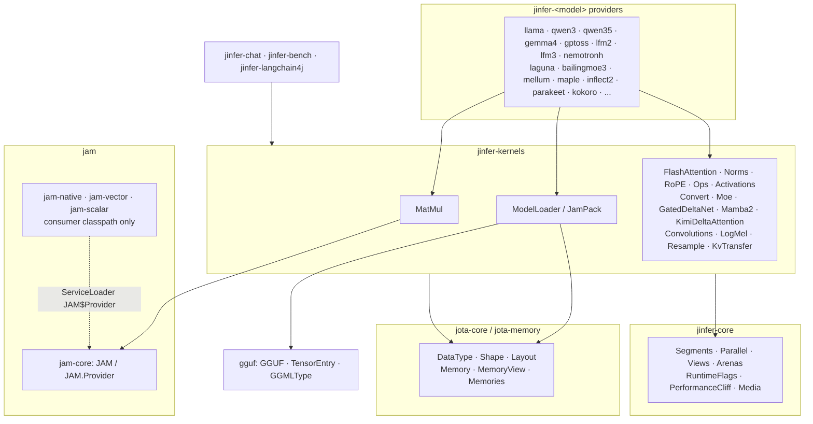

The poms of `jinfer-bench`, `jinfer-chat`, `jinfer-langchain4j` and every model module (list above) depend on
`jinfer-kernels`. Nothing in this module depends on a model.

---

## 2. Class diagrams

### 2a. Loading and dtypes

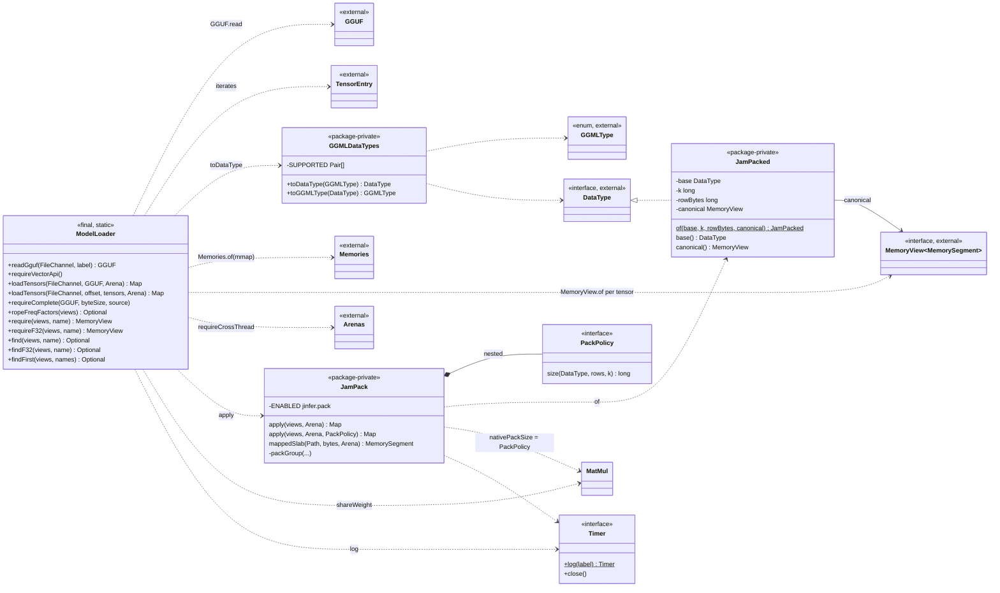

`JamPacked` is never a wire format — `GGMLDataTypes` does not know it, so it cannot be serialized. `MatMul`
reads the packed slab; `Convert.dequantLegacy` / `copyToF32` / `gatherToF32` detect `instanceof JamPacked` and
read `canonical()` instead.

### 2b. Matmul and the JAM backends

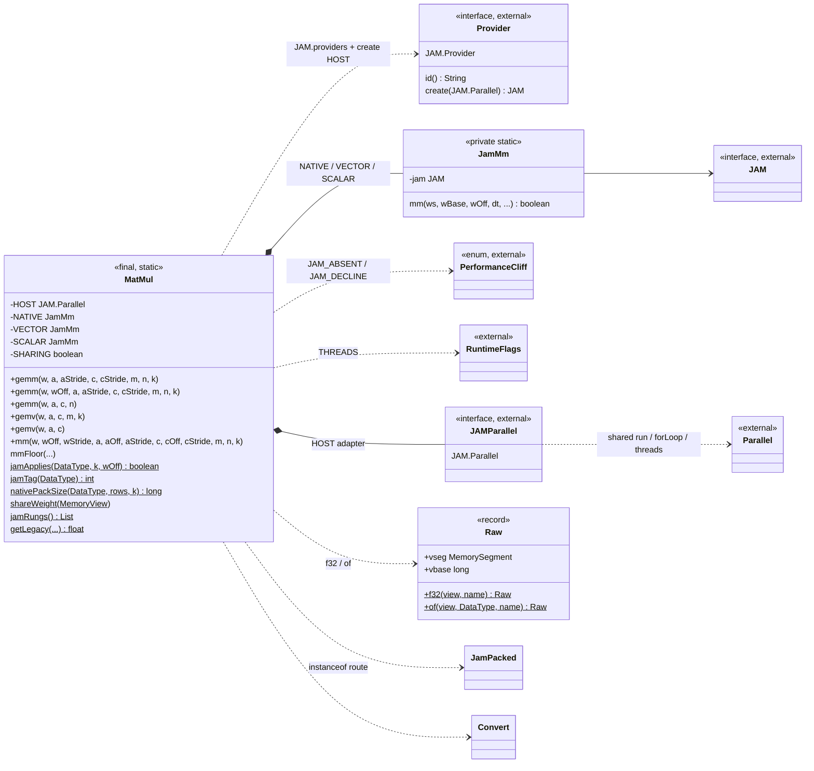

### 2c. Kernel families and their internal dependencies

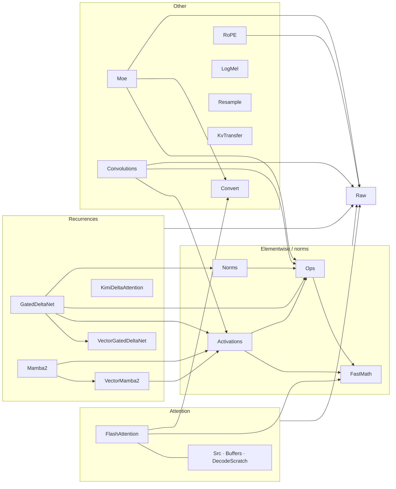

Edges are verified `import`/call references between files of this package. Every kernel validates its view
operands at entry through `Raw.f32` / `Raw.of` (dense, row-major, expected dtype, native-backed) and then works on
raw `(vseg, vbase)` addresses.

### 2d. Nested types and shared infrastructure

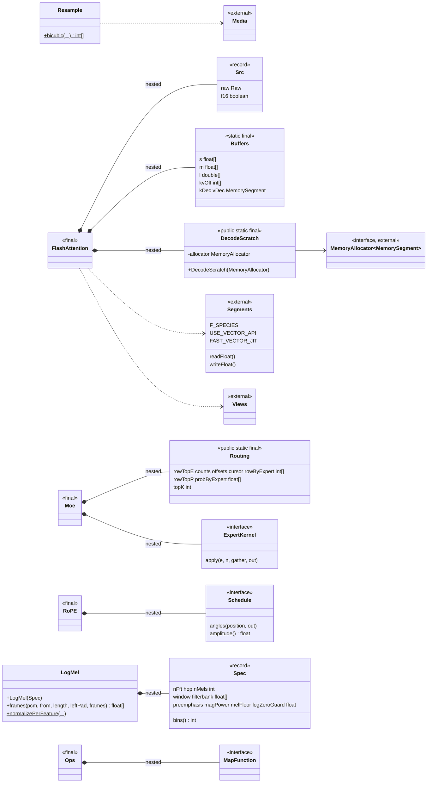

`FlashAttention.Buffers` are per pool *slot* (`BUFFERS = new Buffers[Parallel.threads()]`), sized lazily to the
largest head seen. `DecodeScratch` is per model state and draws from the state's `MemoryAllocator`, so it dies with
the state.

---

## 3. Loading sequence (`ModelLoader.loadTensors`)

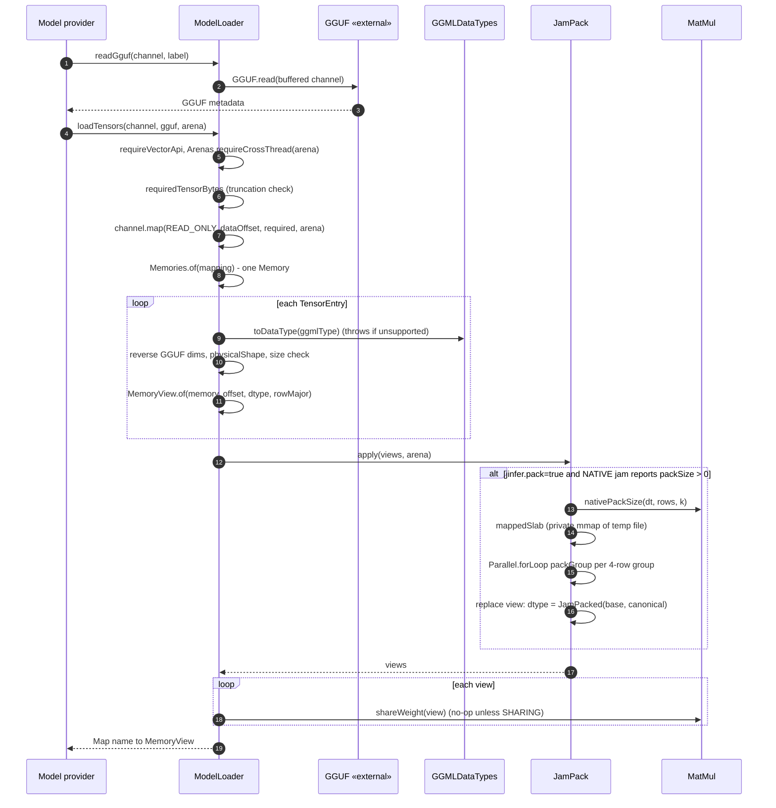

Notes verified in code: a confined arena is refused; the tensor data offset must be 4-byte aligned;
`token_embd.weight` and `per_layer_token_embd.weight` are never packed (row-read outside matmul); only tensors whose
second-to-last dim is a multiple of 4 and whose `packSize` divides into `rows/4` groups are packed.

---

## 4. Matmul dispatch (`MatMul.mm`)

Contract: `C[s*cStride + cOff + row] = dot(W[row], A[s])` — ggml's `ggml_mul_mat(w, a)`, with `m` = weight rows
(output width), `n` = activation rows, `k` = contraction. `a`/`c` are dense FP32.

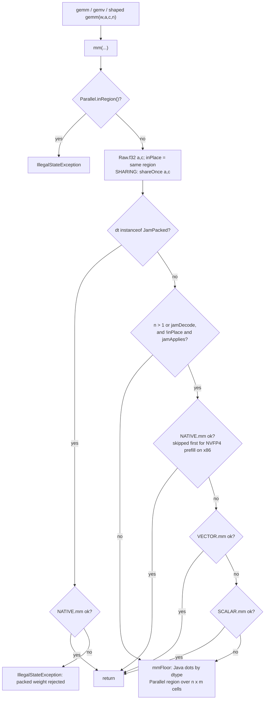

`jamDecode` (n == 1) is true when the Vector API is off, or for the C2 `slowDot` k-quants (Q4_K/Q5_K/Q6_K without
`FAST_VECTOR_JIT`), or when a native decode switch is on for the dtype: `jinfer.q4.nativeDecode`,
`jinfer.q8.nativeDecode` (default: AArch64 or ≤4 threads), `jinfer.kq.nativeDecode` (AArch64 or ≤8 threads),
`jinfer.mxfp4.nativeDecode` and `jinfer.lowbit.nativeDecode` (default AArch64), `jinfer.nvfp4.nativeDecode`
(default true). `jamApplies` accepts Q8_0, Q4_0, Q5_0, Q4_K, Q5_K, Q6_K, MXFP4, NVFP4, Q1_0, Q2_0, PQ2_0, PTQ1_0,
FP32, FP16, BF16 with block-aligned `k` and `wOff`. `JamMm.mm` returns `false` on any non-OK status and reports
`PerformanceCliff.JAM_DECLINE` unless the status is `EUNSUPPORTED`. If no rung loaded at all,
`PerformanceCliff.JAM_ABSENT` is reported from `MatMul`'s static initializer.

`mmFloor` covers every block dtype (adds Q4_1, Q5_1, TQ1_0, TQ2_0 which jam does not take) plus BF16/FP16/FP32 and
throws `UnsupportedOperationException` otherwise.

### Backend loading (class init)

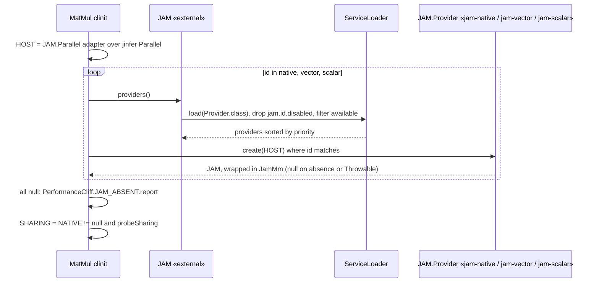

---

## 5. Attention (`FlashAttention`)

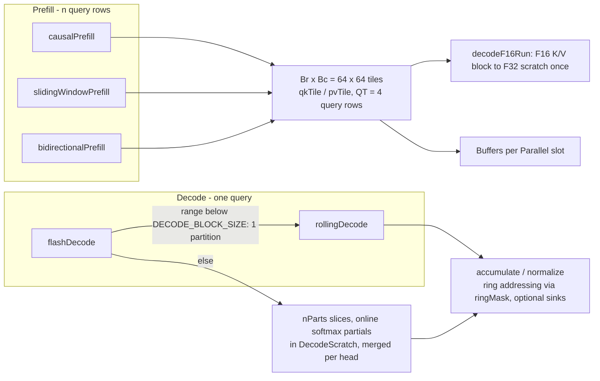

K/V sources are FP32 or FP16 (`Src`); Q/out are FP32 `Raw`. Softmax exponentials use `FastMath.expNeg` and its
vector constants. `nParts = max(1, min(RuntimeFlags.THREADS, range / RuntimeFlags.DECODE_BLOCK_SIZE + 1))`.

---

## 6. Recurrent scans

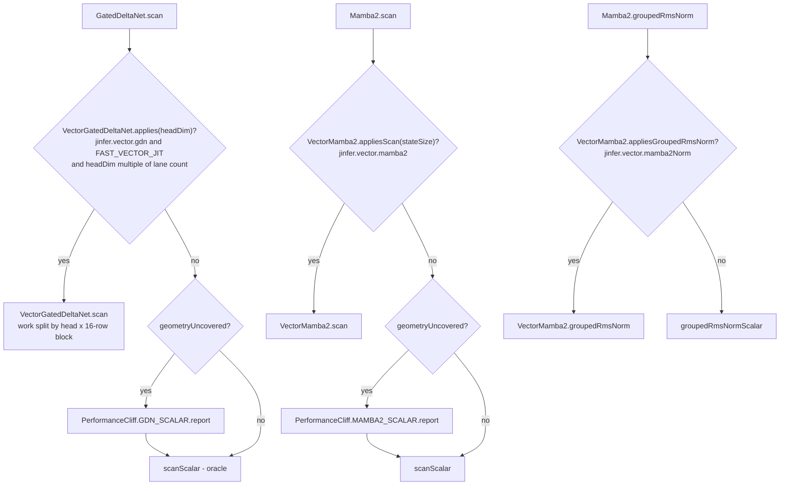

`KimiDeltaAttention.scan` has its own single implementation (no separate vector class). The scalar forms are
package-private so the parity tests can compare against them.

---

## 7. MoE dispatch

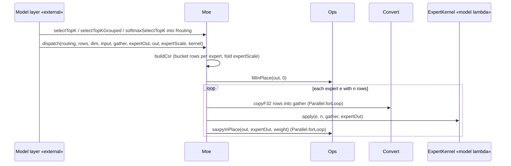

The `ExpertKernel` is where a model calls `MatMul.gemm` with a weight offset (`gemm(w, wOff, …)` — "a MoE expert
slice").

---

## 8. Run-time selection switches, SPI and native image

| Switch | Read in | Effect |
|---|---|---|
| `jinfer.pack` (default true) | `JamPack` | load-time packing on/off |
| `jinfer.{q4,q8,kq,mxfp4,nvfp4,lowbit}.nativeDecode` | `MatMul` | force decode through native jam either way |
| `jam.<id>.disabled` | `JAM.providers` (jam-core) | drop a JAM rung (`native`, `vector`, `scalar`) |
| `jinfer.vector.gdn` | `VectorGatedDeltaNet` | vector GDN recurrence |
| `jinfer.vector.mamba2`, `jinfer.vector.mamba2Norm` | `VectorMamba2` | vector Mamba2 scan / norm |
| `jinfer.convTile` (`auto`, `4x1`, `4x2`, `4x4`) | `Convolutions` | `conv1dRows` register tile (auto: 4x4 on AArch64, else 4x1) |
| `jinfer.trace` | `Trace` | per-layer checksum prints |
| `jinfer.vector.jit`, `jinfer.vector.width` | `Segments` «external» | `FAST_VECTOR_JIT`, species width (exercised by the surefire matrix) |

**SPI.** This module registers no `META-INF/services` entries. It is a *consumer* of the `com.qxotic.jam.JAM$Provider`
SPI: `jam-native`, `jam-vector` and `jam-scalar` each ship that service file, and `MatMul.load(id)` picks the
provider by `id()`.

**Native image.** `META-INF/native-image/com.qxotic/jinfer-kernels/native-image.properties` sets
`--initialize-at-run-time` for `MatMul` (JAM backend resolved at `<clinit>`), `FlashAttention` (per-slot scratch sized
by the host thread budget) and `JamPack` (reads `-Djinfer.pack`). Hot Vector-API callees carry `@AlwaysInline`
(e.g. `FlashAttention.srcFloat`); some tiles are `@NeverInline` to stay their own expansion unit. `Trace.ENABLED` and
`Convolutions`' tile code are deliberately build-time constants in an image.

**Test matrix (pom).** Surefire runs the suite once per selection (`conv-tile-4x2/4x4`, `vector-jit-fast/slow`,
`java-recurrences`, `vector-128/256`, `scalar`, `jam-parity`); ordinary executions exclude `jam-vector`/`jam-scalar`
from the classpath, and `jam-parity` compares `MatMul.mm` against `MatMul.mmFloor` with the pure-Java rungs present.
