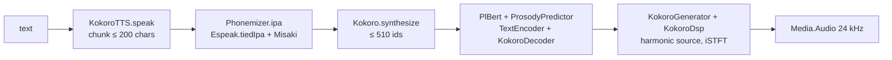

# jinfer-kokoro — architecture summary

`jinfer-kokoro` is jinfer's local **text-to-speech** provider for hexgrad's **Kokoro v1.0** (StyleTTS2-style
model with an iSTFTNet vocoder). It loads a base model GGUF (`general.architecture = kokoro`) plus
one **voice** GGUF (`kokoro-voice`), and turns text into 24 kHz mono PCM on the CPU. One package,
`com.qxotic.jinfer.models.kokoro`, 12 classes (~3000 lines). Details and all diagrams: [ARCHITECTURE.md](ARCHITECTURE.md).

## Where it sits

- **Entry**: `KokoroProvider` is registered in `META-INF/services/com.qxotic.jinfer.chat.ModelProvider`, so
  `Models.loadSpeech(path, arena, {"voice": …})` in `jinfer-chat` finds it by architecture. It is speech-only: it
  implements just `loadSpeech` and declares the companion file role `voice`.
- **Contract**: `KokoroTTS` implements `SpeechSynthesisModel<Kokoro.Configuration, Kokoro.Weights, Kokoro.State>`
  from `jinfer-core` (`phonemizer()`, `synthesize` for raw ids, `speak` for text with streaming clips).
- **Below it**: `jinfer-kernels` (MatMul, Convolutions, Norms, FlashAttention, Activations, Ops, Convert,
  ModelLoader), `jinfer-core` (Workspace, Views, Arenas, Parallel, RuntimeState, Phonemizer, Media.Audio),
  `jinfer-codecs` (`Espeak`), `gguf` and `jota-memory`.

## Main concepts

| Concept | Classes |
|---|---|
| Discovery / loading | `KokoroProvider` → `KokoroTTS.load` → `Kokoro.load` |
| Text front end | `KokoroTTS` (chunking, splitting over-long chunks), `Misaki` (espeak IPA → misaki dialect) |
| Model + state | `Kokoro` (`Configuration`, `Voice`, `Weights`, `State extends RuntimeState`) |
| Neural sub-networks | `PlBert` (shared-layer ALBERT), `TextEncoder` (CNN + BiLSTM), `ProsodyPredictor` (durations, F0, noise), `KokoroDecoder`, `KokoroGenerator` (iSTFTNet) |
| Building blocks | `KokoroLayers` (Linear, Conv1d, ConvTranspose1d, AdaIN, AdaLayerNorm, Snake, AdainResBlock, loaders), `KokoroOps` (LSTM, duration decoding) |
| Signal processing | `KokoroDsp` (nine-harmonic source + STFT, inverse STFT, n_fft 20 / hop 5) |

Each sub-network is a `final class` with a nested `Weights` record, a static `load(tensors, config, allocator)` and
a static `encode`/`forward`; `Kokoro` composes their weights and chains the forwards.

## Key flows

1. **Load**: `readConfig` validates the exact v1.0 layout; the voice GGUF yields the style pack (`voice.pack`,
   F32 `[256, 1, ≥510]`) and the espeak language from the first letter of `kokoro_voice.name`. All weights are
   loaded into the caller's `Arena`. `KokoroTTS.wrap` requires espeak on `PATH` and builds the phonemizer from the
   model's 178-symbol table.
2. **speak**: normalise whitespace, split into sentences (≤ 200 chars), phonemize each; a chunk over 510 ids is
   halved at a word boundary and retried; each chunk is synthesized and passed to the sink, which can cancel.
3. **synthesize**: pad ids with 0 at both ends; pick the style row by input length (decoder style, then predictor
   style); PL-BERT → prosody predictor (durations → alignment, F0 and noise curves); text encoder → decoder; DSP
   harmonic source → generator → magnitude/phase → iSTFT → clamp to [-1, 1].

## Notable design choices

- **Fixed architecture**: the loader refuses any GGUF whose dimensions differ from Kokoro v1.0, so the
  forward code can hard-code channel counts (512/1024/1090, 22 spectral channels, 300× upsampling).
- **Strict trust boundary**: `synthesize` refuses (never splits or substitutes) empty input, > 510 ids, ids off the
  symbol table and speed outside [0.5, 2]. Splitting is left to `speak`, which still has the text.
- **Hybrid execution**: matrix-heavy steps use `jinfer-kernels`; the LSTM, AdaIN/Snake, strided convs and all DSP are
  plain Java over `MemoryView`s or `float[]`, parallelised with `Parallel.forLoop` where the order of floating-point
  sums stays fixed.
- **Determinism**: `KokoroTTS` passes seed 0; noise for the harmonic source is drawn sequentially from a reseeded
  `Random` before the parallel loops.
- **Memory**: per-call temporaries come from the state's `Workspace` (rewound each call, scoped per sub-step);
  `State` owns or borrows a cross-thread arena and is watched by `LeakWatch`. No KV cache or checkpoints exist.
- **Misaki faithfulness**: the IPA rewrite copies misaki's tables, quirks included, because Kokoro was trained on
  that dialect.
