# jinfer-kokoro — class architecture

Package `com.qxotic.jinfer.models.kokoro` (12 classes, ~3030 lines). It is the `jinfer-<model>` provider for GGUF
architecture `kokoro` — a **speech-synthesis-only** family: hexgrad's Kokoro v1.0 (StyleTTS2-style PL-BERT +
prosody predictor + iSTFTNet vocoder) driven by one separate **voice GGUF** (`general.architecture = kokoro-voice`).
Text goes through espeak (required, from `jinfer-codecs`) rewritten into misaki's IPA dialect, then through the
model to 24 kHz mono PCM. Everything runs on the CPU kernels of `jinfer-kernels` plus host-side Java DSP.

Format: **Mermaid**. Legend: `..|>` implements; `--|>` extends; `-->` holds/uses; `..>` creates/depends;
`*--` composition (nested weight records); classes marked `<<external>>` live outside this package.

1. [Position in the stack](#1-position-in-the-jinfer-stack)
2. [Class diagrams](#2-class-diagrams) — 2a contracts, 2b `Kokoro` and its sub-networks, 2c reusable layers
3. [Loading sequence](#3-loading-sequence)
4. [Text front end: `speak`](#4-text-front-end-speak)
5. [Synthesis pipeline: `Kokoro.synthesize`](#5-synthesis-pipeline)
6. [Sub-network forwards](#6-sub-network-forwards) — 6a text encoder, 6b PL-BERT, 6c prosody, 6d decoder, 6e generator + DSP
7. [State, memory and validation](#7-state-memory-and-validation)

| Class | Role |
|---|---|
| `KokoroProvider` | `ModelProvider` SPI: architecture `kokoro`, declares companion `voice`, `loadSpeech` → `KokoroTTS.load` |
| `KokoroTTS` | `SpeechSynthesisModel<Configuration, Weights, State>`: binds espeak + `Misaki` into a `Phonemizer`; text chunking (`speak`) and `synthesize` → `Media.Audio` |
| `Kokoro` | The model: reads/validates GGUF config + voice pack, owns all sub-network weights, runs the whole pipeline in `synthesize`; nested `Configuration`, `Voice`, `Weights`, `State` |
| `Misaki` | `UnaryOperator<String>`: rewrites tied espeak IPA into misaki's dialect (English US/GB tables, "other" table) |
| `TextEncoder` | Token embedding + 3× (conv1d, LayerNorm, LeakyReLU) + bidirectional LSTM → `[steps, 512]` |
| `PlBert` | ALBERT-style parameter-shared PL-BERT (12 repeats of one layer) + `bert_proj` → `[steps, 512]` |
| `ProsodyPredictor` | Duration encoder (3× BiLSTM + AdaLayerNorm), duration head, alignment, shared LSTM, F0 / noise branches |
| `KokoroDecoder` | Pre-generator decoder body: ASR gather, F0/N down-convs, encode block + 4 decode `AdainResBlock`s |
| `KokoroGenerator` | iSTFTNet generator: 2 upsample stages with harmonic-source injection, `AdaINResBlock1` stacks, `conv_post` → spectrum |
| `KokoroDsp` | Host DSP: nine-harmonic HnNSF source + STFT (`sourceStft`), inverse STFT (`istft`); n_fft 20, hop 5 |
| `KokoroLayers` | Reusable layer records (`Linear`, `Conv1d`, `ConvTranspose1d`, `DepthwiseUpsample`, `AdaIN`, `AdaLayerNorm`, `Snake`, `AdainResBlock`) and tensor loaders |
| `KokoroOps` | `LstmWeights`, `lstm` / `bidirectionalLstm`, `durations` (sigmoid-sum duration decoding) |

SPI registration: `src/main/resources/META-INF/services/com.qxotic.jinfer.chat.ModelProvider` →
`com.qxotic.jinfer.models.kokoro.KokoroProvider`.

---

## 1. Position in the jinfer stack

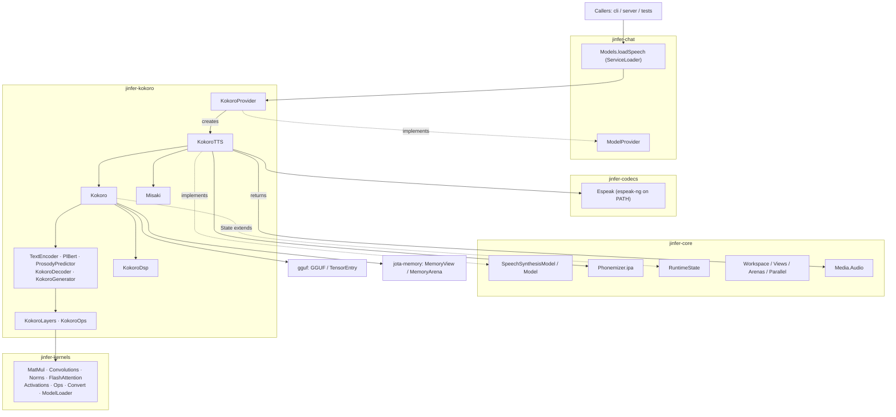

---

## 2. Class diagrams

### 2a. Contracts and relations

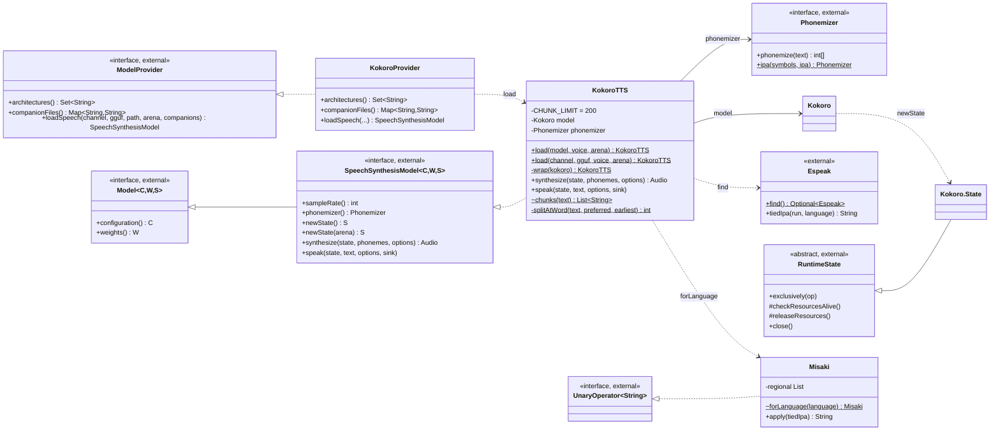

`KokoroProvider.companionFiles()` returns `{"voice": "voice"}`; `loadSpeech` throws `IllegalArgumentException` when the
`voice` companion is missing. `KokoroTTS.wrap` throws `IOException` when `Espeak.find()` is empty — Kokoro has no lexicon,
so espeak is mandatory. The phonemizer is `Phonemizer.ipa(tokens, run -> misaki.apply(espeak.tiedIpa(run, language)))`.

### 2b. `Kokoro` and its sub-networks

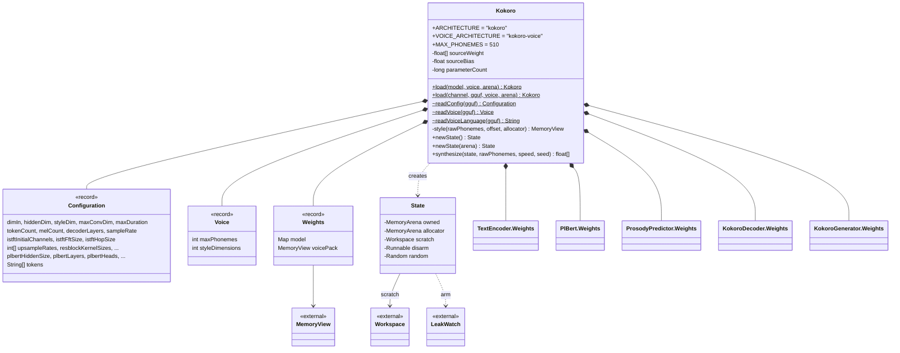

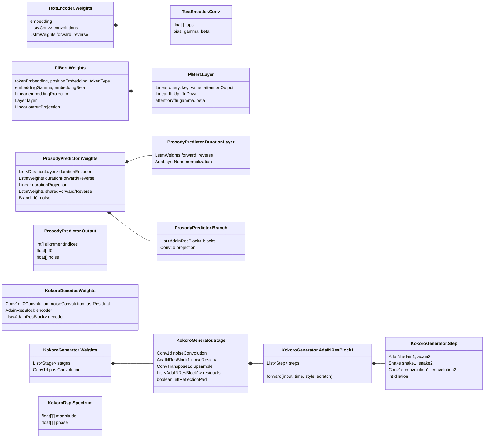

### 2c. Reusable layers — `KokoroLayers` and `KokoroOps`

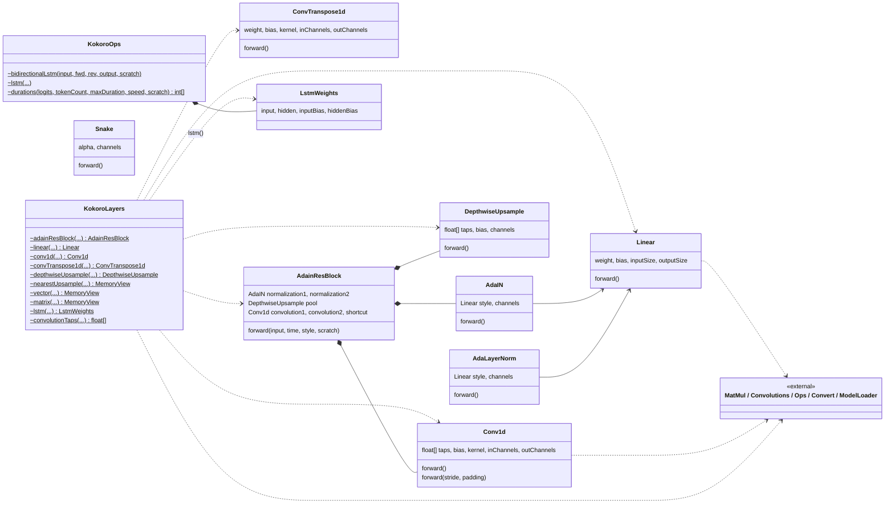

`AdainResBlock.forward`: AdaIN → LeakyReLU(0.2) → optional depthwise ×2 upsample → conv1 → AdaIN → LeakyReLU → conv2,
plus a shortcut path (nearest ×2 upsample when pooled, 1×1 conv when channel counts differ), summed and scaled by
1/√2. `vector` dequantizes non-FP32 tensors to FP32 in the persistent allocator; `matrix` keeps the file-backed
(possibly quantized) view for `MatMul.gemm`; `convolutionTaps` copies conv weights to a host `float[]`.

---

## 3. Loading sequence

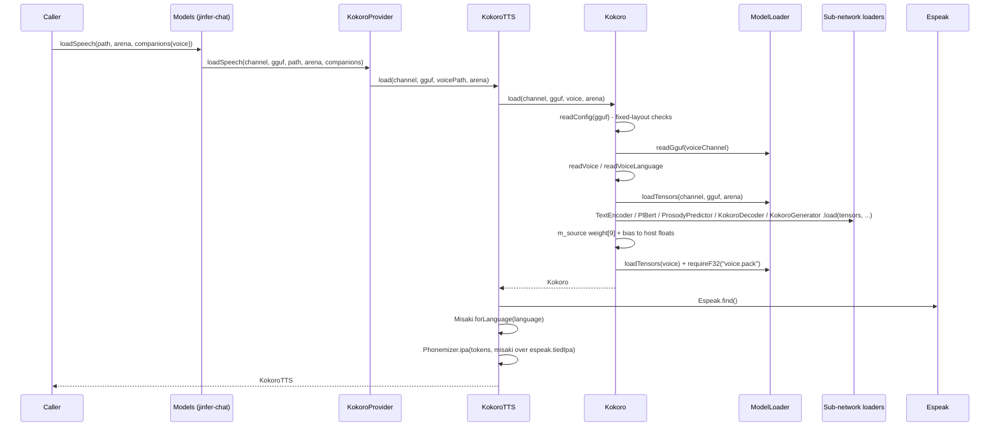

`readConfig` refuses anything but the exact v1.0 layout (hidden 512, style 128, 178 tokens, 24 kHz, n_fft 20 / hop 5,
upsample rates `{10, 6}`, PL-BERT 768×12 layers ×12 heads, …). `readVoice` requires `voice.pack` F32 of GGUF shape
`[256, 1, max_phonemes ≥ 510]`. `readVoiceLanguage` maps the first letter of `kokoro_voice.name` to an espeak
language (`a`→`en-us`, `b`→`en-gb`, `e`→`es`, `f`→`fr-fr`, `h`→`hi`, `i`→`it`, `j`→`ja`, `p`→`pt-br`, `z`→`cmn`).
Weights live in the caller's `Arena`; a `MemoryAllocators.ofArena(arena)` "persistent" allocator holds dequantized
vectors.

---

## 4. Text front end: `speak`

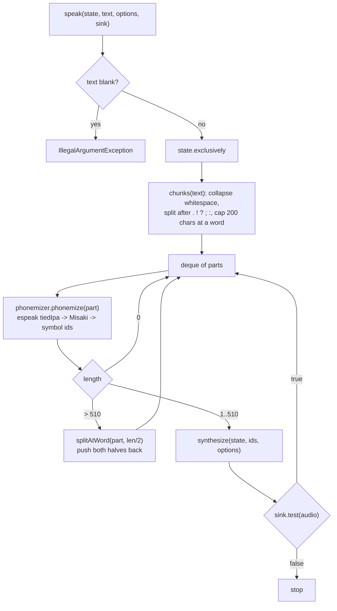

`KokoroTTS.synthesize` reads `options.speed()` (default 1) and calls `Kokoro.synthesize(state, ids, speed, seed=0)`,
wrapping the PCM in `Media.Audio(pcm, 24000, 1)`. If no chunk produced phonemes, `speak` throws.

`Misaki.apply`: for non-English voices one `OTHER` table (ties → single symbols such as `ʤ ʦ A I O W Y Q`);
for English, the `ENGLISH` table, a syllabic-mark → `ᵊ` rewrite, then the regional table (`AMERICAN` or `BRITISH`),
then `ENGLISH_TAIL` (flap `ɾ`→`T`, glottal `ʔ`→`t`, tie removed).

---

## 5. Synthesis pipeline

### 5.0 Global architecture

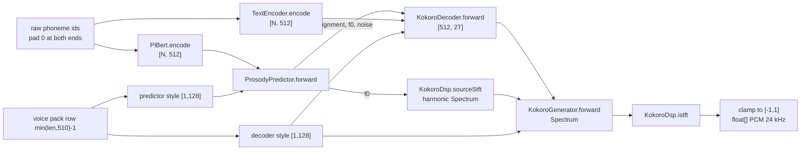

### 5a. `Kokoro.synthesize` sequence

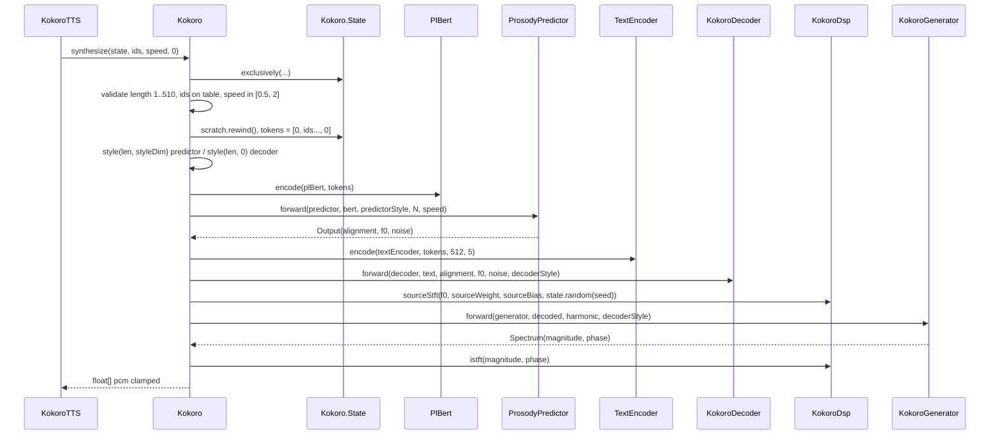

All intermediate tensors come from the state's `Workspace` scratch (rewound per call); sub-steps use
`Workspace.scope(scratch)` to release temporaries. `Reference.reachabilityFence(this)` keeps the model's file-backed
weights alive through the call.

---

## 6. Sub-network forwards

### 6a. `TextEncoder.encode`

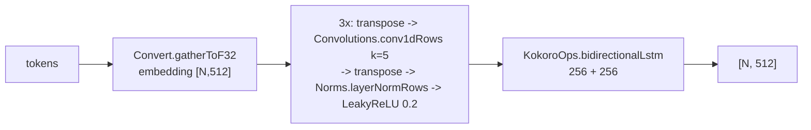

### 6b. `PlBert.encode`

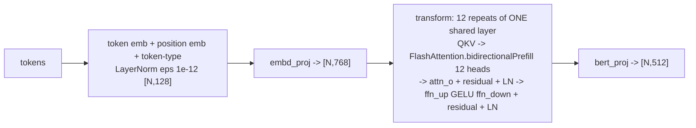

### 6c. `ProsodyPredictor.forward`

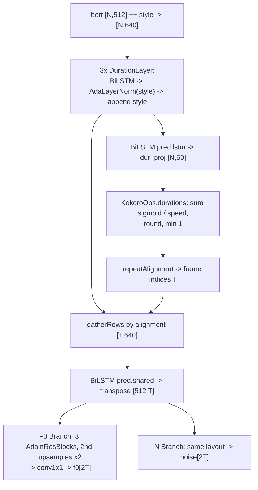

### 6d. `KokoroDecoder.forward`

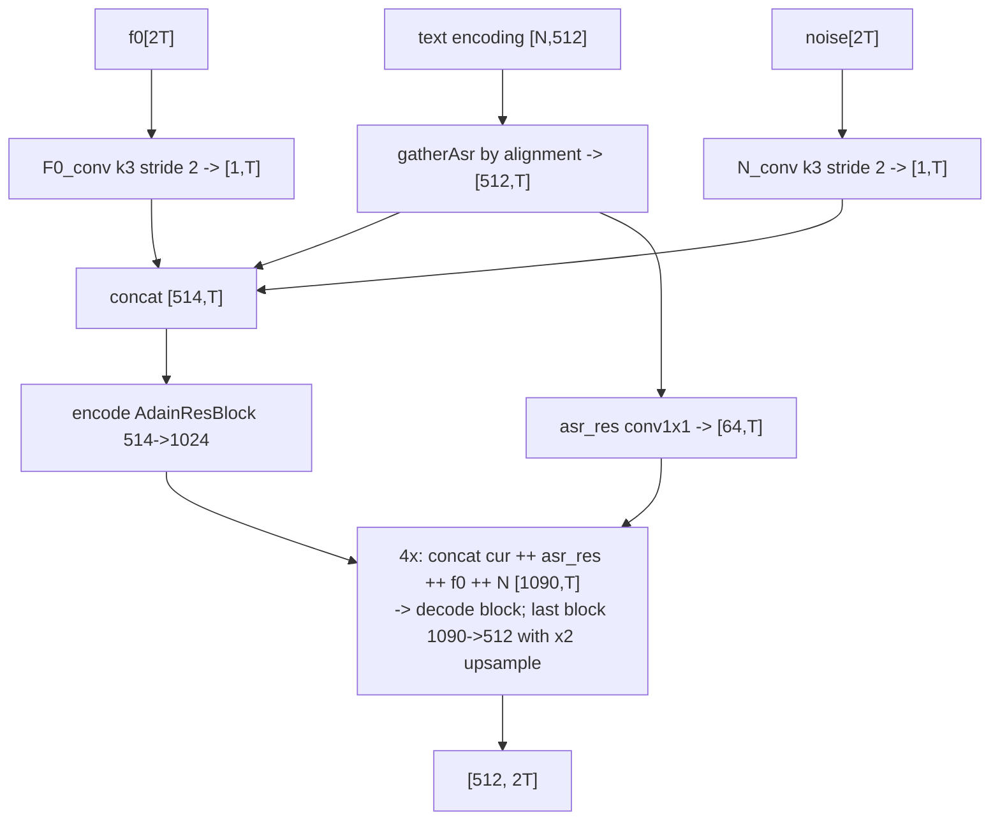

### 6e. `KokoroGenerator.forward` and `KokoroDsp`

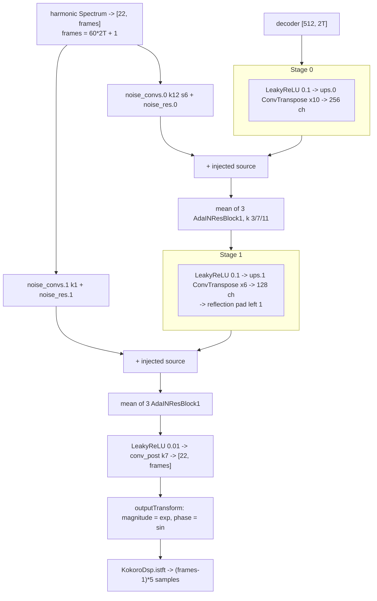

`KokoroDsp.sourceStft`: per-harmonic phase accumulation over F0 (`2T` samples), 300:1 centered interpolation to
the sample rate, sine (amplitude 0.1, voiced when F0 > 10) plus seeded Gaussian noise for nine harmonics, mixed by
`m_source` linear weights + bias and `tanh`, then a reflect-padded, Hann-windowed 20-point DFT (11 bins, hop 5).
`istft` inverts with precomputed twiddles and overlap-add normalised by the window-square sum. Noise draws are taken
sequentially from one `Random` before the `Parallel.forLoop`s, so output is deterministic for a seed.

---

## 7. State, memory and validation

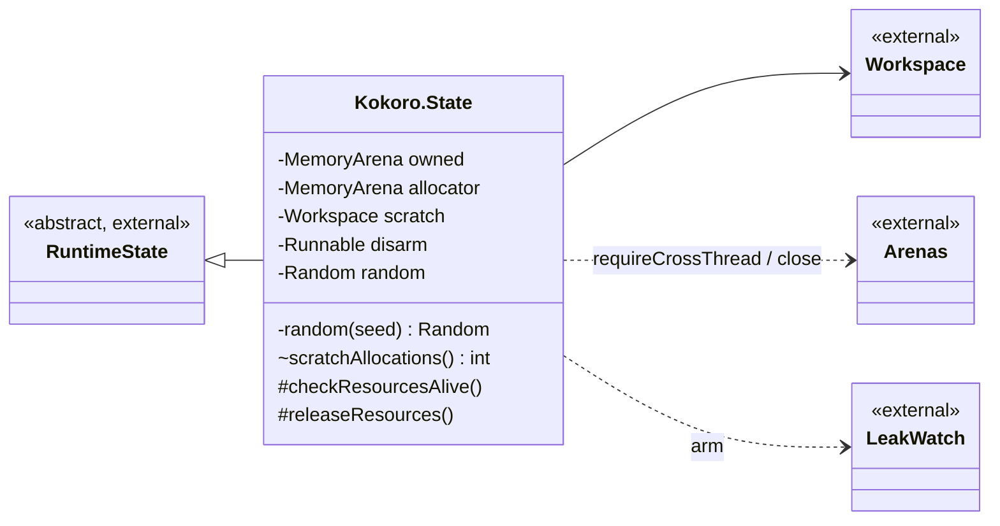

- `newState()` creates an owned cross-thread arena (`Arenas.newCrossThreadMemoryArena`) closed on `close()`;
  `newState(arena)` borrows a caller arena (must be cross-thread, checked by `Arenas.requireCrossThread`).
- There is no KV cache or checkpoint: each `synthesize` call is stateless apart from scratch memory and the
  reseeded `Random`; `RuntimeState.exclusively` serialises use of one state.
- Trust boundary in `Kokoro.synthesize`: non-empty, ≤ 510 ids, each id on a non-empty slot of the 178-entry symbol
  table, speed finite in `[0.5, 2.0]`, voice pack still alive (`Views.checkAlive`).
- Voice style row is chosen by input length: row `min(len, maxPhonemes) - 1`; the first 128 values are decoder
  style, the next 128 predictor style.
