# jinfer-laguna — class architecture

Package `com.qxotic.jinfer.models.laguna` (4 classes, ~1130 lines of main code). It is the `jinfer-<model>` provider for
GGUF architecture `laguna` (Poolside Laguna XS 2.1): a **text-only generative decoder**, hybrid **dense / MoE**
(leading dense FFN layers, then sigmoid-routed experts + one shared expert), with **alternating sliding-window and
full attention** layers, QK-norm, NeoX RoPE (YaRN on full layers, plain on sliding layers) and a **per-head softplus
attention gate**. There is no vision, audio, speculative or recurrent-state subsystem in this module.

Format: **Mermaid**. Legend: `..|>` implements; `--|>` extends; `-->` holds/uses; `..>` creates/depends;
classes marked `<<external>>` live outside this package.

1. [Position in the stack](#1-position-in-the-jinfer-stack)
2. [Class diagrams](#2-class-diagrams) — 2a contracts, 2b model internals, 2c chat template
3. [Loading sequence](#3-loading-sequence)
4. [Forward pass](#4-forward-pass) — 4.0 global, 4a `ingest`, 4b `decoderBlock`
5. [MoE FFN and logits head](#5-moe-ffn-and-logits-head)
6. [State and checkpoint layout](#6-state-and-checkpoint-layout)
7. [Chat template encoding](#7-chat-template-encoding)

| Class | Role |
|---|---|
| `Laguna` | The model: `LanguageModel` impl with nested `Configuration`, `Weights`, `LayerWeights`, `DenseWeights`, `MoeWeights`, `State`; GGUF loading, validation, the whole forward pass and the logits head |
| `LagunaProvider` | `ModelProvider` SPI for architecture `laguna`: `loadLanguage` builds the model, stop tokens, sampling defaults and the chat template |
| `LagunaChatTemplate` | `ChatTemplate`: token-exact encoder of the `<system>/<user>/<assistant>` XML format, think/tool-call reply parser, constrained and forced-call replies |
| `LagunaCheckpointCodec` | `CheckpointCodec<State>`: serialises full-attention KV rows and sliding-window KV rings as FP16 blobs |

---

## 1. Position in the jinfer stack

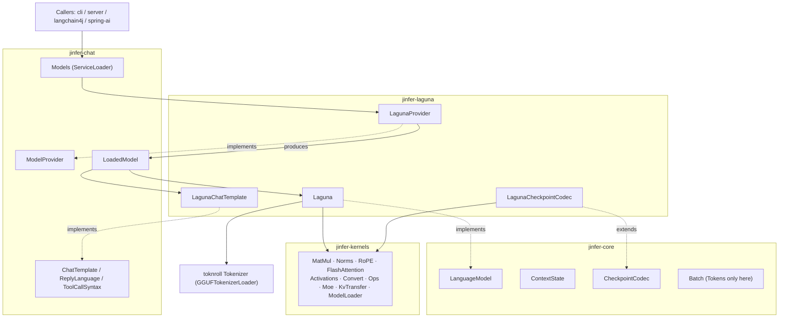

---

## 2. Class diagrams

### 2a. Contracts and relations

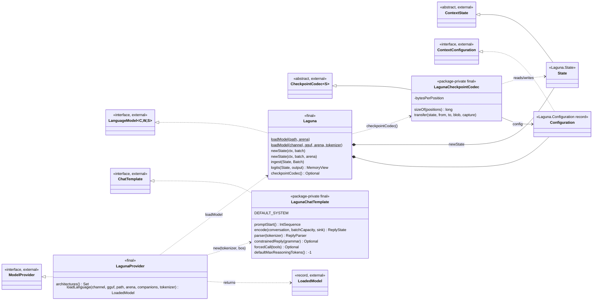

### 2b. Model internals — `Laguna` and its nested types

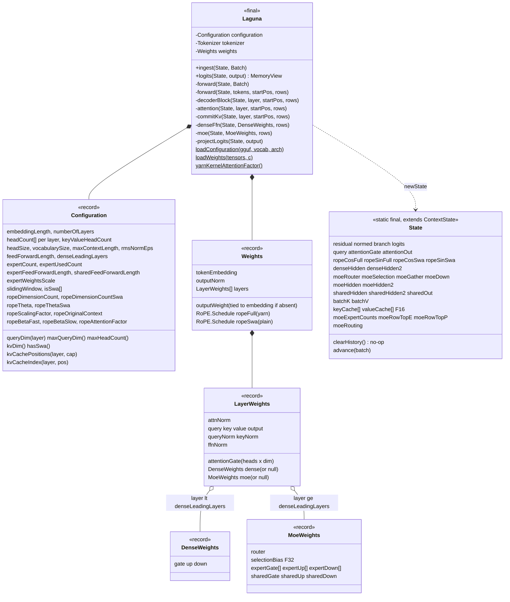

### 2c. Chat template

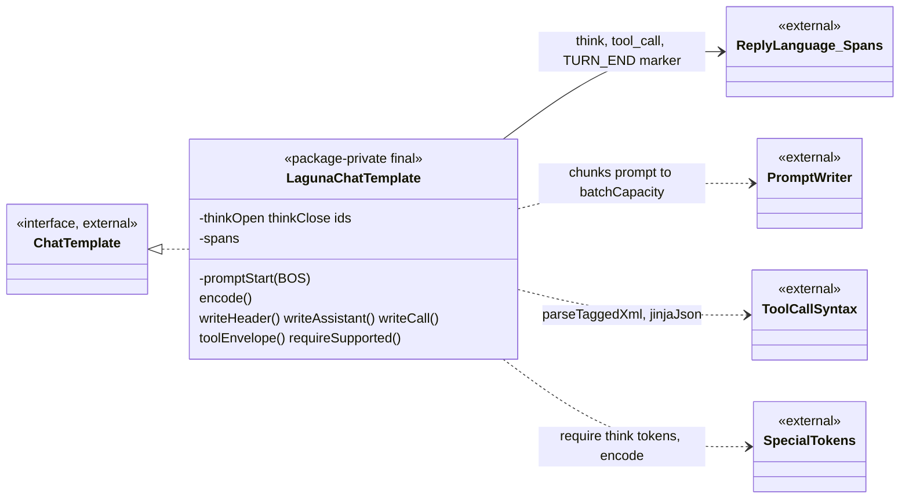

---

## 3. Loading sequence

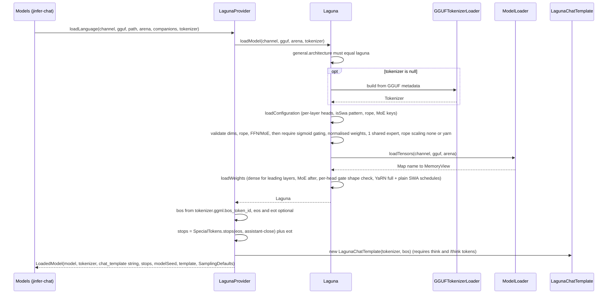

Sampling defaults come from `general.sampling.temp/top_p/top_k/min_p` (fallbacks 1, 1, 20, 0).
`isSwa[layer] = swaPeriod == 0 || layer % swaPeriod != 0` (period default 4, so layers 0, 4, 8, ... are full attention) and only when `sliding_window > 0`; the window must be a power of two.

---

## 4. Forward pass

`ingest(state, batch)` runs `state.exclusively(forward)`. Only `Batch.Input.Tokens` is accepted: `Sequences` throws "does not support packed sequences" and `Embeddings` throws "text-only". There is no recurrent state: carried state is the per-layer F16 KV cache.

### 4.0 Global architecture

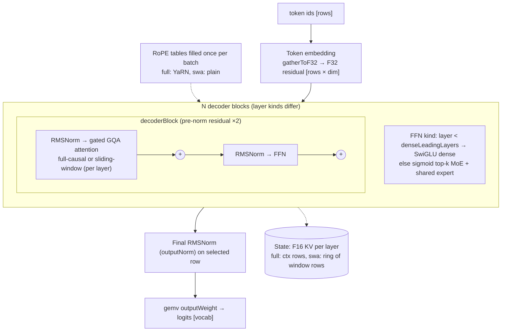

### 4a. `ingest` — batch validation, input kinds, rope/embedding, layer loop

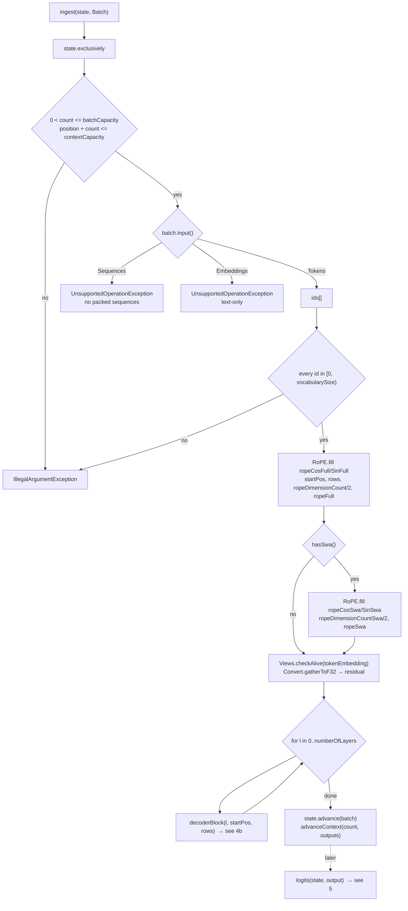

### 4b. `decoderBlock` — one layer

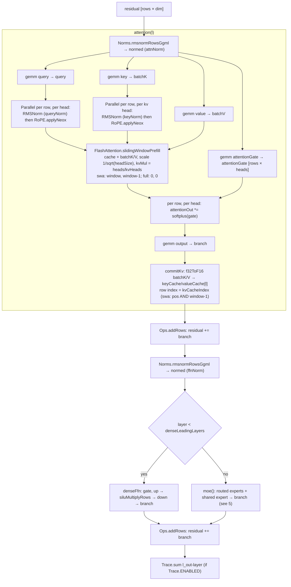

Details worth knowing:

- `commitKv` runs after the layer's attention, because `batchK/batchV` are single buffers shared by all layers; the attention kernel reads the new rows from `batchK/V` and older rows from the cache.
- Heads per layer come from `headCount[layer]` (`attention.head_count` may be a scalar or an array); `keyValueHeadCount` and `headSize` are global; `query` and `attentionOut` are sized for the largest layer.
- The sliding window passed to the kernel is `slidingWindow` (and `slidingWindow - 1` as the second window argument); full layers pass `0, 0`.
- The attention gate is per-head (loader requires the gate tensor shape `headCount[layer] × embeddingLength`) and applied as `softplus` to the attention output before the output projection.

---

## 5. MoE FFN and logits head

### 5a. `moe(state, w, rows)`

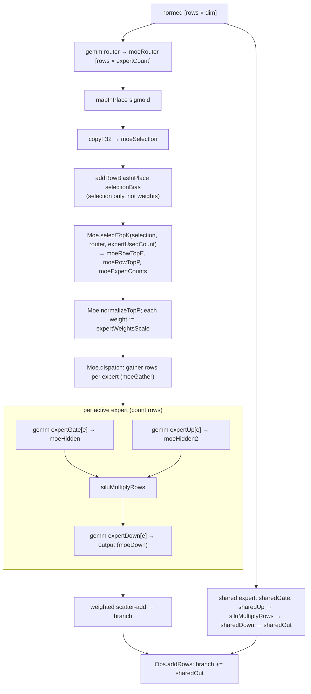

### 5b. Logits head

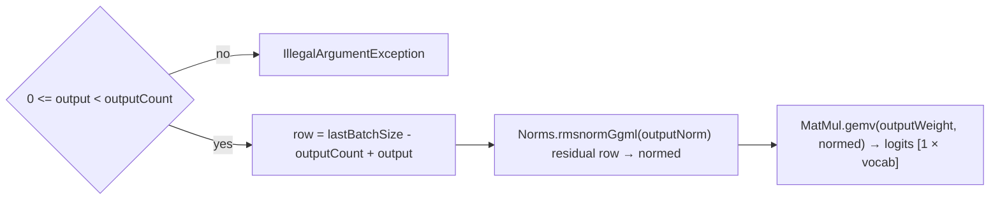

`logits` runs under `state.exclusively`. `outputWeight` falls back to `tokenEmbedding` when `output.weight` is absent (tied head).

---

## 6. State and checkpoint layout

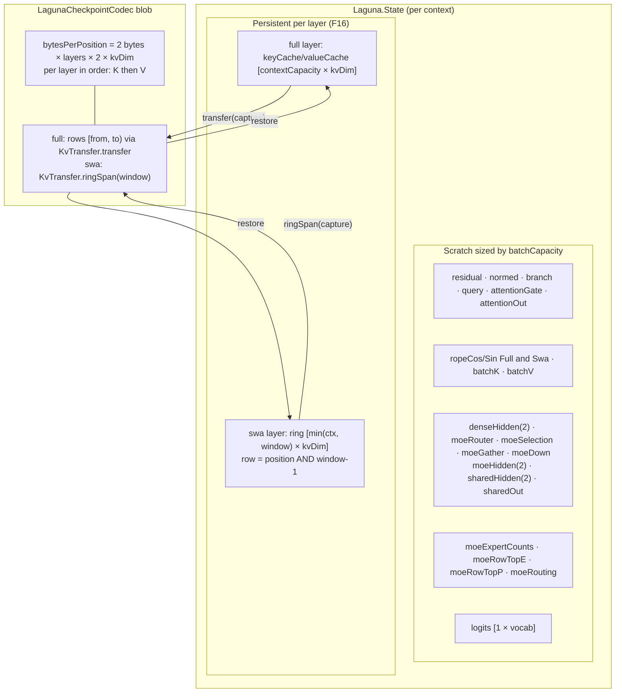

- `clearHistory()` is a no-op: stale rows past the cursor are masked by attention and overwritten on ingest.
- `newState(ctx, batch)` allocates a cross-thread arena owned by the state (closed if construction fails); `newState(ctx, batch, arena)` borrows the caller's arena.
- `State` rejects `contextCapacity <= 0` or `> maxContextLength`. `ropeCosSwa/SinSwa` are null when there is no sliding window.
- `checkpointCodec()` returns a fresh `LagunaCheckpointCodec` over the configuration, so block caching is supported.

---

## 7. Chat template encoding

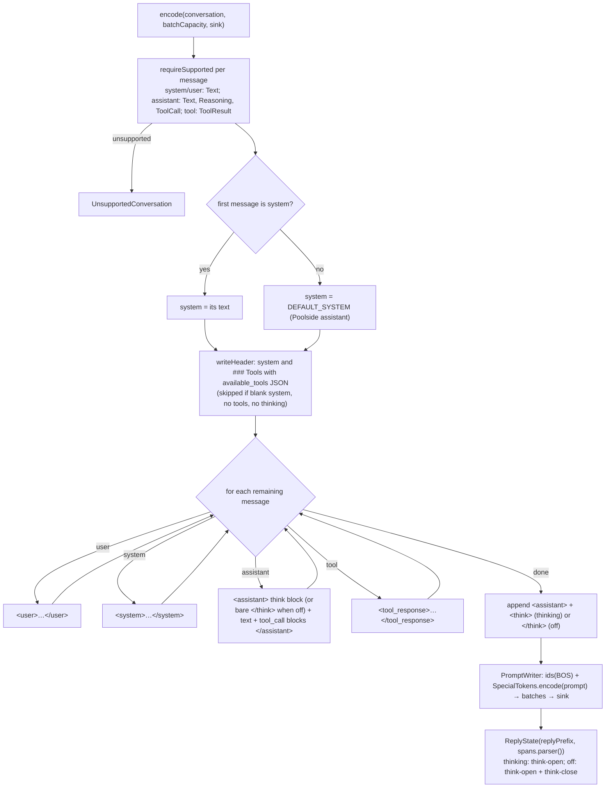

- Tool calls are written as `<tool_call>name<arg_key>k</arg_key><arg_value>v</arg_value></tool_call>`; non-string values use `ToolCallSyntax.jinjaJson`; replies are parsed by `ToolCallSyntax.parseTaggedXml`.
- The turn end marker is `</assistant>` (also a stop token in the provider); `defaultMaxReasoningTokens` returns `-1` (no default reasoning cap).
- `constrainedReply(grammar[, calls])` and `forcedCall(tools)` delegate to `ReplyLanguage.Spans`; `forcedCall` is empty when no tools are callable.
