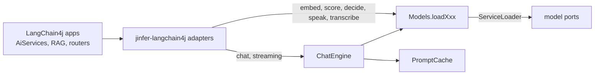

# jinfer-langchain4j — architecture summary

**What it is.** The LangChain4j provider for jinfer: LangChain4j model interfaces implemented over in-process
CPU inference on local GGUF files, with no server and no network on the inference path. One package,
`com.qxotic.jinfer.langchain4j`, 13 types (~4.5k lines). Detailed diagrams: [ARCHITECTURE.md](ARCHITECTURE.md).

**Where it sits.** It is an integration layer above `jinfer-chat` (the framework-neutral `ChatEngine` and the
`Models` loader, which finds model ports through `ServiceLoader<ModelProvider>`), next to the CLI, server and
Spring AI adapters. It also uses `jinfer-cache` (`PromptCache`), `jinfer-hub` (`ModelStore` for model refs),
`jinfer-codecs` (image/audio/video decoding), `jinfer-core` (arenas, states, speech/transcription contracts)
and `toknroll` (tokenizer). The module registers no SPI of its own. Model ports are not compile dependencies:
an application adds `jinfer-models-all` or individual ports.

## Main classes

| LangChain4j interface | Adapter | jinfer delegate |
|---|---|---|
| `ChatModel` | `JinferChatModel` | `ChatEngine` (+ `LoadedModel`) |
| `StreamingChatModel` | `JinferStreamingChatModel` | the same `JinferChatModel` and engine |
| `EmbeddingModel` | `JinferEmbeddingModel` | `LoadedEmbedder` |
| `ScoringModel` | `JinferScoringModel` | `LoadedReranker` |
| `DecisionModel` | `JinferDecisionModel` | `com.qxotic.jinfer.chat.DecisionModel` |
| `TextToSpeechModel` | `JinferSpeechModel` | `SpeechSynthesisModel` |
| `AudioTranscriptionModel` | `JinferTranscriptionModel` | `TranscriptionModel` |

Supporting types: `JinferChatRequestParameters` (grammar, seed, minP, reasoning budget, thinking, timeout,
output modalities), `JinferTokenUsage` (cache hits, cache tier, reasoning tokens, prefill/decode time),
and package-private helpers `Mappings` (all type conversion), `Replies` (exact token records of recent replies),
`CachedPrompt` (a view's prefix and welded tools) and `Estimators` (`TokenCountEstimator` on the real tokenizer).

## Key flows

- **Build.** Each `Builder` takes a model as a local `Path`, a model-ref string (resolved and possibly
  downloaded by `ModelStore` at `build()`, batched with companion refs), or an object the caller already
  loaded. A caller-loaded model keeps its weights in the caller's arena, so several adapters can share one
  load.
- **Chat.** `doChat` calls `prepare`, which maps messages and tools with `Mappings`, applies the view prefix and
  tool precedence, turns a JSON schema, JSON mode or raw GBNF into a grammar, resolves sampling and builds a
  `ChatEngine.Request`. It then runs `engine.complete` and maps the `Completion` back to an `AiMessage` and a
  `ChatResponse` that carries a `JinferTokenUsage`.
- **Streaming.** Preparation is synchronous. Generation runs on the engine's driver thread. Engine `Delta`s go
  to `onPartialResponse` or `onPartialThinking` depending on their channel, speech goes to `onUnmappedRawEvent`,
  and parsed tool calls are reported before the complete response. A `Flow.Publisher` variant uses a
  `SubmissionPublisher` per subscriber.
- **Embedding, scoring, decision.** Each instance holds one reusable state behind a fair lock. Embeddings use
  query/document prefixes from the input type, Matryoshka dimensions when the port supports them, and media
  inputs on multimodal embedders. Scoring prefills the shared query frame once per call. Decision maps
  text, fields, contents or messages, plus yes-no, choice or scale questions, to jinfer's decision API and returns
  probabilities.
- **Speech and transcription.** Each request gets its own state under a read lock. `close()` takes the write
  lock and waits for in-flight requests to finish.

## Notable design choices

- **One serial pipeline per instance** for chat, embedding, scoring and decision. For parallel work, build
  several instances on one caller-loaded model.
- **Shared engine lifecycle.** The base chat model, its cached-prompt views and the streaming twin share one
  `ChatEngine`. Closing any of them closes all of them.
- **Caching never changes output.** `withCachedPrompt` prefills a prefix once. `retainedSessions` keeps whole
  conversations warm, and `promptCache(Path)` mounts a frozen artifact read-only. `JinferTokenUsage` reports
  what each request actually reused.
- **Exact echo replay.** `Replies` remembers each reply's `Verbatim` tokens by a hash of its visible content.
  When that reply comes back in a later history, it re-enters the prompt token-for-token.
- **Structured output by grammar.** `RESPONSE_FORMAT_JSON_SCHEMA` is advertised. A one-line field description
  is added to the prompt by default (`describeSchema`), because a grammar alone constrains the format but does
  not tell the model which fields to fill.
- **Loud refusals.** Unsupported parameters (penalties, per-request model switch, voice selection,
  transcription language or prompt) and remote media URLs raise `UnsupportedFeatureException` rather than
  being ignored.
- **Deterministic memory release.** Constructors free any arena or engine they allocated if construction
  fails. `close()` waits for quiescence and frees only the weights the instance loaded itself.
