# jinfer-langchain4j — class architecture

Package `com.qxotic.jinfer.langchain4j` (13 top-level types + `package-info`, ~4560 lines). It is the
**LangChain4j provider** for jinfer: in-process CPU inference over local GGUF files, no server. Each
public class implements one LangChain4j model interface (`ChatModel`, `StreamingChatModel`, `EmbeddingModel`,
`ScoringModel`, `DecisionModel`, `TextToSpeechModel`, `AudioTranscriptionModel`) and maps LangChain4j types
onto jinfer's framework-neutral runtime (`ChatEngine`, `Models`, `LoadedEmbedder`, `LoadedReranker`, ...).
The module registers **no** `META-INF/services` entries: users build instances with each class's `builder()`;
SPI discovery happens one layer down, in `jinfer-chat`'s `Models` (`ServiceLoader<ModelProvider>`).

Format: **Mermaid**. Legend: `..|>` implements; `--|>` extends; `-->` holds/uses; `..>` creates/depends;
classes marked `<<external>>` live outside this package (LangChain4j or other jinfer modules).

1. [Position in the stack](#1-position-in-the-jinfer-stack)
2. [Class diagrams](#2-class-diagrams) — 2a public surface, 2b chat internals, 2c the other adapters
3. [Builders and model sources](#3-builders-and-model-sources)
4. [Blocking chat flow](#4-blocking-chat-flow)
5. [Streaming chat flow](#5-streaming-chat-flow)
6. [Cached-prompt views and reply records](#6-cached-prompt-views-and-reply-records)
7. [Parameter precedence and structured output](#7-parameter-precedence-and-structured-output)
8. [Embedding, scoring and decision flows](#8-embedding-scoring-and-decision-flows)
9. [Lifecycle, ownership and concurrency](#9-lifecycle-ownership-and-concurrency)

| Class | Visibility | Role |
|---|---|---|
| `JinferChatModel` | public final | `ChatModel` + `AutoCloseable`: owns/shares one `ChatEngine`; request preparation (tools, schema, grammar, sampling) shared with the streaming twin; `withCachedPrompt` views; `tokenCountEstimator()`; nested `Builder` |
| `JinferStreamingChatModel` | public final | `StreamingChatModel`: twin over the same `JinferChatModel`/engine; handler callbacks and `Flow.Publisher` of events; nested `Guarded` subscriber and `Relay` handler |
| `JinferChatRequestParameters` | public | extends `DefaultChatRequestParameters`: adds `grammar`, `seed`, `minP`, `maxReasoningTokens`, `thinking`, `reasoningCutoffMessage`, `timeout`, `outputModalities`; nested `Builder` |
| `JinferTokenUsage` | public final | extends `TokenUsage`: cached input tokens, reasoning tokens, `PromptCache.Tier`, prefill/decode nanos; overrides `add` |
| `JinferEmbeddingModel` | public final | `EmbeddingModel`: `LoadedEmbedder` + one reusable `ContextState`; query/document prefixes; Matryoshka dimensions; multimodal inputs |
| `JinferScoringModel` | public final | `ScoringModel`: `LoadedReranker` + one reusable state; instruction slot; shared-frame reranking |
| `JinferDecisionModel` | public final | LangChain4j `DecisionModel`: wraps jinfer `chat.DecisionModel`; maps inputs (text/fields/contents/messages) and questions (yes-no/choice/scale) |
| `JinferSpeechModel` | public final | `TextToSpeechModel`: `SpeechSynthesisModel`, WAV output, read/write lifecycle lock |
| `JinferTranscriptionModel` | public final | `AudioTranscriptionModel`: `TranscriptionModel`, read/write lifecycle lock |
| `Mappings` | package-private final | static mapping seam: LangChain4j messages/media/tools/JSON schema to jinfer types and back; finish reasons, timeouts |
| `Replies` | package-private final | LRU of recent replies' `Verbatim` token records keyed by `ContentKey` of the reply's visible content |
| `CachedPrompt` | package-private record | a view's prefix (messages + welded tools); tool precedence rule |
| `Estimators` | package-private final | `TokenCountEstimator` over the model's own tokenizer and media position plan |

---

## 1. Position in the jinfer stack

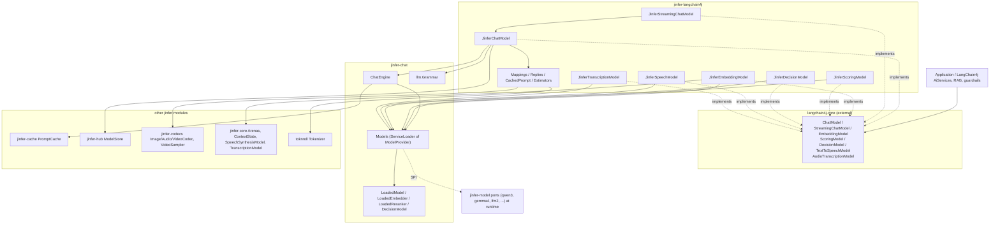

Maven dependencies (compile scope, from `pom.xml`): `langchain4j-core`, `slf4j-api`, `jinfer-core`, `jota-memory`,
`jinfer-chat`, `jinfer-codecs`, `jinfer-cache`, `json`, `jinfer-hub`, `toknroll-core`. Model ports
(`jinfer-models-all`), `jam-native`, `gguf`, `jinfer-kernels` etc. are **test-only**: an application picks its
ports explicitly. The jar carries `Automatic-Module-Name: com.qxotic.jinfer.langchain4j`.

---

## 2. Class diagrams

### 2a. Public surface — LangChain4j contracts

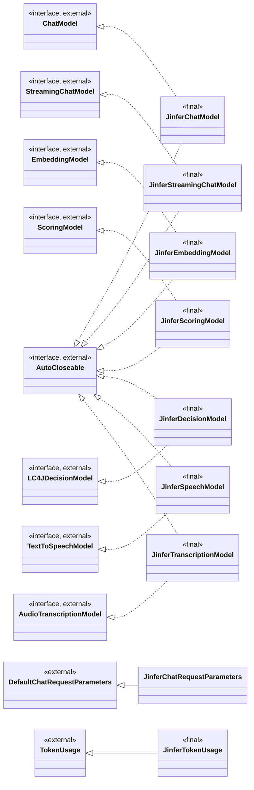

`LC4JDecisionModel` stands for `dev.langchain4j.model.decision.DecisionModel` (the class refers to jinfer's
homonym by its fully qualified name `com.qxotic.jinfer.chat.DecisionModel`).

### 2b. Chat internals

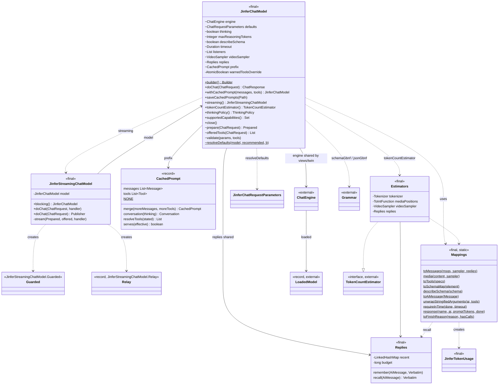

### 2c. The other adapters and their jinfer delegates

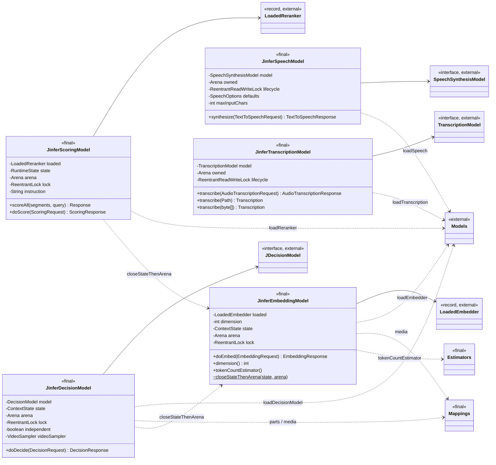

`JDecisionModel` is `com.qxotic.jinfer.chat.DecisionModel` (questions `Predicate`, `Choice`, `Rating`, `Option`;
`decide` / `decideIndependently` returning one probability row per question).

---

## 3. Builders and model sources

Every adapter has a nested `Builder` whose model **source** is one field (`Object source`), last setter wins:
a local `Path` (`modelPath`), a model-ref `String` (`model("owner/repo:Q8_0")`, validated by
`ModelStore.requireRef`), or an already-loaded jinfer object (`LoadedModel`, `LoadedEmbedder`, `LoadedReranker`,
jinfer `DecisionModel`, `SpeechSynthesisModel`, `TranscriptionModel`). Companions (`companion` /
`companionPath`, e.g. `"media"` projector, `"lexicon"`, `"speculation"`) exist on chat, embedding, decision and
speech builders and are refused when the source is a pre-loaded model.

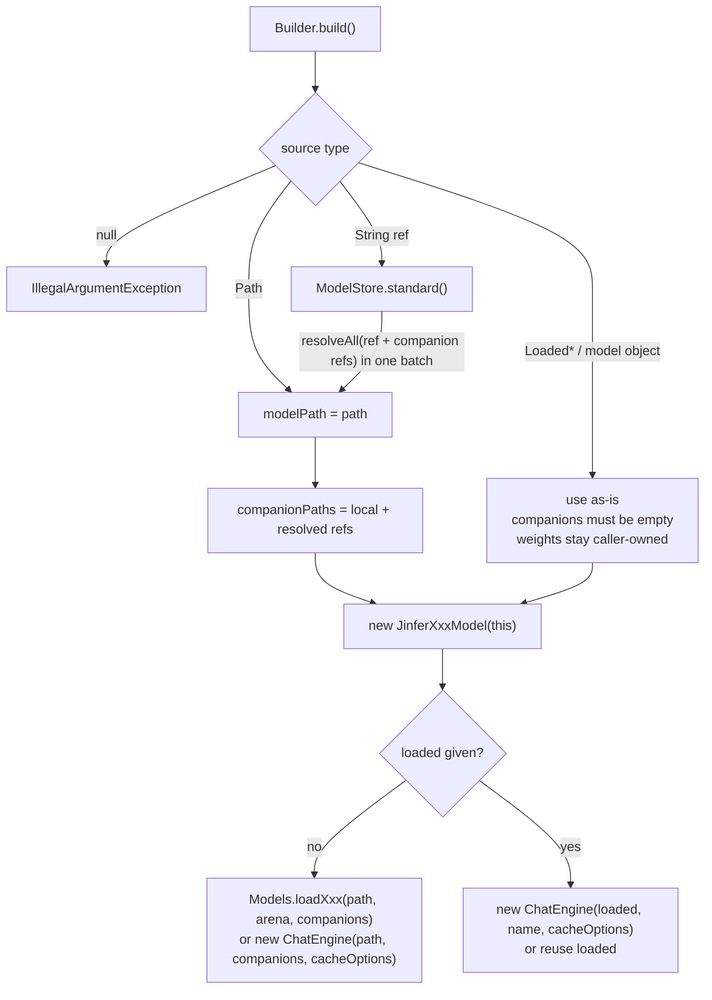

`JinferScoringModel` and `JinferTranscriptionModel` take no companions and resolve a ref with
`ModelStore.standard().resolve(ref)`. Remote resolution happens only at `build()`; nothing on an inference
path downloads, and `Mappings` refuses non-`file://` media URLs.

---

## 4. Blocking chat flow

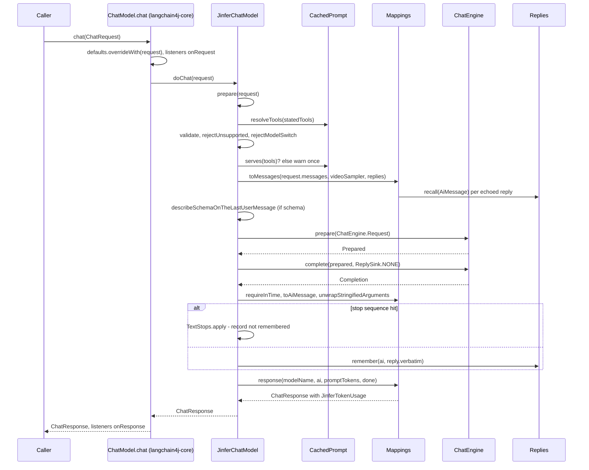

`prepare` lowers a request into `ChatEngine.Request`: messages (view prefix first), effective tools, thinking
(off when `outputModalities` contains `AUDIO`), `maxOutputTokens`, reasoning cap and cutoff message, timeout,
sampling (`LoadedModel.samplingDefaults().resolve(temperature, topP, topK, minP, seed)`), GBNF grammar,
`ForcedTool.ANY` for `ToolChoice.REQUIRED`, stop sequences, output modalities. `UnsupportedOperationException`
from the engine is translated to LangChain4j's `UnsupportedFeatureException` by the private `framed` helpers.
`Mappings.toFinishReason` maps `Generator.FinishReason` (`STOP`, `LENGTH`, else `OTHER`; `TOOL_EXECUTION` when
calls exist); a timeout becomes `dev.langchain4j.exception.TimeoutException`.

---

## 5. Streaming chat flow

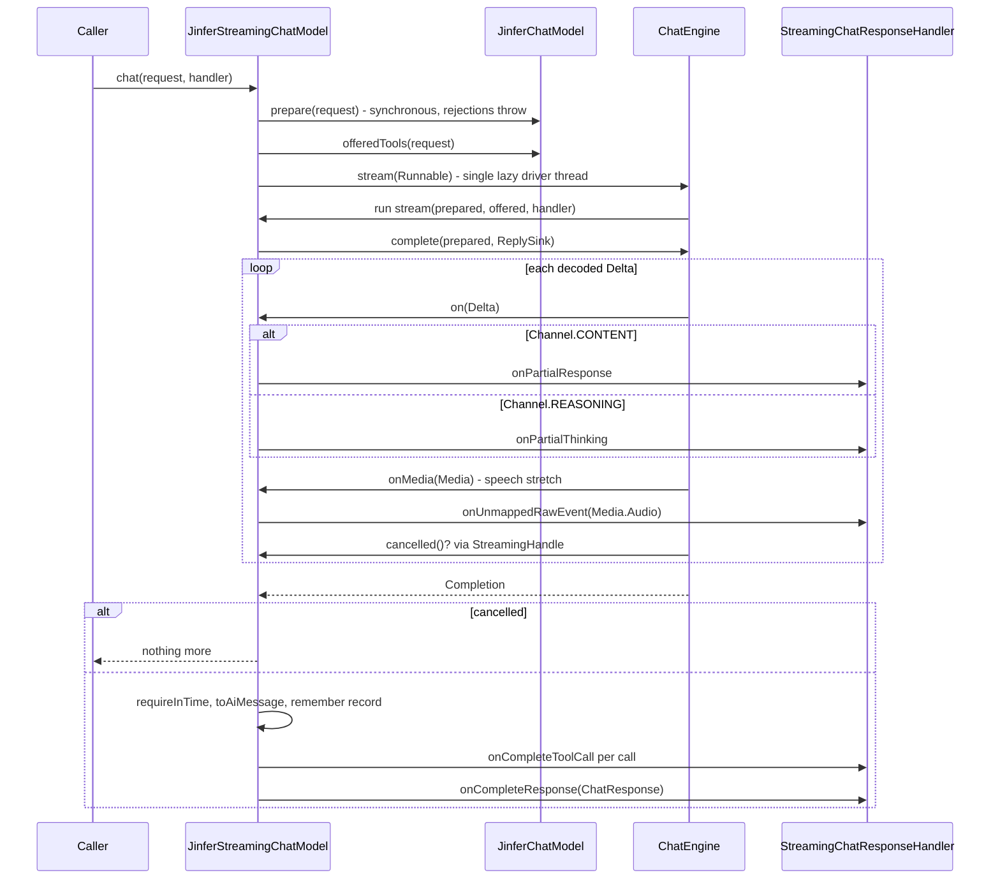

User-callback exceptions are routed to `onError` per occurrence by `safely(...)` while generation continues.
The reactive `doChat(ChatRequest)` returns a `Flow.Publisher` that, per subscriber, creates a
`SubmissionPublisher` (delivered on the `CompletableFuture` default executor, buffer `1 << 20`), wraps the
subscriber in `Guarded` (cancels on a throwing `onNext`) and drives `doChat(request, new Relay(events))`;
`Relay` cancels the generation when no subscriber remains.

---

## 6. Cached-prompt views and reply records

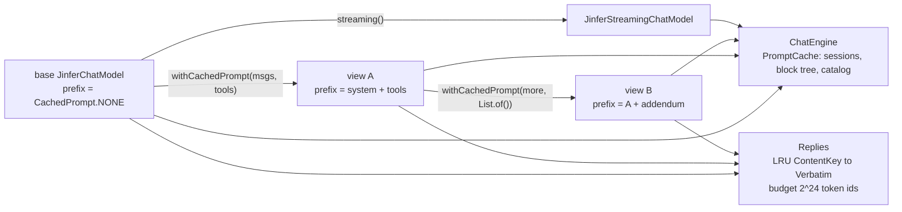

- `withCachedPrompt` converts messages/tools once (`Mappings.toMessages`, `Mappings.toTools`),
  `CachedPrompt.merge`s them onto the current prefix, calls `engine.definePrompt(conversation)` and returns a
  new view sharing every field except `prefix` and its own `warnedToolsOverride` flag.
- Tool precedence (`CachedPrompt.resolveTools`): a request that states tools (or `ToolChoice.NONE`) uses its own;
  unstated falls to the view's welded tools. `serves` tells whether the prepaid prefill applies.
- `saveCachedPrompts(Path)` calls `engine.freezePrompts`; `Builder.promptCache(Path)` mounts that artifact
  read-only through `PromptCache.Options.withCatalog(path, true)`; `retainedSessions` and `contextCapacity`
  also go into `PromptCache.Options`.
- `Replies` keys a reply by SHA-256 (`ContentKey.sha256`) of the JSON of its text, thinking and tool calls; an
  echoed `AiMessage` in later history is mapped to a jinfer `Message` carrying the original `Verbatim` token
  record, so the engine replays exact generated tokens. Stop-sequence-cut replies are never remembered.
- `JinferTokenUsage` exposes the effect per response: `cachedInputTokens` (`Completion.restoredTokens`),
  `servedFrom` (`PromptCache.Tier` `SESSION` / `BLOCKS` / `FRESH`), `promptNanos`, `predictedNanos`,
  `reasoningTokenCount`. Its `add` sums all counters and drops the tier.

---

## 7. Parameter precedence and structured output

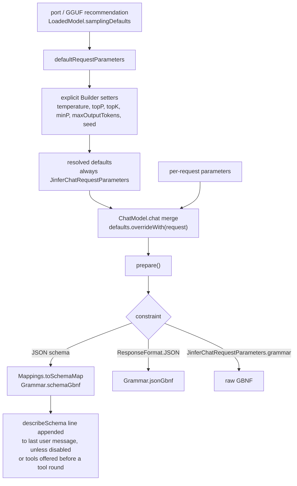

`JinferChatRequestParameters.overrideWith` / `defaultedBy` and its `Builder.overrideWith` carry the jinfer-only
fields across merges, which is why defaults are always built jinfer-typed. `rejectUnsupported` refuses
`frequencyPenalty`, `presencePenalty`, and grammar combined with a JSON response format; `rejectModelSwitch`
refuses a different `modelName`. `supportedCapabilities()` returns `RESPONSE_FORMAT_JSON_SCHEMA`, which makes
AiServices use structured output for POJO extraction. `Mappings.unwrapStringifiedArguments` repairs tool
arguments that small models send as JSON strings where the declared schema says array/object.

---

## 8. Embedding, scoring and decision flows

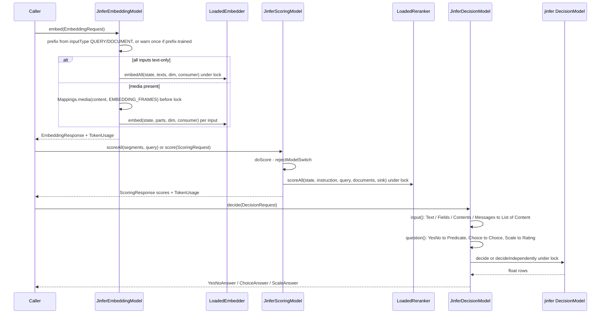

- Embedding: `dimension` resolves from `Builder.dimensions` against `LoadedEmbedder.minimumDimension..dimension`;
  `supportedParameters` adds `DIMENSIONS` only when `supportsCustomDimensions()`. `supportedContentTypes`
  adds IMAGE/VIDEO/AUDIO when the model is `Multimodal` and supports that media.
- Scoring: `instruction` defaults to `reranker().defaultInstruction()`; an explicit instruction on a reranker
  without `hasInstructionSlot()` is refused at build.
- Decision: a `MessagesInput` becomes a JSON transcript `{"messages": [...]}` with media markers
  (`[image 1]`, ...) and the media parts placed ahead of the JSON; token usage is the delta of
  `state.tokensRead()`.
- Speech and transcription (not drawn): `JinferSpeechModel.synthesize` refuses a named voice and over-long
  text, then `model.speak(text, SpeechOptions)` and `AudioCodec.wav`; `JinferTranscriptionModel` refuses prompt,
  temperature and language, decodes bytes with `AudioCodec` and calls `model.transcribe(audio)`.

---

## 9. Lifecycle, ownership and concurrency

| Adapter | Concurrency | State | `close()` | Weights freed |
|---|---|---|---|---|
| `JinferChatModel` (+ views, streaming twin) | serial; `ChatEngine` generation lock, streaming on its driver thread | engine-managed retained sessions + block tree | `engine.close()`; closes base, all views and twin | only if the engine loaded them (path/ref) |
| `JinferEmbeddingModel` | serial; fair `ReentrantLock` | one `ContextState` in a private cross-thread arena | lock, `closeStateThenArena` | arena closed; caller-loaded weights live in caller's arena |
| `JinferScoringModel` | serial; fair lock | one state | same as embedding | same |
| `JinferDecisionModel` | serial; fair lock | one `ContextState` from `model.newState` | same | same |
| `JinferSpeechModel` | parallel; read lock per request, state per call | none held | write lock waits for in-flight, idempotent | only an arena it created |
| `JinferTranscriptionModel` | parallel; read lock per request | none held | write lock waits for in-flight, idempotent | only an arena it created |

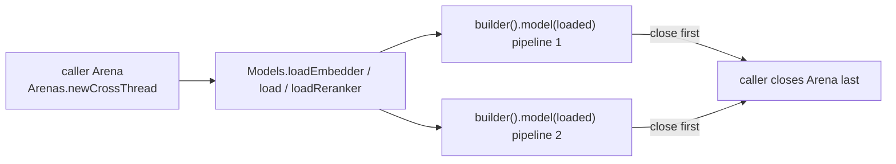

Constructors that allocate an arena or a live engine free it on any failure before rethrowing
(`Arenas.close`, `close(engine::close, e)` keeping the original exception primary). Parallel pipelines share
weights by building several adapters on one caller-owned loaded model, as documented in `package-info.java`.
