# jinfer-lfm2 — class architecture

Package `com.qxotic.jinfer.models.lfm2` (8 classes, ~3860 lines). It is the `jinfer-<model>` provider for the GGUF
architectures `lfm2` and `lfm2moe` (Liquid LFM2 / LFM2.5). One backbone serves **four faces**: generative chat (dense or
MoE), a bidirectional sentence **embedder** (LFM2.5-Embedding, CLS pooling), a **ColBERT** late-interaction reranker
(LFM2.5-ColBERT, per-token `dense_2` vectors), and an optional **LFM2-VL** vision sidecar (`mmproj`). The backbone is a
**hybrid**: each layer is either GQA attention (`kvHeads > 0`) or a gated short-convolution mixer (`kvHeads == 0`), and
its FFN is either dense SwiGLU or top-k MoE.

Format: **Mermaid**. Legend: `..|>` implements; `--|>` extends; `-->` holds/uses; `..>` creates/depends;
classes marked `<<external>>` live outside this package.

1. [Position in the stack](#1-position-in-the-jinfer-stack)
2. [Class diagrams](#2-class-diagrams) — 2a contracts, 2b model internals, 2c vision, retrieval and chat template
3. [Loading sequences](#3-loading-sequences) — 3a provider flows, 3b configuration and weights
4. [Forward pass](#4-forward-pass) — 4.0 global, 4a `ingest`, 4b `decoderBlock` (4b.1 short-conv, 4b.2 MoE, 4b.3 non-causal)
5. [Heads: logits, CLS embedding, ColBERT row](#5-heads)
6. [State and checkpoint layout](#6-state-and-checkpoint-layout)
7. [Chat template and tool codec](#7-chat-template-and-tool-codec)
8. [Vision sidecar](#8-vision-sidecar)
9. [ColBERT scoring](#9-colbert-scoring)

| Class | Role |
|---|---|
| `Lfm2` | The model: `LanguageModel` + `EmbeddingModel` + `Multimodal` impl with nested `Configuration`, `Weights` (+ `AttentionWeights`, `ShortConvWeights`, `DenseFfnWeights`, `MoeFfnWeights`, `LayerWeights`), `State`, `EmbedScratch`; the whole forward pass (causal, tail-only, segmented non-causal, image rows) and the heads |
| `Lfm2Provider` | `ModelProvider` SPI: `architectures` = `lfm2`/`lfm2moe`, companion `media` = `mmproj`, `retrieval(gguf)`, `loadLanguage`, `loadEmbedder`, `loadReranker`, sampling defaults |
| `Lfm2ChatTemplate` | `ChatTemplate`: token-exact ChatML codec with a per-checkpoint `Dialect`, think spans, tool calls, image blocks |
| `Lfm2ToolCodec` | Python-style tool-call wire: `parse` (JSON or Python literals), `renderCalls`, `renderTools` |
| `Lfm2Vision` | `MediaProjector<Media.Image>`: SigLIP2-NaFlex tower + pixel-unshuffle projector into the text residual width |
| `Lfm2VisionPreprocess` | Aligned resize, 512 px tile plan (`Plan`/`Part`/`Geometry`/`Options`), patch extraction |
| `Lfm2Colbert` | `Reranker<State>`: MaxSim over per-token `dense_2` vectors (query padded to 32, docs cut to 512, punctuation skiplist) |
| `Lfm2CheckpointCodec` | `CheckpointCodec<State>`: F16 KV rows of attention layers plus the F32 short-conv history of conv layers |

---

## 1. Position in the jinfer stack

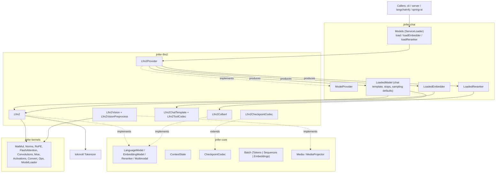

---

## 2. Class diagrams

### 2a. Contracts and relations

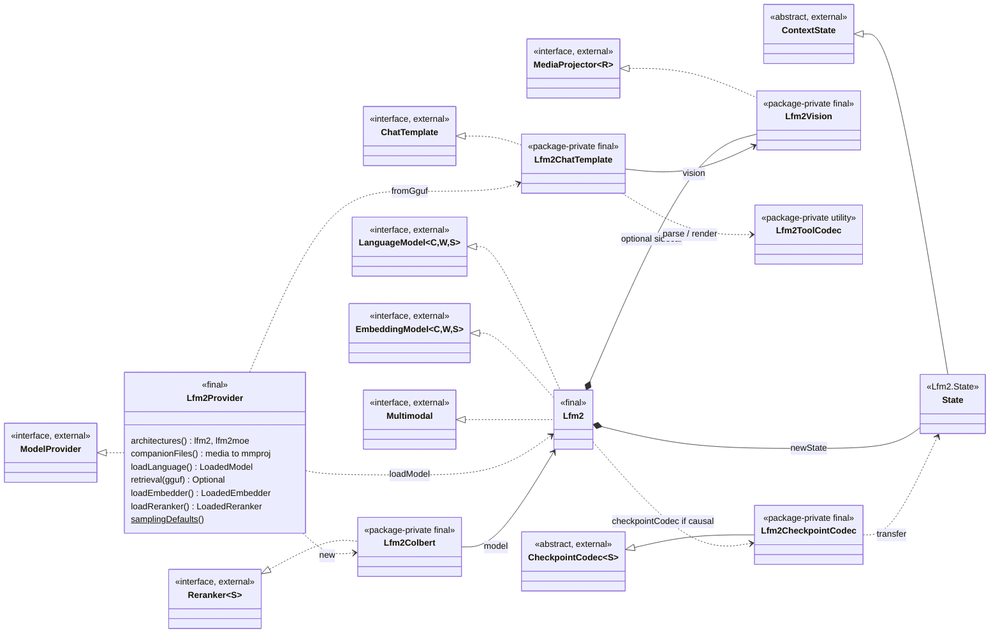

### 2b. Model internals — `Lfm2` and its nested types

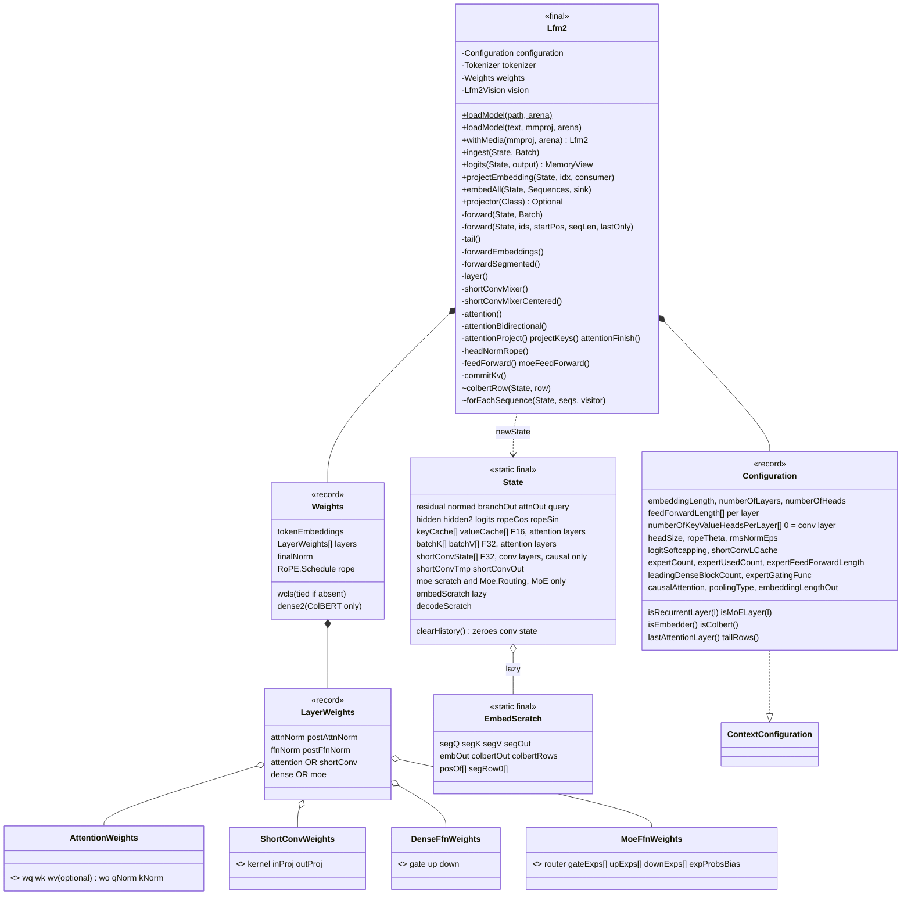

### 2c. Vision, retrieval and chat-template subsystems

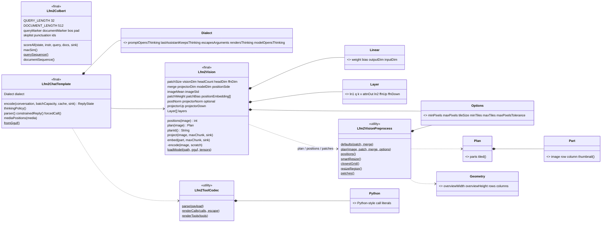

---

## 3. Loading sequences

### 3a. Provider flows

`Models` calls `retrieval(gguf)` first, and `loadLanguage` refuses a non-causal (retrieval) header **before** any weight is read.

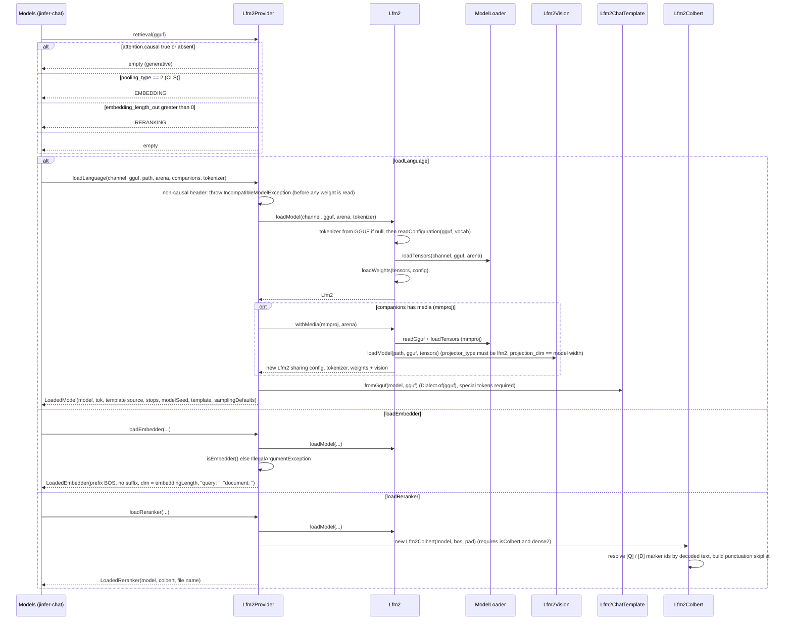

Stop tokens for chat: `SpecialTokens.stops(tok, -1, "<|im_end|>", "<eos>", "<|endoftext|>", "<end_of_turn>")`. Sampling defaults
(`samplingDefaults`, overridden by GGUF `general.sampling.*`): non-LFM2.5 text 0.3 temp / min-p 0.15; LFM2.5 dense 0.1 / top-k 50;
LFM2.5 MoE 0.2 / top-k 80; vision with a large vocab 0.2 / top-k 50, other vision 0.1 / min-p 0.15.

### 3b. Configuration and weights

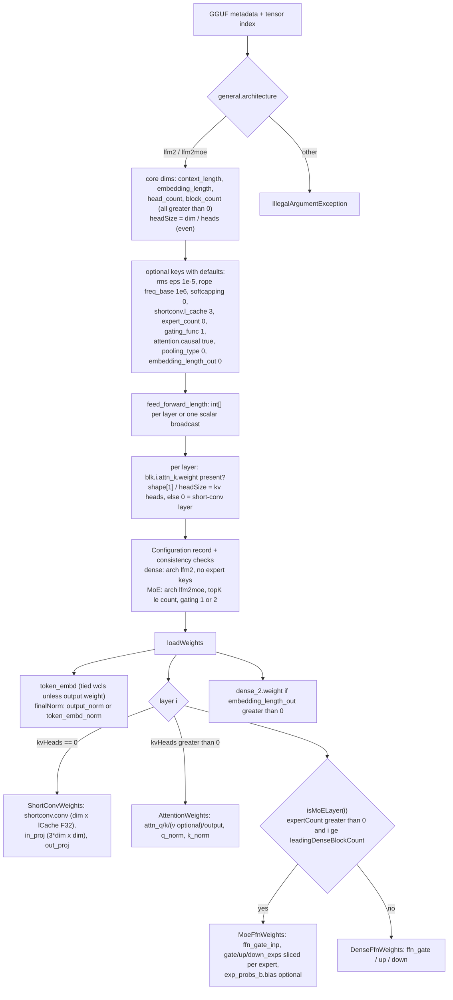

RoPE is `RoPE.plain(headSize, ropeTheta)`. Every weight shape is checked against the expected `[rows, columns]` at load.

---

## 4. Forward pass

`ingest(state, batch)` runs `state.exclusively(forward)`. Layers are heterogeneous: conv layers keep a rolling F32 history of `lCache-1` rows, attention layers keep an F16 KV cache.

### 4.0 Global architecture

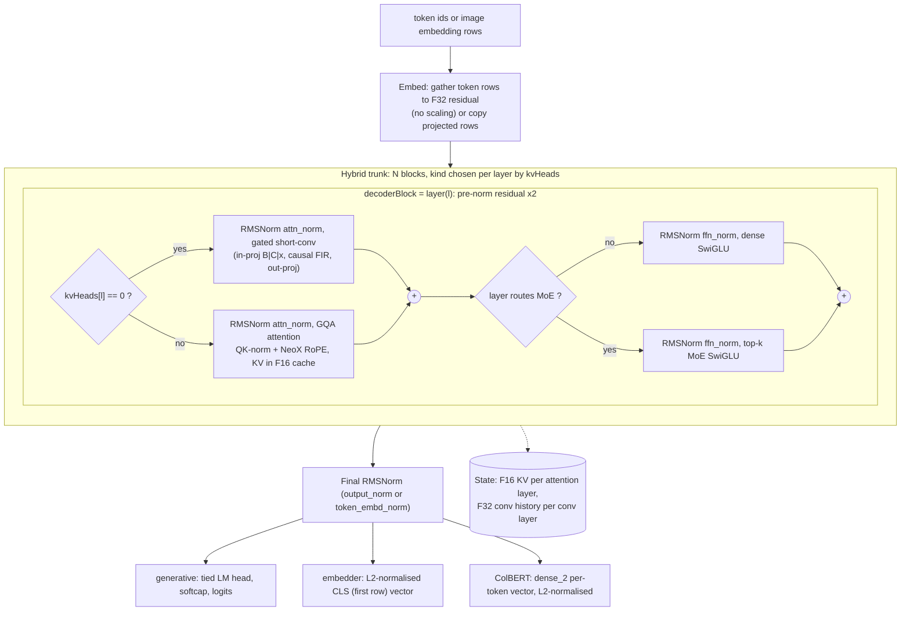

### 4a. `ingest` — batch validation, input kinds, RoPE/embedding, layer loop, advance

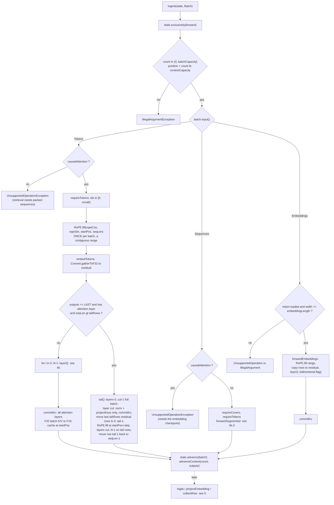

The **tail optimisation**: when only the last row is read, rows past the last attention layer's K/V only feed their own output and the trailing convs' look-back. `tailRows = 1 + (trailing conv layers) × (lCache − 1)` rows are finished alone, reading the earlier rows' keys back from the cache as a next batch would.

### 4b. `decoderBlock` — one layer (`layer(l)`)

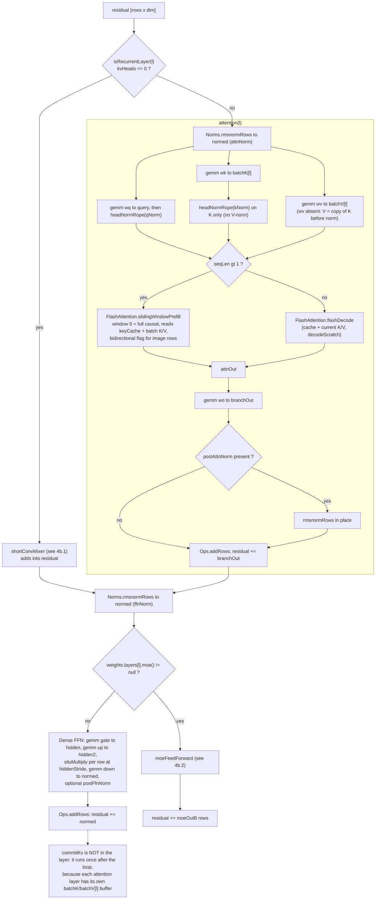

Details worth knowing:

- Scale is `1/sqrt(headSize)`; GQA via `kvMul = heads / kvHeadsPerLayer[l]`; `kvDim(l) = kvHeads[l] × headSize` varies per layer, and `hidden`/`hidden2` are sized to `maxHiddenDim` (dense layers may differ in width, so rows are addressed at the buffer stride).
- `attn_norm` is the mixer pre-norm of conv layers too.
- The FFN pre-norm output is shared by dense and MoE paths.

### 4b.1 Short-conv mixer (recurrent layer)

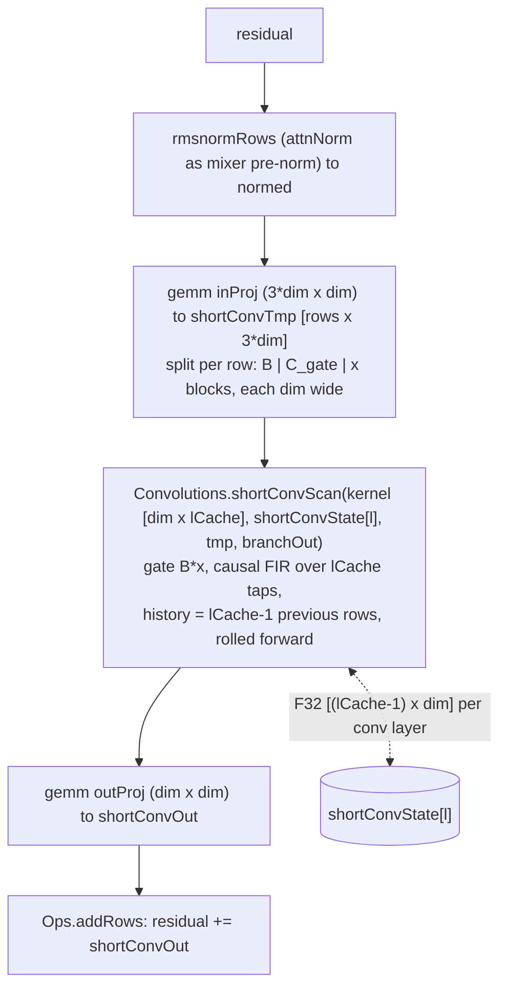

### 4b.2 MoE feed-forward (LFM-style)

No shared MLP and no expert pre/post norms; the router runs on the `ffnNorm` output.

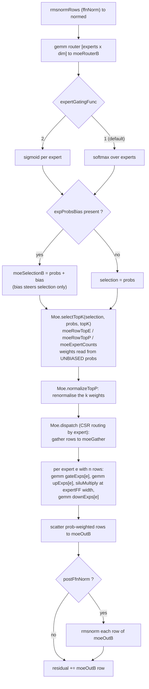

The first `leadingDenseBlockCount` layers are dense even in an `lfm2moe` model.

### 4b.3 Non-causal segmented forward (embedding and ColBERT checkpoints)

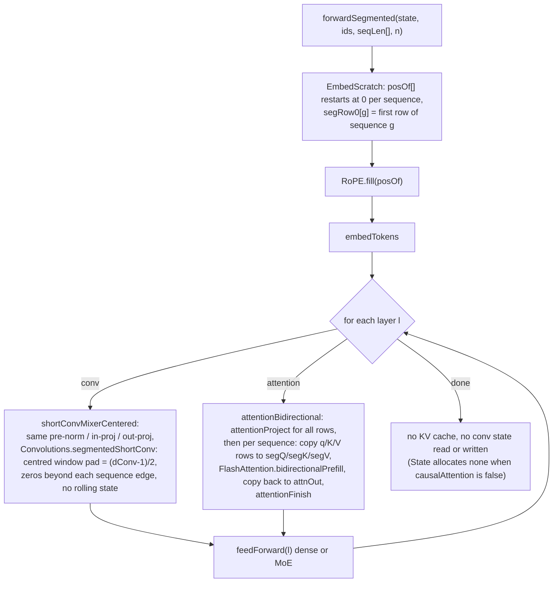

Each sequence must be forwarded whole. `forEachSequence` packs whole sequences greedily into groups capped by `min(batchCapacity, contextCapacity)`, calls `state.reset()` per group, ingests with all outputs, and hands each sequence's first retained row to a visitor; a sequence longer than the cap is refused by name. `embedAll` uses it to emit one CLS vector per sequence.

---

## 5. Heads

All heads read the retained residual row `lastBatchSize - outputCount + output`.

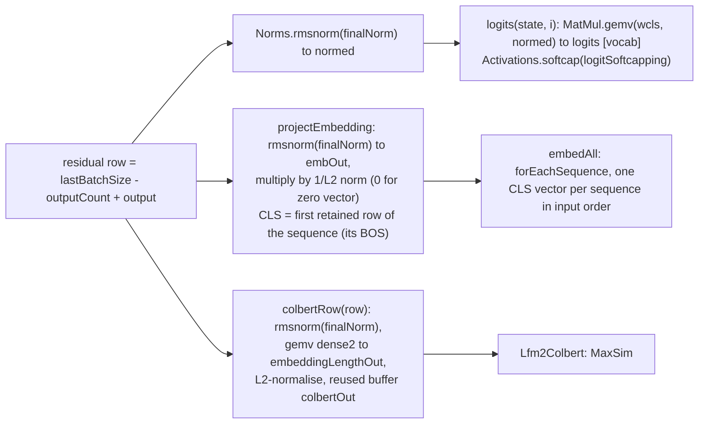

---

## 6. State and checkpoint layout

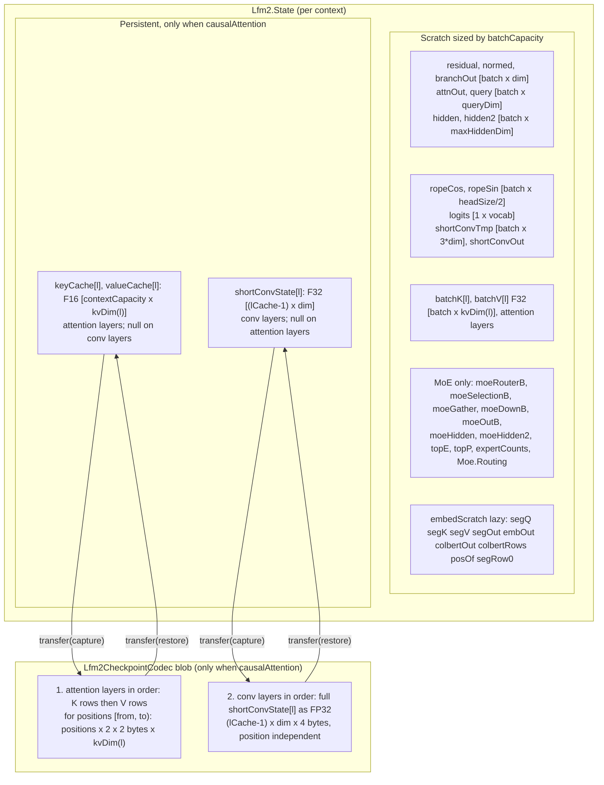

- `sizeOf(positions) = positions × bytesPerPosition + residueBytes`, where `bytesPerPosition = Σ 2·2·kvDim(l)` over attention layers and `residueBytes = convLayers × (lCache−1) × dim × 4`.
- `clearHistory()` zeroes every conv history (stale KV rows past the cursor are masked by attention and overwritten); `State` rejects `contextCapacity > maxContextLength`.
- `checkpointCodec()` is empty for non-causal (retrieval) checkpoints.
- `newState(ctx, batch)` makes a cross-thread arena owned by the state; `newState(ctx, batch, arena)` borrows the caller's.

---

## 7. Chat template and tool codec

`Lfm2ChatTemplate` mirrors the ChatML Jinja template token-exactly. `Dialect.of(gguf)` reads from the template source: `promptOpensThinking` (source contains `<|im_start|>assistant\n<think>`), `lastAssistantKeepsThinking` (`last_assistant_index`), `escapesArguments` (no `format_arg_value`, or `replace(`), `rendersThinking` (`<think>` present), and `modelOpensThinking` (architecture is `lfm2moe`). `thinkingPolicy()` is `ALWAYS` for reasoning-only (MoE, prompt does not open the span), `OPTIONAL` when thinking is rendered, else `NONE`.

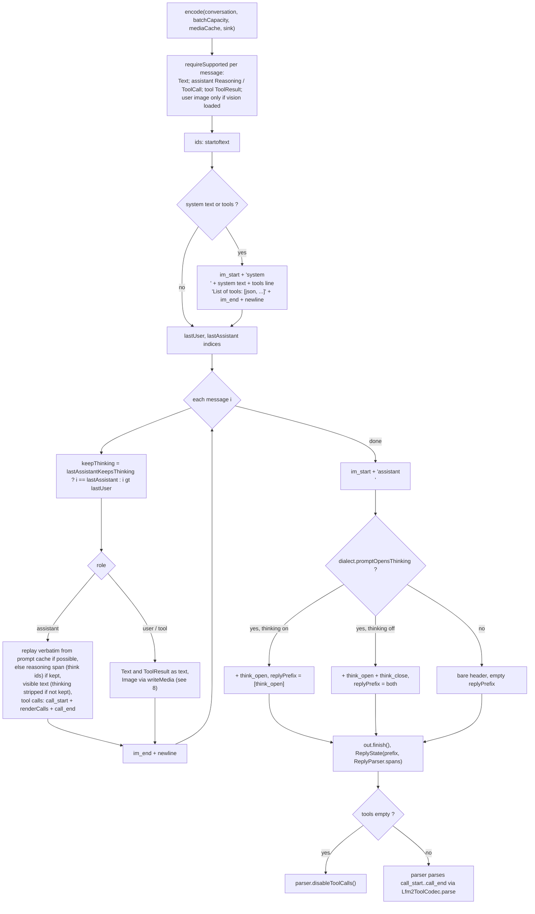

Tool wire: calls render as `[name(arg=value, ...)]` between `<|tool_call_start|>` and `<|tool_call_end|>`; `escape` selects the 2.6B argument formatting (escaped strings, JSON lists) over the 8B one (raw strings, Python repr lists); mappings are JSON in both. `parse` tries JSON first (payload starting with `{` or `[{`) and falls back to the inner Python-literal parser; failure yields no calls. `forcedCall` constrains a reply to start with `[<toolName>`.

---

## 8. Vision sidecar

Loaded only when an `mmproj` companion is supplied (`withMedia`). Metadata comes from `clip.vision.*` (defaults: patch 16, dim 1152, 16 heads, 27 blocks, ffn 4304, merge 2).

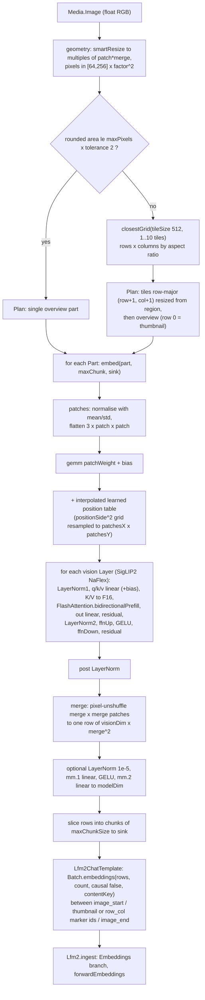

`planId()` serialises patch, merge, position side, pixel bounds, tiling and mean/std so the media cache key changes with the preprocessing. Image rows are projected per `Part` into a per-call cross-thread scratch arena that is closed after the chunks are emitted.

---

## 9. ColBERT scoring

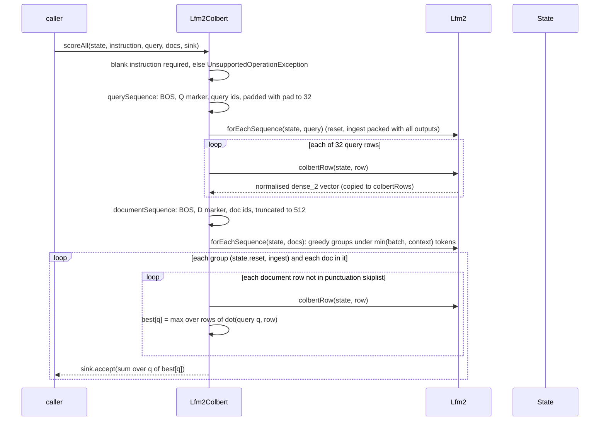

Scores are unbounded MaxSim sums (a 32-row query tops out at 32), not probabilities. There is no instruction slot (`hasInstructionSlot() == false`) and no prefix reuse: the forward is bidirectional and conv history is not addressable by position, so `scoreAll` is owned outright instead of using the cross-encoder template. The `[Q] `/`[D] ` markers are added tokens found by decoded text, scanning the vocabulary from the top.
