# jinfer-lfm3 — class architecture

Package `com.qxotic.jinfer.models.lfm3` (11 classes, ~4,300 lines). It is the `jinfer-<model>` provider for GGUF
architecture `lfm3` (Liquid AI): the **LFM2-style hybrid** of gated short convolutions and GQA attention, where
attention layers alternate sliding-window (ring KV cache, plain RoPE) and full (partial RoPE via `rope_freqs`), every
attention output is gated per head by a sigmoid, and both sublayers carry sandwich post-norms. One backbone serves five
faces: LFM3 (text), LFM3-VL (+ vision tower), LFM3-Omni (+ audio tower + speech head), and the **d1 / d1-Omni decision
checkpoints** (bidirectional full attention, no text generation). Towers come from the `mmproj` companion GGUF.
There is no speculative-decoding class in this module.

Format: **Mermaid**. Legend: `..|>` implements; `--|>` extends; `-->` holds/uses; `..>` creates/depends;
classes marked `<<external>>` live outside this package.

1. [Position in the stack](#1-position-in-the-jinfer-stack)
2. [Class diagrams](#2-class-diagrams) — 2a contracts, 2b model internals, 2c media towers and speech, 2d decision model
3. [Loading sequences](#3-loading-sequences)
4. [Forward pass](#4-forward-pass) — 4.0 global, 4a `ingest`, 4b `decoderBlock` (+ 4b-i short conv, 4b-ii attention)
5. [Heads: logits, targeted logits, hidden state](#5-heads)
6. [State and checkpoint layout](#6-state-and-checkpoint-layout)
7. [Vision tower (LFM3-VL)](#7-vision-tower)
8. [Audio encoder (LFM3-Omni)](#8-audio-encoder)
9. [Speech head (LFM3-Omni output)](#9-speech-head)
10. [Chat template](#10-chat-template)
11. [Decision flow (d1)](#11-decision-flow-d1)

| Class | Role |
|---|---|
| `Lfm3` | The model: `LanguageModel` + `Multimodal` + `SpeechOutput` impl with nested `Configuration`, `Weights`, `LayerWeights`, `AttentionWeights`, `ShortConvWeights`, `State`, `Placed`; the whole forward pass, loading, `withMedia` |
| `Lfm3Provider` | `ModelProvider` SPI: `loadLanguage` (refuses decision checkpoints), `loadDecisionModel` (refuses chat checkpoints), `companionFiles` = `media` -> `mmproj` |
| `Lfm3ChatTemplate` | `ChatTemplate`: token-exact ChatML-like framing, tools as XML, `think` handling, media framing, spoken-turn replay, `tts` instruction helper |
| `Lfm3CheckpointCodec` | `CheckpointCodec<State>`: full-layer KV rows, SWA rings walked by position, short-conv taps |
| `Lfm3Decision` | `DecisionModel` + `Multimodal` for d1 / d1-Omni: packed prompts, label-token scoring, softmax with per-kind temperature |
| `Lfm3Vision` | `MediaProjector<Image>`: patchifier, conv / 2D-RoPE attention blocks, 2x2 merge, GELU MLP; also video frame pairs |
| `Lfm3VisionPreprocess` | `smart_resize` target sizes (image, video) and normalised patch vectors |
| `Lfm3Audio` | `MediaProjector<Audio>`: log-mel, 8x conv downsampler, causal LFM stack, MLP into model width |
| `Lfm3Speech` | Omni speech head: depthformer (MaskGIT), feedback rows, FSQ codec, streaming ISTFT; inner `Stream`, `Speaker`, `Feedback`, `Istft` |
| `Towers` | Shared helpers: per-head norm + NeoX RoPE, SwiGLU FFN, F16 roundings, 3x3 tap layout |
| `GeluErf` | Exact (erf) GELU for the two projectors |

---

## 1. Position in the jinfer stack

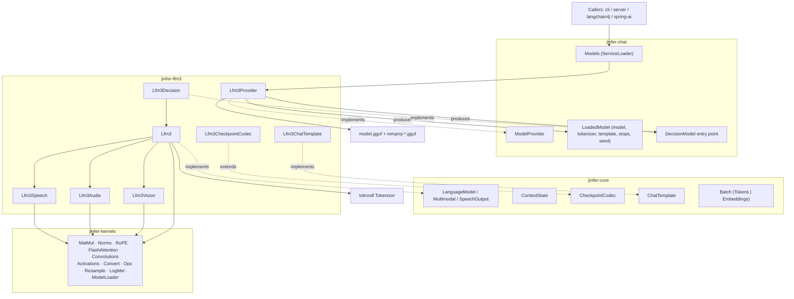

---

## 2. Class diagrams

### 2a. Contracts and relations

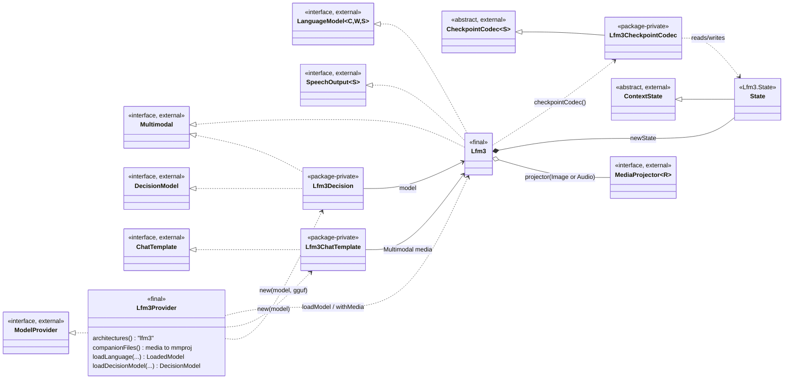

### 2b. Model internals — `Lfm3` and its nested types

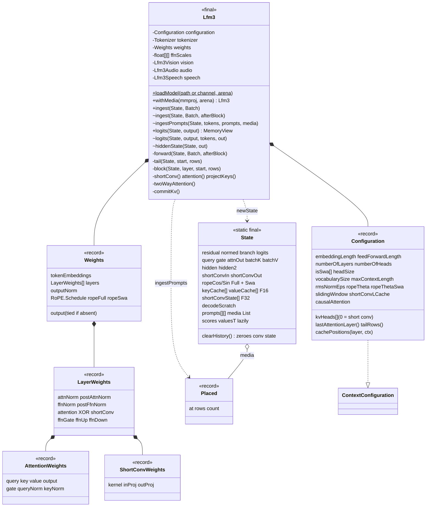

### 2c. Media towers and speech head

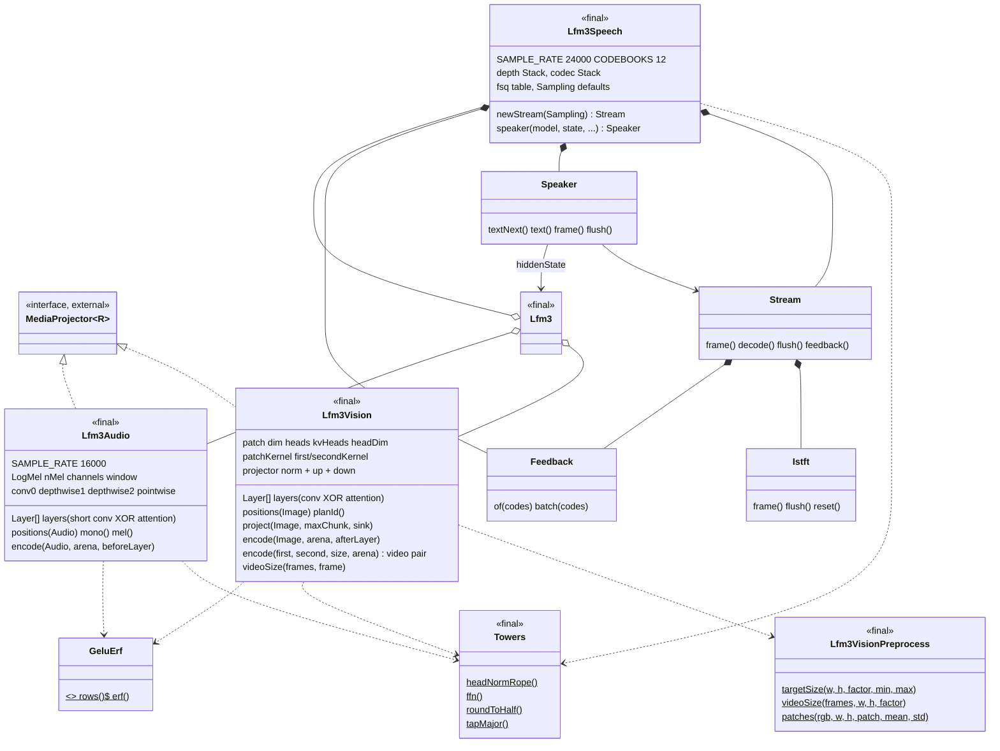

### 2d. Decision model

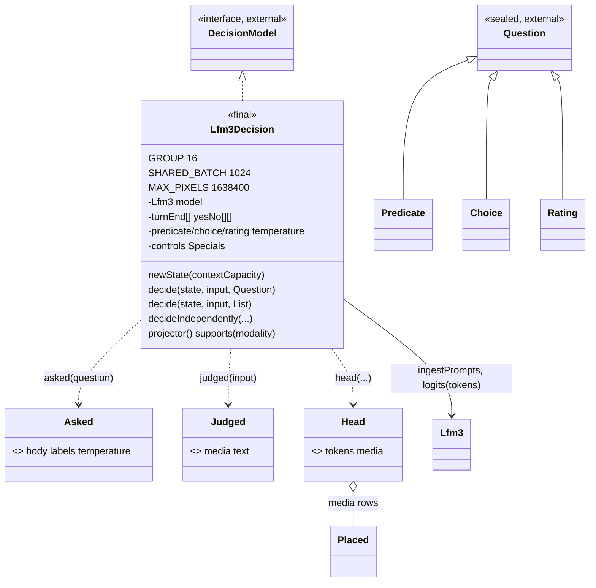

---

## 3. Loading sequences

`Lfm3Provider` is one SPI entry for two faces. The face is decided by `lfm3.decision.type` / `lfm3.attention.causal` **before** any weight is read; the mmproj is optional and attaches towers afterwards.

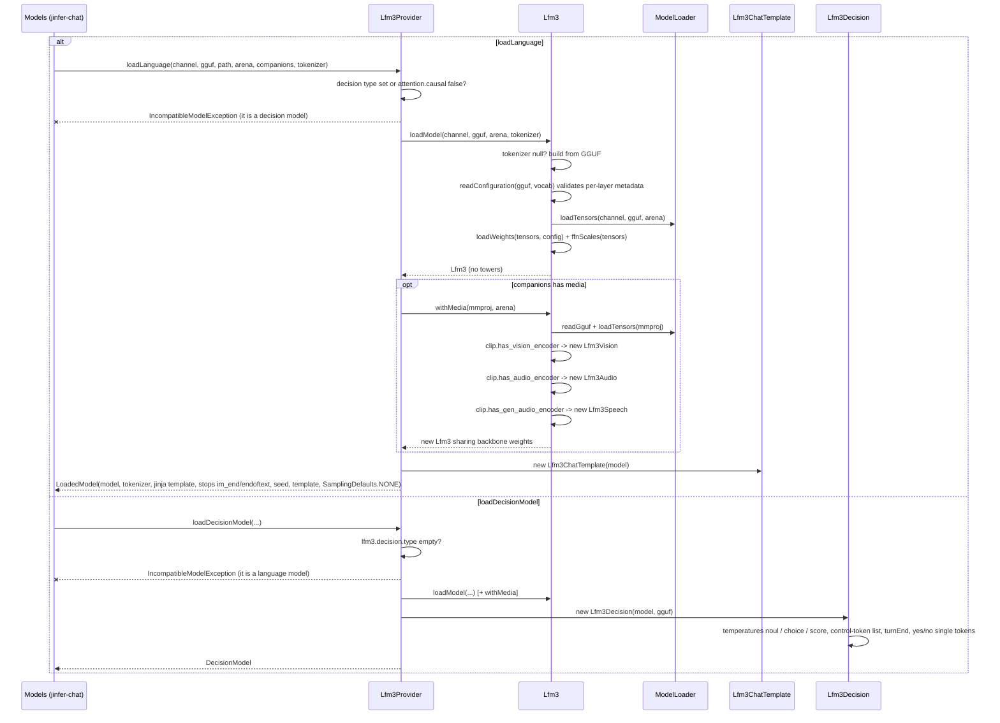

`readConfiguration` requires: architecture `lfm3`; key length equals value length; RoPE spans the head; per-layer `head_count_kv` (0 marks a short-conv layer) and `sliding_window_pattern` of length `block_count`; all attention layers share one KV-head count (one batch K/V buffer serves them all); SWA window a power of two; `shortconv.l_cache > 1`; no unknown `*.scale` tensors (only `ffn_{gate,up,down}.scale`, NVFP4).

---

## 4. Forward pass

`ingest(state, batch)` -> `state.exclusively(forward)`. Carried across calls: per-layer F16 KV cache (full layers linear, SWA layers ring) and the per-short-conv-layer F32 history of the last `lCache - 1` rows.

### 4.0 Global architecture

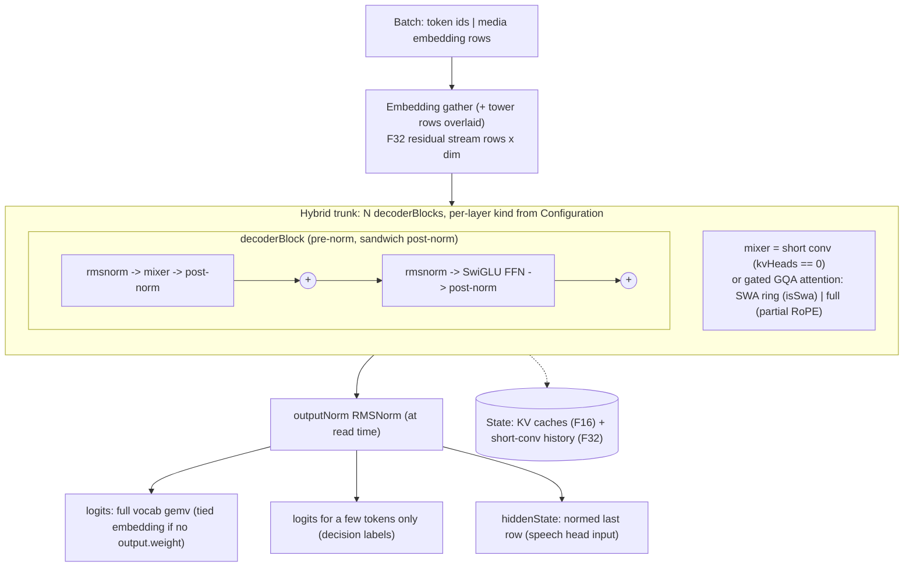

### 4a. `ingest` — batch validation, input kinds, rope, layer loop, advance

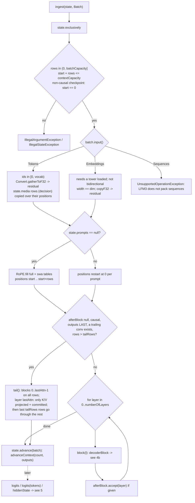

`ingestPrompts` (decision checkpoints) calls `forward` with `Batch.score(tokens)` and sets `state.prompts` / `state.media` for the duration, so each packed prompt gets its own positions, its own empty conv history, and its own attention scope.

The **tail** shortcut exists because past the last attention layer a row only feeds its own output and the trailing convs' look-back: with `outputs == LAST`, `tailRows() = 1 + trailingConvLayers * (lCache - 1)` rows are re-run through those layers, the other rows are skipped, and the last row is moved back to `rows - 1` so logits and speech find it.

### 4b. `decoderBlock` — one layer

`block(state, layer, start, rows)` works in place on `residual`; layers differ in kind (short conv vs attention), see 4b-i and 4b-ii.

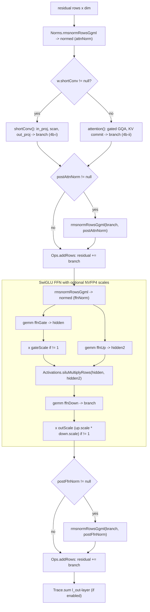

### 4b-i. Short-conv layer

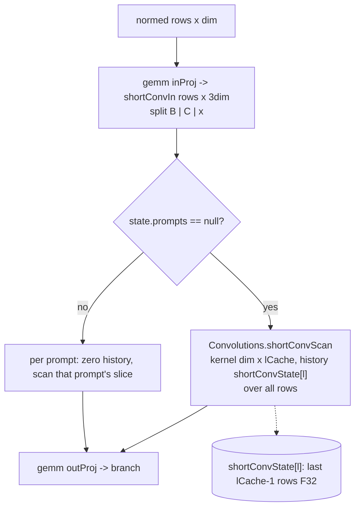

### 4b-ii. Attention layer

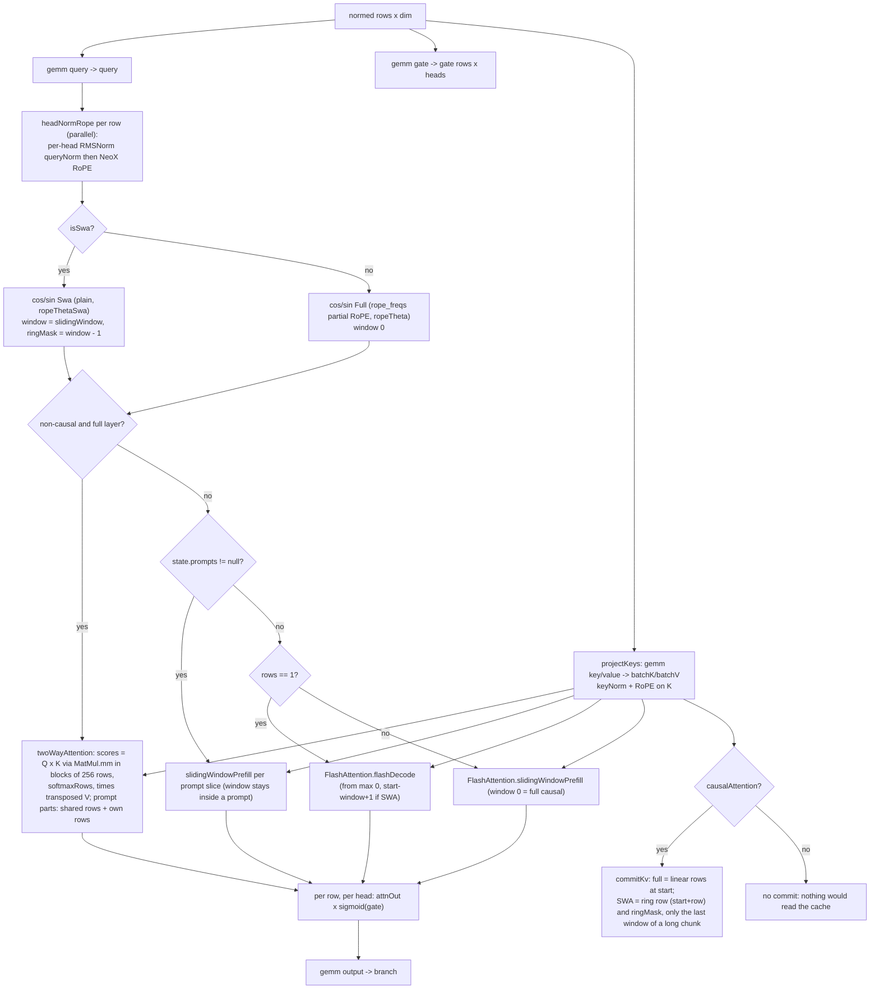

Details worth knowing:

- `commitKv` happens **inside** the layer (batchK/batchV are single buffers reused by every layer); it is skipped for non-causal checkpoints.
- Scale is `1/sqrt(headSize)`; `kvMul = heads / kvHeads[layer]`; `queryDim = heads * headSize`, `kvDim(layer) = kvHeads[layer] * headSize`.
- The attention gate is a per-head scalar (`attn_gate.weight` is `heads x dim`), applied to the whole head output.
- Short-conv layers use ggml's per-channel taps `c * lCache + k`; their history is state that `clearHistory()` must wipe on reset, unlike KV rows which are masked.

---

## 5. Heads

```mermaid
flowchart LR
    Res["residual row = lastBatchSize - outputCount + output"] --> FN["Norms.rmsnormGgml(outputNorm) -> normed"]
    FN --> LG["logits(state, output)<br/>MatMul.gemv(output weight) -> logits [1 x vocab]"]
    FN --> TG["logits(state, output, tokens, out)<br/>gatherToF32 label rows into hidden scratch,<br/>chunked dot products: no vocabulary matmul"]
    Res --> HS["hiddenState(state, out)<br/>rmsnormGgml of the LAST ingested row"]
    HS --> Sp["Lfm3Speech.Stream.frame"]
    TG --> Dec["Lfm3Decision.probabilities"]
```

`output.weight` falls back to the token embeddings when absent (tied head). `logits(...)` validates `0 <= output < outputCount`.

---

## 6. State and checkpoint layout

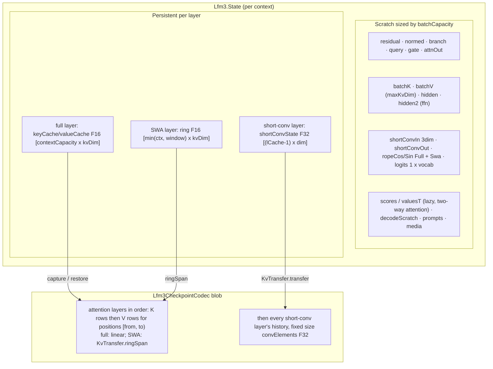

- `sizeOf(positions) = positions * bytesPerPosition + convBytes`, with `bytesPerPosition = sum over attention layers of 2 * 2 bytes * kvDim` and `convBytes = sum over conv layers of (lCache-1) * dim * 4`.
- `clearHistory()` zero-fills every `shortConvState` (KV rows past the cursor are masked and harmless; the conv history would leak the previous conversation).
- `newState(ctx, batch)` makes a cross-thread arena owned by the state; `newState(ctx, batch, arena)` borrows the caller's. `State` rejects `contextCapacity > maxContextLength`.
- A decision state uses `batchCapacity == contextCapacity` because a whole prompt is one batch.

---

## 7. Vision tower

`Lfm3Vision` (projector type `lfm3vl`): `encode` over normalised patches; `positions(image) = (w/(patch*2)) * (h/(patch*2))` rows after the 2x2 merge; the image cap is 4096 tokens.

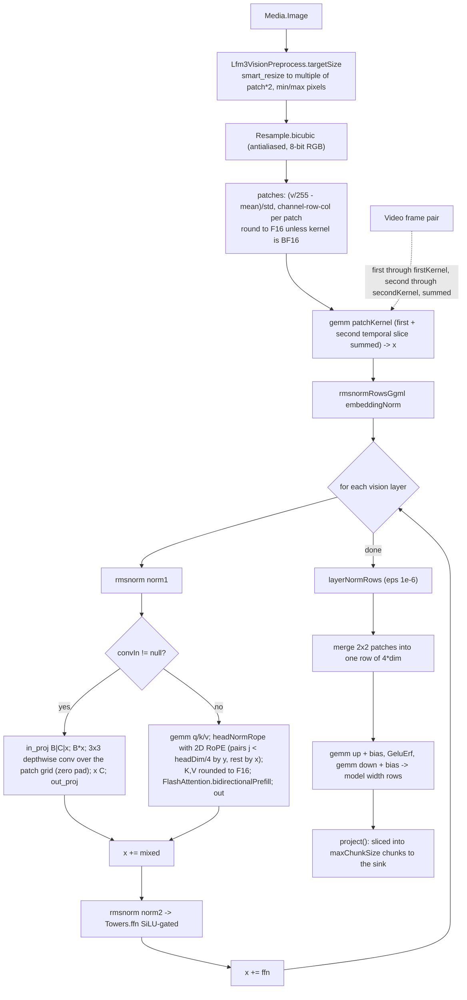

---

## 8. Audio encoder

`Lfm3Audio` (projector type `lfm3a`): 16 kHz only (other rates are refused), channels averaged to mono, whole clip encoded at once.

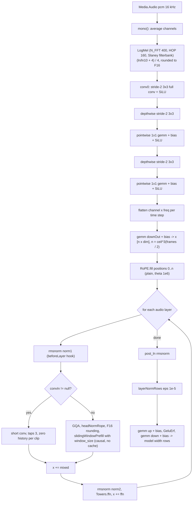

---

## 9. Speech head

LFM3-Omni speaks: after each backbone step the final-normed last row (`Lfm3.hiddenState`) feeds the speech head, which returns one 80 ms frame of 12 codes and 24 kHz PCM, plus a feedback row that becomes the backbone's next input as a keyed `Batch` of embeddings.

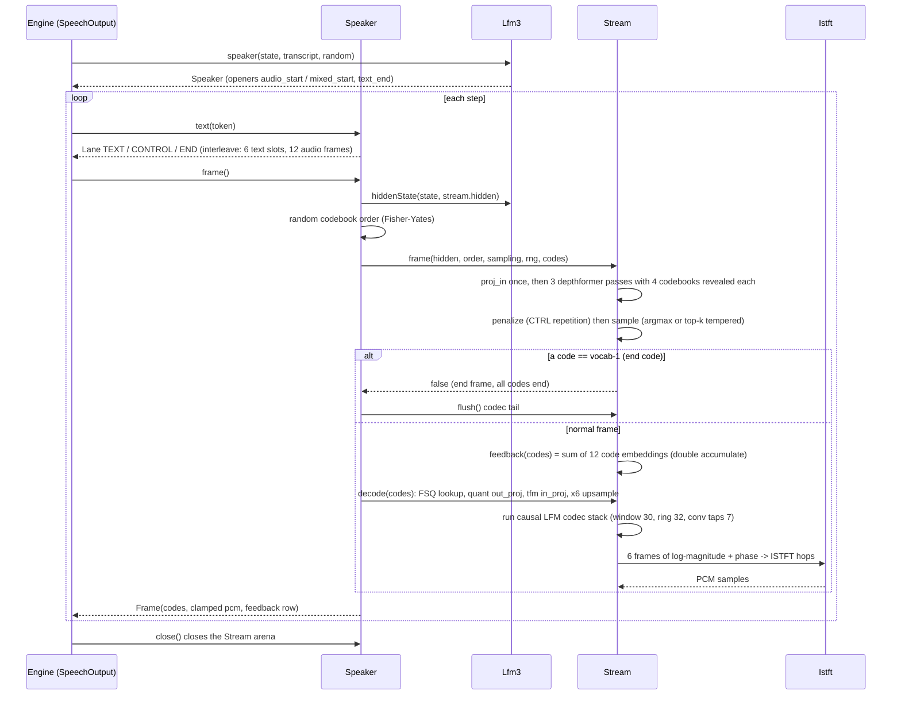

The depthformer stack and the codec stack are both built from the same `Block` record (conv XOR attention, optional sandwich norms) and driven by one `run(Pass, rows, start)`; the depthformer is bidirectional and stateless, the codec is causal and keeps its window and conv state in the `Stream`. `Feedback` rows are keyed by the codes (`ContentKey`) so a replayed spoken turn matches the prompt cache.

---

## 10. Chat template

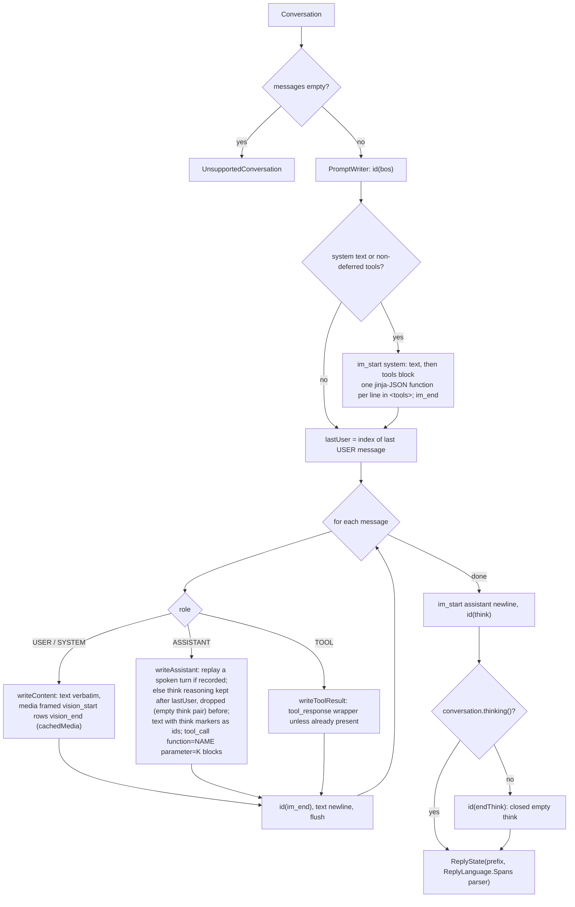

Other contract methods: `mediaPositions` asks the projector; `replyForbidden()` bans the speech lane tokens (`audio_start`, `mixed_start`, `mixed_end`, `text_start`, `text_end`, `audio`, `audio_out`) in text replies; `constrainedReply` / `forcedCall` delegate to `ReplyLanguage.Spans` (header `\n<function=NAME`); `ttsInstruction(language, voice)` renders the GGUF `tts` system turn for parity tests.

---

## 11. Decision flow (d1)

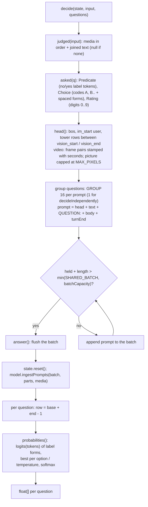

Within a packed prompt the shared rows see the whole prompt and a question's rows see the shared rows plus their own (two-way full-attention layers); sliding-window and short-conv layers stay causal. Control-token text in caller input is broken with a zero-width space (`plain`) so user text cannot close the turn.
