# jinfer-llama — class architecture

Package `com.qxotic.jinfer.models.llama` (12 classes, ~2600 lines). It is the `jinfer-<model>` provider for the GGUF
architectures `llama`, `minicpm`, `mistral3`, `smollm3` (all served by the single `Llama` class, differences driven by
GGUF metadata) and `granite` (the near-identical `Granite` class). All models are **text-only, dense, generative**:
GQA attention with interleaved RoPE, SwiGLU FFN, F16 KV cache. MoE, fused QKV, packed sequences and embedding input are
rejected. Each architecture family brings its own `ChatTemplate` (reply codec: call parsing, constrained and forced calls).

Format: **Mermaid**. Legend: `..|>` implements; `--|>` extends; `-->` holds/uses; `..>` creates/depends;
classes marked `<<external>>` live outside this package.

1. [Position in the stack](#1-position-in-the-jinfer-stack)
2. [Class diagrams](#2-class-diagrams) — 2a contracts, 2b `Llama` internals, 2c `Granite` internals, 2d chat templates
3. [Loading sequence](#3-loading-sequence)
4. [Forward pass](#4-forward-pass) — 4.0 global, 4a `ingest`, 4b `decoderBlock`, 4c lazy last-layer tail and logits
5. [Variant matrix and RoPE selection](#5-variant-matrix-and-rope-selection)
6. [Chat template selection and reply grammar](#6-chat-template-selection-and-reply-grammar)
7. [State and checkpoint layout](#7-state-and-checkpoint-layout)

| Class | Role |
|---|---|
| `Llama` | `LanguageModel` for llama / minicpm / mistral3 / smollm3; nested `Configuration`, `LayerWeights`, `Weights`, `State`; forward pass with a lazy last-layer tail |
| `Granite` | `LanguageModel` for `granite`; same contract, eager full-layer evaluation, optional NoPE switch, no attention temperature |
| `LlamaProvider` | `ModelProvider` SPI for `llama`, `minicpm`, `mistral3`, `smollm3`; picks the chat template and stop tokens |
| `GraniteProvider` | `ModelProvider` SPI for `granite`; always attaches `GraniteChatTemplate` |
| `LlamaCheckpointCodec` | `CheckpointCodec<Llama.State>`: serialises F16 K/V rows of every layer |
| `GraniteCheckpointCodec` | Same for `Granite.State` |
| `Llama32ChatTemplate` | Token-exact native framing for the Llama 3.x plain conversation; bare-JSON tool-call parser; forced-call grammar |
| `MistralChatTemplate` | Reply codec only (`[TOOL_CALLS] name [ARGS] json`, close-less); `<s>` prompt start |
| `SmolLm3ChatTemplate` | Reply codec: `<think>`, `<tool_call>` JSON, `<|im_end|>` |
| `MiniCpm5ChatTemplate` | Reply codec: `<think>`, `<function ...>` XML spans, `<|im_end|>` |
| `MiniCpmToolSyntax` | Parser of MiniCPM5 XML function payload (`name="..."`, `<param>`, CDATA) |
| `GraniteChatTemplate` | Reply codec: `<think>`, `<tool_call>`; JSON envelope (4.1) or function XML (4.2) |

---

## 1. Position in the jinfer stack

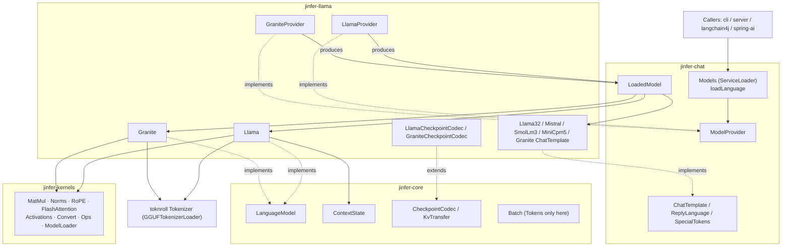

---

## 2. Class diagrams

### 2a. Contracts and relations

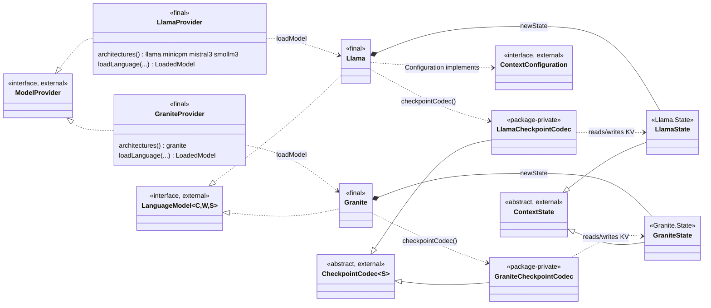

### 2b. Model internals — `Llama` and its nested types

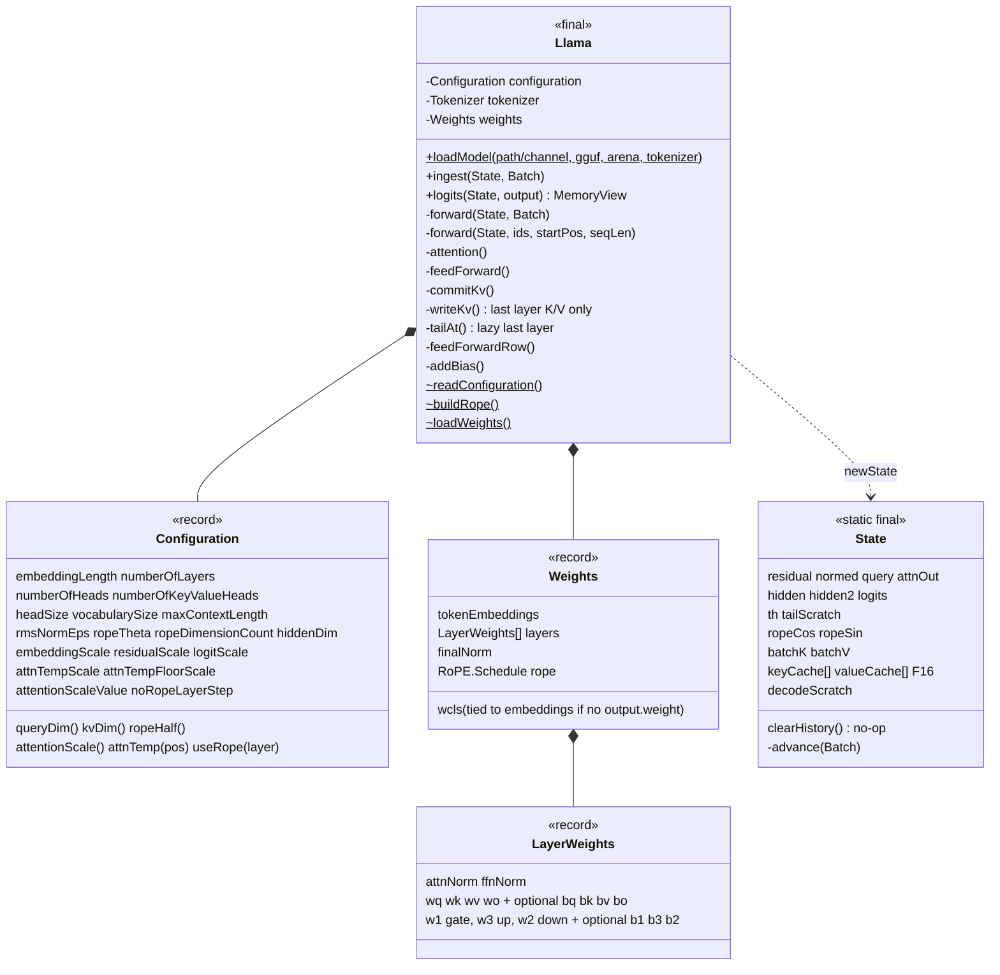

### 2c. `Granite` internals — deltas from `Llama`

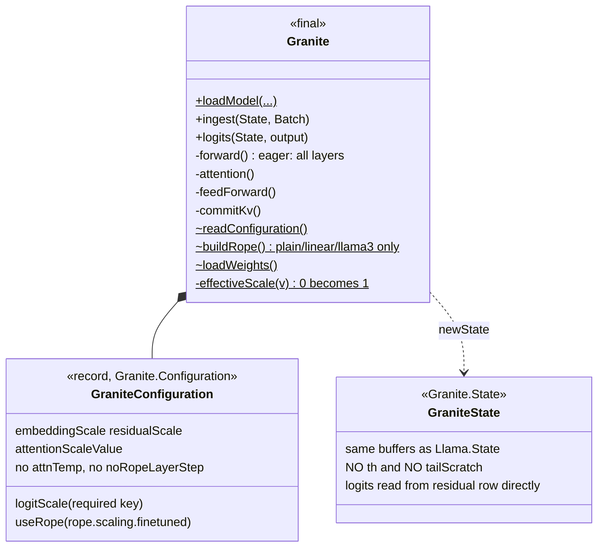

### 2d. Chat templates and reply codecs

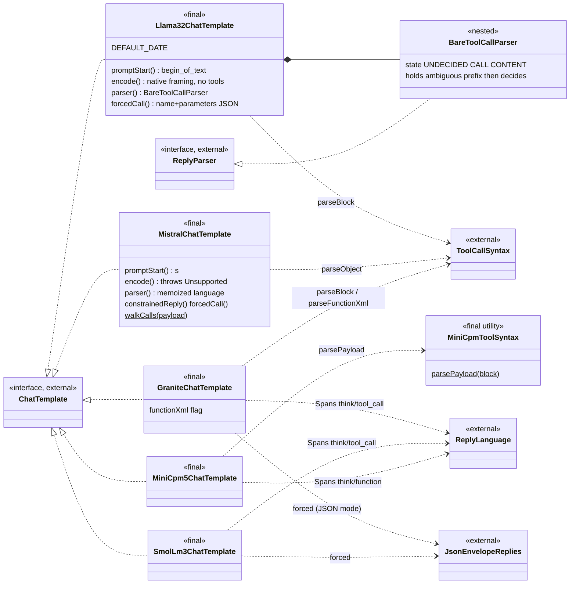

---

## 3. Loading sequence

`LlamaProvider.loadLanguage` and `GraniteProvider.loadLanguage` share the same shape; only the template choice and stop list differ.

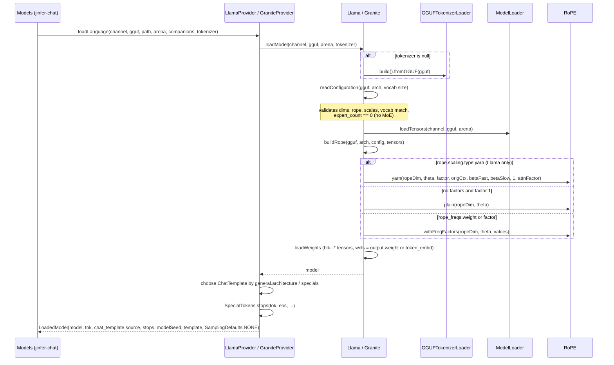

---

## 4. Forward pass

`ingest(state, batch)` → `state.exclusively(forward)`. Every layer is attention + SwiGLU FFN; the only data carried across calls is the per-layer F16 KV cache. Only token batches are accepted (`Sequences` and `Embeddings` throw `UnsupportedOperationException`).

### 4.0 Global architecture

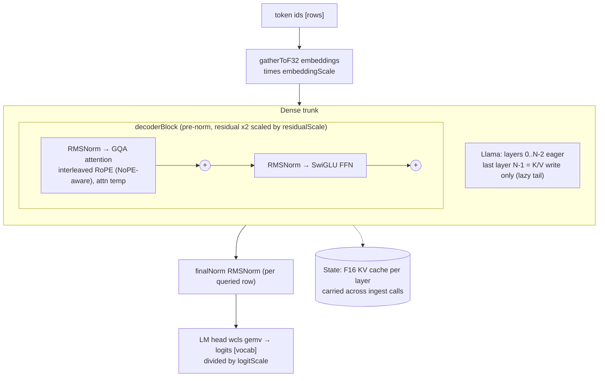

### 4a. `ingest` — validation, inputs, embedding, layer loop, advance

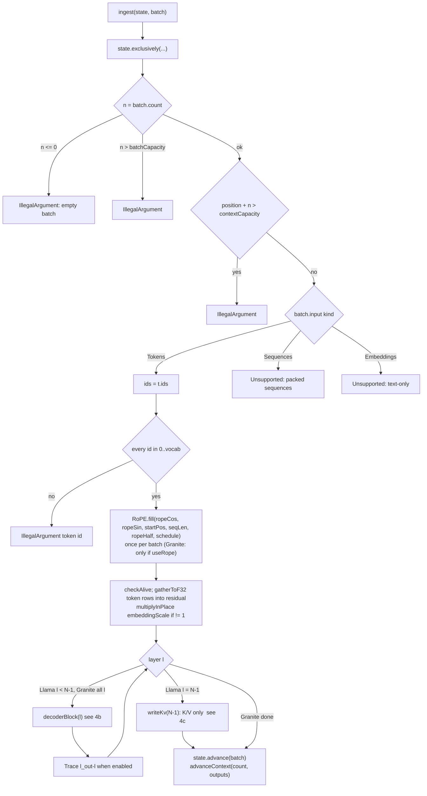

### 4b. `decoderBlock` — one layer

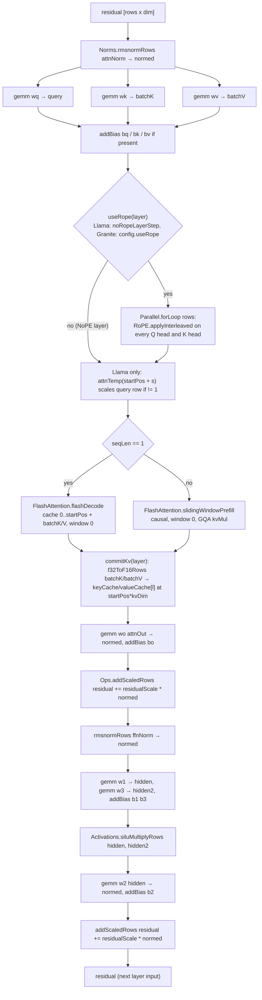

Notes: the KV commit happens **inside** the layer because `batchK/batchV` are single buffers reused by every layer (a deferred commit would write the last layer's values everywhere). There is no MoE and no per-head Q/K norm in this module (unlike `jinfer-qwen3`).

### 4c. Lazy last-layer tail and logits (`Llama` only)

`Llama` never computes the last layer's attention and FFN during `ingest`. It writes only that layer's K and V into the cache, leaving `residual` as the last layer's *input*. Each queried output row finishes the layer on demand in `logits()`. `Granite` instead runs every layer eagerly and applies `finalNorm` straight to `residual[row]`.

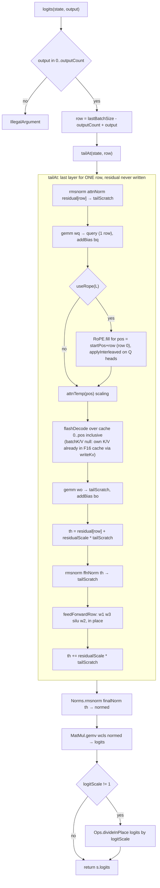

---

## 5. Variant matrix and RoPE selection

All variants run through the same `Llama` forward pass; the GGUF metadata (with architecture-specific defaults) selects the behavior.

| Architecture | Class | Distinct behavior (from code) |
|---|---|---|
| `llama` | `Llama` | Plain RoPE, or `llama3` scaling through `rope_freqs.weight`; scales default 1 |
| `minicpm` | `Llama` | Defaults when keys absent: `embedding_scale` 12.0, `residual_scale` 1.4/sqrt(layers), `logit_scale` dim/256 |
| `mistral3` | `Llama` | YaRN RoPE (`rope.scaling.type = yarn`); attention temperature from `attention.temperature_scale` and `rope.scaling.original_context_length` |
| `smollm3` | `Llama` | `noRopeLayerStep = 4`: RoPE skipped on every 4th layer (1-indexed) |
| `granite` | `Granite` | Required `logit_scale`, optional embedding/residual scale (0 means 1), `attention.scale`; `rope.scaling.finetuned=false` disables RoPE entirely; YaRN and LongRoPE rejected |

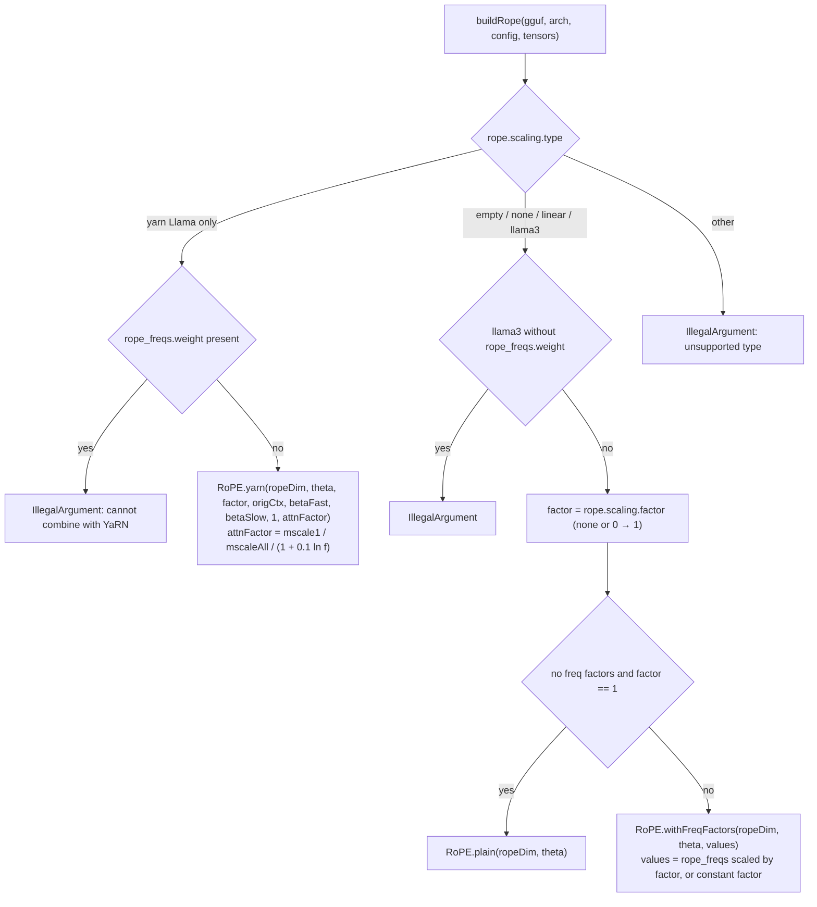

---

## 6. Chat template selection and reply grammar

Only `Llama32ChatTemplate` frames prompts natively (and only without tools; with tools it throws `UnsupportedConversation`). All other templates throw from `encode`, so chat falls back to rendering the GGUF `tokenizer.chat_template` Jinja whole, while the template object still provides the reply parser, constrained decoding and forced calls.

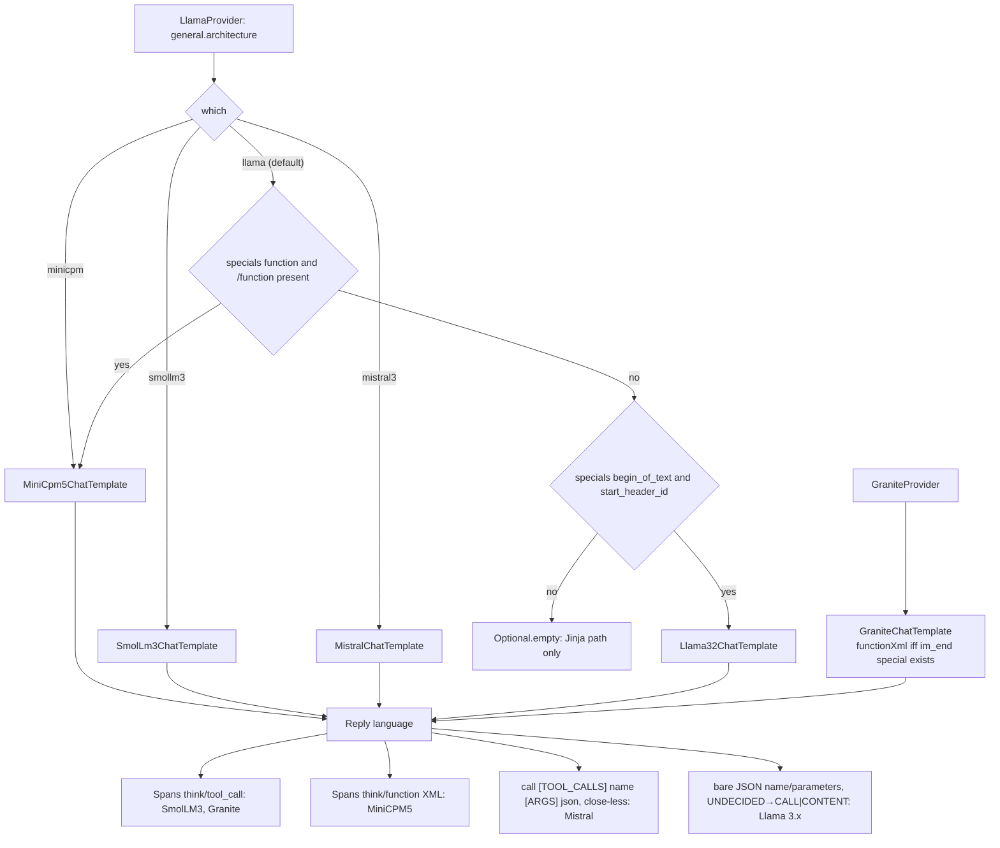

Stop tokens (`LlamaProvider`): EOS id from `tokenizer.ggml.eos_token_id` first, then `<|eot_id|>`, `<|eom_id|>` (Llama 3.1+ tool-call turns), `<|im_end|>`, `<|endoftext|>`, `<|end_of_text|>`, and last `<|im_start|>`, `<|start_header_id|>` (a reply opening a new turn has ended). Absent names are skipped. `GraniteProvider` uses EOS, `<|end_of_text|>`, `<|eot_id|>`, `<|im_end|>`, `<|endoftext|>`. Sampling defaults are `NONE` for both.

---

## 7. State and checkpoint layout

Both `State` classes allocate from a `MemoryArena`: `newState(ctx, batch, arena)` borrows it (`ownsArena=false`); `newState(ctx, batch)` creates a cross-thread arena and owns it (closed on constructor failure). Requirements: `0 < contextCapacity <= maxContextLength`, `batchCapacity > 0`. `clearHistory()` is a no-op: stale KV rows beyond the cursor are attention-masked.

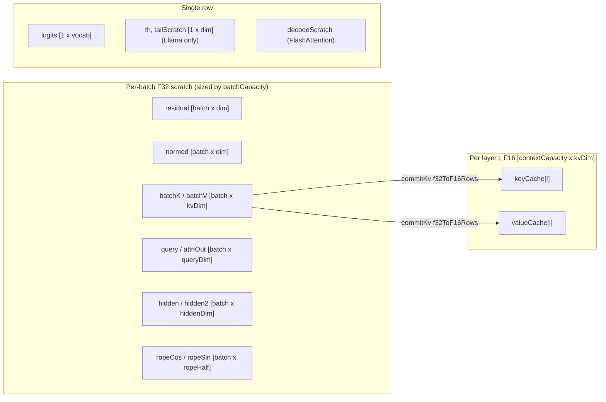

Checkpoint codec (`LlamaCheckpointCodec`, `GraniteCheckpointCodec`, identical): uniform full attention, linear indexing, no ring, no recurrent state, so every position is a resume point. RoPE is baked into K at absolute positions, so a restored row is valid at its slot.

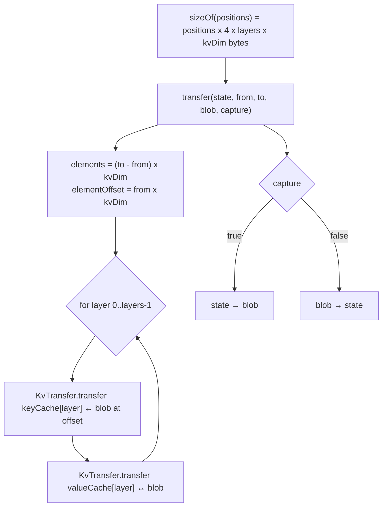

Blob layout per position range: `[K layer0 | V layer0 | K layer1 | V layer1 | ...]`, each segment `(to-from) x kvDim` elements (4 bytes per element-slot per K+V pair, i.e. F16 K plus F16 V).
