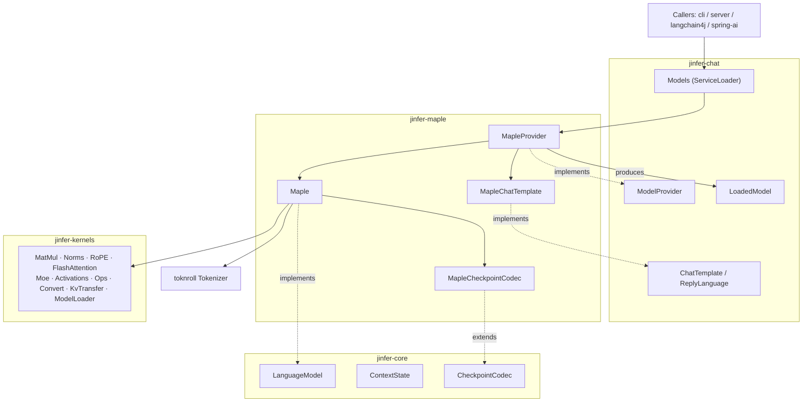
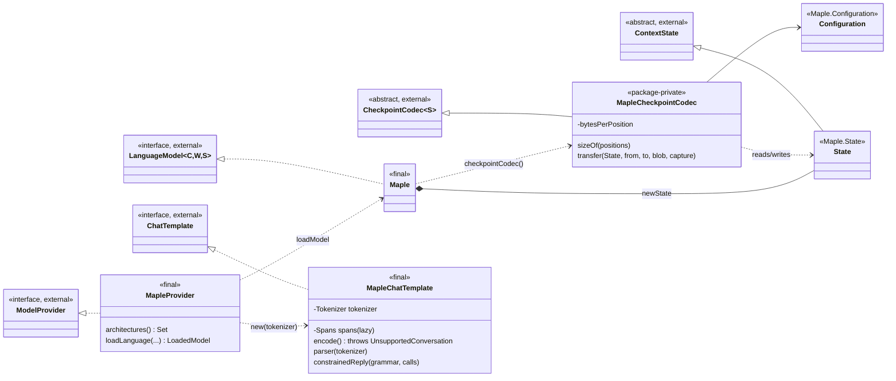
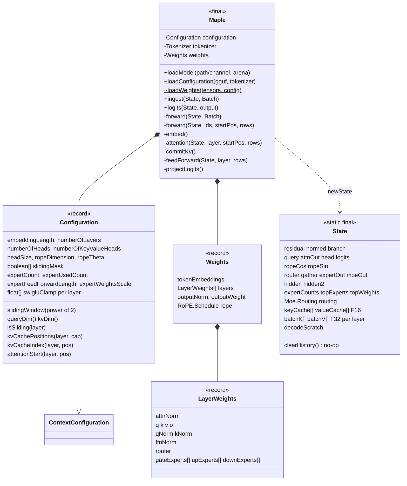
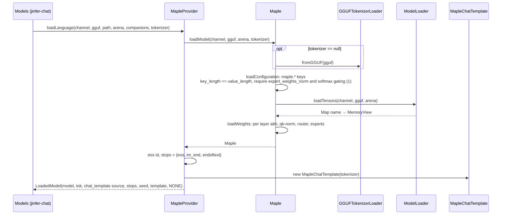
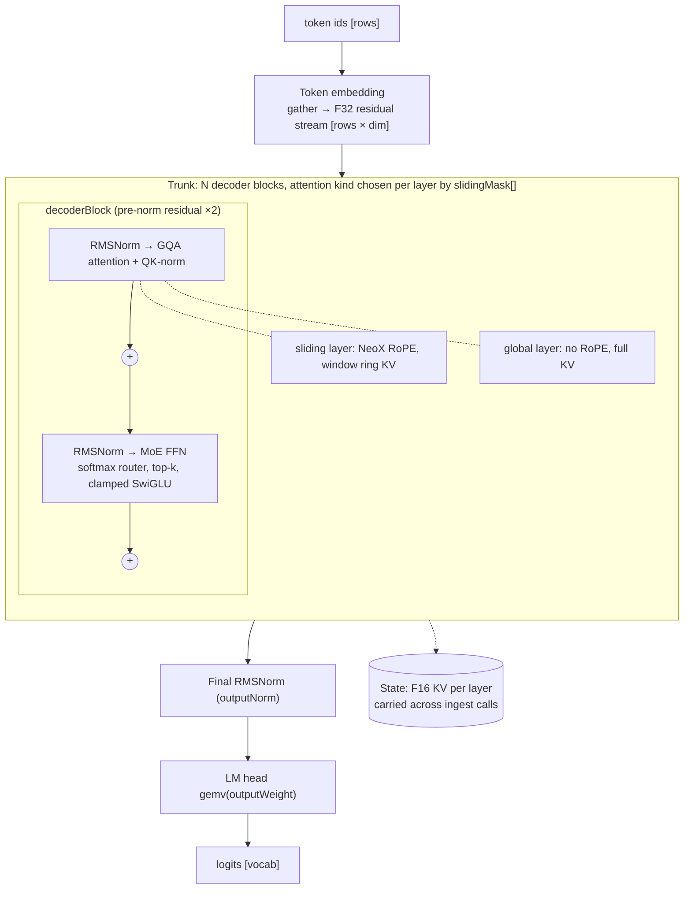
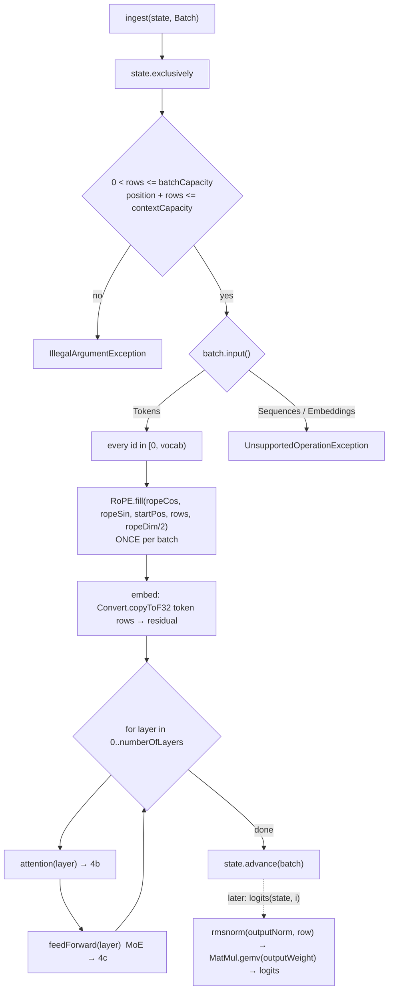
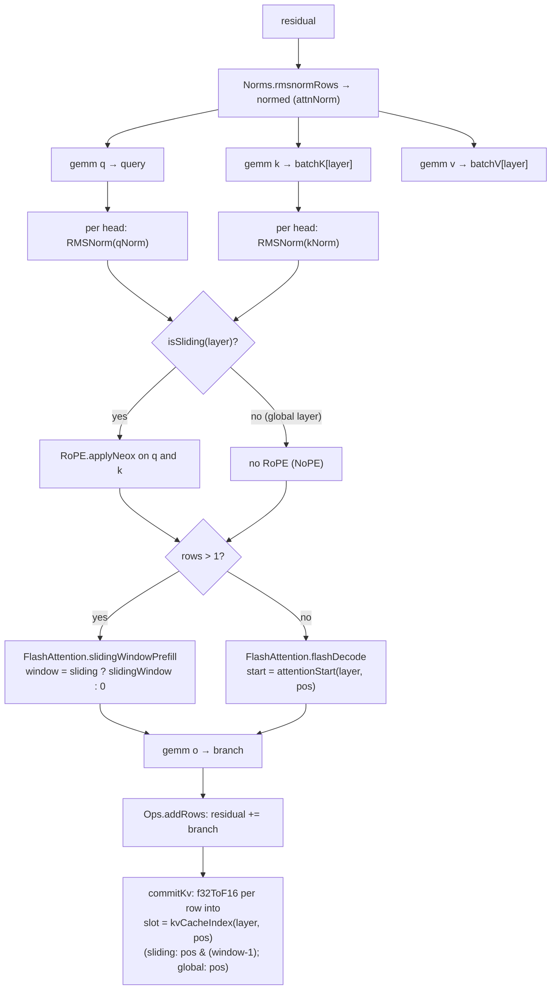
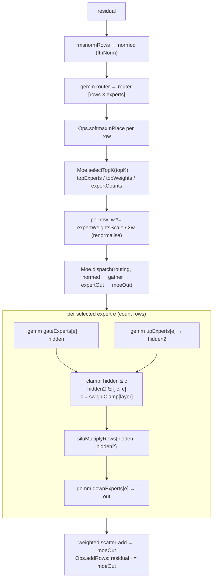
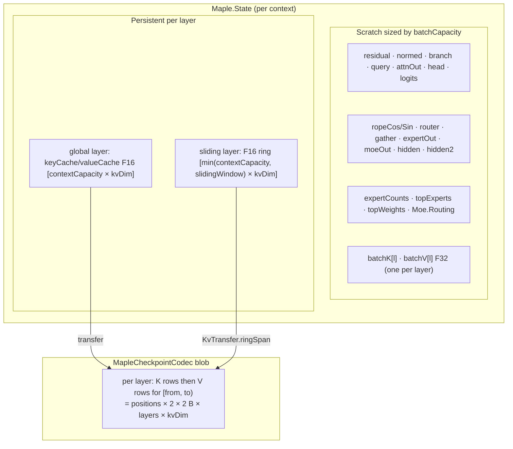

# jinfer-maple — class architecture

Package `com.qxotic.jinfer.models.maple` (4 classes, ~750 lines). Provider for GGUF architecture `maple`: a
**sparse MoE transformer** (text only) with **hybrid sliding-window / global attention** (per-layer mask), per-head
QK RMS-norm, softmax-routed experts with clamped SwiGLU, and a **pure-MoE FFN** (no dense or shared expert).

Format: **Mermaid**. Legend: `..|>` implements; `--|>` extends; `-->` holds/uses; `..>` creates/depends;
classes marked `<<external>>` live outside this package.

1. [Position in the stack](#1-position-in-the-jinfer-stack)
2. [Class diagrams](#2-class-diagrams) — 2a contracts, 2b model internals
3. [Loading sequence](#3-loading-sequence)
4. [Forward pass](#4-forward-pass) — 4a `ingest`, 4b `decoderBlock` (+ MoE)
5. [State and checkpoint layout](#5-state-and-checkpoint-layout)

| Class | Role |
|---|---|
| `Maple` | The model: `LanguageModel` impl + nested `Configuration`, `Weights`, `LayerWeights`, `State`, loaders, forward pass |
| `MapleProvider` | `ModelProvider` SPI for `maple`; builds `LoadedModel` with stops `<\|im_end\|>`, `<\|endoftext\|>` |
| `MapleChatTemplate` | `ChatTemplate`: reply side only (`<think>`, `<tool_call>` spans, grammar); `encode` throws `UnsupportedConversation` so the whole-render (jinja) path frames prompts |
| `MapleCheckpointCodec` | `CheckpointCodec<State>`: KV rows; sliding layers go through a ring-buffer span |

---

## 1. Position in the jinfer stack

---

## 2. Class diagrams

### 2a. Contracts and relations

### 2b. Model internals

---

## 3. Loading sequence

---

## 4. Forward pass

`ingest` → `state.exclusively(forward)`. Maple is **text-only, one sequence**: `Sequences` and `Embeddings` batches throw `UnsupportedOperationException`.

### 4.0 Global architecture

### 4a. `ingest`

### 4b. `decoderBlock` — attention half

There is no `decoderBlock` method; a block is `attention(layer)` + `feedForward(layer)` (pre-norm residual each).
`isSliding(layer)` (from the GGUF `sliding_window_pattern`) drives **three** differences: RoPE, window, cache size.

`commitKv` runs **after** attention (batchK/V are per layer, so nothing is overwritten); the attention call sees the chunk's own K/V from the F32 batch buffers plus earlier rows from the cache.

### 4c. `decoderBlock` — MoE feed-forward half

---

## 5. State and checkpoint layout

- `clearHistory()` is a no-op: stale rows are masked by attention and overwritten on ingest.
- Sliding layers are rings; slot = `position & (slidingWindow - 1)` (hence the power-of-two check in `Configuration`).
- `newState(ctx, batch)` owns a cross-thread arena; `newState(ctx, batch, arena)` borrows one.
